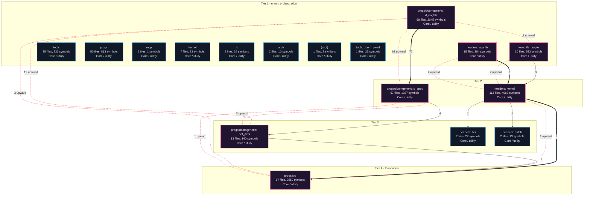
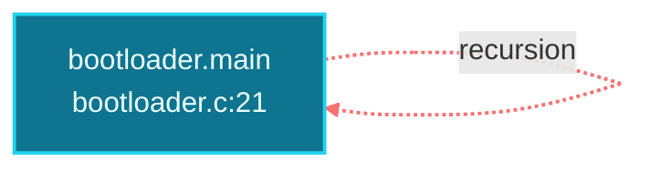
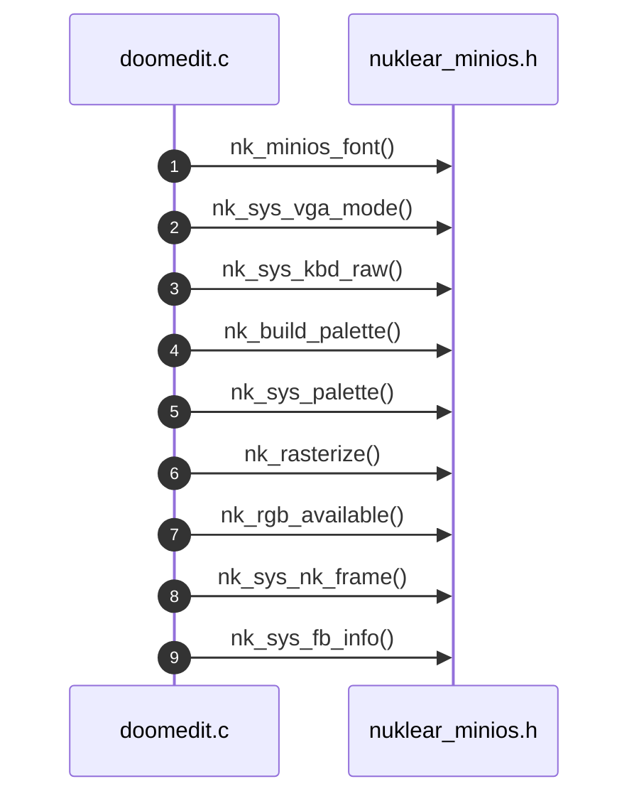
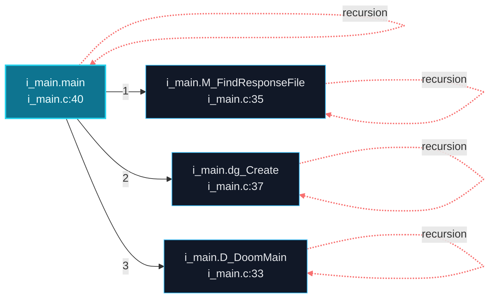

# miniOS Architecture and Execution Flows

[Back to index](index.md)

## Architecture Overview

17 components stacked in 4 dependency tiers (weighted Eades-Lin-Smyth ordering: arrows point from dependent to dependency, top to bottom). Labels are import counts, thick arrows the top quartile; 4 transitively implied edges are omitted. Dashed red arrows are upward dependencies: the smallest set of imports that closes every cycle and breaks the layering. Cyan components hold entry points. Interactive version: `readmenator-apidocs/index.html#/flows`.

Upward dependencies to fix first: `progs/doomgeneric: p_spec` -> `progs/doomgeneric: d_englsh` (63 imports); `progs/doomgeneric: net_defs` -> `progs/doomgeneric: d_englsh` (12 imports); `progs/src` -> `progs/doomgeneric: d_englsh` (3 imports); `headers: kernel` -> `tools: tls_crypto` (2 imports); `headers: kernel` -> `headers: vga_fb` (2 imports); `tools: tls_crypto` -> `progs/doomgeneric: d_englsh` (2 imports); `progs/doomgeneric: net_defs` -> `progs/doomgeneric: p_spec` (2 imports); `progs/src` -> `headers: kernel` (1 imports); `progs/src` -> `progs/doomgeneric: p_spec` (1 imports)

---

## Execution Flows

Entry points are scored from `__main__` guards, `main` functions, entry-style names and files, and call-graph sources. Each flow walks resolved calls in call-site order (depth <= 4, <= 40 steps); numbers give the call order, dashed arrows revisit an already expanded callee, red arrows are recursion. Interactive version with zoom and per-node docs: `readmenator-apidocs/index.html#/flows`.

### `bootloader.main`

`bootloader.c:21`, score 11: `main` in a compiled-language file; entry-style name `main`.

Call tree:

### `doomedit.main`

`progs/doomedit/doomedit.c:2246`, score 11: `main` in a compiled-language file; entry-style name `main`.

Call tree:

```mermaid
flowchart LR
    classDef default fill:#111827,stroke:#38bdf8,color:#e5e7eb;
    classDef entry fill:#0e7490,stroke:#22d3ee,color:#ecfeff,stroke-width:2px;
    classDef external fill:#1a1530,stroke:#a78bfa,color:#ede9fe;
    n_progs_doomedit_doomedit_c__main["doomedit.main<br/>doomedit.c:2246"]:::entry
    n_progs_doomedit_doomedit_c__dmap_selftest["doomedit.dmap_selftest<br/>/** Headless demo room shared by --demo and t...<br/>doomedit.c:2122"]:::default
    n_progs_nuklear_nuklear_minios_h__nk_minios_font["nuklear_minios.nk_minios_font<br/>Hybrid palette: indices 0-14 are the desktop...<br/>nuklear_minios.h:63"]:::external
    n_progs_nuklear_nuklear_minios_h__nk_sys_vga_mode["nuklear_minios.nk_sys_vga_mode<br/>nuklear_minios.h:45"]:::external
    n_progs_nuklear_nuklear_minios_h__nk_sys_kbd_raw["nuklear_minios.nk_sys_kbd_raw<br/>nuklear_minios.h:44"]:::external
    n_progs_nuklear_nuklear_minios_h__nk_build_palette["nuklear_minios.nk_build_palette<br/>Hybrid palette: indices 0-14 are the desktop...<br/>nuklear_minios.h:57"]:::external
    n_progs_nuklear_nuklear_minios_h__nk_sys_palette["nuklear_minios.nk_sys_palette<br/>nuklear_minios.h:43"]:::external
    n_progs_doomedit_doomedit_c__dmap_new["doomedit.dmap_new<br/>case DMAP_RSUIT: case DMAP_CMAP: case DMAP_LA...<br/>doomedit.c:639"]:::default
    n_progs_doomedit_doomedit_c__dmap_push_history["doomedit.dmap_push_history<br/>doomedit.c:272"]:::default
    n_progs_nuklear_nuklear_minios_h__nk_rasterize["nuklear_minios.nk_rasterize<br/>Hybrid palette: indices 0-14 are the desktop...<br/>nuklear_minios.h:66"]:::external
    n_progs_nuklear_nuklear_minios_h__nk_rgb_available["nuklear_minios.nk_rgb_available<br/>RGB companion buffer (R,G,B byte order, NK_W...<br/>nuklear_minios.h:33"]:::external
    n_progs_nuklear_nuklear_minios_h__nk_sys_nk_frame["nuklear_minios.nk_sys_nk_frame<br/>nuklear_minios.h:52"]:::external
    n_progs_nuklear_nuklear_minios_h__nk_sys_fb_info["nuklear_minios.nk_sys_fb_info<br/>nuklear_minios.h:46"]:::external
    n_progs_doomedit_doomedit_c__dmap_demo_room["doomedit.dmap_demo_room<br/>nk_set_window_origin(origin[0], origin[1])#59; n...<br/>doomedit.c:2110"]:::default
    n_progs_doomedit_doomedit_c__dmap_build_wad["doomedit.dmap_build_wad<br/>Compile the grid into a vanilla multi-sector...<br/>doomedit.c:1343"]:::default
    n_progs_doomedit_doomedit_c__dmap_validate["doomedit.dmap_validate<br/>dmap_sec_floor[nsec] = DMAP_FLOOR_H#59; dmap_sec...<br/>doomedit.c:1244"]:::default
    n_progs_doomedit_doomedit_c__dmap_walkable["doomedit.dmap_walkable<br/>__asm__ volatile(#quot;syscall#quot; : #quot;=a#quot;(ret) : #quot;a#quot;(...<br/>doomedit.c:577"]:::default
    n_progs_doomedit_doomedit_c__dmap_is_wall["doomedit.dmap_is_wall<br/>: #quot;rcx#quot;, #quot;r11#quot;, #quot;memory#quot;)#59; return ret#59; } /**...<br/>doomedit.c:570"]:::default
    n_progs_doomedit_doomedit_c__dmap_label_regions["doomedit.dmap_label_regions<br/>Sector table backing the multi-sector exporter.<br/>doomedit.c:1163"]:::default
    n_progs_doomedit_doomedit_c__dmap_thing_type["doomedit.dmap_thing_type<br/>Thing type ids from the engine mobjinfo table...<br/>doomedit.c:165"]:::default
    n_progs_doomedit_doomedit_c__dmap_w16["doomedit.dmap_w16<br/>doomedit.c:1318"]:::default
    n_progs_doomedit_doomedit_c__dmap_wtex["doomedit.dmap_wtex<br/>doomedit.c:1326"]:::default
    n_progs_doomedit_doomedit_c__dmap_w8["doomedit.dmap_w8<br/>doomedit.c:1317"]:::default
    n_progs_doomedit_doomedit_c__dmap_seg_angle["doomedit.dmap_seg_angle<br/>dmap_wp++ = (unsigned char)(v & 0xFF)#59; dmap_w...<br/>doomedit.c:1333"]:::default
    n_progs_doomedit_doomedit_c__dmap_w32["doomedit.dmap_w32<br/>doomedit.c:1322"]:::default
    n_progs_doomedit_doomedit_c__main -.->|"recursion"| n_progs_doomedit_doomedit_c__main
    n_progs_doomedit_doomedit_c__main -->|"1"| n_progs_doomedit_doomedit_c__dmap_selftest
    n_progs_doomedit_doomedit_c__dmap_selftest -->|"1"| n_progs_nuklear_nuklear_minios_h__nk_minios_font
    n_progs_nuklear_nuklear_minios_h__nk_minios_font -.->|"recursion"| n_progs_nuklear_nuklear_minios_h__nk_minios_font
    n_progs_doomedit_doomedit_c__dmap_selftest -->|"2"| n_progs_nuklear_nuklear_minios_h__nk_sys_vga_mode
    n_progs_nuklear_nuklear_minios_h__nk_sys_vga_mode -.->|"recursion"| n_progs_nuklear_nuklear_minios_h__nk_sys_vga_mode
    n_progs_doomedit_doomedit_c__dmap_selftest -->|"3"| n_progs_nuklear_nuklear_minios_h__nk_sys_kbd_raw
    n_progs_nuklear_nuklear_minios_h__nk_sys_kbd_raw -.->|"recursion"| n_progs_nuklear_nuklear_minios_h__nk_sys_kbd_raw
    n_progs_doomedit_doomedit_c__dmap_selftest -->|"4"| n_progs_nuklear_nuklear_minios_h__nk_build_palette
    n_progs_nuklear_nuklear_minios_h__nk_build_palette -.->|"recursion"| n_progs_nuklear_nuklear_minios_h__nk_build_palette
    n_progs_doomedit_doomedit_c__dmap_selftest -->|"5"| n_progs_nuklear_nuklear_minios_h__nk_sys_palette
    n_progs_nuklear_nuklear_minios_h__nk_sys_palette -.->|"recursion"| n_progs_nuklear_nuklear_minios_h__nk_sys_palette
    n_progs_doomedit_doomedit_c__dmap_selftest -->|"6"| n_progs_doomedit_doomedit_c__dmap_new
    n_progs_doomedit_doomedit_c__dmap_new -->|"1"| n_progs_doomedit_doomedit_c__dmap_push_history
    n_progs_doomedit_doomedit_c__dmap_selftest -->|"7"| n_progs_nuklear_nuklear_minios_h__nk_rasterize
    n_progs_nuklear_nuklear_minios_h__nk_rasterize -.->|"recursion"| n_progs_nuklear_nuklear_minios_h__nk_rasterize
    n_progs_doomedit_doomedit_c__dmap_selftest -->|"8"| n_progs_nuklear_nuklear_minios_h__nk_rgb_available
    n_progs_nuklear_nuklear_minios_h__nk_rgb_available -.->|"recursion"| n_progs_nuklear_nuklear_minios_h__nk_rgb_available
    n_progs_doomedit_doomedit_c__dmap_selftest -->|"9"| n_progs_nuklear_nuklear_minios_h__nk_sys_nk_frame
    n_progs_nuklear_nuklear_minios_h__nk_sys_nk_frame -.->|"recursion"| n_progs_nuklear_nuklear_minios_h__nk_sys_nk_frame
    n_progs_doomedit_doomedit_c__dmap_selftest -->|"10"| n_progs_nuklear_nuklear_minios_h__nk_sys_fb_info
    n_progs_nuklear_nuklear_minios_h__nk_sys_fb_info -.->|"recursion"| n_progs_nuklear_nuklear_minios_h__nk_sys_fb_info
    n_progs_doomedit_doomedit_c__dmap_selftest -->|"11"| n_progs_doomedit_doomedit_c__dmap_demo_room
    n_progs_doomedit_doomedit_c__dmap_demo_room -.-> n_progs_doomedit_doomedit_c__dmap_new
    n_progs_doomedit_doomedit_c__dmap_selftest -->|"12"| n_progs_doomedit_doomedit_c__dmap_build_wad
    n_progs_doomedit_doomedit_c__dmap_build_wad -->|"1"| n_progs_doomedit_doomedit_c__dmap_validate
    n_progs_doomedit_doomedit_c__dmap_validate -->|"1"| n_progs_doomedit_doomedit_c__dmap_walkable
    n_progs_doomedit_doomedit_c__dmap_validate -->|"2"| n_progs_doomedit_doomedit_c__dmap_is_wall
    n_progs_doomedit_doomedit_c__dmap_validate -->|"3"| n_progs_doomedit_doomedit_c__dmap_label_regions
    n_progs_doomedit_doomedit_c__dmap_build_wad -->|"2"| n_progs_doomedit_doomedit_c__dmap_thing_type
    n_progs_doomedit_doomedit_c__dmap_build_wad -->|"3"| n_progs_doomedit_doomedit_c__dmap_is_wall
    n_progs_doomedit_doomedit_c__dmap_build_wad -->|"4"| n_progs_doomedit_doomedit_c__dmap_walkable
    n_progs_doomedit_doomedit_c__dmap_walkable -.-> n_progs_doomedit_doomedit_c__dmap_thing_type
    n_progs_doomedit_doomedit_c__dmap_build_wad -->|"5"| n_progs_doomedit_doomedit_c__dmap_w16
    n_progs_doomedit_doomedit_c__dmap_build_wad -->|"6"| n_progs_doomedit_doomedit_c__dmap_wtex
    n_progs_doomedit_doomedit_c__dmap_wtex -->|"1"| n_progs_doomedit_doomedit_c__dmap_w8
    n_progs_doomedit_doomedit_c__dmap_build_wad -->|"7"| n_progs_doomedit_doomedit_c__dmap_seg_angle
    n_progs_doomedit_doomedit_c__dmap_build_wad -->|"8"| n_progs_doomedit_doomedit_c__dmap_w8
    n_progs_doomedit_doomedit_c__dmap_build_wad -->|"9"| n_progs_doomedit_doomedit_c__dmap_w32
    n_progs_doomedit_doomedit_c__dmap_w32 -.-> n_progs_doomedit_doomedit_c__dmap_w16
    linkStyle 0,3,5,7,9,11,15,17,19,21 stroke:#f87171,stroke-width:2px;
```

Cross-file sequence:

### `i_main.main`

`progs/doomgeneric/i_main.c:40`, score 11: `main` in a compiled-language file; entry-style name `main`.

Call tree:

---
