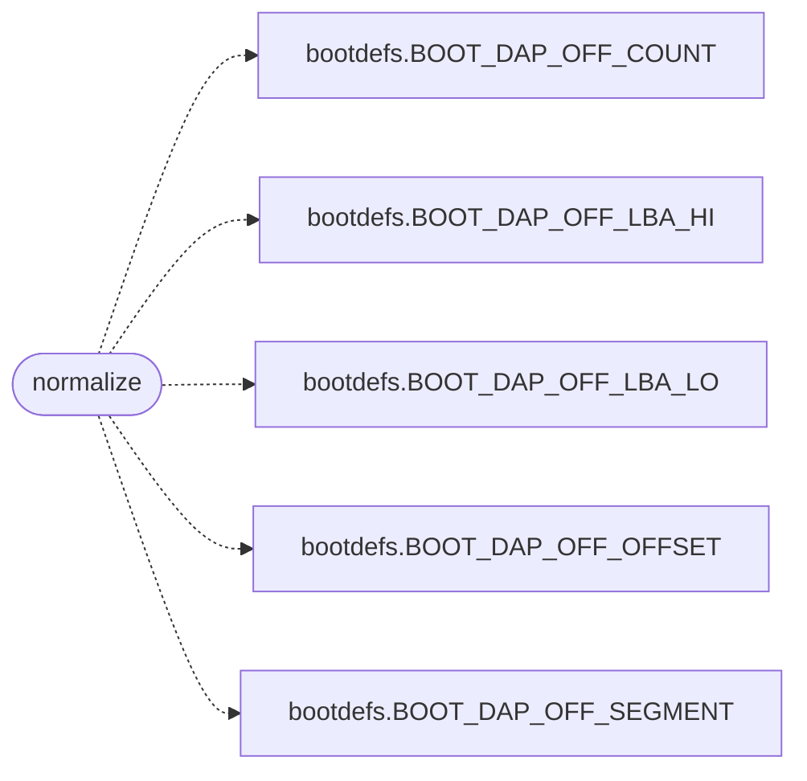

# `arch/x86/boot/stage1.S`

> Source: [arch/x86/boot/stage1.S:1](../../arch/x86/boot/stage1.S#L1) | language `S` | coverage 8.3% | [API index](../index.md)

stage1.S - MiniOS boot sector.

## Contents

- **Functions:** [`main`](#main), [`normalize`](#normalize), [`no_extensions`](#no_extensions), [`read_failed`](#read_failed), [`fail`](#fail), [`halt`](#halt), [`puts`](#puts), [`puts_next`](#puts_next), [`puts_done`](#puts_done), [`msg_no_lba`](#msg_no_lba), [`msg_read`](#msg_read)

## Call Graph

Solid arrows stay in this module, dashed arrows leave it.



## Functions

<a id="main"></a>

### `main`

`function` | [arch/x86/boot/stage1.S:28](../../arch/x86/boot/stage1.S#L28)

```asm
main:
```

---

<a id="normalize"></a>

### `normalize`

`function` | [arch/x86/boot/stage1.S:32](../../arch/x86/boot/stage1.S#L32)

```asm
normalize:
```

*Calls:* [`BOOT_DAP_OFF_COUNT`](headers.arch.x86.boot.bootdefs.h.md#boot_dap_off_count), [`BOOT_DAP_OFF_LBA_HI`](headers.arch.x86.boot.bootdefs.h.md#boot_dap_off_lba_hi), [`BOOT_DAP_OFF_LBA_LO`](headers.arch.x86.boot.bootdefs.h.md#boot_dap_off_lba_lo), [`BOOT_DAP_OFF_OFFSET`](headers.arch.x86.boot.bootdefs.h.md#boot_dap_off_offset), [`BOOT_DAP_OFF_SEGMENT`](headers.arch.x86.boot.bootdefs.h.md#boot_dap_off_segment)

---

<a id="no_extensions"></a>

### `no_extensions`

`function` | [arch/x86/boot/stage1.S:78](../../arch/x86/boot/stage1.S#L78)

```asm
no_extensions:
```

---

<a id="read_failed"></a>

### `read_failed`

`function` | [arch/x86/boot/stage1.S:82](../../arch/x86/boot/stage1.S#L82)

```asm
read_failed:
```

---

<a id="fail"></a>

### `fail`

`function` | [arch/x86/boot/stage1.S:85](../../arch/x86/boot/stage1.S#L85)

```asm
fail:
```

---

<a id="halt"></a>

### `halt`

`function` | [arch/x86/boot/stage1.S:88](../../arch/x86/boot/stage1.S#L88)

```asm
halt:
```

---

<a id="puts"></a>

### `puts`

`function` | [arch/x86/boot/stage1.S:93](../../arch/x86/boot/stage1.S#L93)

```asm
puts:
```

---

<a id="puts_next"></a>

### `puts_next`

`function` | [arch/x86/boot/stage1.S:97](../../arch/x86/boot/stage1.S#L97)

```asm
puts_next:
```

---

<a id="puts_done"></a>

### `puts_done`

`function` | [arch/x86/boot/stage1.S:103](../../arch/x86/boot/stage1.S#L103)

```asm
puts_done:
```

---

<a id="msg_no_lba"></a>

### `msg_no_lba`

`function` | [arch/x86/boot/stage1.S:107](../../arch/x86/boot/stage1.S#L107)

```asm
msg_no_lba:
```

---

<a id="msg_read"></a>

### `msg_read`

`function` | [arch/x86/boot/stage1.S:109](../../arch/x86/boot/stage1.S#L109)

```asm
msg_read:
```

---
