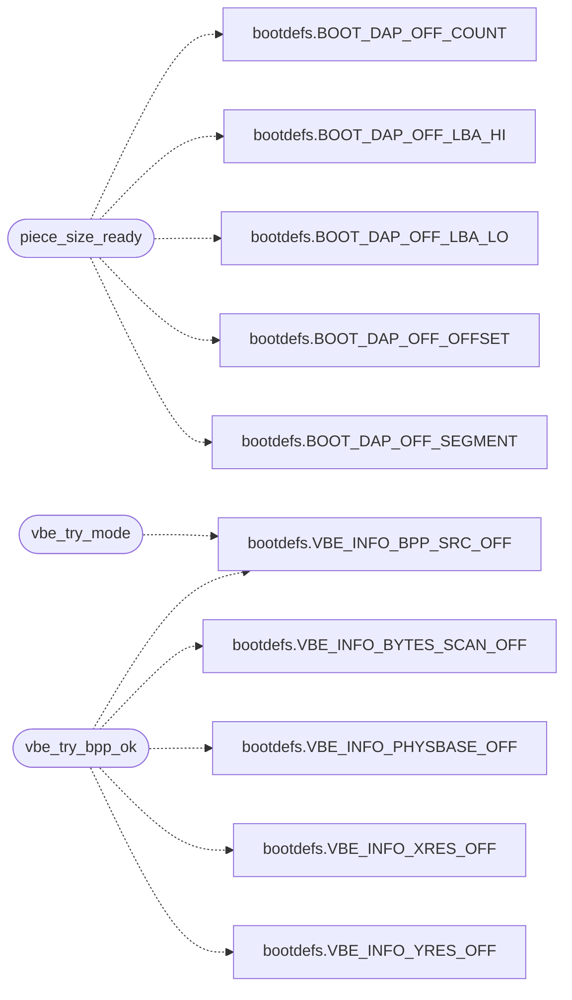

# `arch/x86/boot/stage2.S`

> Source: [arch/x86/boot/stage2.S:1](../../arch/x86/boot/stage2.S#L1) | language `S` | coverage 12.2% | [API index](../index.md)

stage2.S - MiniOS second-stage loader.

## Contents

- **Functions:** [`stage2_main`](#stage2_main), [`a20_ready`](#a20_ready), [`load_chunk`](#load_chunk), [`chunk_size_ready`](#chunk_size_ready), [`read_piece`](#read_piece), [`piece_size_ready`](#piece_size_ready), [`chunk_copy`](#chunk_copy), [`chunk_leave_pm`](#chunk_leave_pm), [`chunk_resume`](#chunk_resume), [`enter_long_mode`](#enter_long_mode), [`fill_pt0_low`](#fill_pt0_low), [`dma_uncache`](#dma_uncache), [`fill_pt0_kernel`](#fill_pt0_kernel), [`fill_pt1_kernel`](#fill_pt1_kernel), [`fill_pt1_bss`](#fill_pt1_bss), [`fill_page_directory`](#fill_page_directory), [`read_failed`](#read_failed), [`halt`](#halt), [`puts`](#puts), [`puts_next`](#puts_next), [`puts_done`](#puts_done), [`msg_read`](#msg_read), [`vbe_probe`](#vbe_probe), [`vbe_try_mode`](#vbe_try_mode), [`vbe_try_bpp_ok`](#vbe_try_bpp_ok), [`vbe_set_fail`](#vbe_set_fail), [`vbe_try_fail`](#vbe_try_fail), [`vbe_ok`](#vbe_ok), [`kaslr_pick`](#kaslr_pick), [`gdt32_start`](#gdt32_start), [`gdt32_end`](#gdt32_end), [`gdt32_ptr`](#gdt32_ptr), [`gdt64_image`](#gdt64_image), [`gdt64_ptr`](#gdt64_ptr), [`saved_gdtr`](#saved_gdtr), [`sectors_left`](#sectors_left), [`chunk_sectors`](#chunk_sectors), [`next_lba`](#next_lba), [`dest_addr`](#dest_addr), [`kaslr_dest`](#kaslr_dest)

## Call Graph

Solid arrows stay in this module, dashed arrows leave it.



## Functions

<a id="stage2_main"></a>

### `stage2_main`

`function` | [arch/x86/boot/stage2.S:39](../../arch/x86/boot/stage2.S#L39)

```asm
stage2_main:
```

---

<a id="a20_ready"></a>

### `a20_ready`

`function` | [arch/x86/boot/stage2.S:54](../../arch/x86/boot/stage2.S#L54)

```asm
a20_ready:
```

---

<a id="load_chunk"></a>

### `load_chunk`

`function` | [arch/x86/boot/stage2.S:69](../../arch/x86/boot/stage2.S#L69)

```asm
load_chunk:
```

---

<a id="chunk_size_ready"></a>

### `chunk_size_ready`

`function` | [arch/x86/boot/stage2.S:74](../../arch/x86/boot/stage2.S#L74)

```asm
chunk_size_ready:
```

---

<a id="read_piece"></a>

### `read_piece`

`function` | [arch/x86/boot/stage2.S:81](../../arch/x86/boot/stage2.S#L81)

```asm
read_piece:
```

---

<a id="piece_size_ready"></a>

### `piece_size_ready`

`function` | [arch/x86/boot/stage2.S:86](../../arch/x86/boot/stage2.S#L86)

```asm
piece_size_ready:
```

*Calls:* [`BOOT_DAP_OFF_COUNT`](headers.arch.x86.boot.bootdefs.h.md#boot_dap_off_count), [`BOOT_DAP_OFF_LBA_HI`](headers.arch.x86.boot.bootdefs.h.md#boot_dap_off_lba_hi), [`BOOT_DAP_OFF_LBA_LO`](headers.arch.x86.boot.bootdefs.h.md#boot_dap_off_lba_lo), [`BOOT_DAP_OFF_OFFSET`](headers.arch.x86.boot.bootdefs.h.md#boot_dap_off_offset), [`BOOT_DAP_OFF_SEGMENT`](headers.arch.x86.boot.bootdefs.h.md#boot_dap_off_segment)

---

<a id="chunk_copy"></a>

### `chunk_copy`

`function` | [arch/x86/boot/stage2.S:118](../../arch/x86/boot/stage2.S#L118)

```asm
chunk_copy:
```

---

<a id="chunk_leave_pm"></a>

### `chunk_leave_pm`

`function` | [arch/x86/boot/stage2.S:131](../../arch/x86/boot/stage2.S#L131)

```asm
chunk_leave_pm:
```

---

<a id="chunk_resume"></a>

### `chunk_resume`

`function` | [arch/x86/boot/stage2.S:141](../../arch/x86/boot/stage2.S#L141)

```asm
chunk_resume:
```

---

<a id="enter_long_mode"></a>

### `enter_long_mode`

`function` | [arch/x86/boot/stage2.S:162](../../arch/x86/boot/stage2.S#L162)

```asm
enter_long_mode:
```

---

<a id="fill_pt0_low"></a>

### `fill_pt0_low`

`function` | [arch/x86/boot/stage2.S:190](../../arch/x86/boot/stage2.S#L190)

```asm
fill_pt0_low:
```

---

<a id="dma_uncache"></a>

### `dma_uncache`

`function` | [arch/x86/boot/stage2.S:208](../../arch/x86/boot/stage2.S#L208)

```asm
dma_uncache:
```

---

<a id="fill_pt0_kernel"></a>

### `fill_pt0_kernel`

`function` | [arch/x86/boot/stage2.S:216](../../arch/x86/boot/stage2.S#L216)

```asm
fill_pt0_kernel:
```

---

<a id="fill_pt1_kernel"></a>

### `fill_pt1_kernel`

`function` | [arch/x86/boot/stage2.S:235](../../arch/x86/boot/stage2.S#L235)

```asm
fill_pt1_kernel:
```

---

<a id="fill_pt1_bss"></a>

### `fill_pt1_bss`

`function` | [arch/x86/boot/stage2.S:244](../../arch/x86/boot/stage2.S#L244)

```asm
fill_pt1_bss:
```

---

<a id="fill_page_directory"></a>

### `fill_page_directory`

`function` | [arch/x86/boot/stage2.S:260](../../arch/x86/boot/stage2.S#L260)

```asm
fill_page_directory:
```

endif

---

<a id="read_failed"></a>

### `read_failed`

`function` | [arch/x86/boot/stage2.S:289](../../arch/x86/boot/stage2.S#L289)

```asm
read_failed:
```

---

<a id="halt"></a>

### `halt`

`function` | [arch/x86/boot/stage2.S:293](../../arch/x86/boot/stage2.S#L293)

```asm
halt:
```

---

<a id="puts"></a>

### `puts`

`function` | [arch/x86/boot/stage2.S:298](../../arch/x86/boot/stage2.S#L298)

```asm
puts:
```

---

<a id="puts_next"></a>

### `puts_next`

`function` | [arch/x86/boot/stage2.S:302](../../arch/x86/boot/stage2.S#L302)

```asm
puts_next:
```

---

<a id="puts_done"></a>

### `puts_done`

`function` | [arch/x86/boot/stage2.S:308](../../arch/x86/boot/stage2.S#L308)

```asm
puts_done:
```

---

<a id="msg_read"></a>

### `msg_read`

`function` | [arch/x86/boot/stage2.S:312](../../arch/x86/boot/stage2.S#L312)

```asm
msg_read:
```

---

<a id="vbe_probe"></a>

### `vbe_probe`

`function` | [arch/x86/boot/stage2.S:325](../../arch/x86/boot/stage2.S#L325)

```asm
vbe_probe:
```

Probe VESA BIOS Extensions for a high-resolution linear framebuffer and record it for the kernel in the fixed VBE_INFO_ADDR struct.

Tries 1024x768 (true color first, then 8-bit palette), then 800x600x32, 800x600x8, 640x480x32 and 640x480x8, then falls back to VGA Mode 13h. Runs in real mode (the kernel image is already fully loaded, so this scratch is safe) and must complete before the transition to long mode kills the BIOS video services. A true-color mode frees the desktop from the 256-entry VGA DAC palette; the 8-bit modes keep that path unchanged. The kernel maps the framebuffer slot by slot, so a multi-MB framebuffer spanning two 2 MB PD slots is fully mapped.

---

<a id="vbe_try_mode"></a>

### `vbe_try_mode`

`function` | [arch/x86/boot/stage2.S:364](../../arch/x86/boot/stage2.S#L364)

```asm
vbe_try_mode:
```

Try one VBE mode held in %bx.

On success the mode is set with the linear framebuffer bit and carry is cleared; on any failure carry is set so the caller can try the next candidate. Only 8/24/32-bit modes are accepted: a 15/16-bit mode would need an RGB565 packer the kernel does not carry, so it is skipped like an unsupported mode.

*Calls:* [`VBE_INFO_BPP_SRC_OFF`](headers.arch.x86.boot.bootdefs.h.md#vbe_info_bpp_src_off)

---

<a id="vbe_try_bpp_ok"></a>

### `vbe_try_bpp_ok`

`function` | [arch/x86/boot/stage2.S:395](../../arch/x86/boot/stage2.S#L395)

```asm
vbe_try_bpp_ok:
```

*Calls:* [`VBE_INFO_BPP_SRC_OFF`](headers.arch.x86.boot.bootdefs.h.md#vbe_info_bpp_src_off), [`VBE_INFO_BYTES_SCAN_OFF`](headers.arch.x86.boot.bootdefs.h.md#vbe_info_bytes_scan_off), [`VBE_INFO_PHYSBASE_OFF`](headers.arch.x86.boot.bootdefs.h.md#vbe_info_physbase_off), [`VBE_INFO_XRES_OFF`](headers.arch.x86.boot.bootdefs.h.md#vbe_info_xres_off), [`VBE_INFO_YRES_OFF`](headers.arch.x86.boot.bootdefs.h.md#vbe_info_yres_off)

---

<a id="vbe_set_fail"></a>

### `vbe_set_fail`

`function` | [arch/x86/boot/stage2.S:420](../../arch/x86/boot/stage2.S#L420)

```asm
vbe_set_fail:
```

---

<a id="vbe_try_fail"></a>

### `vbe_try_fail`

`function` | [arch/x86/boot/stage2.S:423](../../arch/x86/boot/stage2.S#L423)

```asm
vbe_try_fail:
```

---

<a id="vbe_ok"></a>

### `vbe_ok`

`function` | [arch/x86/boot/stage2.S:429](../../arch/x86/boot/stage2.S#L429)

```asm
vbe_ok:
```

---

<a id="kaslr_pick"></a>

### `kaslr_pick`

`function` | [arch/x86/boot/stage2.S:438](../../arch/x86/boot/stage2.S#L438)

```asm
kaslr_pick:
```

Pick the kernel's physical load base: a 2 MB-aligned address in the 64-position window above the kernel heap, seeded from the TSC and the RTC so consecutive boots land at different locations.

Returns the base in eax. The virtual base stays at the link-time 0x100000, which PT0/PT1 map to the returned physical base.

---

<a id="gdt32_start"></a>

### `gdt32_start`

`function` | [arch/x86/boot/stage2.S:475](../../arch/x86/boot/stage2.S#L475)

```asm
gdt32_start:
```

---

<a id="gdt32_end"></a>

### `gdt32_end`

`function` | [arch/x86/boot/stage2.S:481](../../arch/x86/boot/stage2.S#L481)

```asm
gdt32_end:
```

---

<a id="gdt32_ptr"></a>

### `gdt32_ptr`

`function` | [arch/x86/boot/stage2.S:482](../../arch/x86/boot/stage2.S#L482)

```asm
gdt32_ptr:
```

---

<a id="gdt64_image"></a>

### `gdt64_image`

`function` | [arch/x86/boot/stage2.S:487](../../arch/x86/boot/stage2.S#L487)

```asm
gdt64_image:
```

---

<a id="gdt64_ptr"></a>

### `gdt64_ptr`

`function` | [arch/x86/boot/stage2.S:493](../../arch/x86/boot/stage2.S#L493)

```asm
gdt64_ptr:
```

---

<a id="saved_gdtr"></a>

### `saved_gdtr`

`function` | [arch/x86/boot/stage2.S:497](../../arch/x86/boot/stage2.S#L497)

```asm
saved_gdtr:
```

---

<a id="sectors_left"></a>

### `sectors_left`

`function` | [arch/x86/boot/stage2.S:500](../../arch/x86/boot/stage2.S#L500)

```asm
sectors_left:
```

---

<a id="chunk_sectors"></a>

### `chunk_sectors`

`function` | [arch/x86/boot/stage2.S:502](../../arch/x86/boot/stage2.S#L502)

```asm
chunk_sectors:
```

---

<a id="next_lba"></a>

### `next_lba`

`function` | [arch/x86/boot/stage2.S:504](../../arch/x86/boot/stage2.S#L504)

```asm
next_lba:
```

---

<a id="dest_addr"></a>

### `dest_addr`

`function` | [arch/x86/boot/stage2.S:506](../../arch/x86/boot/stage2.S#L506)

```asm
dest_addr:
```

---

<a id="kaslr_dest"></a>

### `kaslr_dest`

`function` | [arch/x86/boot/stage2.S:508](../../arch/x86/boot/stage2.S#L508)

```asm
kaslr_dest:
```

---
