# `boot/uefi_stub.c`

> Source: [boot/uefi_stub.c:1](../../boot/uefi_stub.c#L1) | language `c` | coverage 7.1% | [API index](../index.md)

## Contents

- **Structs:** [`efi_table_header`](#efi_table_header), [`efi_input_key`](#efi_input_key), [`efi_simple_text_output`](#efi_simple_text_output), [`efi_pixel_bitmask`](#efi_pixel_bitmask), [`efi_gop_mode_info`](#efi_gop_mode_info), [`efi_gop_mode`](#efi_gop_mode), [`efi_gop`](#efi_gop), [`efi_mem_desc`](#efi_mem_desc), [`efi_boot_services`](#efi_boot_services), [`efi_system_table`](#efi_system_table), [`efi_block_io`](#efi_block_io), [`efi_block_media`](#efi_block_media), [`efi_loaded_image`](#efi_loaded_image), [`efi_file`](#efi_file), [`efi_sfs`](#efi_sfs)
- **Type Aliases:** [`u64`](#u64), [`u32`](#u32), [`u16`](#u16), [`u8`](#u8), [`efi_status`](#efi_status), [`efi_physical_addr`](#efi_physical_addr), [`efi_virtual_addr`](#efi_virtual_addr), [`efi_simple_text_output`](#efi_simple_text_output), [`efi_gop`](#efi_gop), [`efi_file`](#efi_file)
- **Functions:** [`efi_main`](#efi_main)
- **Macros:** [`EFIABI`](#efiabi), [`EFI_SUCCESS`](#efi_success), [`EFI_LOADER_DATA`](#efi_loader_data), [`EFI_FILE_MODE_READ`](#efi_file_mode_read), [`EFI_BUFFER_TOO_SMALL`](#efi_buffer_too_small), [`UEFI_KERNEL_MAX`](#uefi_kernel_max), [`UBOOT_LOW_PAGES`](#uboot_low_pages), [`UBOOT_KERN_PAGES`](#uboot_kern_pages), [`UBOOT_KERN_SPAN`](#uboot_kern_span), [`UBOOT_KERN_BASE`](#uboot_kern_base), [`UBOOT_TRAMP`](#uboot_tramp), [`TRAMP_LGDT_OFF`](#tramp_lgdt_off), [`TRAMP_LEN`](#tramp_len), [`UBOOT_GDT`](#uboot_gdt), [`UBOOT_GDT_DESC`](#uboot_gdt_desc)

## Type Diagram

```mermaid
classDiagram
    direction LR
    class u64
    <<type_alias>> u64
    class u32
    <<type_alias>> u32
    class u16
    <<type_alias>> u16
    class u8
    <<type_alias>> u8
    class efi_status
    <<type_alias>> efi_status
    class efi_physical_addr
    <<type_alias>> efi_physical_addr
    class efi_virtual_addr
    <<type_alias>> efi_virtual_addr
    class efi_table_header
    <<struct>> efi_table_header
    class efi_input_key
    <<struct>> efi_input_key
    class efi_simple_text_output
    <<type_alias>> efi_simple_text_output
    class efi_simple_text_output
    <<struct>> efi_simple_text_output
    class efi_pixel_bitmask
    <<struct>> efi_pixel_bitmask
    class efi_gop_mode_info
    <<struct>> efi_gop_mode_info
    class efi_gop_mode
    <<struct>> efi_gop_mode
    class efi_gop
    <<type_alias>> efi_gop
    class efi_gop
    <<struct>> efi_gop
    class efi_mem_desc
    <<struct>> efi_mem_desc
    class efi_boot_services
    <<struct>> efi_boot_services
    class efi_system_table
    <<struct>> efi_system_table
    class efi_block_io
    <<struct>> efi_block_io
    class efi_block_media
    <<struct>> efi_block_media
    class efi_loaded_image
    <<struct>> efi_loaded_image
    class efi_file
    <<type_alias>> efi_file
    class efi_file
    <<struct>> efi_file
```



## Call Graph

Solid arrows stay in this module, dashed arrows leave it.


## Structs

<a id="efi_table_header"></a>

### `efi_table_header`

`struct` | [boot/uefi_stub.c:45](../../boot/uefi_stub.c#L45)

```c
typedef struct
```

---

<a id="efi_input_key"></a>

### `efi_input_key`

`struct` | [boot/uefi_stub.c:53](../../boot/uefi_stub.c#L53)

```c
typedef struct
```

---

<a id="efi_simple_text_output"></a>

### `efi_simple_text_output`

`struct` | [boot/uefi_stub.c:61](../../boot/uefi_stub.c#L61)

```c
struct efi_simple_text_output
```

---

<a id="efi_pixel_bitmask"></a>

### `efi_pixel_bitmask`

`struct` | [boot/uefi_stub.c:74](../../boot/uefi_stub.c#L74)

```c
typedef struct
```

---

<a id="efi_gop_mode_info"></a>

### `efi_gop_mode_info`

`struct` | [boot/uefi_stub.c:81](../../boot/uefi_stub.c#L81)

```c
typedef struct
```

---

<a id="efi_gop_mode"></a>

### `efi_gop_mode`

`struct` | [boot/uefi_stub.c:90](../../boot/uefi_stub.c#L90)

```c
typedef struct
```

---

<a id="efi_gop"></a>

### `efi_gop`

`struct` | [boot/uefi_stub.c:100](../../boot/uefi_stub.c#L100)

```c
struct efi_gop
```

---

<a id="efi_mem_desc"></a>

### `efi_mem_desc`

`struct` | [boot/uefi_stub.c:107](../../boot/uefi_stub.c#L107)

```c
typedef struct
```

---

<a id="efi_boot_services"></a>

### `efi_boot_services`

`struct` | [boot/uefi_stub.c:115](../../boot/uefi_stub.c#L115)

```c
typedef struct
```

---

<a id="efi_system_table"></a>

### `efi_system_table`

`struct` | [boot/uefi_stub.c:171](../../boot/uefi_stub.c#L171)

```c
typedef struct
```

---

<a id="efi_block_io"></a>

### `efi_block_io`

`struct` | [boot/uefi_stub.c:240](../../boot/uefi_stub.c#L240)

```c
typedef struct
```

Block I/O protocol (boot disk proof): Revision, Media pointer, Reset, ReadBlocks, WriteBlocks, FlushBlocks.

Only Media->BlockSize and a one-block read are touched.

---

<a id="efi_block_media"></a>

### `efi_block_media`

`struct` | [boot/uefi_stub.c:250](../../boot/uefi_stub.c#L250)

```c
typedef struct
```

---

<a id="efi_loaded_image"></a>

### `efi_loaded_image`

`struct` | [boot/uefi_stub.c:272](../../boot/uefi_stub.c#L272)

```c
typedef struct
```

---

<a id="efi_file"></a>

### `efi_file`

`struct` | [boot/uefi_stub.c:288](../../boot/uefi_stub.c#L288)

```c
struct efi_file
```

---

<a id="efi_sfs"></a>

### `efi_sfs`

`struct` | [boot/uefi_stub.c:302](../../boot/uefi_stub.c#L302)

```c
typedef struct
```

---

## Type Aliases

<a id="u64"></a>

### `u64`

`type_alias` | [boot/uefi_stub.c:26](../../boot/uefi_stub.c#L26)

```c
typedef unsigned long long u64;
```

Docstring: boot/uefi_stub.c -- Minimal MiniOS UEFI stub (Phase 1).

A freestanding x86-64 PE/COFF application (BOOTX64.EFI) proving the
UEFI firmware handshake MiniOS needs: entry through efi_main with
the system table, console + COM1 banner, GOP mode query (reported
when the firmware ships a video driver, unavailable on headless
OVMF), a full memory-map retrieval and a boot-disk read proving
Block I/O (LBA 0 carries the MBR signature). Hand-rolled UEFI
types (no gnu-efi): only the tables this phase touches, with the
MS x64 ABI on every firmware call and the 24-byte table header
present (both were proven necessary the hard way: SysV calls hang
and a missing header turns the first call into a jump at the
"BOOTSERV" magic itself).

Phase 2a (landed): SimpleFileSystem reads kernel.bin whole,
ExitBootServices, then a 64-bit entry prints the handoff block over
serial and halts (load + exit + jump with no kernel changes).
Slices (b) dynamic framebuffer and (c) full boot to shell stay
future work; VESA/VGA text is the fallback, INT 13h paths untouched.

Hand-rolled GUIDs are byte-checked against EDK2, never memory:
LoadedImage is 5B1B31A1 (not B1) and SFS Data2 is 0x6459 (not
0x52); each wrong byte is a silent EFI_NOT_FOUND with no hint
which nibble lied.

---

<a id="u32"></a>

### `u32`

`type_alias` | [boot/uefi_stub.c:28](../../boot/uefi_stub.c#L28)

```c
typedef unsigned int u32;
```

---

<a id="u16"></a>

### `u16`

`type_alias` | [boot/uefi_stub.c:29](../../boot/uefi_stub.c#L29)

```c
typedef unsigned short u16;
```

---

<a id="u8"></a>

### `u8`

`type_alias` | [boot/uefi_stub.c:30](../../boot/uefi_stub.c#L30)

```c
typedef unsigned char u8;
```

---

<a id="efi_status"></a>

### `efi_status`

`type_alias` | [boot/uefi_stub.c:31](../../boot/uefi_stub.c#L31)

```c
typedef u64 efi_status;
```

---

<a id="efi_physical_addr"></a>

### `efi_physical_addr`

`type_alias` | [boot/uefi_stub.c:33](../../boot/uefi_stub.c#L33)

```c
typedef u64 efi_physical_addr;
```

---

<a id="efi_virtual_addr"></a>

### `efi_virtual_addr`

`type_alias` | [boot/uefi_stub.c:34](../../boot/uefi_stub.c#L34)

```c
typedef u64 efi_virtual_addr;
```

---

<a id="efi_simple_text_output"></a>

### `efi_simple_text_output`

`type_alias` | [boot/uefi_stub.c:57](../../boot/uefi_stub.c#L57)

```c
typedef struct efi_simple_text_output efi_simple_text_output;
```

---

<a id="efi_gop"></a>

### `efi_gop`

`type_alias` | [boot/uefi_stub.c:98](../../boot/uefi_stub.c#L98)

```c
typedef struct efi_gop efi_gop;
```

---

<a id="efi_file"></a>

### `efi_file`

`type_alias` | [boot/uefi_stub.c:279](../../boot/uefi_stub.c#L279)

```c
typedef struct efi_file efi_file;
```

---

## Functions

<a id="efi_main"></a>

### `efi_main`

`function` | [boot/uefi_stub.c:416](../../boot/uefi_stub.c#L416)

```c
efi_status EFIABI efi_main(efi_handle image, efi_system_table *systab)
```

**Parameters**

| Name | Type | Default | Description |
|---|---|---|---|
| `image` | `efi_handle` |  |  |
| `systab` | `efi_system_table *` |  |  |

**Returns:** `efi_status EFIABI`

*Calls:* [`GitResult.ok`](tools.update_sources.py.md#gitresult-ok)

---

## Macros

<a id="efiabi"></a>

### `EFIABI`

`macro` | [boot/uefi_stub.c:41](../../boot/uefi_stub.c#L41)

```c
#define EFIABI
```

UEFI firmware calls use the Microsoft x64 ABI (rcx, rdx, r8, r9), never System V.

Every function pointer below carries ms_abi, and efi_main itself is entered that way; without this the first table call jumps wild (proven by a silent hang after the COM1 banner, which needs no tables at all).

---

<a id="efi_success"></a>

### `EFI_SUCCESS`

`macro` | [boot/uefi_stub.c:43](../../boot/uefi_stub.c#L43)

```c
#define EFI_SUCCESS
```

---

<a id="efi_loader_data"></a>

### `EFI_LOADER_DATA`

`macro` | [boot/uefi_stub.c:267](../../boot/uefi_stub.c#L267)

```c
#define EFI_LOADER_DATA
```

---

<a id="efi_file_mode_read"></a>

### `EFI_FILE_MODE_READ`

`macro` | [boot/uefi_stub.c:268](../../boot/uefi_stub.c#L268)

```c
#define EFI_FILE_MODE_READ
```

---

<a id="efi_buffer_too_small"></a>

### `EFI_BUFFER_TOO_SMALL`

`macro` | [boot/uefi_stub.c:269](../../boot/uefi_stub.c#L269)

```c
#define EFI_BUFFER_TOO_SMALL
```

---

<a id="uefi_kernel_max"></a>

### `UEFI_KERNEL_MAX`

`macro` | [boot/uefi_stub.c:270](../../boot/uefi_stub.c#L270)

```c
#define UEFI_KERNEL_MAX
```

---

<a id="uboot_low_pages"></a>

### `UBOOT_LOW_PAGES`

`macro` | [boot/uefi_stub.c:316](../../boot/uefi_stub.c#L316)

```c
#define UBOOT_LOW_PAGES
```

---

<a id="uboot_kern_pages"></a>

### `UBOOT_KERN_PAGES`

`macro` | [boot/uefi_stub.c:317](../../boot/uefi_stub.c#L317)

```c
#define UBOOT_KERN_PAGES
```

---

<a id="uboot_kern_span"></a>

### `UBOOT_KERN_SPAN`

`macro` | [boot/uefi_stub.c:318](../../boot/uefi_stub.c#L318)

```c
#define UBOOT_KERN_SPAN
```

---

<a id="uboot_kern_base"></a>

### `UBOOT_KERN_BASE`

`macro` | [boot/uefi_stub.c:319](../../boot/uefi_stub.c#L319)

```c
#define UBOOT_KERN_BASE
```

---

<a id="uboot_tramp"></a>

### `UBOOT_TRAMP`

`macro` | [boot/uefi_stub.c:320](../../boot/uefi_stub.c#L320)

```c
#define UBOOT_TRAMP
```

---

<a id="tramp_lgdt_off"></a>

### `TRAMP_LGDT_OFF`

`macro` | [boot/uefi_stub.c:321](../../boot/uefi_stub.c#L321)

```c
#define TRAMP_LGDT_OFF
```

---

<a id="tramp_len"></a>

### `TRAMP_LEN`

`macro` | [boot/uefi_stub.c:322](../../boot/uefi_stub.c#L322)

```c
#define TRAMP_LEN
```

---

<a id="uboot_gdt"></a>

### `UBOOT_GDT`

`macro` | [boot/uefi_stub.c:323](../../boot/uefi_stub.c#L323)

```c
#define UBOOT_GDT
```

---

<a id="uboot_gdt_desc"></a>

### `UBOOT_GDT_DESC`

`macro` | [boot/uefi_stub.c:324](../../boot/uefi_stub.c#L324)

```c
#define UBOOT_GDT_DESC
```

---
