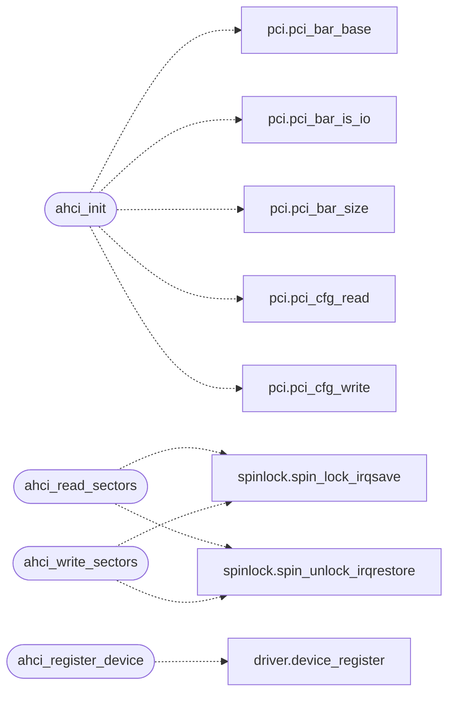

# `drivers/ahci.c`

> Source: [drivers/ahci.c:1](../../drivers/ahci.c#L1) | language `c` | coverage 10.2% | [API index](../index.md)

Docstring: drivers/ahci.c -- Polled AHCI (SATA) disk driver.

## Contents

- **Functions:** [`ahci_present`](#ahci_present), [`ahci_version`](#ahci_version), [`ahci_port`](#ahci_port), [`ahci_ports_implemented`](#ahci_ports_implemented), [`ahci_note`](#ahci_note), [`ahci_sectors`](#ahci_sectors), [`ahci_init`](#ahci_init), [`ahci_read_sectors`](#ahci_read_sectors), [`ahci_write_sectors`](#ahci_write_sectors), [`ahci_register_device`](#ahci_register_device)
- **Macros:** [`AHCI_CLASS_BASE`](#ahci_class_base), [`AHCI_CLASS_SUB`](#ahci_class_sub), [`AHCI_CLASS_PI`](#ahci_class_pi), [`AHCI_ABAR_INDEX`](#ahci_abar_index), [`AHCI_REG_CAP`](#ahci_reg_cap), [`AHCI_REG_GHC`](#ahci_reg_ghc), [`AHCI_REG_IS`](#ahci_reg_is), [`AHCI_REG_PI`](#ahci_reg_pi), [`AHCI_REG_VS`](#ahci_reg_vs), [`AHCI_REG_CAP2`](#ahci_reg_cap2), [`AHCI_REG_BOHC`](#ahci_reg_bohc), [`AHCI_CAP_S64A`](#ahci_cap_s64a), [`AHCI_CAP_SSS`](#ahci_cap_sss), [`AHCI_GHC_AE`](#ahci_ghc_ae), [`AHCI_GHC_IE`](#ahci_ghc_ie), [`AHCI_CAP2_BOH`](#ahci_cap2_boh), [`AHCI_BOHC_BOS`](#ahci_bohc_bos), [`AHCI_BOHC_OOS`](#ahci_bohc_oos), [`AHCI_BOHC_BB`](#ahci_bohc_bb), [`AHCI_MAX_PORTS`](#ahci_max_ports), [`AHCI_PORT_BASE`](#ahci_port_base), [`AHCI_PORT_STRIDE`](#ahci_port_stride), [`AHCI_PX_CLB`](#ahci_px_clb), [`AHCI_PX_CLBU`](#ahci_px_clbu), [`AHCI_PX_FB`](#ahci_px_fb), [`AHCI_PX_FBU`](#ahci_px_fbu), [`AHCI_PX_IS`](#ahci_px_is), [`AHCI_PX_IE`](#ahci_px_ie), [`AHCI_PX_CMD`](#ahci_px_cmd), [`AHCI_PX_TFD`](#ahci_px_tfd), [`AHCI_PX_SIG`](#ahci_px_sig), [`AHCI_PX_SSTS`](#ahci_px_ssts), [`AHCI_PX_SCTL`](#ahci_px_sctl), [`AHCI_PX_SERR`](#ahci_px_serr), [`AHCI_PX_CI`](#ahci_px_ci), [`AHCI_CMD_ST`](#ahci_cmd_st), [`AHCI_CMD_SUD`](#ahci_cmd_sud), [`AHCI_CMD_POD`](#ahci_cmd_pod), [`AHCI_CMD_FRE`](#ahci_cmd_fre), [`AHCI_CMD_FR`](#ahci_cmd_fr), [`AHCI_CMD_CR`](#ahci_cmd_cr), [`AHCI_CMD_ICC_MASK`](#ahci_cmd_icc_mask), [`AHCI_CMD_ICC_ACTIVE`](#ahci_cmd_icc_active), [`AHCI_TFD_ERR`](#ahci_tfd_err), [`AHCI_TFD_DRQ`](#ahci_tfd_drq), [`AHCI_TFD_BSY`](#ahci_tfd_bsy), [`AHCI_IS_TFES`](#ahci_is_tfes), [`AHCI_ALL_ONES`](#ahci_all_ones), [`AHCI_SSTS_DET_MASK`](#ahci_ssts_det_mask), [`AHCI_SSTS_DET_PRESENT`](#ahci_ssts_det_present), [`AHCI_SSTS_DET_ONLINE`](#ahci_ssts_det_online), [`AHCI_SSTS_IPM_SHIFT`](#ahci_ssts_ipm_shift), [`AHCI_SSTS_IPM_MASK`](#ahci_ssts_ipm_mask), [`AHCI_SSTS_IPM_ACTIVE`](#ahci_ssts_ipm_active), [`AHCI_SCTL_DET_MASK`](#ahci_sctl_det_mask), [`AHCI_SCTL_DET_COMRESET`](#ahci_sctl_det_comreset), [`AHCI_SIG_ATA`](#ahci_sig_ata), [`AHCI_CL_BYTES`](#ahci_cl_bytes), [`AHCI_CL_ALIGN`](#ahci_cl_align), [`AHCI_FIS_BYTES`](#ahci_fis_bytes), [`AHCI_FIS_ALIGN`](#ahci_fis_align), [`AHCI_CT_BYTES`](#ahci_ct_bytes), [`AHCI_CT_ALIGN`](#ahci_ct_align), [`AHCI_CT_PRDT_OFF`](#ahci_ct_prdt_off), [`AHCI_PRD_BYTES`](#ahci_prd_bytes), [`AHCI_CH_BYTES`](#ahci_ch_bytes), [`AHCI_CH_CFL_H2D`](#ahci_ch_cfl_h2d), [`AHCI_CH_WRITE`](#ahci_ch_write), [`AHCI_CH_PRDTL_SHIFT`](#ahci_ch_prdtl_shift), [`AHCI_PRD_DBC_MASK`](#ahci_prd_dbc_mask), [`AHCI_FIS_TYPE_H2D`](#ahci_fis_type_h2d), [`AHCI_FIS_H2D_CMD`](#ahci_fis_h2d_cmd), [`AHCI_FIS_DEV_LBA`](#ahci_fis_dev_lba), [`AHCI_FIS_BYTES_H2D`](#ahci_fis_bytes_h2d), [`ATA_CMD_IDENTIFY`](#ata_cmd_identify), [`ATA_CMD_READ_DMA_EXT`](#ata_cmd_read_dma_ext), [`ATA_CMD_WRITE_DMA_EXT`](#ata_cmd_write_dma_ext), [`ATA_CMD_FLUSH_EXT`](#ata_cmd_flush_ext), [`ATA_ID_WORDS`](#ata_id_words), [`ATA_ID_CMDSET2`](#ata_id_cmdset2), [`ATA_ID_LBA48_BIT`](#ata_id_lba48_bit), [`ATA_ID_LBA48_SECTORS`](#ata_id_lba48_sectors), [`ATA_ID_SECTOR_SIZE`](#ata_id_sector_size), [`ATA_ID_SS_VALID_MASK`](#ata_id_ss_valid_mask), [`ATA_ID_SS_VALID`](#ata_id_ss_valid), [`ATA_ID_SS_LONG`](#ata_id_ss_long), [`AHCI_SECTOR`](#ahci_sector), [`AHCI_MAX_SECTORS`](#ahci_max_sectors), [`AHCI_STAGE_BYTES`](#ahci_stage_bytes), [`AHCI_STAGE_ALIGN`](#ahci_stage_align), [`AHCI_LBA48_LIMIT`](#ahci_lba48_limit), [`AHCI_DMA_LIMIT_32`](#ahci_dma_limit_32), [`AHCI_TMO_HANDOFF_MS`](#ahci_tmo_handoff_ms), [`AHCI_TMO_ENGINE_MS`](#ahci_tmo_engine_ms), [`AHCI_TMO_LINK_MS`](#ahci_tmo_link_ms), [`AHCI_TMO_COMRESET_HOLD_MS`](#ahci_tmo_comreset_hold_ms), [`AHCI_TMO_CMD_MS`](#ahci_tmo_cmd_ms)

## Call Graph

Solid arrows stay in this module, dashed arrows leave it.



## Functions

<a id="ahci_present"></a>

### `ahci_present`

`function` | [drivers/ahci.c:215](../../drivers/ahci.c#L215)

```c
int ahci_present(void)
```

Docstring: True once ahci_init brought a disk up.

**Returns:** `int`

> **Inherited:** Documentation from [`ahci_present`](#ahci_present) (headers/drivers/ahci.h:19).

---

<a id="ahci_version"></a>

### `ahci_version`

`function` | [drivers/ahci.c:219](../../drivers/ahci.c#L219)

```c
unsigned ahci_version(void)
```

Docstring: HBA version register (major in bits 31:16, minor 15:0).

**Returns:** `unsigned`

> **Inherited:** Documentation from [`ahci_version`](#ahci_version) (headers/drivers/ahci.h:22).

---

<a id="ahci_port"></a>

### `ahci_port`

`function` | [drivers/ahci.c:223](../../drivers/ahci.c#L223)

```c
int ahci_port(void)
```

Docstring: Port number of the claimed disk, or -1 when none.

**Returns:** `int`

> **Inherited:** Documentation from [`ahci_port`](#ahci_port) (headers/drivers/ahci.h:25).

---

<a id="ahci_ports_implemented"></a>

### `ahci_ports_implemented`

`function` | [drivers/ahci.c:227](../../drivers/ahci.c#L227)

```c
unsigned ahci_ports_implemented(void)
```

Docstring: Bitmap of ports the HBA implements (PI register).

**Returns:** `unsigned`

> **Inherited:** Documentation from [`ahci_ports_implemented`](#ahci_ports_implemented) (headers/drivers/ahci.h:28).

---

<a id="ahci_note"></a>

### `ahci_note`

`function` `const` | [drivers/ahci.c:231](../../drivers/ahci.c#L231)

```c
const char *ahci_note(void)
```

Docstring: Human-readable state of the last probe.

**Returns:** `char *`

> **Inherited:** Documentation from [`ahci_note`](#ahci_note) (headers/drivers/ahci.h:31).

---

<a id="ahci_sectors"></a>

### `ahci_sectors`

`function` | [drivers/ahci.c:235](../../drivers/ahci.c#L235)

```c
unsigned long ahci_sectors(void)
```

Docstring: Capacity of the claimed disk in 512-byte sectors.

**Returns:** `unsigned long`

> **Inherited:** Documentation from [`ahci_sectors`](#ahci_sectors) (headers/drivers/ahci.h:34).

---

<a id="ahci_init"></a>

### `ahci_init`

`function` | [drivers/ahci.c:507](../../drivers/ahci.c#L507)

```c
int ahci_init(void)
```

Docstring: Probe PCI for an AHCI function and bring up the first ATA disk.

Idempotent: a second call returns the cached result. Returns 1 when a disk is ready for I/O, 0 otherwise (ahci_note says why).

**Returns:** `int`

> **Inherited:** Documentation from [`ahci_init`](#ahci_init) (headers/drivers/ahci.h:16).

*Calls:* [`pci_bar_base`](headers.drivers.pci.h.md#pci_bar_base), [`pci_bar_is_io`](headers.drivers.pci.h.md#pci_bar_is_io), [`pci_bar_size`](headers.drivers.pci.h.md#pci_bar_size), [`pci_cfg_read`](headers.drivers.pci.h.md#pci_cfg_read), [`pci_cfg_write`](headers.drivers.pci.h.md#pci_cfg_write)

---

<a id="ahci_read_sectors"></a>

### `ahci_read_sectors`

`function` | [drivers/ahci.c:587](../../drivers/ahci.c#L587)

```c
int ahci_read_sectors(unsigned lba, unsigned count, void *buf)
```

Docstring: Read count sectors starting at lba into buf.

Any count is accepted; it is split into AHCI_MAX_SECTORS commands. Returns 0 on success, -1 on a bad argument, a range past the disk, a device error or a timeout.

**Parameters**

| Name | Type | Default | Description |
|---|---|---|---|
| `lba` | `unsigned` |  |  |
| `count` | `unsigned` |  |  |
| `buf` | `void *` |  |  |

**Returns:** `int`

> **Inherited:** Documentation from [`ahci_read_sectors`](#ahci_read_sectors) (headers/drivers/ahci.h:40).

*Calls:* [`spin_lock_irqsave`](headers.spinlock.h.md#spin_lock_irqsave), [`spin_unlock_irqrestore`](headers.spinlock.h.md#spin_unlock_irqrestore)

---

<a id="ahci_write_sectors"></a>

### `ahci_write_sectors`

`function` | [drivers/ahci.c:607](../../drivers/ahci.c#L607)

```c
int ahci_write_sectors(unsigned lba, unsigned count, const void *buf)
```

Docstring: Write count sectors starting at lba from buf, followed by FLUSH CACHE EXT so the data survives a power cut.

Same contract as the read.

**Parameters**

| Name | Type | Default | Description |
|---|---|---|---|
| `lba` | `unsigned` |  |  |
| `count` | `unsigned` |  |  |
| `buf` | `void *` |  |  |

**Returns:** `int`

> **Inherited:** Documentation from [`ahci_write_sectors`](#ahci_write_sectors) (headers/drivers/ahci.h:45).

*Calls:* [`spin_lock_irqsave`](headers.spinlock.h.md#spin_lock_irqsave), [`spin_unlock_irqrestore`](headers.spinlock.h.md#spin_unlock_irqrestore)

---

<a id="ahci_register_device"></a>

### `ahci_register_device`

`function` | [drivers/ahci.c:673](../../drivers/ahci.c#L673)

```c
void ahci_register_device(void)
```

Docstring: Publish the disk as "ahci0" in the device registry.

> **Inherited:** Documentation from [`ahci_register_device`](#ahci_register_device) (headers/drivers/ahci.h:48).

*Calls:* [`device_register`](headers.driver.h.md#device_register)

---

## Macros

<a id="ahci_class_base"></a>

### `AHCI_CLASS_BASE`

`macro` | [drivers/ahci.c:38](../../drivers/ahci.c#L38)

```c
#define AHCI_CLASS_BASE
```

---

<a id="ahci_class_sub"></a>

### `AHCI_CLASS_SUB`

`macro` | [drivers/ahci.c:39](../../drivers/ahci.c#L39)

```c
#define AHCI_CLASS_SUB
```

---

<a id="ahci_class_pi"></a>

### `AHCI_CLASS_PI`

`macro` | [drivers/ahci.c:40](../../drivers/ahci.c#L40)

```c
#define AHCI_CLASS_PI
```

---

<a id="ahci_abar_index"></a>

### `AHCI_ABAR_INDEX`

`macro` | [drivers/ahci.c:41](../../drivers/ahci.c#L41)

```c
#define AHCI_ABAR_INDEX
```

---

<a id="ahci_reg_cap"></a>

### `AHCI_REG_CAP`

`macro` | [drivers/ahci.c:43](../../drivers/ahci.c#L43)

```c
#define AHCI_REG_CAP
```

---

<a id="ahci_reg_ghc"></a>

### `AHCI_REG_GHC`

`macro` | [drivers/ahci.c:44](../../drivers/ahci.c#L44)

```c
#define AHCI_REG_GHC
```

---

<a id="ahci_reg_is"></a>

### `AHCI_REG_IS`

`macro` | [drivers/ahci.c:45](../../drivers/ahci.c#L45)

```c
#define AHCI_REG_IS
```

---

<a id="ahci_reg_pi"></a>

### `AHCI_REG_PI`

`macro` | [drivers/ahci.c:46](../../drivers/ahci.c#L46)

```c
#define AHCI_REG_PI
```

---

<a id="ahci_reg_vs"></a>

### `AHCI_REG_VS`

`macro` | [drivers/ahci.c:47](../../drivers/ahci.c#L47)

```c
#define AHCI_REG_VS
```

---

<a id="ahci_reg_cap2"></a>

### `AHCI_REG_CAP2`

`macro` | [drivers/ahci.c:48](../../drivers/ahci.c#L48)

```c
#define AHCI_REG_CAP2
```

---

<a id="ahci_reg_bohc"></a>

### `AHCI_REG_BOHC`

`macro` | [drivers/ahci.c:49](../../drivers/ahci.c#L49)

```c
#define AHCI_REG_BOHC
```

---

<a id="ahci_cap_s64a"></a>

### `AHCI_CAP_S64A`

`macro` | [drivers/ahci.c:51](../../drivers/ahci.c#L51)

```c
#define AHCI_CAP_S64A
```

---

<a id="ahci_cap_sss"></a>

### `AHCI_CAP_SSS`

`macro` | [drivers/ahci.c:52](../../drivers/ahci.c#L52)

```c
#define AHCI_CAP_SSS
```

---

<a id="ahci_ghc_ae"></a>

### `AHCI_GHC_AE`

`macro` | [drivers/ahci.c:53](../../drivers/ahci.c#L53)

```c
#define AHCI_GHC_AE
```

---

<a id="ahci_ghc_ie"></a>

### `AHCI_GHC_IE`

`macro` | [drivers/ahci.c:54](../../drivers/ahci.c#L54)

```c
#define AHCI_GHC_IE
```

---

<a id="ahci_cap2_boh"></a>

### `AHCI_CAP2_BOH`

`macro` | [drivers/ahci.c:55](../../drivers/ahci.c#L55)

```c
#define AHCI_CAP2_BOH
```

---

<a id="ahci_bohc_bos"></a>

### `AHCI_BOHC_BOS`

`macro` | [drivers/ahci.c:56](../../drivers/ahci.c#L56)

```c
#define AHCI_BOHC_BOS
```

---

<a id="ahci_bohc_oos"></a>

### `AHCI_BOHC_OOS`

`macro` | [drivers/ahci.c:57](../../drivers/ahci.c#L57)

```c
#define AHCI_BOHC_OOS
```

---

<a id="ahci_bohc_bb"></a>

### `AHCI_BOHC_BB`

`macro` | [drivers/ahci.c:58](../../drivers/ahci.c#L58)

```c
#define AHCI_BOHC_BB
```

---

<a id="ahci_max_ports"></a>

### `AHCI_MAX_PORTS`

`macro` | [drivers/ahci.c:60](../../drivers/ahci.c#L60)

```c
#define AHCI_MAX_PORTS
```

---

<a id="ahci_port_base"></a>

### `AHCI_PORT_BASE`

`macro` | [drivers/ahci.c:61](../../drivers/ahci.c#L61)

```c
#define AHCI_PORT_BASE
```

---

<a id="ahci_port_stride"></a>

### `AHCI_PORT_STRIDE`

`macro` | [drivers/ahci.c:62](../../drivers/ahci.c#L62)

```c
#define AHCI_PORT_STRIDE
```

---

<a id="ahci_px_clb"></a>

### `AHCI_PX_CLB`

`macro` | [drivers/ahci.c:63](../../drivers/ahci.c#L63)

```c
#define AHCI_PX_CLB
```

---

<a id="ahci_px_clbu"></a>

### `AHCI_PX_CLBU`

`macro` | [drivers/ahci.c:64](../../drivers/ahci.c#L64)

```c
#define AHCI_PX_CLBU
```

---

<a id="ahci_px_fb"></a>

### `AHCI_PX_FB`

`macro` | [drivers/ahci.c:65](../../drivers/ahci.c#L65)

```c
#define AHCI_PX_FB
```

---

<a id="ahci_px_fbu"></a>

### `AHCI_PX_FBU`

`macro` | [drivers/ahci.c:66](../../drivers/ahci.c#L66)

```c
#define AHCI_PX_FBU
```

---

<a id="ahci_px_is"></a>

### `AHCI_PX_IS`

`macro` | [drivers/ahci.c:67](../../drivers/ahci.c#L67)

```c
#define AHCI_PX_IS
```

---

<a id="ahci_px_ie"></a>

### `AHCI_PX_IE`

`macro` | [drivers/ahci.c:68](../../drivers/ahci.c#L68)

```c
#define AHCI_PX_IE
```

---

<a id="ahci_px_cmd"></a>

### `AHCI_PX_CMD`

`macro` | [drivers/ahci.c:69](../../drivers/ahci.c#L69)

```c
#define AHCI_PX_CMD
```

---

<a id="ahci_px_tfd"></a>

### `AHCI_PX_TFD`

`macro` | [drivers/ahci.c:70](../../drivers/ahci.c#L70)

```c
#define AHCI_PX_TFD
```

---

<a id="ahci_px_sig"></a>

### `AHCI_PX_SIG`

`macro` | [drivers/ahci.c:71](../../drivers/ahci.c#L71)

```c
#define AHCI_PX_SIG
```

---

<a id="ahci_px_ssts"></a>

### `AHCI_PX_SSTS`

`macro` | [drivers/ahci.c:72](../../drivers/ahci.c#L72)

```c
#define AHCI_PX_SSTS
```

---

<a id="ahci_px_sctl"></a>

### `AHCI_PX_SCTL`

`macro` | [drivers/ahci.c:73](../../drivers/ahci.c#L73)

```c
#define AHCI_PX_SCTL
```

---

<a id="ahci_px_serr"></a>

### `AHCI_PX_SERR`

`macro` | [drivers/ahci.c:74](../../drivers/ahci.c#L74)

```c
#define AHCI_PX_SERR
```

---

<a id="ahci_px_ci"></a>

### `AHCI_PX_CI`

`macro` | [drivers/ahci.c:75](../../drivers/ahci.c#L75)

```c
#define AHCI_PX_CI
```

---

<a id="ahci_cmd_st"></a>

### `AHCI_CMD_ST`

`macro` | [drivers/ahci.c:77](../../drivers/ahci.c#L77)

```c
#define AHCI_CMD_ST
```

---

<a id="ahci_cmd_sud"></a>

### `AHCI_CMD_SUD`

`macro` | [drivers/ahci.c:78](../../drivers/ahci.c#L78)

```c
#define AHCI_CMD_SUD
```

---

<a id="ahci_cmd_pod"></a>

### `AHCI_CMD_POD`

`macro` | [drivers/ahci.c:79](../../drivers/ahci.c#L79)

```c
#define AHCI_CMD_POD
```

---

<a id="ahci_cmd_fre"></a>

### `AHCI_CMD_FRE`

`macro` | [drivers/ahci.c:80](../../drivers/ahci.c#L80)

```c
#define AHCI_CMD_FRE
```

---

<a id="ahci_cmd_fr"></a>

### `AHCI_CMD_FR`

`macro` | [drivers/ahci.c:81](../../drivers/ahci.c#L81)

```c
#define AHCI_CMD_FR
```

---

<a id="ahci_cmd_cr"></a>

### `AHCI_CMD_CR`

`macro` | [drivers/ahci.c:82](../../drivers/ahci.c#L82)

```c
#define AHCI_CMD_CR
```

---

<a id="ahci_cmd_icc_mask"></a>

### `AHCI_CMD_ICC_MASK`

`macro` | [drivers/ahci.c:83](../../drivers/ahci.c#L83)

```c
#define AHCI_CMD_ICC_MASK
```

---

<a id="ahci_cmd_icc_active"></a>

### `AHCI_CMD_ICC_ACTIVE`

`macro` | [drivers/ahci.c:84](../../drivers/ahci.c#L84)

```c
#define AHCI_CMD_ICC_ACTIVE
```

---

<a id="ahci_tfd_err"></a>

### `AHCI_TFD_ERR`

`macro` | [drivers/ahci.c:86](../../drivers/ahci.c#L86)

```c
#define AHCI_TFD_ERR
```

---

<a id="ahci_tfd_drq"></a>

### `AHCI_TFD_DRQ`

`macro` | [drivers/ahci.c:87](../../drivers/ahci.c#L87)

```c
#define AHCI_TFD_DRQ
```

---

<a id="ahci_tfd_bsy"></a>

### `AHCI_TFD_BSY`

`macro` | [drivers/ahci.c:88](../../drivers/ahci.c#L88)

```c
#define AHCI_TFD_BSY
```

---

<a id="ahci_is_tfes"></a>

### `AHCI_IS_TFES`

`macro` | [drivers/ahci.c:89](../../drivers/ahci.c#L89)

```c
#define AHCI_IS_TFES
```

---

<a id="ahci_all_ones"></a>

### `AHCI_ALL_ONES`

`macro` | [drivers/ahci.c:90](../../drivers/ahci.c#L90)

```c
#define AHCI_ALL_ONES
```

---

<a id="ahci_ssts_det_mask"></a>

### `AHCI_SSTS_DET_MASK`

`macro` | [drivers/ahci.c:92](../../drivers/ahci.c#L92)

```c
#define AHCI_SSTS_DET_MASK
```

---

<a id="ahci_ssts_det_present"></a>

### `AHCI_SSTS_DET_PRESENT`

`macro` | [drivers/ahci.c:93](../../drivers/ahci.c#L93)

```c
#define AHCI_SSTS_DET_PRESENT
```

---

<a id="ahci_ssts_det_online"></a>

### `AHCI_SSTS_DET_ONLINE`

`macro` | [drivers/ahci.c:94](../../drivers/ahci.c#L94)

```c
#define AHCI_SSTS_DET_ONLINE
```

---

<a id="ahci_ssts_ipm_shift"></a>

### `AHCI_SSTS_IPM_SHIFT`

`macro` | [drivers/ahci.c:95](../../drivers/ahci.c#L95)

```c
#define AHCI_SSTS_IPM_SHIFT
```

---

<a id="ahci_ssts_ipm_mask"></a>

### `AHCI_SSTS_IPM_MASK`

`macro` | [drivers/ahci.c:96](../../drivers/ahci.c#L96)

```c
#define AHCI_SSTS_IPM_MASK
```

---

<a id="ahci_ssts_ipm_active"></a>

### `AHCI_SSTS_IPM_ACTIVE`

`macro` | [drivers/ahci.c:97](../../drivers/ahci.c#L97)

```c
#define AHCI_SSTS_IPM_ACTIVE
```

---

<a id="ahci_sctl_det_mask"></a>

### `AHCI_SCTL_DET_MASK`

`macro` | [drivers/ahci.c:98](../../drivers/ahci.c#L98)

```c
#define AHCI_SCTL_DET_MASK
```

---

<a id="ahci_sctl_det_comreset"></a>

### `AHCI_SCTL_DET_COMRESET`

`macro` | [drivers/ahci.c:99](../../drivers/ahci.c#L99)

```c
#define AHCI_SCTL_DET_COMRESET
```

---

<a id="ahci_sig_ata"></a>

### `AHCI_SIG_ATA`

`macro` | [drivers/ahci.c:101](../../drivers/ahci.c#L101)

```c
#define AHCI_SIG_ATA
```

---

<a id="ahci_cl_bytes"></a>

### `AHCI_CL_BYTES`

`macro` | [drivers/ahci.c:103](../../drivers/ahci.c#L103)

```c
#define AHCI_CL_BYTES
```

---

<a id="ahci_cl_align"></a>

### `AHCI_CL_ALIGN`

`macro` | [drivers/ahci.c:104](../../drivers/ahci.c#L104)

```c
#define AHCI_CL_ALIGN
```

---

<a id="ahci_fis_bytes"></a>

### `AHCI_FIS_BYTES`

`macro` | [drivers/ahci.c:105](../../drivers/ahci.c#L105)

```c
#define AHCI_FIS_BYTES
```

---

<a id="ahci_fis_align"></a>

### `AHCI_FIS_ALIGN`

`macro` | [drivers/ahci.c:106](../../drivers/ahci.c#L106)

```c
#define AHCI_FIS_ALIGN
```

---

<a id="ahci_ct_bytes"></a>

### `AHCI_CT_BYTES`

`macro` | [drivers/ahci.c:107](../../drivers/ahci.c#L107)

```c
#define AHCI_CT_BYTES
```

---

<a id="ahci_ct_align"></a>

### `AHCI_CT_ALIGN`

`macro` | [drivers/ahci.c:108](../../drivers/ahci.c#L108)

```c
#define AHCI_CT_ALIGN
```

---

<a id="ahci_ct_prdt_off"></a>

### `AHCI_CT_PRDT_OFF`

`macro` | [drivers/ahci.c:109](../../drivers/ahci.c#L109)

```c
#define AHCI_CT_PRDT_OFF
```

---

<a id="ahci_prd_bytes"></a>

### `AHCI_PRD_BYTES`

`macro` | [drivers/ahci.c:110](../../drivers/ahci.c#L110)

```c
#define AHCI_PRD_BYTES
```

---

<a id="ahci_ch_bytes"></a>

### `AHCI_CH_BYTES`

`macro` | [drivers/ahci.c:111](../../drivers/ahci.c#L111)

```c
#define AHCI_CH_BYTES
```

---

<a id="ahci_ch_cfl_h2d"></a>

### `AHCI_CH_CFL_H2D`

`macro` | [drivers/ahci.c:113](../../drivers/ahci.c#L113)

```c
#define AHCI_CH_CFL_H2D
```

---

<a id="ahci_ch_write"></a>

### `AHCI_CH_WRITE`

`macro` | [drivers/ahci.c:114](../../drivers/ahci.c#L114)

```c
#define AHCI_CH_WRITE
```

---

<a id="ahci_ch_prdtl_shift"></a>

### `AHCI_CH_PRDTL_SHIFT`

`macro` | [drivers/ahci.c:115](../../drivers/ahci.c#L115)

```c
#define AHCI_CH_PRDTL_SHIFT
```

---

<a id="ahci_prd_dbc_mask"></a>

### `AHCI_PRD_DBC_MASK`

`macro` | [drivers/ahci.c:116](../../drivers/ahci.c#L116)

```c
#define AHCI_PRD_DBC_MASK
```

---

<a id="ahci_fis_type_h2d"></a>

### `AHCI_FIS_TYPE_H2D`

`macro` | [drivers/ahci.c:118](../../drivers/ahci.c#L118)

```c
#define AHCI_FIS_TYPE_H2D
```

---

<a id="ahci_fis_h2d_cmd"></a>

### `AHCI_FIS_H2D_CMD`

`macro` | [drivers/ahci.c:119](../../drivers/ahci.c#L119)

```c
#define AHCI_FIS_H2D_CMD
```

---

<a id="ahci_fis_dev_lba"></a>

### `AHCI_FIS_DEV_LBA`

`macro` | [drivers/ahci.c:120](../../drivers/ahci.c#L120)

```c
#define AHCI_FIS_DEV_LBA
```

---

<a id="ahci_fis_bytes_h2d"></a>

### `AHCI_FIS_BYTES_H2D`

`macro` | [drivers/ahci.c:121](../../drivers/ahci.c#L121)

```c
#define AHCI_FIS_BYTES_H2D
```

---

<a id="ata_cmd_identify"></a>

### `ATA_CMD_IDENTIFY`

`macro` | [drivers/ahci.c:123](../../drivers/ahci.c#L123)

```c
#define ATA_CMD_IDENTIFY
```

---

<a id="ata_cmd_read_dma_ext"></a>

### `ATA_CMD_READ_DMA_EXT`

`macro` | [drivers/ahci.c:124](../../drivers/ahci.c#L124)

```c
#define ATA_CMD_READ_DMA_EXT
```

---

<a id="ata_cmd_write_dma_ext"></a>

### `ATA_CMD_WRITE_DMA_EXT`

`macro` | [drivers/ahci.c:125](../../drivers/ahci.c#L125)

```c
#define ATA_CMD_WRITE_DMA_EXT
```

---

<a id="ata_cmd_flush_ext"></a>

### `ATA_CMD_FLUSH_EXT`

`macro` | [drivers/ahci.c:126](../../drivers/ahci.c#L126)

```c
#define ATA_CMD_FLUSH_EXT
```

---

<a id="ata_id_words"></a>

### `ATA_ID_WORDS`

`macro` | [drivers/ahci.c:128](../../drivers/ahci.c#L128)

```c
#define ATA_ID_WORDS
```

---

<a id="ata_id_cmdset2"></a>

### `ATA_ID_CMDSET2`

`macro` | [drivers/ahci.c:129](../../drivers/ahci.c#L129)

```c
#define ATA_ID_CMDSET2
```

---

<a id="ata_id_lba48_bit"></a>

### `ATA_ID_LBA48_BIT`

`macro` | [drivers/ahci.c:130](../../drivers/ahci.c#L130)

```c
#define ATA_ID_LBA48_BIT
```

---

<a id="ata_id_lba48_sectors"></a>

### `ATA_ID_LBA48_SECTORS`

`macro` | [drivers/ahci.c:131](../../drivers/ahci.c#L131)

```c
#define ATA_ID_LBA48_SECTORS
```

---

<a id="ata_id_sector_size"></a>

### `ATA_ID_SECTOR_SIZE`

`macro` | [drivers/ahci.c:132](../../drivers/ahci.c#L132)

```c
#define ATA_ID_SECTOR_SIZE
```

---

<a id="ata_id_ss_valid_mask"></a>

### `ATA_ID_SS_VALID_MASK`

`macro` | [drivers/ahci.c:133](../../drivers/ahci.c#L133)

```c
#define ATA_ID_SS_VALID_MASK
```

---

<a id="ata_id_ss_valid"></a>

### `ATA_ID_SS_VALID`

`macro` | [drivers/ahci.c:134](../../drivers/ahci.c#L134)

```c
#define ATA_ID_SS_VALID
```

---

<a id="ata_id_ss_long"></a>

### `ATA_ID_SS_LONG`

`macro` | [drivers/ahci.c:135](../../drivers/ahci.c#L135)

```c
#define ATA_ID_SS_LONG
```

---

<a id="ahci_sector"></a>

### `AHCI_SECTOR`

`macro` | [drivers/ahci.c:137](../../drivers/ahci.c#L137)

```c
#define AHCI_SECTOR
```

---

<a id="ahci_max_sectors"></a>

### `AHCI_MAX_SECTORS`

`macro` | [drivers/ahci.c:138](../../drivers/ahci.c#L138)

```c
#define AHCI_MAX_SECTORS
```

---

<a id="ahci_stage_bytes"></a>

### `AHCI_STAGE_BYTES`

`macro` | [drivers/ahci.c:139](../../drivers/ahci.c#L139)

```c
#define AHCI_STAGE_BYTES
```

---

<a id="ahci_stage_align"></a>

### `AHCI_STAGE_ALIGN`

`macro` | [drivers/ahci.c:140](../../drivers/ahci.c#L140)

```c
#define AHCI_STAGE_ALIGN
```

---

<a id="ahci_lba48_limit"></a>

### `AHCI_LBA48_LIMIT`

`macro` | [drivers/ahci.c:141](../../drivers/ahci.c#L141)

```c
#define AHCI_LBA48_LIMIT
```

---

<a id="ahci_dma_limit_32"></a>

### `AHCI_DMA_LIMIT_32`

`macro` | [drivers/ahci.c:142](../../drivers/ahci.c#L142)

```c
#define AHCI_DMA_LIMIT_32
```

---

<a id="ahci_tmo_handoff_ms"></a>

### `AHCI_TMO_HANDOFF_MS`

`macro` | [drivers/ahci.c:144](../../drivers/ahci.c#L144)

```c
#define AHCI_TMO_HANDOFF_MS
```

---

<a id="ahci_tmo_engine_ms"></a>

### `AHCI_TMO_ENGINE_MS`

`macro` | [drivers/ahci.c:145](../../drivers/ahci.c#L145)

```c
#define AHCI_TMO_ENGINE_MS
```

---

<a id="ahci_tmo_link_ms"></a>

### `AHCI_TMO_LINK_MS`

`macro` | [drivers/ahci.c:146](../../drivers/ahci.c#L146)

```c
#define AHCI_TMO_LINK_MS
```

---

<a id="ahci_tmo_comreset_hold_ms"></a>

### `AHCI_TMO_COMRESET_HOLD_MS`

`macro` | [drivers/ahci.c:147](../../drivers/ahci.c#L147)

```c
#define AHCI_TMO_COMRESET_HOLD_MS
```

---

<a id="ahci_tmo_cmd_ms"></a>

### `AHCI_TMO_CMD_MS`

`macro` | [drivers/ahci.c:148](../../drivers/ahci.c#L148)

```c
#define AHCI_TMO_CMD_MS
```

---
