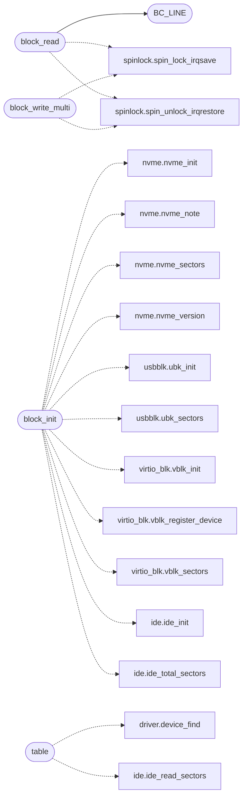

# `drivers/block.c`

> Source: [drivers/block.c:1](../../drivers/block.c#L1) | language `c` | coverage 60.0% | [API index](../index.md)

Block device layer for MiniFS.

## Contents

- **Functions:** [`block_init`](#block_init), [`block_set_base`](#block_set_base), [`table`](#table), [`block_read`](#block_read), [`block_write`](#block_write), [`block_read_multi`](#block_read_multi), [`block_write_multi`](#block_write_multi), [`block_flush`](#block_flush), [`block_total`](#block_total), [`block_read_sectors`](#block_read_sectors), [`block_disk_sectors`](#block_disk_sectors)
- **Macros:** [`BC_WAYS`](#bc_ways), [`BC_MASK`](#bc_mask), [`BC_LINE`](#bc_line)

## Call Graph

Solid arrows stay in this module, dashed arrows leave it.



## Functions

<a id="block_init"></a>

### `block_init`

`function` | [drivers/block.c:80](../../drivers/block.c#L80)

```c
void block_init(void)
```

Initialize the block layer.

Calls ide_init() internally.

> **Inherited:** Documentation from [`block_init`](#block_init) (headers/block.h:12).

*Calls:* [`nvme_init`](headers.drivers.nvme.h.md#nvme_init), [`nvme_note`](headers.drivers.nvme.h.md#nvme_note), [`nvme_sectors`](headers.drivers.nvme.h.md#nvme_sectors), [`nvme_version`](headers.drivers.nvme.h.md#nvme_version), [`ubk_init`](headers.drivers.usbblk.h.md#ubk_init), [`ubk_sectors`](headers.drivers.usbblk.h.md#ubk_sectors), [`vblk_init`](headers.drivers.virtio_blk.h.md#vblk_init), [`vblk_register_device`](headers.drivers.virtio_blk.h.md#vblk_register_device), [`vblk_sectors`](headers.drivers.virtio_blk.h.md#vblk_sectors), [`ide_init`](headers.ide.h.md#ide_init), [`ide_total_sectors`](headers.ide.h.md#ide_total_sectors)

---

<a id="block_set_base"></a>

### `block_set_base`

`function` | [drivers/block.c:113](../../drivers/block.c#L113)

```c
void block_set_base(unsigned int lba_base)
```

Set the base LBA offset for all block I/O.

**Parameters**

| Name | Type | Default | Description |
|---|---|---|---|
| `lba_base` | `unsigned int` |  |  |

> **Inherited:** Documentation from [`block_set_base`](#block_set_base) (headers/block.h:15).

---

<a id="table"></a>

### `table`

`function` | [drivers/block.c:122](../../drivers/block.c#L122)

```c
* ops table (dev->ops->read/write), never straight at the hardware. The * virtio queue wins when block_init preferred it (same image as IDE, or * IDE absent on virtio-only hardware);
```

**Parameters**

| Name | Type | Default | Description |
|---|---|---|---|
| `write` | `dev->ops->read/` |  |  |

**Returns:** `* ops`

*Calls:* [`device_find`](headers.driver.h.md#device_find), [`ide_read_sectors`](headers.ide.h.md#ide_read_sectors)

---

<a id="block_read"></a>

### `block_read`

`function` | [drivers/block.c:164](../../drivers/block.c#L164)

```c
int block_read(unsigned int block_num, void *buf)
```

Read/write one 4096-byte block.

Returns 0 on success.

**Parameters**

| Name | Type | Default | Description |
|---|---|---|---|
| `block_num` | `unsigned int` |  |  |
| `buf` | `void *` |  |  |

**Returns:** `int`

> **Inherited:** Documentation from [`block_read`](#block_read) (headers/block.h:18).

*Calls:* [`BC_LINE`](#bc_line), [`spin_lock_irqsave`](headers.spinlock.h.md#spin_lock_irqsave), [`spin_unlock_irqrestore`](headers.spinlock.h.md#spin_unlock_irqrestore)

---

<a id="block_write"></a>

### `block_write`

`function` | [drivers/block.c:205](../../drivers/block.c#L205)

```c
int block_write(unsigned int block_num, const void *buf)
```

**Parameters**

| Name | Type | Default | Description |
|---|---|---|---|
| `block_num` | `unsigned int` |  |  |
| `buf` | `void *` |  |  |

**Returns:** `int`

---

<a id="block_read_multi"></a>

### `block_read_multi`

`function` | [drivers/block.c:214](../../drivers/block.c#L214)

```c
int block_read_multi(unsigned int block_num, unsigned int count, void *buf)
```

Read/write multiple contiguous blocks.

Returns 0 on success.

**Parameters**

| Name | Type | Default | Description |
|---|---|---|---|
| `block_num` | `unsigned int` |  |  |
| `count` | `unsigned int` |  |  |
| `buf` | `void *` |  |  |

**Returns:** `int`

> **Inherited:** Documentation from [`block_read_multi`](#block_read_multi) (headers/block.h:23).

---

<a id="block_write_multi"></a>

### `block_write_multi`

`function` | [drivers/block.c:219](../../drivers/block.c#L219)

```c
int block_write_multi(unsigned int block_num, unsigned int count, const void *buf)
```

**Parameters**

| Name | Type | Default | Description |
|---|---|---|---|
| `block_num` | `unsigned int` |  |  |
| `count` | `unsigned int` |  |  |
| `buf` | `void *` |  |  |

**Returns:** `int`

*Calls:* [`spin_lock_irqsave`](headers.spinlock.h.md#spin_lock_irqsave), [`spin_unlock_irqrestore`](headers.spinlock.h.md#spin_unlock_irqrestore)

---

<a id="block_flush"></a>

### `block_flush`

`function` | [drivers/block.c:234](../../drivers/block.c#L234)

```c
void block_flush(void)
```

Flush any cached writes (currently a no-op, IDE is synchronous).

> **Inherited:** Documentation from [`block_flush`](#block_flush) (headers/block.h:27).

---

<a id="block_total"></a>

### `block_total`

`function` | [drivers/block.c:236](../../drivers/block.c#L236)

```c
unsigned int block_total(void)
```

Total blocks available, 0 if no disk.

**Returns:** `unsigned int`

> **Inherited:** Documentation from [`block_total`](#block_total) (headers/block.h:30).

---

<a id="block_read_sectors"></a>

### `block_read_sectors`

`function` | [drivers/block.c:244](../../drivers/block.c#L244)

```c
int block_read_sectors(unsigned lba, unsigned count, void *buf)
```

Docstring: Absolute sector read on the active backend, with no cache and no base offset: partition tables and foreign filesystems address the whole disk, not the MiniFS window.

**Parameters**

| Name | Type | Default | Description |
|---|---|---|---|
| `lba` | `unsigned` |  |  |
| `count` | `unsigned` |  |  |
| `buf` | `void *` |  |  |

**Returns:** `int`

---

<a id="block_disk_sectors"></a>

### `block_disk_sectors`

`function` | [drivers/block.c:255](../../drivers/block.c#L255)

```c
unsigned long block_disk_sectors(void)
```

Docstring: Size of the active backend in sectors, so scanners fence to the USB stick when it is the backend and not to the IDE disk.

**Returns:** `unsigned long`

---

## Macros

<a id="bc_ways"></a>

### `BC_WAYS`

`macro` | [drivers/block.c:53](../../drivers/block.c#L53)

```c
#define BC_WAYS
```

---

<a id="bc_mask"></a>

### `BC_MASK`

`macro` | [drivers/block.c:54](../../drivers/block.c#L54)

```c
#define BC_MASK
```

---

<a id="bc_line"></a>

### `BC_LINE`

`macro` | [drivers/block.c:62](../../drivers/block.c#L62)

```c
#define BC_LINE(idx)
```

*Called by:* [`block_read`](#block_read)

---
