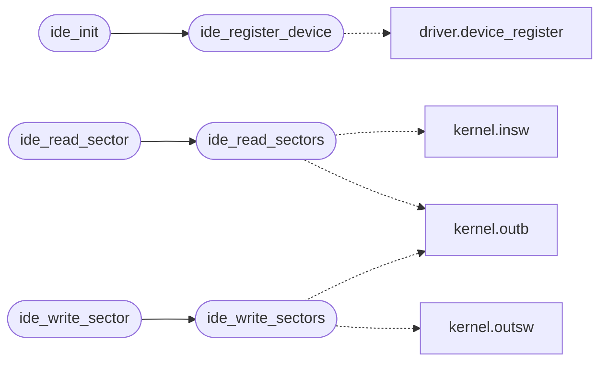

# `drivers/ide.c`

> Source: [drivers/ide.c:1](../../drivers/ide.c#L1) | language `c` | coverage 77.8% | [API index](../index.md)

IDE/ATA PIO driver for MiniOS.

## Contents

- **Functions:** [`ide_init`](#ide_init), [`ide_present`](#ide_present), [`ide_total_sectors`](#ide_total_sectors), [`ide_register_device`](#ide_register_device), [`ide_read_sectors`](#ide_read_sectors), [`ide_write_sectors`](#ide_write_sectors), [`ide_read_sector`](#ide_read_sector), [`ide_write_sector`](#ide_write_sector)

## Call Graph

Solid arrows stay in this module, dashed arrows leave it.



## Functions

<a id="ide_init"></a>

### `ide_init`

`function` | [drivers/ide.c:91](../../drivers/ide.c#L91)

```c
void ide_init(void)
```

Initialize the IDE driver: probe, IDENTIFY, report geometry.

> **Inherited:** Documentation from [`ide_init`](#ide_init) (headers/ide.h:49).

*Calls:* [`ide_register_device`](#ide_register_device)

---

<a id="ide_present"></a>

### `ide_present`

`function` | [drivers/ide.c:110](../../drivers/ide.c#L110)

```c
int ide_present(void)
```

Returns 1 if a disk was successfully detected.

**Returns:** `int`

> **Inherited:** Documentation from [`ide_present`](#ide_present) (headers/ide.h:64).

---

<a id="ide_total_sectors"></a>

### `ide_total_sectors`

`function` | [drivers/ide.c:111](../../drivers/ide.c#L111)

```c
unsigned int ide_total_sectors(void)
```

Returns total sectors on the disk, or 0 if not detected.

**Returns:** `unsigned int`

> **Inherited:** Documentation from [`ide_total_sectors`](#ide_total_sectors) (headers/ide.h:61).

---

<a id="ide_register_device"></a>

### `ide_register_device`

`function` | [drivers/ide.c:148](../../drivers/ide.c#L148)

```c
void ide_register_device(void)
```

Publish the Strategy ops table to the device registry (driver.h).

Called from ide_init; re-registration is a no-op (duplicate refused).

> **Inherited:** Documentation from [`ide_register_device`](#ide_register_device) (headers/ide.h:68).

*Calls:* [`device_register`](headers.driver.h.md#device_register)

*Called by:* [`ide_init`](#ide_init)

---

<a id="ide_read_sectors"></a>

### `ide_read_sectors`

`function` | [drivers/ide.c:152](../../drivers/ide.c#L152)

```c
int ide_read_sectors(unsigned int lba, unsigned int count, void *buf)
```

Read/write sectors using 28-bit LBA.

Returns 0 on success, -1 on error.

**Parameters**

| Name | Type | Default | Description |
|---|---|---|---|
| `lba` | `unsigned int` |  |  |
| `count` | `unsigned int` |  |  |
| `buf` | `void *` |  |  |

**Returns:** `int`

> **Inherited:** Documentation from [`ide_read_sectors`](#ide_read_sectors) (headers/ide.h:53).

*Calls:* [`insw`](headers.kernel.h.md#insw), [`outb`](headers.kernel.h.md#outb)

*Called by:* [`ide_read_sector`](#ide_read_sector)

---

<a id="ide_write_sectors"></a>

### `ide_write_sectors`

`function` | [drivers/ide.c:184](../../drivers/ide.c#L184)

```c
int ide_write_sectors(unsigned int lba, unsigned int count, const void *buf)
```

**Parameters**

| Name | Type | Default | Description |
|---|---|---|---|
| `lba` | `unsigned int` |  |  |
| `count` | `unsigned int` |  |  |
| `buf` | `void *` |  |  |

**Returns:** `int`

*Calls:* [`outb`](headers.kernel.h.md#outb), [`outsw`](headers.kernel.h.md#outsw)

*Called by:* [`ide_write_sector`](#ide_write_sector)

---

<a id="ide_read_sector"></a>

### `ide_read_sector`

`function` | [drivers/ide.c:214](../../drivers/ide.c#L214)

```c
int ide_read_sector(unsigned int lba, void *buf)
```

Convenience: single sector read/write.

**Parameters**

| Name | Type | Default | Description |
|---|---|---|---|
| `lba` | `unsigned int` |  |  |
| `buf` | `void *` |  |  |

**Returns:** `int`

> **Inherited:** Documentation from [`ide_read_sector`](#ide_read_sector) (headers/ide.h:57).

*Calls:* [`ide_read_sectors`](#ide_read_sectors)

---

<a id="ide_write_sector"></a>

### `ide_write_sector`

`function` | [drivers/ide.c:218](../../drivers/ide.c#L218)

```c
int ide_write_sector(unsigned int lba, const void *buf)
```

**Parameters**

| Name | Type | Default | Description |
|---|---|---|---|
| `lba` | `unsigned int` |  |  |
| `buf` | `void *` |  |  |

**Returns:** `int`

*Calls:* [`ide_write_sectors`](#ide_write_sectors)

---
