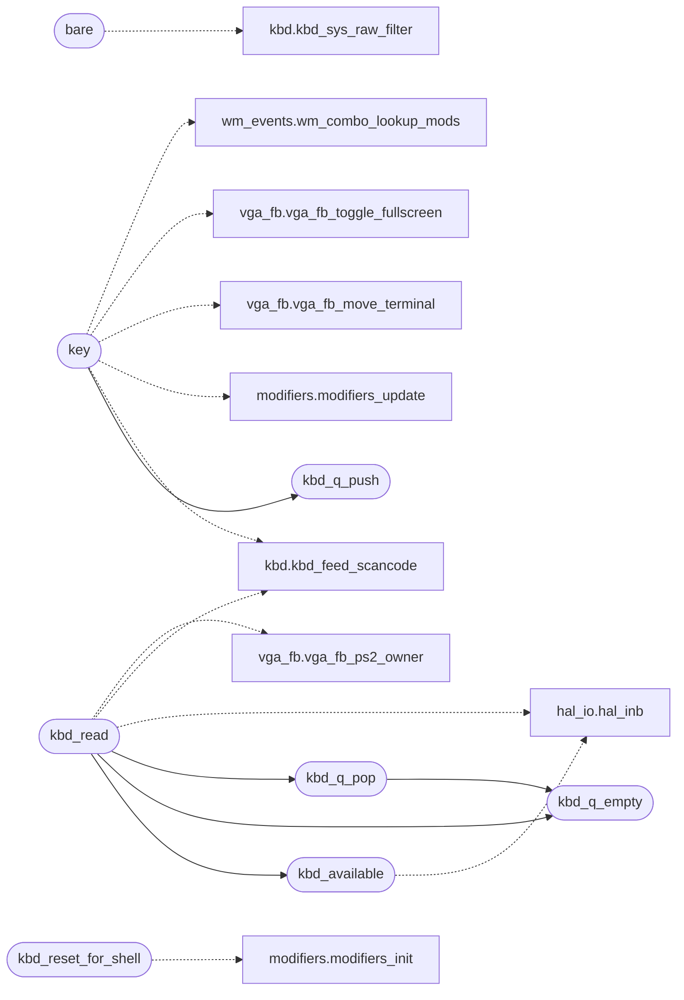

# `drivers/kbd.c`

> Source: [drivers/kbd.c:1](../../drivers/kbd.c#L1) | language `c` | coverage 18.8% | [API index](../index.md)

================================================================

## Contents

- **Functions:** [`kbd_get_layout`](#kbd_get_layout), [`kbd_set_layout`](#kbd_set_layout), [`kbd_toggle_layout`](#kbd_toggle_layout), [`kbd_drop_counts`](#kbd_drop_counts), [`kbd_q_push`](#kbd_q_push), [`kbd_q_empty`](#kbd_q_empty), [`kbd_q_pop`](#kbd_q_pop), [`kbd_available`](#kbd_available), [`kbd_raw_mode_get`](#kbd_raw_mode_get), [`kbd_raw_mode_set`](#kbd_raw_mode_set), [`kbd_raw_empty`](#kbd_raw_empty), [`kbd_raw_pop`](#kbd_raw_pop), [`kbd_raw_push_byte`](#kbd_raw_push_byte), [`kbd_e0_get`](#kbd_e0_get), [`kbd_e0_set`](#kbd_e0_set), [`kbd_flush_all`](#kbd_flush_all), [`kbd_raw_flush`](#kbd_raw_flush), [`paths`](#paths), [`too`](#too), [`bare`](#bare), [`key`](#key), [`kbd_read`](#kbd_read), [`kbd_reset_for_shell`](#kbd_reset_for_shell)
- **Macros:** [`kbd_shift`](#kbd_shift), [`kbd_ctrl`](#kbd_ctrl), [`kbd_alt`](#kbd_alt), [`kbd_super`](#kbd_super), [`kbd_altgr`](#kbd_altgr), [`KBD_QUEUE_LEN`](#kbd_queue_len), [`KBD_SCAN_DEL`](#kbd_scan_del), [`KBD_RAW_LEN`](#kbd_raw_len)

## Call Graph

Solid arrows stay in this module, dashed arrows leave it.



## Functions

<a id="kbd_get_layout"></a>

### `kbd_get_layout`

`function` | [drivers/kbd.c:100](../../drivers/kbd.c#L100)

```c
int kbd_get_layout(void)
```

Layout selection

**Returns:** `int`

> **Inherited:** Documentation from [`kbd_get_layout`](#kbd_get_layout) (headers/drivers/kbd.h:15).

---

<a id="kbd_set_layout"></a>

### `kbd_set_layout`

`function` | [drivers/kbd.c:101](../../drivers/kbd.c#L101)

```c
void kbd_set_layout(int layout)
```

**Parameters**

| Name | Type | Default | Description |
|---|---|---|---|
| `layout` | `int` |  |  |

---

<a id="kbd_toggle_layout"></a>

### `kbd_toggle_layout`

`function` | [drivers/kbd.c:105](../../drivers/kbd.c#L105)

```c
void kbd_toggle_layout(void)
```

---

<a id="kbd_drop_counts"></a>

### `kbd_drop_counts`

`function` | [drivers/kbd.c:132](../../drivers/kbd.c#L132)

```c
void kbd_drop_counts(unsigned long *cooked, unsigned long *raw)
```

Docstring: Report cooked and raw queue drop counters.

**Parameters**

| Name | Type | Default | Description |
|---|---|---|---|
| `cooked` | `unsigned long *` |  |  |
| `raw` | `unsigned long *` |  |  |

---

<a id="kbd_q_push"></a>

### `kbd_q_push`

`function` | [drivers/kbd.c:146](../../drivers/kbd.c#L146)

```c
void kbd_q_push(unsigned char c)
```

**Parameters**

| Name | Type | Default | Description |
|---|---|---|---|
| `c` | `unsigned char` |  |  |

*Called by:* [`key`](#key)

---

<a id="kbd_q_empty"></a>

### `kbd_q_empty`

`function` | [drivers/kbd.c:166](../../drivers/kbd.c#L166)

```c
int kbd_q_empty(void)
```

Translated queue (shell input)

**Returns:** `int`

> **Inherited:** Documentation from [`kbd_q_empty`](#kbd_q_empty) (headers/drivers/kbd.h:27).

*Called by:* [`kbd_q_pop`](#kbd_q_pop), [`kbd_read`](#kbd_read)

---

<a id="kbd_q_pop"></a>

### `kbd_q_pop`

`function` | [drivers/kbd.c:168](../../drivers/kbd.c#L168)

```c
int kbd_q_pop(void)
```

**Returns:** `int`

*Calls:* [`kbd_q_empty`](#kbd_q_empty)

*Called by:* [`kbd_read`](#kbd_read)

---

<a id="kbd_available"></a>

### `kbd_available`

`function` | [drivers/kbd.c:175](../../drivers/kbd.c#L175)

```c
int kbd_available(void)
```

**Returns:** `int`

*Calls:* [`hal_inb`](headers.arch.x86.hal_io.h.md#hal_inb)

*Called by:* [`kbd_read`](#kbd_read)

---

<a id="kbd_raw_mode_get"></a>

### `kbd_raw_mode_get`

`function` | [drivers/kbd.c:181](../../drivers/kbd.c#L181)

```c
int kbd_raw_mode_get(void)
```

Raw queue (DOOM / SYS_KBD)

**Returns:** `int`

> **Inherited:** Documentation from [`kbd_raw_mode_get`](#kbd_raw_mode_get) (headers/drivers/kbd.h:35).

---

<a id="kbd_raw_mode_set"></a>

### `kbd_raw_mode_set`

`function` | [drivers/kbd.c:182](../../drivers/kbd.c#L182)

```c
void kbd_raw_mode_set(int on)
```

**Parameters**

| Name | Type | Default | Description |
|---|---|---|---|
| `on` | `int` |  |  |

---

<a id="kbd_raw_empty"></a>

### `kbd_raw_empty`

`function` | [drivers/kbd.c:183](../../drivers/kbd.c#L183)

```c
int kbd_raw_empty(void)
```

**Returns:** `int`

---

<a id="kbd_raw_pop"></a>

### `kbd_raw_pop`

`function` | [drivers/kbd.c:184](../../drivers/kbd.c#L184)

```c
int kbd_raw_pop(void)
```

**Returns:** `int`

---

<a id="kbd_raw_push_byte"></a>

### `kbd_raw_push_byte`

`function` | [drivers/kbd.c:190](../../drivers/kbd.c#L190)

```c
void kbd_raw_push_byte(unsigned char c)
```

**Parameters**

| Name | Type | Default | Description |
|---|---|---|---|
| `c` | `unsigned char` |  |  |

---

<a id="kbd_e0_get"></a>

### `kbd_e0_get`

`function` | [drivers/kbd.c:191](../../drivers/kbd.c#L191)

```c
int kbd_e0_get(void)
```

**Returns:** `int`

---

<a id="kbd_e0_set"></a>

### `kbd_e0_set`

`function` | [drivers/kbd.c:192](../../drivers/kbd.c#L192)

```c
void kbd_e0_set(int v)
```

**Parameters**

| Name | Type | Default | Description |
|---|---|---|---|
| `v` | `int` |  |  |

---

<a id="kbd_flush_all"></a>

### `kbd_flush_all`

`function` | [drivers/kbd.c:193](../../drivers/kbd.c#L193)

```c
void kbd_flush_all(void)
```

---

<a id="kbd_raw_flush"></a>

### `kbd_raw_flush`

`function` | [drivers/kbd.c:200](../../drivers/kbd.c#L200)

```c
void kbd_raw_flush(void)
```

Drop queued raw scancodes (shell-typed while a terminal owned PS/2) so a newly focused game never replays them as input.

Cooked shell keys stay.

---

<a id="paths"></a>

### `paths`

`function` | [drivers/kbd.c:210](../../drivers/kbd.c#L210)

```c
* keeps the modifier state in sync on both paths (the old raw branch never * tracked Alt/Super, so a modifier held across raw mode stuck forever);
```

**Parameters**

| Name | Type | Default | Description |
|---|---|---|---|
| `Super` | `the old raw branch never * tracked Alt/` |  |  |
| `forever` | `so a modifier held across raw mode stuck` |  |  |

**Returns:** `* keeps the modifier state in sync on both`

---

<a id="too"></a>

### `too`

`function` | [drivers/kbd.c:215](../../drivers/kbd.c#L215)

```c
* too (DOOM strafes with Alt+arrows);
```

**Parameters**

| Name | Type | Default | Description |
|---|---|---|---|
| `arrows` | `DOOM strafes with Alt+` |  |  |

**Returns:** `*`

---

<a id="bare"></a>

### `bare`

`function` | [drivers/kbd.c:297](../../drivers/kbd.c#L297)

```c
* second byte is not a WM combo is delivered bare (keypad alias): games map * both, so play surv...
```

**Parameters**

| Name | Type | Default | Description |
|---|---|---|---|
| `alias` | `keypad` |  |  |

**Returns:** `games map * both, so play surv...`

*Calls:* [`kbd_sys_raw_filter`](headers.drivers.kbd.h.md#kbd_sys_raw_filter)

---

<a id="key"></a>

### `key`

`function` | [drivers/kbd.c:333](../../drivers/kbd.c#L333)

```c
* navigation key (which is pushed to the cooked queue as an escape sequence * instead) or a key ...
```

**Parameters**

| Name | Type | Default | Description |
|---|---|---|---|
| `instead` | `which is pushed to the cooked queue as an escape sequence *` |  |  |

**Returns:** `* navigation`

*Calls:* [`kbd_q_push`](#kbd_q_push), [`kbd_feed_scancode`](headers.drivers.kbd.h.md#kbd_feed_scancode), [`modifiers_update`](headers.drivers.modifiers.h.md#modifiers_update), [`vga_fb_move_terminal`](headers.vga_fb.h.md#vga_fb_move_terminal), [`vga_fb_toggle_fullscreen`](headers.vga_fb.h.md#vga_fb_toggle_fullscreen), [`wm_combo_lookup_mods`](headers.wm_events.h.md#wm_combo_lookup_mods)

---

<a id="kbd_read"></a>

### `kbd_read`

`function` | [drivers/kbd.c:449](../../drivers/kbd.c#L449)

```c
int kbd_read(void)
```

**Returns:** `int`

*Calls:* [`kbd_available`](#kbd_available), [`kbd_q_empty`](#kbd_q_empty), [`kbd_q_pop`](#kbd_q_pop), [`hal_inb`](headers.arch.x86.hal_io.h.md#hal_inb), [`kbd_feed_scancode`](headers.drivers.kbd.h.md#kbd_feed_scancode), [`vga_fb_ps2_owner`](headers.vga_fb.h.md#vga_fb_ps2_owner)

---

<a id="kbd_reset_for_shell"></a>

### `kbd_reset_for_shell`

`function` | [drivers/kbd.c:463](../../drivers/kbd.c#L463)

```c
void kbd_reset_for_shell(void)
```

*Calls:* [`modifiers_init`](headers.drivers.modifiers.h.md#modifiers_init)

---

## Macros

<a id="kbd_shift"></a>

### `kbd_shift`

`macro` | [drivers/kbd.c:115](../../drivers/kbd.c#L115)

```c
#define kbd_shift
```

---

<a id="kbd_ctrl"></a>

### `kbd_ctrl`

`macro` | [drivers/kbd.c:116](../../drivers/kbd.c#L116)

```c
#define kbd_ctrl
```

---

<a id="kbd_alt"></a>

### `kbd_alt`

`macro` | [drivers/kbd.c:117](../../drivers/kbd.c#L117)

```c
#define kbd_alt
```

---

<a id="kbd_super"></a>

### `kbd_super`

`macro` | [drivers/kbd.c:118](../../drivers/kbd.c#L118)

```c
#define kbd_super
```

---

<a id="kbd_altgr"></a>

### `kbd_altgr`

`macro` | [drivers/kbd.c:119](../../drivers/kbd.c#L119)

```c
#define kbd_altgr
```

---

<a id="kbd_queue_len"></a>

### `KBD_QUEUE_LEN`

`macro` | [drivers/kbd.c:121](../../drivers/kbd.c#L121)

```c
#define KBD_QUEUE_LEN
```

---

<a id="kbd_scan_del"></a>

### `KBD_SCAN_DEL`

`macro` | [drivers/kbd.c:122](../../drivers/kbd.c#L122)

```c
#define KBD_SCAN_DEL
```

---

<a id="kbd_raw_len"></a>

### `KBD_RAW_LEN`

`macro` | [drivers/kbd.c:141](../../drivers/kbd.c#L141)

```c
#define KBD_RAW_LEN
```

---
