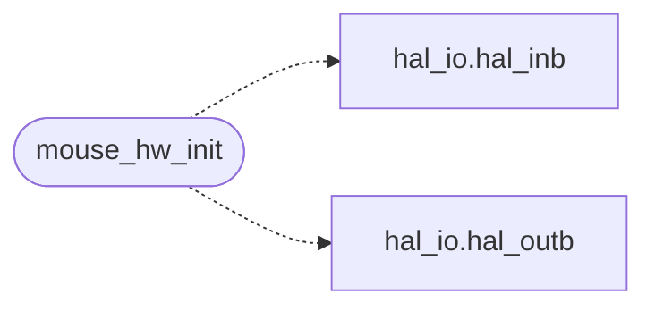

# `drivers/mouse.c`

> Source: [drivers/mouse.c:1](../../drivers/mouse.c#L1) | language `c` | coverage 80.0% | [API index](../index.md)

Docstring: PS/2 mouse device driver (drivers/mouse.c).

## Contents

- **Functions:** [`mouse_hw_init`](#mouse_hw_init), [`wrong`](#wrong), [`mouse_disable`](#mouse_disable), [`mouse_enable`](#mouse_enable)

## Call Graph

Solid arrows stay in this module, dashed arrows leave it.



## Functions

<a id="mouse_hw_init"></a>

### `mouse_hw_init`

`function` | [drivers/mouse.c:36](../../drivers/mouse.c#L36)

```c
void mouse_hw_init(void)
```

Docstring: Detect the wheel mouse and enable data reporting.

> **Inherited:** Documentation from [`mouse_hw_init`](#mouse_hw_init) (headers/drivers/mouse.h:11).

*Calls:* [`hal_inb`](headers.arch.x86.hal_io.h.md#hal_inb), [`hal_outb`](headers.arch.x86.hal_io.h.md#hal_outb)

---

<a id="wrong"></a>

### `wrong`

`function` | [drivers/mouse.c:83](../../drivers/mouse.c#L83)

```c
* later packet is framed wrong (a left press reads back as bit 1, * motion warps), permanently. */ mouse_write(HAL_MOUSE_CMD_RESET);
```

**Parameters**

| Name | Type | Default | Description |
|---|---|---|---|
| `bit` | `a left press reads back as 1` |  |  |
| `warps` | `* motion` |  |  |

**Returns:** `* later packet is framed`

---

<a id="mouse_disable"></a>

### `mouse_disable`

`function` | [drivers/mouse.c:112](../../drivers/mouse.c#L112)

```c
void mouse_disable(void)
```

Docstring: Disable mouse data reporting.

> **Inherited:** Documentation from [`mouse_disable`](#mouse_disable) (headers/drivers/mouse.h:14).

---

<a id="mouse_enable"></a>

### `mouse_enable`

`function` | [drivers/mouse.c:113](../../drivers/mouse.c#L113)

```c
void mouse_enable(void)
```

Docstring: Enable mouse data reporting.

> **Inherited:** Documentation from [`mouse_enable`](#mouse_enable) (headers/drivers/mouse.h:17).

---
