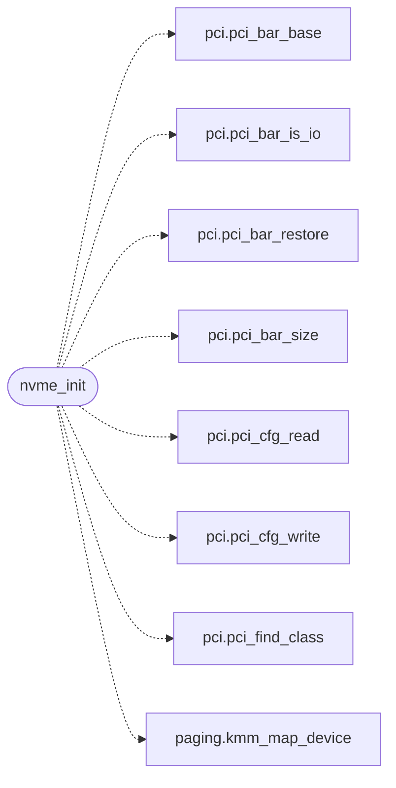

# `drivers/nvme.c`

> Source: [drivers/nvme.c:1](../../drivers/nvme.c#L1) | language `c` | coverage 0.0% | [API index](../index.md)

## Contents

- **Functions:** [`nvme_present`](#nvme_present), [`nvme_version`](#nvme_version), [`nvme_note`](#nvme_note), [`nvme_sectors`](#nvme_sectors), [`nvme_read_sectors`](#nvme_read_sectors), [`nvme_init`](#nvme_init)
- **Macros:** [`NVME_CLASS_BASE`](#nvme_class_base), [`NVME_CLASS_SUB`](#nvme_class_sub), [`NVME_CLASS_PI`](#nvme_class_pi), [`NVME_REG_VS`](#nvme_reg_vs), [`NVME_REG_CAP`](#nvme_reg_cap), [`NVME_REG_CC`](#nvme_reg_cc), [`NVME_REG_CSTS`](#nvme_reg_csts), [`NVME_REG_AQA`](#nvme_reg_aqa), [`NVME_REG_ASQ`](#nvme_reg_asq), [`NVME_REG_ACQ`](#nvme_reg_acq), [`NVME_DB_BASE`](#nvme_db_base), [`NVME_CC_EN`](#nvme_cc_en), [`NVME_CC_IOSQES`](#nvme_cc_iosqes), [`NVME_CC_IOCQES`](#nvme_cc_iocqes), [`NVME_CSTS_RDY`](#nvme_csts_rdy), [`NVME_QSIZE`](#nvme_qsize), [`NVME_SQE_LEN`](#nvme_sqe_len), [`NVME_CQE_LEN`](#nvme_cqe_len), [`NVME_QPAGES`](#nvme_qpages), [`NVME_OPC_CREATE_IOSQ`](#nvme_opc_create_iosq), [`NVME_OPC_READ`](#nvme_opc_read), [`NVME_OPC_CREATE_IOCQ`](#nvme_opc_create_iocq), [`NVME_OPC_IDENTIFY`](#nvme_opc_identify), [`NVME_NSID`](#nvme_nsid), [`NVME_CNS_NS`](#nvme_cns_ns), [`NVME_LBADS_512`](#nvme_lbads_512), [`NVME_MAX_SECTORS`](#nvme_max_sectors), [`NVME_SECTOR`](#nvme_sector), [`NVME_TMO_MS`](#nvme_tmo_ms)

## Call Graph

Solid arrows stay in this module, dashed arrows leave it.



## Functions

<a id="nvme_present"></a>

### `nvme_present`

`function` | [drivers/nvme.c:58](../../drivers/nvme.c#L58)

```c
int nvme_present(void)
```

**Returns:** `int`

---

<a id="nvme_version"></a>

### `nvme_version`

`function` | [drivers/nvme.c:62](../../drivers/nvme.c#L62)

```c
unsigned nvme_version(void)
```

**Returns:** `unsigned`

---

<a id="nvme_note"></a>

### `nvme_note`

`function` `const` | [drivers/nvme.c:66](../../drivers/nvme.c#L66)

```c
const char *nvme_note(void)
```

**Returns:** `char *`

---

<a id="nvme_sectors"></a>

### `nvme_sectors`

`function` | [drivers/nvme.c:286](../../drivers/nvme.c#L286)

```c
unsigned long nvme_sectors(void)
```

**Returns:** `unsigned long`

---

<a id="nvme_read_sectors"></a>

### `nvme_read_sectors`

`function` | [drivers/nvme.c:290](../../drivers/nvme.c#L290)

```c
int nvme_read_sectors(unsigned lba, unsigned count, void *buf)
```

**Parameters**

| Name | Type | Default | Description |
|---|---|---|---|
| `lba` | `unsigned` |  |  |
| `count` | `unsigned` |  |  |
| `buf` | `void *` |  |  |

**Returns:** `int`

---

<a id="nvme_init"></a>

### `nvme_init`

`function` | [drivers/nvme.c:310](../../drivers/nvme.c#L310)

```c
int nvme_init(void)
```

**Returns:** `int`

*Calls:* [`pci_bar_base`](headers.drivers.pci.h.md#pci_bar_base), [`pci_bar_is_io`](headers.drivers.pci.h.md#pci_bar_is_io), [`pci_bar_restore`](headers.drivers.pci.h.md#pci_bar_restore), [`pci_bar_size`](headers.drivers.pci.h.md#pci_bar_size), [`pci_cfg_read`](headers.drivers.pci.h.md#pci_cfg_read), [`pci_cfg_write`](headers.drivers.pci.h.md#pci_cfg_write), [`pci_find_class`](headers.drivers.pci.h.md#pci_find_class), [`kmm_map_device`](kernel.mm.paging.c.md#kmm_map_device)

---

## Macros

<a id="nvme_class_base"></a>

### `NVME_CLASS_BASE`

`macro` | [drivers/nvme.c:6](../../drivers/nvme.c#L6)

```c
#define NVME_CLASS_BASE
```

---

<a id="nvme_class_sub"></a>

### `NVME_CLASS_SUB`

`macro` | [drivers/nvme.c:7](../../drivers/nvme.c#L7)

```c
#define NVME_CLASS_SUB
```

---

<a id="nvme_class_pi"></a>

### `NVME_CLASS_PI`

`macro` | [drivers/nvme.c:8](../../drivers/nvme.c#L8)

```c
#define NVME_CLASS_PI
```

---

<a id="nvme_reg_vs"></a>

### `NVME_REG_VS`

`macro` | [drivers/nvme.c:10](../../drivers/nvme.c#L10)

```c
#define NVME_REG_VS
```

---

<a id="nvme_reg_cap"></a>

### `NVME_REG_CAP`

`macro` | [drivers/nvme.c:11](../../drivers/nvme.c#L11)

```c
#define NVME_REG_CAP
```

---

<a id="nvme_reg_cc"></a>

### `NVME_REG_CC`

`macro` | [drivers/nvme.c:12](../../drivers/nvme.c#L12)

```c
#define NVME_REG_CC
```

---

<a id="nvme_reg_csts"></a>

### `NVME_REG_CSTS`

`macro` | [drivers/nvme.c:13](../../drivers/nvme.c#L13)

```c
#define NVME_REG_CSTS
```

---

<a id="nvme_reg_aqa"></a>

### `NVME_REG_AQA`

`macro` | [drivers/nvme.c:14](../../drivers/nvme.c#L14)

```c
#define NVME_REG_AQA
```

---

<a id="nvme_reg_asq"></a>

### `NVME_REG_ASQ`

`macro` | [drivers/nvme.c:15](../../drivers/nvme.c#L15)

```c
#define NVME_REG_ASQ
```

---

<a id="nvme_reg_acq"></a>

### `NVME_REG_ACQ`

`macro` | [drivers/nvme.c:16](../../drivers/nvme.c#L16)

```c
#define NVME_REG_ACQ
```

---

<a id="nvme_db_base"></a>

### `NVME_DB_BASE`

`macro` | [drivers/nvme.c:17](../../drivers/nvme.c#L17)

```c
#define NVME_DB_BASE
```

---

<a id="nvme_cc_en"></a>

### `NVME_CC_EN`

`macro` | [drivers/nvme.c:19](../../drivers/nvme.c#L19)

```c
#define NVME_CC_EN
```

---

<a id="nvme_cc_iosqes"></a>

### `NVME_CC_IOSQES`

`macro` | [drivers/nvme.c:20](../../drivers/nvme.c#L20)

```c
#define NVME_CC_IOSQES
```

---

<a id="nvme_cc_iocqes"></a>

### `NVME_CC_IOCQES`

`macro` | [drivers/nvme.c:21](../../drivers/nvme.c#L21)

```c
#define NVME_CC_IOCQES
```

---

<a id="nvme_csts_rdy"></a>

### `NVME_CSTS_RDY`

`macro` | [drivers/nvme.c:22](../../drivers/nvme.c#L22)

```c
#define NVME_CSTS_RDY
```

---

<a id="nvme_qsize"></a>

### `NVME_QSIZE`

`macro` | [drivers/nvme.c:24](../../drivers/nvme.c#L24)

```c
#define NVME_QSIZE
```

---

<a id="nvme_sqe_len"></a>

### `NVME_SQE_LEN`

`macro` | [drivers/nvme.c:25](../../drivers/nvme.c#L25)

```c
#define NVME_SQE_LEN
```

---

<a id="nvme_cqe_len"></a>

### `NVME_CQE_LEN`

`macro` | [drivers/nvme.c:26](../../drivers/nvme.c#L26)

```c
#define NVME_CQE_LEN
```

---

<a id="nvme_qpages"></a>

### `NVME_QPAGES`

`macro` | [drivers/nvme.c:27](../../drivers/nvme.c#L27)

```c
#define NVME_QPAGES
```

---

<a id="nvme_opc_create_iosq"></a>

### `NVME_OPC_CREATE_IOSQ`

`macro` | [drivers/nvme.c:29](../../drivers/nvme.c#L29)

```c
#define NVME_OPC_CREATE_IOSQ
```

---

<a id="nvme_opc_read"></a>

### `NVME_OPC_READ`

`macro` | [drivers/nvme.c:30](../../drivers/nvme.c#L30)

```c
#define NVME_OPC_READ
```

---

<a id="nvme_opc_create_iocq"></a>

### `NVME_OPC_CREATE_IOCQ`

`macro` | [drivers/nvme.c:31](../../drivers/nvme.c#L31)

```c
#define NVME_OPC_CREATE_IOCQ
```

---

<a id="nvme_opc_identify"></a>

### `NVME_OPC_IDENTIFY`

`macro` | [drivers/nvme.c:32](../../drivers/nvme.c#L32)

```c
#define NVME_OPC_IDENTIFY
```

---

<a id="nvme_nsid"></a>

### `NVME_NSID`

`macro` | [drivers/nvme.c:33](../../drivers/nvme.c#L33)

```c
#define NVME_NSID
```

---

<a id="nvme_cns_ns"></a>

### `NVME_CNS_NS`

`macro` | [drivers/nvme.c:34](../../drivers/nvme.c#L34)

```c
#define NVME_CNS_NS
```

---

<a id="nvme_lbads_512"></a>

### `NVME_LBADS_512`

`macro` | [drivers/nvme.c:35](../../drivers/nvme.c#L35)

```c
#define NVME_LBADS_512
```

---

<a id="nvme_max_sectors"></a>

### `NVME_MAX_SECTORS`

`macro` | [drivers/nvme.c:37](../../drivers/nvme.c#L37)

```c
#define NVME_MAX_SECTORS
```

---

<a id="nvme_sector"></a>

### `NVME_SECTOR`

`macro` | [drivers/nvme.c:38](../../drivers/nvme.c#L38)

```c
#define NVME_SECTOR
```

---

<a id="nvme_tmo_ms"></a>

### `NVME_TMO_MS`

`macro` | [drivers/nvme.c:39](../../drivers/nvme.c#L39)

```c
#define NVME_TMO_MS
```

---
