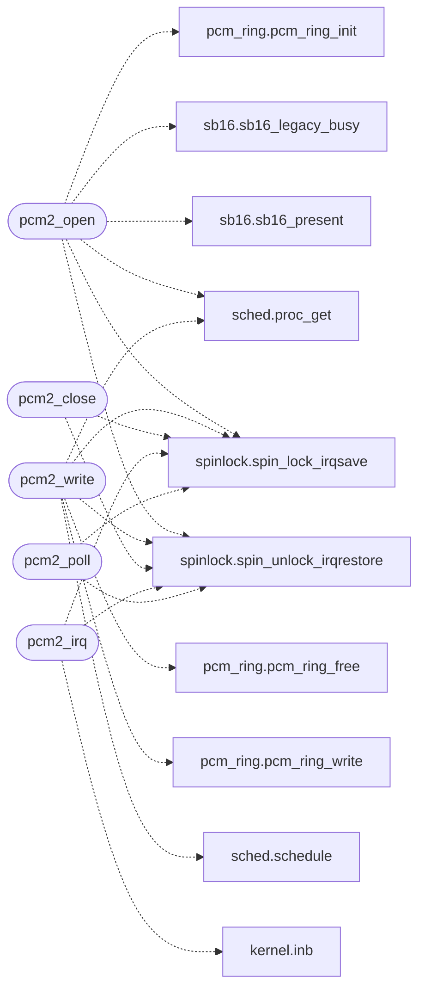

# `drivers/pcm2.c`

> Source: [drivers/pcm2.c:1](../../drivers/pcm2.c#L1) | language `c` | coverage 8.8% | [API index](../index.md)

drivers/pcm2.c -- low-latency PCM audio over SB16 single-cycle DMA.

## Contents

- **Functions:** [`loop`](#loop), [`pcm2_active`](#pcm2_active), [`pcm2_open`](#pcm2_open), [`pcm2_write`](#pcm2_write), [`pcm2_close`](#pcm2_close), [`pcm2_irq`](#pcm2_irq), [`pcm2_poll`](#pcm2_poll), [`pcm2_counters`](#pcm2_counters)
- **Macros:** [`PCM2_BASE_PORT`](#pcm2_base_port), [`PCM2_DSP_RESET`](#pcm2_dsp_reset), [`PCM2_DSP_WRITE_DATA`](#pcm2_dsp_write_data), [`PCM2_DSP_STATUS`](#pcm2_dsp_status), [`PCM2_IRQ_ACK`](#pcm2_irq_ack), [`PCM2_CMD_SET_FREQ`](#pcm2_cmd_set_freq), [`PCM2_CMD_SPK_ON`](#pcm2_cmd_spk_on), [`PCM2_CMD_PLAY8`](#pcm2_cmd_play8), [`PCM2_CMD_STOP_NOW`](#pcm2_cmd_stop_now), [`PCM2_DMA_MODE_PORT`](#pcm2_dma_mode_port), [`PCM2_DMA_CH1_SINGLE`](#pcm2_dma_ch1_single), [`PCM2_DMA_CH1_ADDR`](#pcm2_dma_ch1_addr), [`PCM2_DMA_CH1_CNT`](#pcm2_dma_ch1_cnt), [`PCM2_DMA_CH1_PAGE`](#pcm2_dma_ch1_page), [`PCM2_DMA_MASK`](#pcm2_dma_mask), [`PCM2_DMA_FF_CLR`](#pcm2_dma_ff_clr), [`PCM2_DMA_CH1_MASK`](#pcm2_dma_ch1_mask), [`PCM2_DMA_CH1_UNMASK`](#pcm2_dma_ch1_unmask), [`PCM2_DMA_ADDR`](#pcm2_dma_addr), [`PCM2_DMA_COUNT`](#pcm2_dma_count), [`PCM2_READY_MASK`](#pcm2_ready_mask), [`PCM2_PROBE_WAIT`](#pcm2_probe_wait), [`PCM2_SILENCE`](#pcm2_silence), [`PCM2_BLOCK_MS`](#pcm2_block_ms), [`PCM2_BLOCK_SLACK_MS`](#pcm2_block_slack_ms)

## Call Graph

Solid arrows stay in this module, dashed arrows leave it.



## Functions

<a id="loop"></a>

### `loop`

`function` | [drivers/pcm2.c:150](../../drivers/pcm2.c#L150)

```c
* loop (the auto-init livelock is structurally impossible here). The IRQ * path rejects a stray ...
```

**Parameters**

| Name | Type | Default | Description |
|---|---|---|---|
| `here` | `the auto-init livelock is structurally impossible` |  |  |

**Returns:** `*`

---

<a id="pcm2_active"></a>

### `pcm2_active`

`function` | [drivers/pcm2.c:179](../../drivers/pcm2.c#L179)

```c
int pcm2_active(void)
```

**Returns:** `int`

---

<a id="pcm2_open"></a>

### `pcm2_open`

`function` | [drivers/pcm2.c:183](../../drivers/pcm2.c#L183)

```c
int pcm2_open(unsigned flags, int owner)
```

**Parameters**

| Name | Type | Default | Description |
|---|---|---|---|
| `flags` | `unsigned` |  |  |
| `owner` | `int` |  |  |

**Returns:** `int`

*Calls:* [`pcm_ring_init`](headers.pcm_ring.h.md#pcm_ring_init), [`sb16_legacy_busy`](headers.sb16.h.md#sb16_legacy_busy), [`sb16_present`](headers.sb16.h.md#sb16_present), [`proc_get`](headers.sched.h.md#proc_get), [`spin_lock_irqsave`](headers.spinlock.h.md#spin_lock_irqsave), [`spin_unlock_irqrestore`](headers.spinlock.h.md#spin_unlock_irqrestore)

---

<a id="pcm2_write"></a>

### `pcm2_write`

`function` | [drivers/pcm2.c:235](../../drivers/pcm2.c#L235)

```c
int pcm2_write(const unsigned char *user, unsigned len, int owner)
```

**Parameters**

| Name | Type | Default | Description |
|---|---|---|---|
| `user` | `unsigned char *` |  |  |
| `len` | `unsigned` |  |  |
| `owner` | `int` |  |  |

**Returns:** `int`

*Calls:* [`pcm_ring_free`](headers.pcm_ring.h.md#pcm_ring_free), [`pcm_ring_write`](headers.pcm_ring.h.md#pcm_ring_write), [`proc_get`](headers.sched.h.md#proc_get), [`schedule`](headers.sched.h.md#schedule), [`spin_lock_irqsave`](headers.spinlock.h.md#spin_lock_irqsave), [`spin_unlock_irqrestore`](headers.spinlock.h.md#spin_unlock_irqrestore)

---

<a id="pcm2_close"></a>

### `pcm2_close`

`function` | [drivers/pcm2.c:282](../../drivers/pcm2.c#L282)

```c
void pcm2_close(int owner)
```

**Parameters**

| Name | Type | Default | Description |
|---|---|---|---|
| `owner` | `int` |  |  |

*Calls:* [`spin_lock_irqsave`](headers.spinlock.h.md#spin_lock_irqsave), [`spin_unlock_irqrestore`](headers.spinlock.h.md#spin_unlock_irqrestore)

---

<a id="pcm2_irq"></a>

### `pcm2_irq`

`function` | [drivers/pcm2.c:293](../../drivers/pcm2.c#L293)

```c
void pcm2_irq(void)
```

*Calls:* [`inb`](headers.kernel.h.md#inb), [`spin_lock_irqsave`](headers.spinlock.h.md#spin_lock_irqsave), [`spin_unlock_irqrestore`](headers.spinlock.h.md#spin_unlock_irqrestore)

---

<a id="pcm2_poll"></a>

### `pcm2_poll`

`function` | [drivers/pcm2.c:306](../../drivers/pcm2.c#L306)

```c
void pcm2_poll(void)
```

*Calls:* [`spin_lock_irqsave`](headers.spinlock.h.md#spin_lock_irqsave), [`spin_unlock_irqrestore`](headers.spinlock.h.md#spin_unlock_irqrestore)

---

<a id="pcm2_counters"></a>

### `pcm2_counters`

`function` | [drivers/pcm2.c:318](../../drivers/pcm2.c#L318)

```c
void pcm2_counters(pcm2_counters_t *out)
```

**Parameters**

| Name | Type | Default | Description |
|---|---|---|---|
| `out` | `pcm2_counters_t *` |  |  |

---

## Macros

<a id="pcm2_base_port"></a>

### `PCM2_BASE_PORT`

`macro` | [drivers/pcm2.c:26](../../drivers/pcm2.c#L26)

```c
#define PCM2_BASE_PORT
```

---

<a id="pcm2_dsp_reset"></a>

### `PCM2_DSP_RESET`

`macro` | [drivers/pcm2.c:27](../../drivers/pcm2.c#L27)

```c
#define PCM2_DSP_RESET
```

---

<a id="pcm2_dsp_write_data"></a>

### `PCM2_DSP_WRITE_DATA`

`macro` | [drivers/pcm2.c:28](../../drivers/pcm2.c#L28)

```c
#define PCM2_DSP_WRITE_DATA
```

---

<a id="pcm2_dsp_status"></a>

### `PCM2_DSP_STATUS`

`macro` | [drivers/pcm2.c:29](../../drivers/pcm2.c#L29)

```c
#define PCM2_DSP_STATUS
```

---

<a id="pcm2_irq_ack"></a>

### `PCM2_IRQ_ACK`

`macro` | [drivers/pcm2.c:30](../../drivers/pcm2.c#L30)

```c
#define PCM2_IRQ_ACK
```

---

<a id="pcm2_cmd_set_freq"></a>

### `PCM2_CMD_SET_FREQ`

`macro` | [drivers/pcm2.c:32](../../drivers/pcm2.c#L32)

```c
#define PCM2_CMD_SET_FREQ
```

---

<a id="pcm2_cmd_spk_on"></a>

### `PCM2_CMD_SPK_ON`

`macro` | [drivers/pcm2.c:33](../../drivers/pcm2.c#L33)

```c
#define PCM2_CMD_SPK_ON
```

---

<a id="pcm2_cmd_play8"></a>

### `PCM2_CMD_PLAY8`

`macro` | [drivers/pcm2.c:34](../../drivers/pcm2.c#L34)

```c
#define PCM2_CMD_PLAY8
```

---

<a id="pcm2_cmd_stop_now"></a>

### `PCM2_CMD_STOP_NOW`

`macro` | [drivers/pcm2.c:35](../../drivers/pcm2.c#L35)

```c
#define PCM2_CMD_STOP_NOW
```

---

<a id="pcm2_dma_mode_port"></a>

### `PCM2_DMA_MODE_PORT`

`macro` | [drivers/pcm2.c:42](../../drivers/pcm2.c#L42)

```c
#define PCM2_DMA_MODE_PORT
```

Single-cycle DMA, the same sequence the legacy engine has proven under QEMU: auto-init DMA holds the ISA DMA engine busy in emulation and wedges the IDE PIO path, so each 512-byte block is armed on its own and re-armed from the terminal-count IRQ (prompt, gapless) with the timer poll as the null-backend fallback (ktime_ms elapsed).

---

<a id="pcm2_dma_ch1_single"></a>

### `PCM2_DMA_CH1_SINGLE`

`macro` | [drivers/pcm2.c:43](../../drivers/pcm2.c#L43)

```c
#define PCM2_DMA_CH1_SINGLE
```

---

<a id="pcm2_dma_ch1_addr"></a>

### `PCM2_DMA_CH1_ADDR`

`macro` | [drivers/pcm2.c:44](../../drivers/pcm2.c#L44)

```c
#define PCM2_DMA_CH1_ADDR
```

---

<a id="pcm2_dma_ch1_cnt"></a>

### `PCM2_DMA_CH1_CNT`

`macro` | [drivers/pcm2.c:45](../../drivers/pcm2.c#L45)

```c
#define PCM2_DMA_CH1_CNT
```

---

<a id="pcm2_dma_ch1_page"></a>

### `PCM2_DMA_CH1_PAGE`

`macro` | [drivers/pcm2.c:46](../../drivers/pcm2.c#L46)

```c
#define PCM2_DMA_CH1_PAGE
```

---

<a id="pcm2_dma_mask"></a>

### `PCM2_DMA_MASK`

`macro` | [drivers/pcm2.c:47](../../drivers/pcm2.c#L47)

```c
#define PCM2_DMA_MASK
```

---

<a id="pcm2_dma_ff_clr"></a>

### `PCM2_DMA_FF_CLR`

`macro` | [drivers/pcm2.c:48](../../drivers/pcm2.c#L48)

```c
#define PCM2_DMA_FF_CLR
```

---

<a id="pcm2_dma_ch1_mask"></a>

### `PCM2_DMA_CH1_MASK`

`macro` | [drivers/pcm2.c:49](../../drivers/pcm2.c#L49)

```c
#define PCM2_DMA_CH1_MASK
```

---

<a id="pcm2_dma_ch1_unmask"></a>

### `PCM2_DMA_CH1_UNMASK`

`macro` | [drivers/pcm2.c:50](../../drivers/pcm2.c#L50)

```c
#define PCM2_DMA_CH1_UNMASK
```

---

<a id="pcm2_dma_addr"></a>

### `PCM2_DMA_ADDR`

`macro` | [drivers/pcm2.c:52](../../drivers/pcm2.c#L52)

```c
#define PCM2_DMA_ADDR
```

---

<a id="pcm2_dma_count"></a>

### `PCM2_DMA_COUNT`

`macro` | [drivers/pcm2.c:53](../../drivers/pcm2.c#L53)

```c
#define PCM2_DMA_COUNT
```

---

<a id="pcm2_ready_mask"></a>

### `PCM2_READY_MASK`

`macro` | [drivers/pcm2.c:54](../../drivers/pcm2.c#L54)

```c
#define PCM2_READY_MASK
```

---

<a id="pcm2_probe_wait"></a>

### `PCM2_PROBE_WAIT`

`macro` | [drivers/pcm2.c:55](../../drivers/pcm2.c#L55)

```c
#define PCM2_PROBE_WAIT
```

---

<a id="pcm2_silence"></a>

### `PCM2_SILENCE`

`macro` | [drivers/pcm2.c:56](../../drivers/pcm2.c#L56)

```c
#define PCM2_SILENCE
```

---

<a id="pcm2_block_ms"></a>

### `PCM2_BLOCK_MS`

`macro` | [drivers/pcm2.c:59](../../drivers/pcm2.c#L59)

```c
#define PCM2_BLOCK_MS
```

One armed block plays for this long.

Ceil so an early completion can never cut the tail; the IRQ path re-arms at the true terminal count.

---

<a id="pcm2_block_slack_ms"></a>

### `PCM2_BLOCK_SLACK_MS`

`macro` | [drivers/pcm2.c:60](../../drivers/pcm2.c#L60)

```c
#define PCM2_BLOCK_SLACK_MS
```

---
