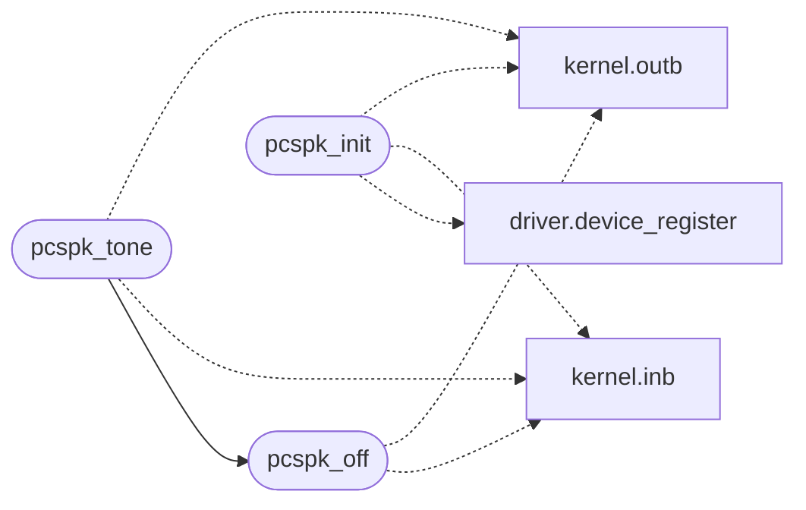

# `drivers/pcspk.c`

> Source: [drivers/pcspk.c:1](../../drivers/pcspk.c#L1) | language `c` | coverage 13.3% | [API index](../index.md)

PC speaker driver with a software master volume.

The speaker has no

## Contents

- **Functions:** [`pcspk_init`](#pcspk_init), [`pcspk_set_volume`](#pcspk_set_volume), [`pcspk_get_volume`](#pcspk_get_volume), [`pcspk_tone`](#pcspk_tone), [`pcspk_off`](#pcspk_off)
- **Macros:** [`PIT_CH2_DATA`](#pit_ch2_data), [`PIT_CH2_CMD`](#pit_ch2_cmd), [`SPEAKER_PORT`](#speaker_port), [`PIT_FREQ`](#pit_freq), [`PCSPK_MIN_FREQ`](#pcspk_min_freq), [`PCSPK_MAX_FREQ`](#pcspk_max_freq), [`SPEAKER_DATA_BIT`](#speaker_data_bit), [`SPEAKER_GATE_BIT`](#speaker_gate_bit), [`SPEAKER_ENABLE_BITS`](#speaker_enable_bits)

## Call Graph

Solid arrows stay in this module, dashed arrows leave it.



## Functions

<a id="pcspk_init"></a>

### `pcspk_init`

`function` | [drivers/pcspk.c:72](../../drivers/pcspk.c#L72)

```c
void pcspk_init(void)
```

========== PC speaker ==========

> **Inherited:** Documentation from [`pcspk_init`](#pcspk_init) (headers/kernel.h:921).

*Calls:* [`device_register`](headers.driver.h.md#device_register), [`inb`](headers.kernel.h.md#inb), [`outb`](headers.kernel.h.md#outb)

---

<a id="pcspk_set_volume"></a>

### `pcspk_set_volume`

`function` | [drivers/pcspk.c:78](../../drivers/pcspk.c#L78)

```c
void pcspk_set_volume(unsigned volume)
```

**Parameters**

| Name | Type | Default | Description |
|---|---|---|---|
| `volume` | `unsigned` |  |  |

---

<a id="pcspk_get_volume"></a>

### `pcspk_get_volume`

`function` | [drivers/pcspk.c:82](../../drivers/pcspk.c#L82)

```c
unsigned pcspk_get_volume(void)
```

**Returns:** `unsigned`

---

<a id="pcspk_tone"></a>

### `pcspk_tone`

`function` | [drivers/pcspk.c:86](../../drivers/pcspk.c#L86)

```c
void pcspk_tone(unsigned freq)
```

**Parameters**

| Name | Type | Default | Description |
|---|---|---|---|
| `freq` | `unsigned` |  |  |

*Calls:* [`pcspk_off`](#pcspk_off), [`inb`](headers.kernel.h.md#inb), [`outb`](headers.kernel.h.md#outb)

---

<a id="pcspk_off"></a>

### `pcspk_off`

`function` | [drivers/pcspk.c:104](../../drivers/pcspk.c#L104)

```c
void pcspk_off(void)
```

*Calls:* [`inb`](headers.kernel.h.md#inb), [`outb`](headers.kernel.h.md#outb)

*Called by:* [`pcspk_tone`](#pcspk_tone)

---

## Macros

<a id="pit_ch2_data"></a>

### `PIT_CH2_DATA`

`macro` | [drivers/pcspk.c:14](../../drivers/pcspk.c#L14)

```c
#define PIT_CH2_DATA
```

---

<a id="pit_ch2_cmd"></a>

### `PIT_CH2_CMD`

`macro` | [drivers/pcspk.c:15](../../drivers/pcspk.c#L15)

```c
#define PIT_CH2_CMD
```

---

<a id="speaker_port"></a>

### `SPEAKER_PORT`

`macro` | [drivers/pcspk.c:16](../../drivers/pcspk.c#L16)

```c
#define SPEAKER_PORT
```

---

<a id="pit_freq"></a>

### `PIT_FREQ`

`macro` | [drivers/pcspk.c:17](../../drivers/pcspk.c#L17)

```c
#define PIT_FREQ
```

---

<a id="pcspk_min_freq"></a>

### `PCSPK_MIN_FREQ`

`macro` | [drivers/pcspk.c:19](../../drivers/pcspk.c#L19)

```c
#define PCSPK_MIN_FREQ
```

---

<a id="pcspk_max_freq"></a>

### `PCSPK_MAX_FREQ`

`macro` | [drivers/pcspk.c:20](../../drivers/pcspk.c#L20)

```c
#define PCSPK_MAX_FREQ
```

---

<a id="speaker_data_bit"></a>

### `SPEAKER_DATA_BIT`

`macro` | [drivers/pcspk.c:22](../../drivers/pcspk.c#L22)

```c
#define SPEAKER_DATA_BIT
```

---

<a id="speaker_gate_bit"></a>

### `SPEAKER_GATE_BIT`

`macro` | [drivers/pcspk.c:23](../../drivers/pcspk.c#L23)

```c
#define SPEAKER_GATE_BIT
```

---

<a id="speaker_enable_bits"></a>

### `SPEAKER_ENABLE_BITS`

`macro` | [drivers/pcspk.c:24](../../drivers/pcspk.c#L24)

```c
#define SPEAKER_ENABLE_BITS
```

---
