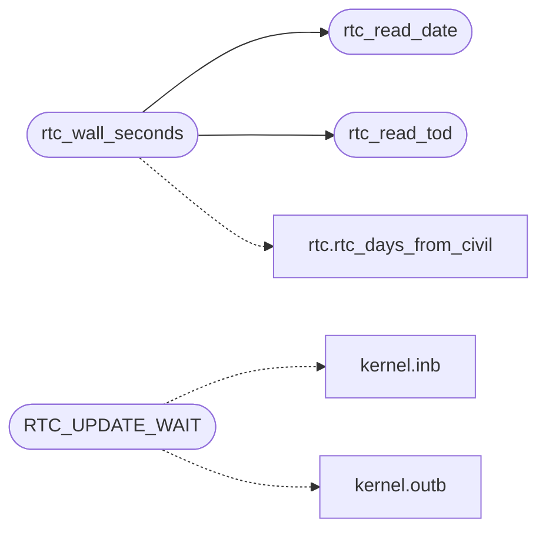

# `drivers/rtc.c`

> Source: [drivers/rtc.c:1](../../drivers/rtc.c#L1) | language `c` | coverage 21.7% | [API index](../index.md)

CMOS RTC time-of-day reader.

The desktop clock and the shell `date` builtin

## Contents

- **Functions:** [`rtc_read_tod`](#rtc_read_tod), [`rtc_read_date`](#rtc_read_date), [`rtc_wall_seconds`](#rtc_wall_seconds)
- **Macros:** [`RTC_CMOS_ADDR`](#rtc_cmos_addr), [`RTC_CMOS_DATA`](#rtc_cmos_data), [`RTC_REG_SEC`](#rtc_reg_sec), [`RTC_REG_MIN`](#rtc_reg_min), [`RTC_REG_HOUR`](#rtc_reg_hour), [`RTC_REG_DAY`](#rtc_reg_day), [`RTC_REG_MON`](#rtc_reg_mon), [`RTC_REG_YEAR`](#rtc_reg_year), [`RTC_REG_STATUS_A`](#rtc_reg_status_a), [`RTC_REG_STATUS_B`](#rtc_reg_status_b), [`RTC_UPDATE_IN_PROGRESS`](#rtc_update_in_progress), [`RTC_BCD_FLAG`](#rtc_bcd_flag), [`RTC_HOUR_MIN`](#rtc_hour_min), [`RTC_HOUR_MAX`](#rtc_hour_max), [`RTC_MIN_MIN`](#rtc_min_min), [`RTC_MIN_MAX`](#rtc_min_max), [`RTC_SEC_MIN`](#rtc_sec_min), [`RTC_SEC_MAX`](#rtc_sec_max), [`RTC_UPDATE_WAIT`](#rtc_update_wait)

## Call Graph

Solid arrows stay in this module, dashed arrows leave it.



## Functions

<a id="rtc_read_tod"></a>

### `rtc_read_tod`

`function` | [drivers/rtc.c:44](../../drivers/rtc.c#L44)

```c
int rtc_read_tod(int *hour, int *min, int *sec)
```

========== RTC time-of-day ==========

**Parameters**

| Name | Type | Default | Description |
|---|---|---|---|
| `hour` | `int *` |  |  |
| `min` | `int *` |  |  |
| `sec` | `int *` |  |  |

**Returns:** `int`

> **Inherited:** Documentation from [`rtc_read_tod`](#rtc_read_tod) (headers/kernel.h:928).

*Called by:* [`rtc_wall_seconds`](#rtc_wall_seconds)

---

<a id="rtc_read_date"></a>

### `rtc_read_date`

`function` | [drivers/rtc.c:78](../../drivers/rtc.c#L78)

```c
int rtc_read_date(int *year, int *mon, int *day)
```

Calendar date from the CMOS RTC (registers 0x07-0x09).

Full year (CMOS carries two digits; 0..99 maps to 2000..2099). Fail-closed like the time reader: impossible month/day (including Feb 29 on a non-leap year) or a clock that never stops updating returns 0 and writes nothing.

**Parameters**

| Name | Type | Default | Description |
|---|---|---|---|
| `year` | `int *` |  |  |
| `mon` | `int *` |  |  |
| `day` | `int *` |  |  |

**Returns:** `int`

> **Inherited:** Documentation from [`rtc_read_date`](#rtc_read_date) (headers/rtc.h:11).

*Called by:* [`rtc_wall_seconds`](#rtc_wall_seconds)

---

<a id="rtc_wall_seconds"></a>

### `rtc_wall_seconds`

`function` | [drivers/rtc.c:102](../../drivers/rtc.c#L102)

```c
int rtc_wall_seconds(unsigned long *out)
```

Wall-clock seconds since the Unix epoch from one RTC snapshot.

Returns 1 and stores the value, or 0 on any RTC failure (caller decides the fallback; TLS treats 0 as "no clock" and fails the chain check closed downstream).

**Parameters**

| Name | Type | Default | Description |
|---|---|---|---|
| `out` | `unsigned long *` |  |  |

**Returns:** `int`

> **Inherited:** Documentation from [`rtc_wall_seconds`](#rtc_wall_seconds) (headers/rtc.h:33).

*Calls:* [`rtc_read_date`](#rtc_read_date), [`rtc_read_tod`](#rtc_read_tod), [`rtc_days_from_civil`](headers.rtc.h.md#rtc_days_from_civil)

---

## Macros

<a id="rtc_cmos_addr"></a>

### `RTC_CMOS_ADDR`

`macro` | [drivers/rtc.c:9](../../drivers/rtc.c#L9)

```c
#define RTC_CMOS_ADDR
```

---

<a id="rtc_cmos_data"></a>

### `RTC_CMOS_DATA`

`macro` | [drivers/rtc.c:10](../../drivers/rtc.c#L10)

```c
#define RTC_CMOS_DATA
```

---

<a id="rtc_reg_sec"></a>

### `RTC_REG_SEC`

`macro` | [drivers/rtc.c:12](../../drivers/rtc.c#L12)

```c
#define RTC_REG_SEC
```

---

<a id="rtc_reg_min"></a>

### `RTC_REG_MIN`

`macro` | [drivers/rtc.c:13](../../drivers/rtc.c#L13)

```c
#define RTC_REG_MIN
```

---

<a id="rtc_reg_hour"></a>

### `RTC_REG_HOUR`

`macro` | [drivers/rtc.c:14](../../drivers/rtc.c#L14)

```c
#define RTC_REG_HOUR
```

---

<a id="rtc_reg_day"></a>

### `RTC_REG_DAY`

`macro` | [drivers/rtc.c:15](../../drivers/rtc.c#L15)

```c
#define RTC_REG_DAY
```

---

<a id="rtc_reg_mon"></a>

### `RTC_REG_MON`

`macro` | [drivers/rtc.c:16](../../drivers/rtc.c#L16)

```c
#define RTC_REG_MON
```

---

<a id="rtc_reg_year"></a>

### `RTC_REG_YEAR`

`macro` | [drivers/rtc.c:17](../../drivers/rtc.c#L17)

```c
#define RTC_REG_YEAR
```

---

<a id="rtc_reg_status_a"></a>

### `RTC_REG_STATUS_A`

`macro` | [drivers/rtc.c:18](../../drivers/rtc.c#L18)

```c
#define RTC_REG_STATUS_A
```

---

<a id="rtc_reg_status_b"></a>

### `RTC_REG_STATUS_B`

`macro` | [drivers/rtc.c:19](../../drivers/rtc.c#L19)

```c
#define RTC_REG_STATUS_B
```

---

<a id="rtc_update_in_progress"></a>

### `RTC_UPDATE_IN_PROGRESS`

`macro` | [drivers/rtc.c:21](../../drivers/rtc.c#L21)

```c
#define RTC_UPDATE_IN_PROGRESS
```

---

<a id="rtc_bcd_flag"></a>

### `RTC_BCD_FLAG`

`macro` | [drivers/rtc.c:22](../../drivers/rtc.c#L22)

```c
#define RTC_BCD_FLAG
```

---

<a id="rtc_hour_min"></a>

### `RTC_HOUR_MIN`

`macro` | [drivers/rtc.c:24](../../drivers/rtc.c#L24)

```c
#define RTC_HOUR_MIN
```

---

<a id="rtc_hour_max"></a>

### `RTC_HOUR_MAX`

`macro` | [drivers/rtc.c:25](../../drivers/rtc.c#L25)

```c
#define RTC_HOUR_MAX
```

---

<a id="rtc_min_min"></a>

### `RTC_MIN_MIN`

`macro` | [drivers/rtc.c:26](../../drivers/rtc.c#L26)

```c
#define RTC_MIN_MIN
```

---

<a id="rtc_min_max"></a>

### `RTC_MIN_MAX`

`macro` | [drivers/rtc.c:27](../../drivers/rtc.c#L27)

```c
#define RTC_MIN_MAX
```

---

<a id="rtc_sec_min"></a>

### `RTC_SEC_MIN`

`macro` | [drivers/rtc.c:28](../../drivers/rtc.c#L28)

```c
#define RTC_SEC_MIN
```

---

<a id="rtc_sec_max"></a>

### `RTC_SEC_MAX`

`macro` | [drivers/rtc.c:29](../../drivers/rtc.c#L29)

```c
#define RTC_SEC_MAX
```

---

<a id="rtc_update_wait"></a>

### `RTC_UPDATE_WAIT`

`macro` | [drivers/rtc.c:33](../../drivers/rtc.c#L33)

```c
#define RTC_UPDATE_WAIT
```

The RTC reports a time-of-day that is mid-update; waiting out this flag before reading the three fields makes the snapshot consistent.

*Calls:* [`inb`](headers.kernel.h.md#inb), [`outb`](headers.kernel.h.md#outb)

---
