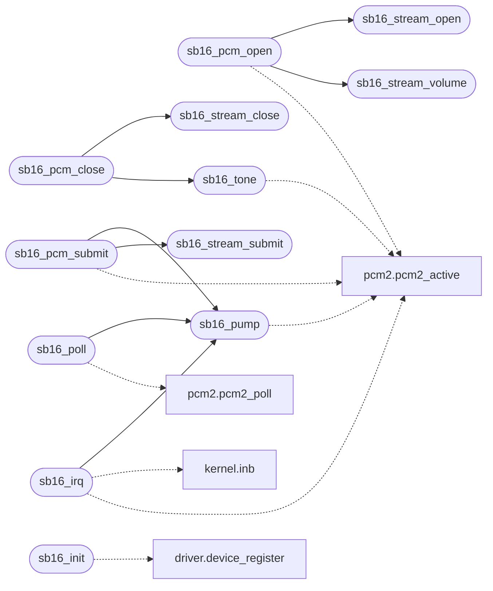

# `drivers/sb16.c`

> Source: [drivers/sb16.c:1](../../drivers/sb16.c#L1) | language `c` | coverage 9.8% | [API index](../index.md)

Sound Blaster 16 DMA audio driver.

## Contents

- **Functions:** [`IRQ`](#irq), [`sb16_stream_open`](#sb16_stream_open), [`sb16_stream_close`](#sb16_stream_close), [`sb16_stream_submit`](#sb16_stream_submit), [`sb16_stream_volume`](#sb16_stream_volume), [`sb16_stream_count`](#sb16_stream_count), [`sb16_pump`](#sb16_pump), [`sb16_present`](#sb16_present), [`sb16_tone`](#sb16_tone), [`sb16_pcm_open`](#sb16_pcm_open), [`sb16_pcm_close`](#sb16_pcm_close), [`sb16_pcm_submit`](#sb16_pcm_submit), [`sb16_irq`](#sb16_irq), [`sb16_poll`](#sb16_poll), [`sb16_ring_free`](#sb16_ring_free), [`sb16_mode_active`](#sb16_mode_active), [`sb16_legacy_busy`](#sb16_legacy_busy), [`sb16_counters`](#sb16_counters), [`sb16_init`](#sb16_init), [`pending`](#pending)
- **Macros:** [`SB16_BASE_PORT`](#sb16_base_port), [`SB16_DSP_RESET`](#sb16_dsp_reset), [`SB16_DSP_READ_DATA`](#sb16_dsp_read_data), [`SB16_DSP_WRITE_DATA`](#sb16_dsp_write_data), [`SB16_DSP_STATUS`](#sb16_dsp_status), [`SB16_IRQ_ACK`](#sb16_irq_ack), [`SB16_CMD_READ_VER`](#sb16_cmd_read_ver), [`SB16_CMD_SET_FREQ`](#sb16_cmd_set_freq), [`SB16_CMD_PLAY8`](#sb16_cmd_play8), [`SB16_CMD_SPK_ON`](#sb16_cmd_spk_on), [`SB16_CMD_SPK_OFF`](#sb16_cmd_spk_off), [`SB16_DSP_RDSTATUS`](#sb16_dsp_rdstatus), [`DMA_MODE_PORT`](#dma_mode_port), [`DMA_CH1_SINGLE_READ`](#dma_ch1_single_read), [`SB16_FREQ_LO`](#sb16_freq_lo), [`SB16_FREQ_HI`](#sb16_freq_hi), [`SB16_DSP_READY_MASK`](#sb16_dsp_ready_mask), [`DMA_CH1_ADDR`](#dma_ch1_addr), [`DMA_CH1_CNT`](#dma_ch1_cnt), [`DMA_CH1_PAGE`](#dma_ch1_page), [`DMA_MASK`](#dma_mask), [`DMA_FF_CLR`](#dma_ff_clr), [`DMA_CH1_UNMASK`](#dma_ch1_unmask), [`DMA_CH1_MASK`](#dma_ch1_mask), [`SB16_DMA_BUF0`](#sb16_dma_buf0), [`SB16_SILENCE_SLOT`](#sb16_silence_slot), [`SB16_BUF`](#sb16_buf), [`SB16_MODE_TONE`](#sb16_mode_tone), [`SB16_MODE_PCM`](#sb16_mode_pcm), [`SB16_SQ_CYCLE`](#sb16_sq_cycle)

## Call Graph

Solid arrows stay in this module, dashed arrows leave it.



## Functions

<a id="irq"></a>

### `IRQ`

`function` | [drivers/sb16.c:22](../../drivers/sb16.c#L22)

```c
* QEMU audio backends never raise the completion IRQ (they only consume once * their engine buffer drains, which a stalled host backend never does), and * without a fallback the 7-slot ring fills once
```

**Parameters**

| Name | Type | Default | Description |
|---|---|---|---|
| `drains` | `they only consume once * their engine buffer` |  |  |
| `does` | `which a stalled host backend never` |  |  |

**Returns:** `* QEMU audio backends never raise the completion`

---

<a id="sb16_stream_open"></a>

### `sb16_stream_open`

`function` | [drivers/sb16.c:138](../../drivers/sb16.c#L138)

```c
int sb16_stream_open(void)
```

Mixer stream API.

**Returns:** `int`

> **Inherited:** Documentation from [`sb16_stream_open`](#sb16_stream_open) (headers/sb16.h:79).

*Called by:* [`sb16_pcm_open`](#sb16_pcm_open)

---

<a id="sb16_stream_close"></a>

### `sb16_stream_close`

`function` | [drivers/sb16.c:154](../../drivers/sb16.c#L154)

```c
void sb16_stream_close(int id)
```

**Parameters**

| Name | Type | Default | Description |
|---|---|---|---|
| `id` | `int` |  |  |

*Called by:* [`sb16_pcm_close`](#sb16_pcm_close)

---

<a id="sb16_stream_submit"></a>

### `sb16_stream_submit`

`function` | [drivers/sb16.c:162](../../drivers/sb16.c#L162)

```c
int sb16_stream_submit(int id, const unsigned char *pcm, unsigned len)
```

**Parameters**

| Name | Type | Default | Description |
|---|---|---|---|
| `id` | `int` |  |  |
| `pcm` | `unsigned char *` |  |  |
| `len` | `unsigned` |  |  |

**Returns:** `int`

*Called by:* [`sb16_pcm_submit`](#sb16_pcm_submit)

---

<a id="sb16_stream_volume"></a>

### `sb16_stream_volume`

`function` | [drivers/sb16.c:177](../../drivers/sb16.c#L177)

```c
void sb16_stream_volume(int id, unsigned char vol)
```

**Parameters**

| Name | Type | Default | Description |
|---|---|---|---|
| `id` | `int` |  |  |
| `vol` | `unsigned char` |  |  |

*Called by:* [`sb16_pcm_open`](#sb16_pcm_open)

---

<a id="sb16_stream_count"></a>

### `sb16_stream_count`

`function` | [drivers/sb16.c:183](../../drivers/sb16.c#L183)

```c
int sb16_stream_count(void)
```

**Returns:** `int`

---

<a id="sb16_pump"></a>

### `sb16_pump`

`function` | [drivers/sb16.c:236](../../drivers/sb16.c#L236)

```c
void sb16_pump(void)
```

*Calls:* [`pcm2_active`](headers.pcm2.h.md#pcm2_active)

*Called by:* [`sb16_irq`](#sb16_irq), [`sb16_pcm_submit`](#sb16_pcm_submit), [`sb16_poll`](#sb16_poll)

---

<a id="sb16_present"></a>

### `sb16_present`

`function` | [drivers/sb16.c:380](../../drivers/sb16.c#L380)

```c
int sb16_present(void)
```

**Returns:** `int`

---

<a id="sb16_tone"></a>

### `sb16_tone`

`function` | [drivers/sb16.c:382](../../drivers/sb16.c#L382)

```c
void sb16_tone(unsigned freq)
```

**Parameters**

| Name | Type | Default | Description |
|---|---|---|---|
| `freq` | `unsigned` |  |  |

*Calls:* [`pcm2_active`](headers.pcm2.h.md#pcm2_active)

*Called by:* [`sb16_pcm_close`](#sb16_pcm_close)

---

<a id="sb16_pcm_open"></a>

### `sb16_pcm_open`

`function` | [drivers/sb16.c:398](../../drivers/sb16.c#L398)

```c
void sb16_pcm_open(void)
```

Legacy single-stream API (maps to mixer stream 0: pcm_open allocates it, pcm_submit forwards into it, pcm_close releases it).

> **Inherited:** Documentation from [`sb16_pcm_open`](#sb16_pcm_open) (headers/sb16.h:73).

*Calls:* [`sb16_stream_open`](#sb16_stream_open), [`sb16_stream_volume`](#sb16_stream_volume), [`pcm2_active`](headers.pcm2.h.md#pcm2_active)

---

<a id="sb16_pcm_close"></a>

### `sb16_pcm_close`

`function` | [drivers/sb16.c:422](../../drivers/sb16.c#L422)

```c
void sb16_pcm_close(void)
```

*Calls:* [`sb16_stream_close`](#sb16_stream_close), [`sb16_tone`](#sb16_tone)

---

<a id="sb16_pcm_submit"></a>

### `sb16_pcm_submit`

`function` | [drivers/sb16.c:431](../../drivers/sb16.c#L431)

```c
int sb16_pcm_submit(const unsigned char *pcm, unsigned len)
```

**Parameters**

| Name | Type | Default | Description |
|---|---|---|---|
| `pcm` | `unsigned char *` |  |  |
| `len` | `unsigned` |  |  |

**Returns:** `int`

*Calls:* [`sb16_pump`](#sb16_pump), [`sb16_stream_submit`](#sb16_stream_submit), [`pcm2_active`](headers.pcm2.h.md#pcm2_active)

---

<a id="sb16_irq"></a>

### `sb16_irq`

`function` | [drivers/sb16.c:449](../../drivers/sb16.c#L449)

```c
void sb16_irq(void)
```

*Calls:* [`sb16_pump`](#sb16_pump), [`inb`](headers.kernel.h.md#inb), [`pcm2_active`](headers.pcm2.h.md#pcm2_active)

---

<a id="sb16_poll"></a>

### `sb16_poll`

`function` | [drivers/sb16.c:457](../../drivers/sb16.c#L457)

```c
void sb16_poll(void)
```

*Calls:* [`sb16_pump`](#sb16_pump), [`pcm2_poll`](headers.pcm2.h.md#pcm2_poll)

---

<a id="sb16_ring_free"></a>

### `sb16_ring_free`

`function` | [drivers/sb16.c:466](../../drivers/sb16.c#L466)

```c
unsigned sb16_ring_free(void)
```

**Returns:** `unsigned`

---

<a id="sb16_mode_active"></a>

### `sb16_mode_active`

`function` | [drivers/sb16.c:467](../../drivers/sb16.c#L467)

```c
int sb16_mode_active(void)
```

**Returns:** `int`

---

<a id="sb16_legacy_busy"></a>

### `sb16_legacy_busy`

`function` | [drivers/sb16.c:472](../../drivers/sb16.c#L472)

```c
int sb16_legacy_busy(void)
```

Audible legacy ownership for the pcm2 mutual exclusion: a PCM stream is always audible-by-contract, a tone only when sounding.

Silent/idle legacy state (probe-only, tone(0)) never blocks pcm2.

**Returns:** `int`

---

<a id="sb16_counters"></a>

### `sb16_counters`

`function` | [drivers/sb16.c:479](../../drivers/sb16.c#L479)

```c
void sb16_counters(sb16_counters_t *out)
```

**Parameters**

| Name | Type | Default | Description |
|---|---|---|---|
| `out` | `sb16_counters_t *` |  |  |

---

<a id="sb16_init"></a>

### `sb16_init`

`function` | [drivers/sb16.c:530](../../drivers/sb16.c#L530)

```c
int sb16_init(void)
```

**Returns:** `int`

*Calls:* [`device_register`](headers.driver.h.md#device_register)

---

<a id="pending"></a>

### `pending`

`function` | [drivers/sb16.c:535](../../drivers/sb16.c#L535)

```c
* reading without it eats whatever byte happens to be pending (or * times out), so the probe used to fail or misread here. */ sb16_cmd(SB16_CMD_READ_VER);
```

**Parameters**

| Name | Type | Default | Description |
|---|---|---|---|
| `out` | `or * times` |  |  |

**Returns:** `* reading without it eats whatever byte happens to be`

---

## Macros

<a id="sb16_base_port"></a>

### `SB16_BASE_PORT`

`macro` | [drivers/sb16.c:48](../../drivers/sb16.c#L48)

```c
#define SB16_BASE_PORT
```

---

<a id="sb16_dsp_reset"></a>

### `SB16_DSP_RESET`

`macro` | [drivers/sb16.c:49](../../drivers/sb16.c#L49)

```c
#define SB16_DSP_RESET
```

---

<a id="sb16_dsp_read_data"></a>

### `SB16_DSP_READ_DATA`

`macro` | [drivers/sb16.c:50](../../drivers/sb16.c#L50)

```c
#define SB16_DSP_READ_DATA
```

---

<a id="sb16_dsp_write_data"></a>

### `SB16_DSP_WRITE_DATA`

`macro` | [drivers/sb16.c:51](../../drivers/sb16.c#L51)

```c
#define SB16_DSP_WRITE_DATA
```

---

<a id="sb16_dsp_status"></a>

### `SB16_DSP_STATUS`

`macro` | [drivers/sb16.c:52](../../drivers/sb16.c#L52)

```c
#define SB16_DSP_STATUS
```

---

<a id="sb16_irq_ack"></a>

### `SB16_IRQ_ACK`

`macro` | [drivers/sb16.c:53](../../drivers/sb16.c#L53)

```c
#define SB16_IRQ_ACK
```

---

<a id="sb16_cmd_read_ver"></a>

### `SB16_CMD_READ_VER`

`macro` | [drivers/sb16.c:55](../../drivers/sb16.c#L55)

```c
#define SB16_CMD_READ_VER
```

---

<a id="sb16_cmd_set_freq"></a>

### `SB16_CMD_SET_FREQ`

`macro` | [drivers/sb16.c:56](../../drivers/sb16.c#L56)

```c
#define SB16_CMD_SET_FREQ
```

---

<a id="sb16_cmd_play8"></a>

### `SB16_CMD_PLAY8`

`macro` | [drivers/sb16.c:57](../../drivers/sb16.c#L57)

```c
#define SB16_CMD_PLAY8
```

---

<a id="sb16_cmd_spk_on"></a>

### `SB16_CMD_SPK_ON`

`macro` | [drivers/sb16.c:58](../../drivers/sb16.c#L58)

```c
#define SB16_CMD_SPK_ON
```

---

<a id="sb16_cmd_spk_off"></a>

### `SB16_CMD_SPK_OFF`

`macro` | [drivers/sb16.c:59](../../drivers/sb16.c#L59)

```c
#define SB16_CMD_SPK_OFF
```

---

<a id="sb16_dsp_rdstatus"></a>

### `SB16_DSP_RDSTATUS`

`macro` | [drivers/sb16.c:61](../../drivers/sb16.c#L61)

```c
#define SB16_DSP_RDSTATUS
```

---

<a id="dma_mode_port"></a>

### `DMA_MODE_PORT`

`macro` | [drivers/sb16.c:67](../../drivers/sb16.c#L67)

```c
#define DMA_MODE_PORT
```

8237 DMA mode port and the channel-1 playback mode: single-cycle (01), address increment (0), DMA read transfer memory->device (10), channel 1 (01).

Without this the channel keeps whatever mode the firmware left behind and the transfer length/address misbehave.

---

<a id="dma_ch1_single_read"></a>

### `DMA_CH1_SINGLE_READ`

`macro` | [drivers/sb16.c:68](../../drivers/sb16.c#L68)

```c
#define DMA_CH1_SINGLE_READ
```

---

<a id="sb16_freq_lo"></a>

### `SB16_FREQ_LO`

`macro` | [drivers/sb16.c:70](../../drivers/sb16.c#L70)

```c
#define SB16_FREQ_LO
```

---

<a id="sb16_freq_hi"></a>

### `SB16_FREQ_HI`

`macro` | [drivers/sb16.c:71](../../drivers/sb16.c#L71)

```c
#define SB16_FREQ_HI
```

---

<a id="sb16_dsp_ready_mask"></a>

### `SB16_DSP_READY_MASK`

`macro` | [drivers/sb16.c:73](../../drivers/sb16.c#L73)

```c
#define SB16_DSP_READY_MASK
```

---

<a id="dma_ch1_addr"></a>

### `DMA_CH1_ADDR`

`macro` | [drivers/sb16.c:75](../../drivers/sb16.c#L75)

```c
#define DMA_CH1_ADDR
```

---

<a id="dma_ch1_cnt"></a>

### `DMA_CH1_CNT`

`macro` | [drivers/sb16.c:76](../../drivers/sb16.c#L76)

```c
#define DMA_CH1_CNT
```

---

<a id="dma_ch1_page"></a>

### `DMA_CH1_PAGE`

`macro` | [drivers/sb16.c:77](../../drivers/sb16.c#L77)

```c
#define DMA_CH1_PAGE
```

---

<a id="dma_mask"></a>

### `DMA_MASK`

`macro` | [drivers/sb16.c:78](../../drivers/sb16.c#L78)

```c
#define DMA_MASK
```

---

<a id="dma_ff_clr"></a>

### `DMA_FF_CLR`

`macro` | [drivers/sb16.c:79](../../drivers/sb16.c#L79)

```c
#define DMA_FF_CLR
```

---

<a id="dma_ch1_unmask"></a>

### `DMA_CH1_UNMASK`

`macro` | [drivers/sb16.c:80](../../drivers/sb16.c#L80)

```c
#define DMA_CH1_UNMASK
```

---

<a id="dma_ch1_mask"></a>

### `DMA_CH1_MASK`

`macro` | [drivers/sb16.c:81](../../drivers/sb16.c#L81)

```c
#define DMA_CH1_MASK
```

---

<a id="sb16_dma_buf0"></a>

### `SB16_DMA_BUF0`

`macro` | [drivers/sb16.c:83](../../drivers/sb16.c#L83)

```c
#define SB16_DMA_BUF0
```

---

<a id="sb16_silence_slot"></a>

### `SB16_SILENCE_SLOT`

`macro` | [drivers/sb16.c:84](../../drivers/sb16.c#L84)

```c
#define SB16_SILENCE_SLOT
```

---

<a id="sb16_buf"></a>

### `SB16_BUF`

`macro` | [drivers/sb16.c:85](../../drivers/sb16.c#L85)

```c
#define SB16_BUF
```

---

<a id="sb16_mode_tone"></a>

### `SB16_MODE_TONE`

`macro` | [drivers/sb16.c:88](../../drivers/sb16.c#L88)

```c
#define SB16_MODE_TONE
```

---

<a id="sb16_mode_pcm"></a>

### `SB16_MODE_PCM`

`macro` | [drivers/sb16.c:89](../../drivers/sb16.c#L89)

```c
#define SB16_MODE_PCM
```

---

<a id="sb16_sq_cycle"></a>

### `SB16_SQ_CYCLE`

`macro` | [drivers/sb16.c:91](../../drivers/sb16.c#L91)

```c
#define SB16_SQ_CYCLE
```

---
