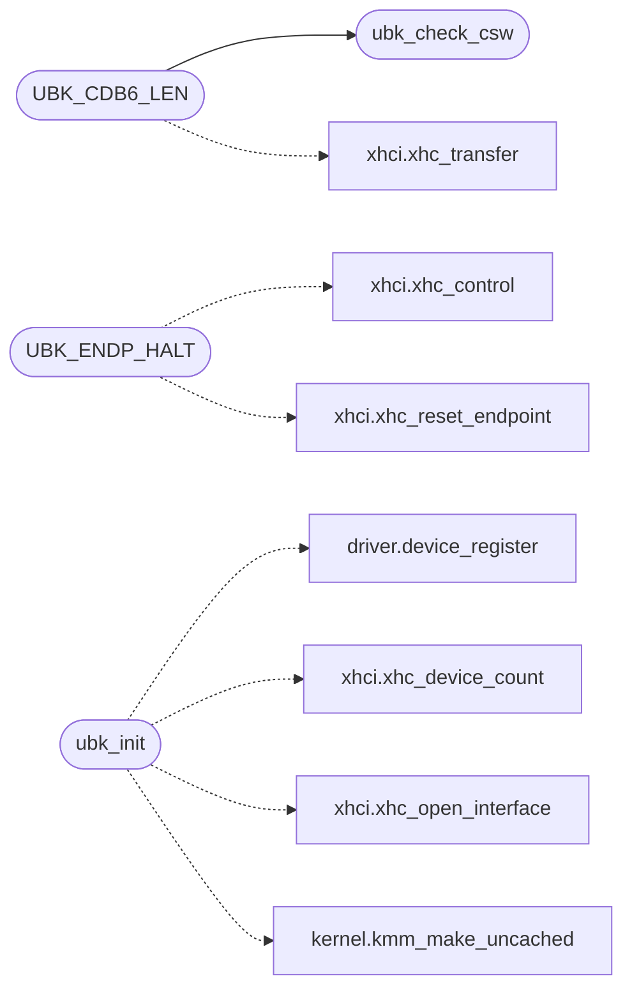

# `drivers/usbblk.c`

> Source: [drivers/usbblk.c:1](../../drivers/usbblk.c#L1) | language `c` | coverage 57.6% | [API index](../index.md)

usbblk.c -- USB mass storage, Bulk-Only Transport over SCSI.

## Contents

- **Structs:** [`ubk_disk_t`](#ubk_disk_t)
- **Functions:** [`ubk_counters`](#ubk_counters), [`ubk_build_cbw`](#ubk_build_cbw), [`ubk_check_csw`](#ubk_check_csw), [`ubk_present`](#ubk_present), [`ubk_sectors`](#ubk_sectors), [`ubk_read_sectors`](#ubk_read_sectors), [`ubk_write_sectors`](#ubk_write_sectors), [`ubk_init`](#ubk_init)
- **Macros:** [`UBK_CBW_LEN`](#ubk_cbw_len), [`UBK_CBW_SIG`](#ubk_cbw_sig), [`UBK_CBW_FLAG_IN`](#ubk_cbw_flag_in), [`UBK_CSW_LEN`](#ubk_csw_len), [`UBK_CSW_SIG`](#ubk_csw_sig), [`UBK_CSW_STATUS_PASSED`](#ubk_csw_status_passed), [`UBK_CSW_STATUS_FAILED`](#ubk_csw_status_failed), [`UBK_SCSI_TEST_UNIT_READY`](#ubk_scsi_test_unit_ready), [`UBK_SCSI_REQUEST_SENSE`](#ubk_scsi_request_sense), [`UBK_SCSI_INQUIRY`](#ubk_scsi_inquiry), [`UBK_SCSI_READ_CAPACITY`](#ubk_scsi_read_capacity), [`UBK_SCSI_READ10`](#ubk_scsi_read10), [`UBK_SCSI_WRITE10`](#ubk_scsi_write10), [`UBK_BULK_INTERVAL`](#ubk_bulk_interval), [`UBK_BULK_BURST`](#ubk_bulk_burst), [`UBK_MAX_XFER_BLOCKS`](#ubk_max_xfer_blocks), [`UBK_CDB_LEN`](#ubk_cdb_len), [`UBK_MS_RESET`](#ubk_ms_reset), [`UBK_CLEAR_FEATURE`](#ubk_clear_feature), [`UBK_ENDP_HALT`](#ubk_endp_halt), [`UBK_CDB6_LEN`](#ubk_cdb6_len), [`UBK_SENSE_LEN`](#ubk_sense_len), [`UBK_READY_TRIES`](#ubk_ready_tries)

## Call Graph

Solid arrows stay in this module, dashed arrows leave it.



## Structs

<a id="ubk_disk_t"></a>

### `ubk_disk_t`

`struct` | [drivers/usbblk.c:44](../../drivers/usbblk.c#L44)

```c
typedef struct
```

Docstring: One registered disk: its device record, the OUT and IN endpoint indices, the sector count, and the tag counter that pairs each CBW with its CSW.

The transfer buffers are heap, because the controller cannot reach .bss under KASLR.

---

## Functions

<a id="ubk_counters"></a>

### `ubk_counters`

`function` | [drivers/usbblk.c:72](../../drivers/usbblk.c#L72)

```c
void ubk_counters(ubk_counters_t *out)
```

Docstring: Snapshot the counters.

**Parameters**

| Name | Type | Default | Description |
|---|---|---|---|
| `out` | `ubk_counters_t *` |  |  |

> **Inherited:** Documentation from [`ubk_counters`](#ubk_counters) (headers/drivers/usbblk.h:46).

---

<a id="ubk_build_cbw"></a>

### `ubk_build_cbw`

`function` | [drivers/usbblk.c:92](../../drivers/usbblk.c#L92)

```c
void ubk_build_cbw(unsigned char *out, unsigned tag, unsigned long lba, unsigned blocks, int read, int data_len)
```

Docstring: Build a Command Block Wrapper into out, which must have room for UBK_CBW_LEN bytes.

Pure, for the host test: a CBW whose fields disagree with its arguments is a command the device must reject, and getting the residue wrong makes a short write look complete.

**Parameters**

| Name | Type | Default | Description |
|---|---|---|---|
| `out` | `unsigned char *` |  |  |
| `tag` | `unsigned` |  |  |
| `lba` | `unsigned long` |  |  |
| `blocks` | `unsigned` |  |  |
| `read` | `int` |  |  |
| `data_len` | `int` |  |  |

> **Inherited:** Documentation from [`ubk_build_cbw`](#ubk_build_cbw) (headers/drivers/usbblk.h:52).

---

<a id="ubk_check_csw"></a>

### `ubk_check_csw`

`function` | [drivers/usbblk.c:121](../../drivers/usbblk.c#L121)

```c
int ubk_check_csw(const unsigned char *csw, unsigned tag, unsigned expect_len)
```

Docstring: Check a Command Status Wrapper.

Returns 1 when the CSW matches the CBW it was sent with and reports success, 0 otherwise. Pure, for the same reason. The residue check is what catches a device that moved fewer bytes than asked for: without it a truncated sector read would be handed back as good data.

**Parameters**

| Name | Type | Default | Description |
|---|---|---|---|
| `csw` | `unsigned char *` |  |  |
| `tag` | `unsigned` |  |  |
| `expect_len` | `unsigned` |  |  |

**Returns:** `int`

> **Inherited:** Documentation from [`ubk_check_csw`](#ubk_check_csw) (headers/drivers/usbblk.h:60).

*Called by:* [`UBK_CDB6_LEN`](#ubk_cdb6_len)

---

<a id="ubk_present"></a>

### `ubk_present`

`function` | [drivers/usbblk.c:336](../../drivers/usbblk.c#L336)

```c
int ubk_present(void)
```

Docstring: True when a USB disk was registered and is the active backend.

**Returns:** `int`

> **Inherited:** Documentation from [`ubk_present`](#ubk_present) (headers/drivers/usbblk.h:24).

---

<a id="ubk_sectors"></a>

### `ubk_sectors`

`function` | [drivers/usbblk.c:340](../../drivers/usbblk.c#L340)

```c
unsigned long ubk_sectors(void)
```

Docstring: Sector count of the registered disk.

**Returns:** `unsigned long`

> **Inherited:** Documentation from [`ubk_sectors`](#ubk_sectors) (headers/drivers/usbblk.h:27).

---

<a id="ubk_read_sectors"></a>

### `ubk_read_sectors`

`function` | [drivers/usbblk.c:365](../../drivers/usbblk.c#L365)

```c
int ubk_read_sectors(unsigned long lba, unsigned count, void *buf)
```

Docstring: Read or write whole 512-byte sectors.

Returns 1 on success, 0 on a refused request: a range outside the disk, a short transfer, a command failure or a stale CSW. Never reports a partial block as read.

**Parameters**

| Name | Type | Default | Description |
|---|---|---|---|
| `lba` | `unsigned long` |  |  |
| `count` | `unsigned` |  |  |
| `buf` | `void *` |  |  |

**Returns:** `int`

> **Inherited:** Documentation from [`ubk_read_sectors`](#ubk_read_sectors) (headers/drivers/usbblk.h:32).

---

<a id="ubk_write_sectors"></a>

### `ubk_write_sectors`

`function` | [drivers/usbblk.c:370](../../drivers/usbblk.c#L370)

```c
int ubk_write_sectors(unsigned long lba, unsigned count, const void *buf)
```

**Parameters**

| Name | Type | Default | Description |
|---|---|---|---|
| `lba` | `unsigned long` |  |  |
| `count` | `unsigned` |  |  |
| `buf` | `void *` |  |  |

**Returns:** `int`

---

<a id="ubk_init"></a>

### `ubk_init`

`function` | [drivers/usbblk.c:457](../../drivers/usbblk.c#L457)

```c
int ubk_init(void)
```

Docstring: Bring up mass storage on every enumerated device.

Returns the number of disks registered, which is 0 on a machine with none and is not an error.

**Returns:** `int`

> **Inherited:** Documentation from [`ubk_init`](#ubk_init) (headers/drivers/usbblk.h:21).

*Calls:* [`device_register`](headers.driver.h.md#device_register), [`xhc_device_count`](headers.drivers.xhci.h.md#xhc_device_count), [`xhc_open_interface`](headers.drivers.xhci.h.md#xhc_open_interface), [`kmm_make_uncached`](headers.kernel.h.md#kmm_make_uncached)

---

## Macros

<a id="ubk_cbw_len"></a>

### `UBK_CBW_LEN`

`macro` | [drivers/usbblk.c:22](../../drivers/usbblk.c#L22)

```c
#define UBK_CBW_LEN
```

---- CBW: signature, tag, data transfer length, flags, LUN, command ----

---

<a id="ubk_cbw_sig"></a>

### `UBK_CBW_SIG`

`macro` | [drivers/usbblk.c:23](../../drivers/usbblk.c#L23)

```c
#define UBK_CBW_SIG
```

---

<a id="ubk_cbw_flag_in"></a>

### `UBK_CBW_FLAG_IN`

`macro` | [drivers/usbblk.c:24](../../drivers/usbblk.c#L24)

```c
#define UBK_CBW_FLAG_IN
```

---

<a id="ubk_csw_len"></a>

### `UBK_CSW_LEN`

`macro` | [drivers/usbblk.c:27](../../drivers/usbblk.c#L27)

```c
#define UBK_CSW_LEN
```

---- CSW: signature, tag, residue, status ----

---

<a id="ubk_csw_sig"></a>

### `UBK_CSW_SIG`

`macro` | [drivers/usbblk.c:28](../../drivers/usbblk.c#L28)

```c
#define UBK_CSW_SIG
```

---

<a id="ubk_csw_status_passed"></a>

### `UBK_CSW_STATUS_PASSED`

`macro` | [drivers/usbblk.c:29](../../drivers/usbblk.c#L29)

```c
#define UBK_CSW_STATUS_PASSED
```

---

<a id="ubk_csw_status_failed"></a>

### `UBK_CSW_STATUS_FAILED`

`macro` | [drivers/usbblk.c:30](../../drivers/usbblk.c#L30)

```c
#define UBK_CSW_STATUS_FAILED
```

---

<a id="ubk_scsi_test_unit_ready"></a>

### `UBK_SCSI_TEST_UNIT_READY`

`macro` | [drivers/usbblk.c:33](../../drivers/usbblk.c#L33)

```c
#define UBK_SCSI_TEST_UNIT_READY
```

---- SCSI opcodes used ----

---

<a id="ubk_scsi_request_sense"></a>

### `UBK_SCSI_REQUEST_SENSE`

`macro` | [drivers/usbblk.c:34](../../drivers/usbblk.c#L34)

```c
#define UBK_SCSI_REQUEST_SENSE
```

---

<a id="ubk_scsi_inquiry"></a>

### `UBK_SCSI_INQUIRY`

`macro` | [drivers/usbblk.c:35](../../drivers/usbblk.c#L35)

```c
#define UBK_SCSI_INQUIRY
```

---

<a id="ubk_scsi_read_capacity"></a>

### `UBK_SCSI_READ_CAPACITY`

`macro` | [drivers/usbblk.c:36](../../drivers/usbblk.c#L36)

```c
#define UBK_SCSI_READ_CAPACITY
```

---

<a id="ubk_scsi_read10"></a>

### `UBK_SCSI_READ10`

`macro` | [drivers/usbblk.c:37](../../drivers/usbblk.c#L37)

```c
#define UBK_SCSI_READ10
```

---

<a id="ubk_scsi_write10"></a>

### `UBK_SCSI_WRITE10`

`macro` | [drivers/usbblk.c:38](../../drivers/usbblk.c#L38)

```c
#define UBK_SCSI_WRITE10
```

---

<a id="ubk_bulk_interval"></a>

### `UBK_BULK_INTERVAL`

`macro` | [drivers/usbblk.c:63](../../drivers/usbblk.c#L63)

```c
#define UBK_BULK_INTERVAL
```

---- Endpoint interval and burst ----

---

<a id="ubk_bulk_burst"></a>

### `UBK_BULK_BURST`

`macro` | [drivers/usbblk.c:64](../../drivers/usbblk.c#L64)

```c
#define UBK_BULK_BURST
```

---

<a id="ubk_max_xfer_blocks"></a>

### `UBK_MAX_XFER_BLOCKS`

`macro` | [drivers/usbblk.c:70](../../drivers/usbblk.c#L70)

```c
#define UBK_MAX_XFER_BLOCKS
```

Docstring: Bytes per SCSI command block: a read or write of at most this many blocks is the largest this driver issues.

Bounded so a single allocation cannot be unbounded, and so a failure reports a whole transfer rather than a partially applied one.

---

<a id="ubk_cdb_len"></a>

### `UBK_CDB_LEN`

`macro` | [drivers/usbblk.c:79](../../drivers/usbblk.c#L79)

```c
#define UBK_CDB_LEN
```

Docstring: Ten-byte SCSI CDB at the CBW command block: opcode, LBA big-endian, transfer length big-endian.

READ(10) and WRITE(10) are ten-byte commands, and a six-byte block with the same opcode is rejected.

---

<a id="ubk_ms_reset"></a>

### `UBK_MS_RESET`

`macro` | [drivers/usbblk.c:148](../../drivers/usbblk.c#L148)

```c
#define UBK_MS_RESET
```

Docstring: Bulk-Only Mass Storage Reset on the control endpoint, then CLEAR_FEATURE(ENDPOINT_HALT) on both bulk endpoints and an xHCI stop/reset/re-point of both transfer rings.

Real silicon stalls a command it dislikes instead of answering it, and without this no transfer on either endpoint ever completes again. Results are ignored: recovery is best-effort, the retry decides.

---

<a id="ubk_clear_feature"></a>

### `UBK_CLEAR_FEATURE`

`macro` | [drivers/usbblk.c:149](../../drivers/usbblk.c#L149)

```c
#define UBK_CLEAR_FEATURE
```

---

<a id="ubk_endp_halt"></a>

### `UBK_ENDP_HALT`

`macro` | [drivers/usbblk.c:150](../../drivers/usbblk.c#L150)

```c
#define UBK_ENDP_HALT
```

*Calls:* [`xhc_control`](headers.drivers.xhci.h.md#xhc_control), [`xhc_reset_endpoint`](headers.drivers.xhci.h.md#xhc_reset_endpoint)

---

<a id="ubk_cdb6_len"></a>

### `UBK_CDB6_LEN`

`macro` | [drivers/usbblk.c:181](../../drivers/usbblk.c#L181)

```c
#define UBK_CDB6_LEN
```

Docstring: Six-byte SCSI block: opcode first, the rest zeroed here by the caller through len.

TEST UNIT READY and REQUEST SENSE are six-byte commands; sending them in a ten-byte wrapper confuses strict firmware.

*Calls:* [`ubk_check_csw`](#ubk_check_csw), [`xhc_transfer`](headers.drivers.xhci.h.md#xhc_transfer)

---

<a id="ubk_sense_len"></a>

### `UBK_SENSE_LEN`

`macro` | [drivers/usbblk.c:261](../../drivers/usbblk.c#L261)

```c
#define UBK_SENSE_LEN
```

Docstring: REQUEST SENSE after a failure, so a unit attention clears instead of failing every later command, and the key lands in the log.

Six-byte command, eighteen bytes of sense. Best-effort: its own failure changes nothing.

---

<a id="ubk_ready_tries"></a>

### `UBK_READY_TRIES`

`macro` | [drivers/usbblk.c:293](../../drivers/usbblk.c#L293)

```c
#define UBK_READY_TRIES
```

Docstring: Wait for the medium with TEST UNIT READY.

Real devices answer CHECK CONDITION until the media is up; without this the first capacity read runs against a device that is not there yet. Bounded, so a dead device costs tries, never the boot.

---
