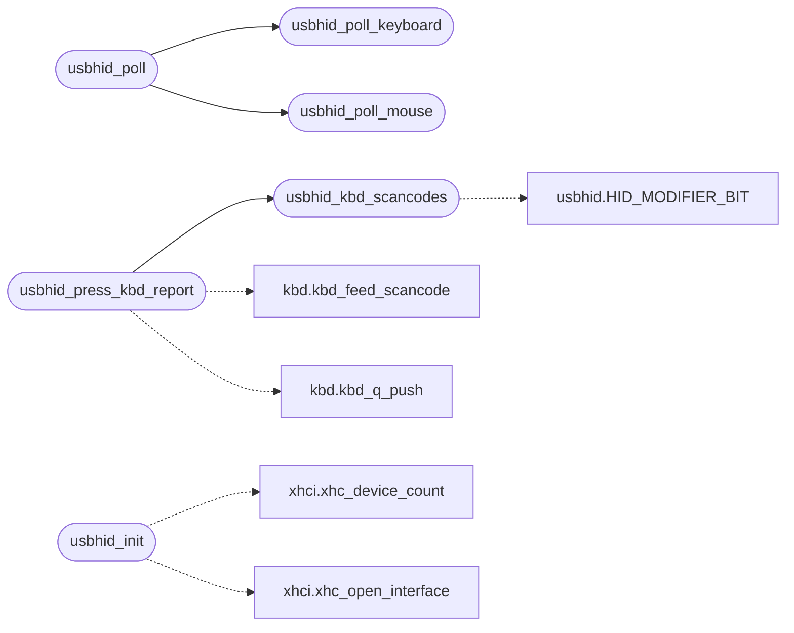

# `drivers/usbhid.c`

> Source: [drivers/usbhid.c:1](../../drivers/usbhid.c#L1) | language `c` | coverage 100.0% | [API index](../index.md)

usbhid.c -- USB HID boot-protocol keyboard and mouse.

## Contents

- **Structs:** [`usbhid_dev_t`](#usbhid_dev_t)
- **Functions:** [`usbhid_set1_from_usage`](#usbhid_set1_from_usage), [`usbhid_kbd_scancodes`](#usbhid_kbd_scancodes), [`usbhid_mouse_decode`](#usbhid_mouse_decode), [`usbhid_keyboard_present`](#usbhid_keyboard_present), [`usbhid_mouse_present`](#usbhid_mouse_present), [`usbhid_counters`](#usbhid_counters), [`usbhid_press_kbd_report`](#usbhid_press_kbd_report), [`usbhid_init`](#usbhid_init), [`usbhid_poll_keyboard`](#usbhid_poll_keyboard), [`usbhid_poll_mouse`](#usbhid_poll_mouse), [`usbhid_poll`](#usbhid_poll)
- **Macros:** [`USBHID_MAX_DEVS`](#usbhid_max_devs), [`USBHID_INTERVAL`](#usbhid_interval), [`USBHID_MAX_SCANCODES`](#usbhid_max_scancodes)

## Call Graph

Solid arrows stay in this module, dashed arrows leave it.



## Structs

<a id="usbhid_dev_t"></a>

### `usbhid_dev_t`

`struct` | [drivers/usbhid.c:40](../../drivers/usbhid.c#L40)

```c
typedef struct
```

Docstring: A claimed HID interface: the device record, the endpoint index that serves it, and the previous report so the next one can be differenced against it.

---

## Functions

<a id="usbhid_set1_from_usage"></a>

### `usbhid_set1_from_usage`

`function` | [drivers/usbhid.c:117](../../drivers/usbhid.c#L117)

```c
int usbhid_set1_from_usage(unsigned usage, unsigned char *sc, int *e0)
```

Docstring: Translate a HID usage code to its PS/2 set-1 make code and whether it needs the 0xE0 prefix.

Returns 0 for a usage with no set-1 equivalent, which the caller drops rather than inventing a scancode for.

A pure function over a table, host-testable: HID usage ids are not
scancodes above 0x27 (usage 0x28 is Return while set-1 Return is 0x1C), and
the navigation cluster and the right-hand modifiers exist in one place on
a USB keyboard while set-1 needs the prefix to tell them from their
left-hand twins. Both decisions live here so no caller has to know them.

**Parameters**

| Name | Type | Default | Description |
|---|---|---|---|
| `usage` | `unsigned` |  |  |
| `sc` | `unsigned char *` |  |  |
| `e0` | `int *` |  |  |

**Returns:** `int`

> **Inherited:** Documentation from [`usbhid_set1_from_usage`](#usbhid_set1_from_usage) (headers/drivers/usbhid.h:127).

---

<a id="usbhid_kbd_scancodes"></a>

### `usbhid_kbd_scancodes`

`function` | [drivers/usbhid.c:206](../../drivers/usbhid.c#L206)

```c
int usbhid_kbd_scancodes(const unsigned char prev[HID_KBD_REPORT_LEN], const unsigned char cur[HID_KBD_REPORT_LEN], unsigned char *out, int max)
```

Docstring: Set-1 scancode stream for one keyboard report transition.

Pure: no hardware, no kernel state, no allocation, which is what makes it
host-testable. Breaks are emitted before makes, for modifiers and for keys
alike, so a burst never reads as a held-key repeat. A key that merely moved
slot within the array produces nothing, because the array order is the
device's choice. Returns the number of scancodes written, which is less
than max only when the report produced no events.

**Parameters**

| Name | Type | Default | Description |
|---|---|---|---|
| `HID_KBD_REPORT_LEN` | `unsigned char prev[ ]` |  |  |
| `HID_KBD_REPORT_LEN` | `unsigned char cur[ ]` |  |  |
| `out` | `unsigned char *` |  |  |
| `max` | `int` |  |  |

**Returns:** `int`

> **Inherited:** Documentation from [`usbhid_kbd_scancodes`](#usbhid_kbd_scancodes) (headers/drivers/usbhid.h:94).

*Calls:* [`HID_MODIFIER_BIT`](headers.drivers.usbhid.h.md#hid_modifier_bit)

*Called by:* [`usbhid_press_kbd_report`](#usbhid_press_kbd_report)

---

<a id="usbhid_mouse_decode"></a>

### `usbhid_mouse_decode`

`function` | [drivers/usbhid.c:241](../../drivers/usbhid.c#L241)

```c
void usbhid_mouse_decode(const unsigned char prev[HID_MOUSE_REPORT_LEN], const unsigned char cur[HID_MOUSE_REPORT_LEN], int *dx, int *dy, int *buttons, int *wheel)
```

Docstring: Decode one boot mouse report transition into screen-space motion, buttons and wheel.

Pure, for the same reason. dx and dy are raw report deltas; the caller applies the motion scale, matching the PS/2 path so both sources move the pointer identically.

**Parameters**

| Name | Type | Default | Description |
|---|---|---|---|
| `HID_MOUSE_REPORT_LEN` | `unsigned char prev[ ]` |  |  |
| `HID_MOUSE_REPORT_LEN` | `unsigned char cur[ ]` |  |  |
| `dx` | `int *` |  |  |
| `dy` | `int *` |  |  |
| `buttons` | `int *` |  |  |
| `wheel` | `int *` |  |  |

> **Inherited:** Documentation from [`usbhid_mouse_decode`](#usbhid_mouse_decode) (headers/drivers/usbhid.h:102).

---

<a id="usbhid_keyboard_present"></a>

### `usbhid_keyboard_present`

`function` | [drivers/usbhid.c:256](../../drivers/usbhid.c#L256)

```c
int usbhid_keyboard_present(void)
```

Docstring: True when a USB keyboard is driving the input path, so the keyboard driver can skip the PS/2 port instead of spinning on a controller that does not exist on modern hardware.

**Returns:** `int`

> **Inherited:** Documentation from [`usbhid_keyboard_present`](#usbhid_keyboard_present) (headers/drivers/usbhid.h:76).

---

<a id="usbhid_mouse_present"></a>

### `usbhid_mouse_present`

`function` | [drivers/usbhid.c:263](../../drivers/usbhid.c#L263)

```c
int usbhid_mouse_present(void)
```

Docstring: True when a USB mouse is driving mouse_state.

**Returns:** `int`

> **Inherited:** Documentation from [`usbhid_mouse_present`](#usbhid_mouse_present) (headers/drivers/usbhid.h:79).

---

<a id="usbhid_counters"></a>

### `usbhid_counters`

`function` | [drivers/usbhid.c:270](../../drivers/usbhid.c#L270)

```c
void usbhid_counters(usbhid_counters_t *out)
```

Docstring: Snapshot the counters.

**Parameters**

| Name | Type | Default | Description |
|---|---|---|---|
| `out` | `usbhid_counters_t *` |  |  |

> **Inherited:** Documentation from [`usbhid_counters`](#usbhid_counters) (headers/drivers/usbhid.h:116).

---

<a id="usbhid_press_kbd_report"></a>

### `usbhid_press_kbd_report`

`function` | [drivers/usbhid.c:274](../../drivers/usbhid.c#L274)

```c
int usbhid_press_kbd_report(const unsigned char report[HID_KBD_REPORT_LEN])
```

Docstring: Feed a boot keyboard report through the differ, for the host test and the in-OS self test.

Uses the first claimed keyboard's stored previous report and updates it. Returns the scancodes emitted.

**Parameters**

| Name | Type | Default | Description |
|---|---|---|---|
| `HID_KBD_REPORT_LEN` | `unsigned char report[ ]` |  |  |

**Returns:** `int`

> **Inherited:** Documentation from [`usbhid_press_kbd_report`](#usbhid_press_kbd_report) (headers/drivers/usbhid.h:84).

*Calls:* [`usbhid_kbd_scancodes`](#usbhid_kbd_scancodes), [`kbd_feed_scancode`](headers.drivers.kbd.h.md#kbd_feed_scancode), [`kbd_q_push`](headers.drivers.kbd.h.md#kbd_q_push)

---

<a id="usbhid_init"></a>

### `usbhid_init`

`function` | [drivers/usbhid.c:384](../../drivers/usbhid.c#L384)

```c
int usbhid_init(void)
```

Docstring: Bring up HID on every enumerated device and report what was found.

Returns the number of HID interfaces claimed, which is 0 on a machine with no HID device and is not an error.

**Returns:** `int`

> **Inherited:** Documentation from [`usbhid_init`](#usbhid_init) (headers/drivers/usbhid.h:60).

*Calls:* [`xhc_device_count`](headers.drivers.xhci.h.md#xhc_device_count), [`xhc_open_interface`](headers.drivers.xhci.h.md#xhc_open_interface)

---

<a id="usbhid_poll_keyboard"></a>

### `usbhid_poll_keyboard`

`function` | [drivers/usbhid.c:485](../../drivers/usbhid.c#L485)

```c
int usbhid_poll_keyboard(void)
```

Docstring: Service the interrupt endpoint of a claimed keyboard.

One report per call; returns 1 when a report was processed.

**Returns:** `int`

> **Inherited:** Documentation from [`usbhid_poll_keyboard`](#usbhid_poll_keyboard) (headers/drivers/usbhid.h:64).

*Called by:* [`usbhid_poll`](#usbhid_poll)

---

<a id="usbhid_poll_mouse"></a>

### `usbhid_poll_mouse`

`function` | [drivers/usbhid.c:493](../../drivers/usbhid.c#L493)

```c
int usbhid_poll_mouse(void)
```

Docstring: Service the interrupt endpoint of a claimed mouse.

One report per call; returns 1 when a report was processed.

**Returns:** `int`

> **Inherited:** Documentation from [`usbhid_poll_mouse`](#usbhid_poll_mouse) (headers/drivers/usbhid.h:68).

*Called by:* [`usbhid_poll`](#usbhid_poll)

---

<a id="usbhid_poll"></a>

### `usbhid_poll`

`function` | [drivers/usbhid.c:501](../../drivers/usbhid.c#L501)

```c
int usbhid_poll(void)
```

Docstring: Service both, for the tick bus.

Returns the reports handled.

**Returns:** `int`

> **Inherited:** Documentation from [`usbhid_poll`](#usbhid_poll) (headers/drivers/usbhid.h:71).

*Calls:* [`usbhid_poll_keyboard`](#usbhid_poll_keyboard), [`usbhid_poll_mouse`](#usbhid_poll_mouse)

---

## Macros

<a id="usbhid_max_devs"></a>

### `USBHID_MAX_DEVS`

`macro` | [drivers/usbhid.c:35](../../drivers/usbhid.c#L35)

```c
#define USBHID_MAX_DEVS
```

---- One HID keyboard and one HID mouse is what this kernel drives ----

---

<a id="usbhid_interval"></a>

### `USBHID_INTERVAL`

`macro` | [drivers/usbhid.c:55](../../drivers/usbhid.c#L55)

```c
#define USBHID_INTERVAL
```

Docstring: Endpoint interval in the units the context field counts.

One frame at high speed, one millisecond at full speed: the smallest values that do not lose reports on a busy bus.

---

<a id="usbhid_max_scancodes"></a>

### `USBHID_MAX_SCANCODES`

`macro` | [drivers/usbhid.c:204](../../drivers/usbhid.c#L204)

```c
#define USBHID_MAX_SCANCODES
```

Docstring: How many scancodes a keyboard report transition can produce at worst: six keys each able to emit prefix plus make or break plus prefix break, plus eight modifier bits.

Sized so the buffer is never the limit.

---
