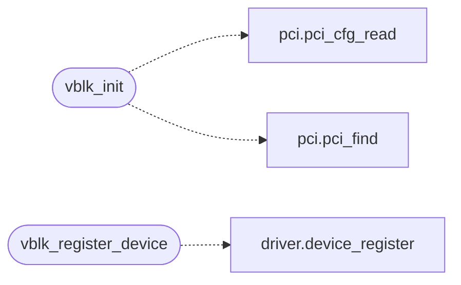

# `drivers/virtio_blk.c`

> Source: [drivers/virtio_blk.c:1](../../drivers/virtio_blk.c#L1) | language `c` | coverage 28.0% | [API index](../index.md)

Docstring: drivers/virtio_blk.c -- Polled legacy virtio-blk driver.

## Contents

- **Structs:** [`vblk_req_t`](#vblk_req_t)
- **Functions:** [`vblk_init`](#vblk_init), [`vblk_present`](#vblk_present), [`vblk_sectors`](#vblk_sectors), [`vblk_write_sectors`](#vblk_write_sectors), [`vblk_register_device`](#vblk_register_device)
- **Macros:** [`VBLK_VENDOR`](#vblk_vendor), [`VBLK_DEV_LEGACY`](#vblk_dev_legacy), [`VBLK_DEV_TRANS`](#vblk_dev_trans), [`VBLK_F_ACK`](#vblk_f_ack), [`VBLK_F_DRIVER`](#vblk_f_driver), [`VBLK_F_OK`](#vblk_f_ok), [`VBLK_F_DRIVER_OK`](#vblk_f_driver_ok), [`VBLK_QNUM`](#vblk_qnum), [`VBLK_DESC_SZ`](#vblk_desc_sz), [`VBLK_AVAIL_OFF`](#vblk_avail_off), [`VBLK_USED_OFF`](#vblk_used_off), [`VBLK_QAREA`](#vblk_qarea), [`VBLK_DESC_NEXT`](#vblk_desc_next), [`VBLK_DESC_WRITE`](#vblk_desc_write), [`VBLK_REQ_IN`](#vblk_req_in), [`VBLK_REQ_OUT`](#vblk_req_out), [`VBLK_TMO_MS`](#vblk_tmo_ms), [`VBLK_SECTOR`](#vblk_sector)

## Call Graph

Solid arrows stay in this module, dashed arrows leave it.



## Structs

<a id="vblk_req_t"></a>

### `vblk_req_t`

`struct` | [drivers/virtio_blk.c:56](../../drivers/virtio_blk.c#L56)

```c
typedef struct
```

---

## Functions

<a id="vblk_init"></a>

### `vblk_init`

`function` | [drivers/virtio_blk.c:100](../../drivers/virtio_blk.c#L100)

```c
int vblk_init(void)
```

Docstring: Probe PCI for a virtio-blk device and bring queue 0 up.

Idempotent: a second call reuses the live queue. Returns 1 when the device is ready, 0 when absent or unusable (fail-closed, IDE stays).

**Returns:** `int`

*Calls:* [`pci_cfg_read`](headers.drivers.pci.h.md#pci_cfg_read), [`pci_find`](headers.drivers.pci.h.md#pci_find)

---

<a id="vblk_present"></a>

### `vblk_present`

`function` | [drivers/virtio_blk.c:158](../../drivers/virtio_blk.c#L158)

```c
int vblk_present(void)
```

Docstring: True once vblk_init brought the queue up.

**Returns:** `int`

---

<a id="vblk_sectors"></a>

### `vblk_sectors`

`function` | [drivers/virtio_blk.c:163](../../drivers/virtio_blk.c#L163)

```c
unsigned long vblk_sectors(void)
```

Docstring: Device capacity in 512-byte sectors (0 when absent).

**Returns:** `unsigned long`

---

<a id="vblk_write_sectors"></a>

### `vblk_write_sectors`

`function` | [drivers/virtio_blk.c:266](../../drivers/virtio_blk.c#L266)

```c
int vblk_write_sectors(unsigned lba, unsigned count, const void *buf)
```

Docstring: Write count sectors from buf at lba.

The caller buffer is DMA-safe by construction (identity-mapped heap/user pages), so it is handed to the device directly, never bounced. Chunks like the read path past 16 sectors.

**Parameters**

| Name | Type | Default | Description |
|---|---|---|---|
| `lba` | `unsigned` |  |  |
| `count` | `unsigned` |  |  |
| `buf` | `void *` |  |  |

**Returns:** `int`

---

<a id="vblk_register_device"></a>

### `vblk_register_device`

`function` | [drivers/virtio_blk.c:327](../../drivers/virtio_blk.c#L327)

```c
void vblk_register_device(void)
```

Docstring: Publish vblk0 for the block layer preference.

Boot-time only, before sti, like the ide0 registration; re-registration is a no-op (duplicate refused).

*Calls:* [`device_register`](headers.driver.h.md#device_register)

---

## Macros

<a id="vblk_vendor"></a>

### `VBLK_VENDOR`

`macro` | [drivers/virtio_blk.c:28](../../drivers/virtio_blk.c#L28)

```c
#define VBLK_VENDOR
```

---

<a id="vblk_dev_legacy"></a>

### `VBLK_DEV_LEGACY`

`macro` | [drivers/virtio_blk.c:29](../../drivers/virtio_blk.c#L29)

```c
#define VBLK_DEV_LEGACY
```

---

<a id="vblk_dev_trans"></a>

### `VBLK_DEV_TRANS`

`macro` | [drivers/virtio_blk.c:30](../../drivers/virtio_blk.c#L30)

```c
#define VBLK_DEV_TRANS
```

---

<a id="vblk_f_ack"></a>

### `VBLK_F_ACK`

`macro` | [drivers/virtio_blk.c:32](../../drivers/virtio_blk.c#L32)

```c
#define VBLK_F_ACK
```

---

<a id="vblk_f_driver"></a>

### `VBLK_F_DRIVER`

`macro` | [drivers/virtio_blk.c:33](../../drivers/virtio_blk.c#L33)

```c
#define VBLK_F_DRIVER
```

---

<a id="vblk_f_ok"></a>

### `VBLK_F_OK`

`macro` | [drivers/virtio_blk.c:34](../../drivers/virtio_blk.c#L34)

```c
#define VBLK_F_OK
```

---

<a id="vblk_f_driver_ok"></a>

### `VBLK_F_DRIVER_OK`

`macro` | [drivers/virtio_blk.c:35](../../drivers/virtio_blk.c#L35)

```c
#define VBLK_F_DRIVER_OK
```

---

<a id="vblk_qnum"></a>

### `VBLK_QNUM`

`macro` | [drivers/virtio_blk.c:37](../../drivers/virtio_blk.c#L37)

```c
#define VBLK_QNUM
```

---

<a id="vblk_desc_sz"></a>

### `VBLK_DESC_SZ`

`macro` | [drivers/virtio_blk.c:38](../../drivers/virtio_blk.c#L38)

```c
#define VBLK_DESC_SZ
```

---

<a id="vblk_avail_off"></a>

### `VBLK_AVAIL_OFF`

`macro` | [drivers/virtio_blk.c:43](../../drivers/virtio_blk.c#L43)

```c
#define VBLK_AVAIL_OFF
```

Three-page queue for qnum <= 256: descriptors fill page 0 (256 x 16 = 4096), the avail ring opens page 1, the used ring opens page 2.

The device derives both from QueuePFN, so the area must be contiguous and page-aligned (one 12 KB heap slice).

---

<a id="vblk_used_off"></a>

### `VBLK_USED_OFF`

`macro` | [drivers/virtio_blk.c:44](../../drivers/virtio_blk.c#L44)

```c
#define VBLK_USED_OFF
```

---

<a id="vblk_qarea"></a>

### `VBLK_QAREA`

`macro` | [drivers/virtio_blk.c:45](../../drivers/virtio_blk.c#L45)

```c
#define VBLK_QAREA
```

---

<a id="vblk_desc_next"></a>

### `VBLK_DESC_NEXT`

`macro` | [drivers/virtio_blk.c:47](../../drivers/virtio_blk.c#L47)

```c
#define VBLK_DESC_NEXT
```

---

<a id="vblk_desc_write"></a>

### `VBLK_DESC_WRITE`

`macro` | [drivers/virtio_blk.c:48](../../drivers/virtio_blk.c#L48)

```c
#define VBLK_DESC_WRITE
```

---

<a id="vblk_req_in"></a>

### `VBLK_REQ_IN`

`macro` | [drivers/virtio_blk.c:50](../../drivers/virtio_blk.c#L50)

```c
#define VBLK_REQ_IN
```

---

<a id="vblk_req_out"></a>

### `VBLK_REQ_OUT`

`macro` | [drivers/virtio_blk.c:51](../../drivers/virtio_blk.c#L51)

```c
#define VBLK_REQ_OUT
```

---

<a id="vblk_tmo_ms"></a>

### `VBLK_TMO_MS`

`macro` | [drivers/virtio_blk.c:53](../../drivers/virtio_blk.c#L53)

```c
#define VBLK_TMO_MS
```

---

<a id="vblk_sector"></a>

### `VBLK_SECTOR`

`macro` | [drivers/virtio_blk.c:54](../../drivers/virtio_blk.c#L54)

```c
#define VBLK_SECTOR
```

---
