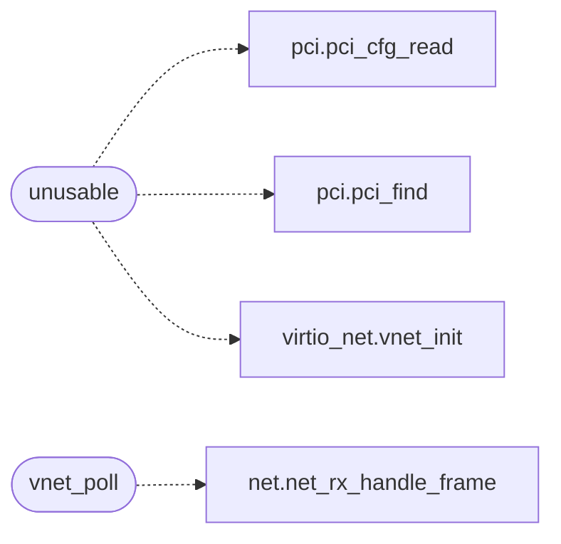

# `drivers/virtio_net.c`

> Source: [drivers/virtio_net.c:1](../../drivers/virtio_net.c#L1) | language `c` | coverage 20.0% | [API index](../index.md)

Docstring: drivers/virtio_net.c -- Polled legacy virtio-net driver.

## Contents

- **Functions:** [`unusable`](#unusable), [`vnet_present`](#vnet_present), [`vnet_get_mac`](#vnet_get_mac), [`vnet_iobase`](#vnet_iobase), [`vnet_counters`](#vnet_counters), [`vnet_link_up`](#vnet_link_up), [`vnet_poll`](#vnet_poll)
- **Macros:** [`VNET_VENDOR`](#vnet_vendor), [`VNET_DEV_LEGACY`](#vnet_dev_legacy), [`VNET_DEV_TRANS`](#vnet_dev_trans), [`VNET_F_ACK`](#vnet_f_ack), [`VNET_F_DRIVER`](#vnet_f_driver), [`VNET_F_OK`](#vnet_f_ok), [`VNET_F_DRIVER_OK`](#vnet_f_driver_ok), [`VNET_QNUM`](#vnet_qnum), [`VNET_DESC_SZ`](#vnet_desc_sz), [`VNET_AVAIL_OFF`](#vnet_avail_off), [`VNET_USED_OFF`](#vnet_used_off), [`VNET_QAREA`](#vnet_qarea), [`VNET_DESC_NEXT`](#vnet_desc_next), [`VNET_DESC_WRITE`](#vnet_desc_write), [`VNET_Q_RX`](#vnet_q_rx), [`VNET_Q_TX`](#vnet_q_tx), [`VNET_HDR_LEN`](#vnet_hdr_len), [`VNET_RX_BUFS`](#vnet_rx_bufs), [`VNET_RX_SIZE`](#vnet_rx_size), [`VNET_TX_SIZE`](#vnet_tx_size), [`VNET_MIN_FRAME`](#vnet_min_frame), [`VNET_MAX_FRAME`](#vnet_max_frame), [`VNET_TMO_MS`](#vnet_tmo_ms), [`VNET_POLL_MAX`](#vnet_poll_max), [`VNET_CFG_MAC`](#vnet_cfg_mac), [`VNET_CFG_STATUS`](#vnet_cfg_status), [`VNET_ST_LINK_UP`](#vnet_st_link_up)

## Call Graph

Solid arrows stay in this module, dashed arrows leave it.



## Functions

<a id="unusable"></a>

### `unusable`

`function` | [drivers/virtio_net.c:181](../../drivers/virtio_net.c#L181)

```c
* unusable (fail-closed, rtl8139 stays). */ int vnet_init(void)
```

**Parameters**

| Name | Type | Default | Description |
|---|---|---|---|
| `closed` | `fail-` |  |  |
| `stays` | `rtl8139` |  |  |

**Returns:** `*`

*Calls:* [`pci_cfg_read`](headers.drivers.pci.h.md#pci_cfg_read), [`pci_find`](headers.drivers.pci.h.md#pci_find), [`vnet_init`](headers.drivers.virtio_net.h.md#vnet_init)

---

<a id="vnet_present"></a>

### `vnet_present`

`function` | [drivers/virtio_net.c:223](../../drivers/virtio_net.c#L223)

```c
int vnet_present(void)
```

Docstring: True once vnet_init brought the queues up.

**Returns:** `int`

---

<a id="vnet_get_mac"></a>

### `vnet_get_mac`

`function` | [drivers/virtio_net.c:228](../../drivers/virtio_net.c#L228)

```c
void vnet_get_mac(unsigned char out[6])
```

Docstring: Copy the NIC MAC into out (NET_ETH_ALEN bytes).

**Parameters**

| Name | Type | Default | Description |
|---|---|---|---|
| `out` | `unsigned char [6]` |  |  |

---

<a id="vnet_iobase"></a>

### `vnet_iobase`

`function` | [drivers/virtio_net.c:234](../../drivers/virtio_net.c#L234)

```c
unsigned short vnet_iobase(void)
```

Docstring: The NIC I/O base, or 0 when the device is absent.

**Returns:** `unsigned short`

---

<a id="vnet_counters"></a>

### `vnet_counters`

`function` | [drivers/virtio_net.c:239](../../drivers/virtio_net.c#L239)

```c
void vnet_counters(unsigned int *tx_frames, unsigned int *rx_frames)
```

Docstring: Frame-level TX/RX counters.

**Parameters**

| Name | Type | Default | Description |
|---|---|---|---|
| `tx_frames` | `unsigned int *` |  |  |
| `rx_frames` | `unsigned int *` |  |  |

---

<a id="vnet_link_up"></a>

### `vnet_link_up`

`function` | [drivers/virtio_net.c:277](../../drivers/virtio_net.c#L277)

```c
int vnet_link_up(void)
```

Docstring: Link-up status from the config space.

**Returns:** `int`

---

<a id="vnet_poll"></a>

### `vnet_poll`

`function` | [drivers/virtio_net.c:287](../../drivers/virtio_net.c#L287)

```c
void vnet_poll(void)
```

Docstring: Drain completed RX buffers into net_rx_handle_frame, reposting every descriptor.

The 10-byte device header is skipped; frames outside 14..1514 payload bytes are dropped and counted, exactly like the rtl8139 path. Bounded per call, never blocks.

*Calls:* [`net_rx_handle_frame`](headers.net.h.md#net_rx_handle_frame)

---

## Macros

<a id="vnet_vendor"></a>

### `VNET_VENDOR`

`macro` | [drivers/virtio_net.c:29](../../drivers/virtio_net.c#L29)

```c
#define VNET_VENDOR
```

---

<a id="vnet_dev_legacy"></a>

### `VNET_DEV_LEGACY`

`macro` | [drivers/virtio_net.c:30](../../drivers/virtio_net.c#L30)

```c
#define VNET_DEV_LEGACY
```

---

<a id="vnet_dev_trans"></a>

### `VNET_DEV_TRANS`

`macro` | [drivers/virtio_net.c:31](../../drivers/virtio_net.c#L31)

```c
#define VNET_DEV_TRANS
```

---

<a id="vnet_f_ack"></a>

### `VNET_F_ACK`

`macro` | [drivers/virtio_net.c:33](../../drivers/virtio_net.c#L33)

```c
#define VNET_F_ACK
```

---

<a id="vnet_f_driver"></a>

### `VNET_F_DRIVER`

`macro` | [drivers/virtio_net.c:34](../../drivers/virtio_net.c#L34)

```c
#define VNET_F_DRIVER
```

---

<a id="vnet_f_ok"></a>

### `VNET_F_OK`

`macro` | [drivers/virtio_net.c:35](../../drivers/virtio_net.c#L35)

```c
#define VNET_F_OK
```

---

<a id="vnet_f_driver_ok"></a>

### `VNET_F_DRIVER_OK`

`macro` | [drivers/virtio_net.c:36](../../drivers/virtio_net.c#L36)

```c
#define VNET_F_DRIVER_OK
```

---

<a id="vnet_qnum"></a>

### `VNET_QNUM`

`macro` | [drivers/virtio_net.c:38](../../drivers/virtio_net.c#L38)

```c
#define VNET_QNUM
```

---

<a id="vnet_desc_sz"></a>

### `VNET_DESC_SZ`

`macro` | [drivers/virtio_net.c:39](../../drivers/virtio_net.c#L39)

```c
#define VNET_DESC_SZ
```

---

<a id="vnet_avail_off"></a>

### `VNET_AVAIL_OFF`

`macro` | [drivers/virtio_net.c:40](../../drivers/virtio_net.c#L40)

```c
#define VNET_AVAIL_OFF
```

---

<a id="vnet_used_off"></a>

### `VNET_USED_OFF`

`macro` | [drivers/virtio_net.c:41](../../drivers/virtio_net.c#L41)

```c
#define VNET_USED_OFF
```

---

<a id="vnet_qarea"></a>

### `VNET_QAREA`

`macro` | [drivers/virtio_net.c:42](../../drivers/virtio_net.c#L42)

```c
#define VNET_QAREA
```

---

<a id="vnet_desc_next"></a>

### `VNET_DESC_NEXT`

`macro` | [drivers/virtio_net.c:44](../../drivers/virtio_net.c#L44)

```c
#define VNET_DESC_NEXT
```

---

<a id="vnet_desc_write"></a>

### `VNET_DESC_WRITE`

`macro` | [drivers/virtio_net.c:45](../../drivers/virtio_net.c#L45)

```c
#define VNET_DESC_WRITE
```

---

<a id="vnet_q_rx"></a>

### `VNET_Q_RX`

`macro` | [drivers/virtio_net.c:47](../../drivers/virtio_net.c#L47)

```c
#define VNET_Q_RX
```

---

<a id="vnet_q_tx"></a>

### `VNET_Q_TX`

`macro` | [drivers/virtio_net.c:48](../../drivers/virtio_net.c#L48)

```c
#define VNET_Q_TX
```

---

<a id="vnet_hdr_len"></a>

### `VNET_HDR_LEN`

`macro` | [drivers/virtio_net.c:50](../../drivers/virtio_net.c#L50)

```c
#define VNET_HDR_LEN
```

---

<a id="vnet_rx_bufs"></a>

### `VNET_RX_BUFS`

`macro` | [drivers/virtio_net.c:51](../../drivers/virtio_net.c#L51)

```c
#define VNET_RX_BUFS
```

---

<a id="vnet_rx_size"></a>

### `VNET_RX_SIZE`

`macro` | [drivers/virtio_net.c:52](../../drivers/virtio_net.c#L52)

```c
#define VNET_RX_SIZE
```

---

<a id="vnet_tx_size"></a>

### `VNET_TX_SIZE`

`macro` | [drivers/virtio_net.c:53](../../drivers/virtio_net.c#L53)

```c
#define VNET_TX_SIZE
```

---

<a id="vnet_min_frame"></a>

### `VNET_MIN_FRAME`

`macro` | [drivers/virtio_net.c:54](../../drivers/virtio_net.c#L54)

```c
#define VNET_MIN_FRAME
```

---

<a id="vnet_max_frame"></a>

### `VNET_MAX_FRAME`

`macro` | [drivers/virtio_net.c:55](../../drivers/virtio_net.c#L55)

```c
#define VNET_MAX_FRAME
```

---

<a id="vnet_tmo_ms"></a>

### `VNET_TMO_MS`

`macro` | [drivers/virtio_net.c:56](../../drivers/virtio_net.c#L56)

```c
#define VNET_TMO_MS
```

---

<a id="vnet_poll_max"></a>

### `VNET_POLL_MAX`

`macro` | [drivers/virtio_net.c:57](../../drivers/virtio_net.c#L57)

```c
#define VNET_POLL_MAX
```

---

<a id="vnet_cfg_mac"></a>

### `VNET_CFG_MAC`

`macro` | [drivers/virtio_net.c:59](../../drivers/virtio_net.c#L59)

```c
#define VNET_CFG_MAC
```

---

<a id="vnet_cfg_status"></a>

### `VNET_CFG_STATUS`

`macro` | [drivers/virtio_net.c:60](../../drivers/virtio_net.c#L60)

```c
#define VNET_CFG_STATUS
```

---

<a id="vnet_st_link_up"></a>

### `VNET_ST_LINK_UP`

`macro` | [drivers/virtio_net.c:61](../../drivers/virtio_net.c#L61)

```c
#define VNET_ST_LINK_UP
```

---
