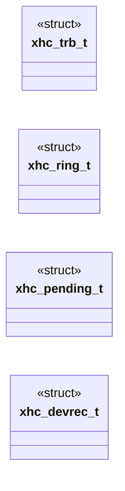
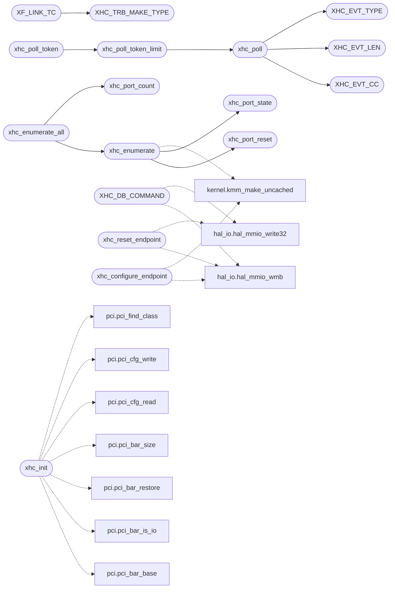

# `drivers/xhci.c`

> Source: [drivers/xhci.c:1](../../drivers/xhci.c#L1) | language `c` | coverage 32.2% | [API index](../index.md)

xhci.c -- xHCI host controller driver, polled event ring.

## Contents

- **Structs:** [`xhc_trb_t`](#xhc_trb_t), [`xhc_ring_t`](#xhc_ring_t), [`xhc_pending_t`](#xhc_pending_t), [`xhc_devrec_t`](#xhc_devrec_t)
- **Functions:** [`xhc_poll`](#xhc_poll), [`xhc_reset_endpoint`](#xhc_reset_endpoint), [`xhc_port_count`](#xhc_port_count), [`xhc_port_state`](#xhc_port_state), [`xhc_port_reset`](#xhc_port_reset), [`xhc_device_count`](#xhc_device_count), [`xhc_device_info`](#xhc_device_info), [`xhc_open_interface`](#xhc_open_interface), [`xhc_control`](#xhc_control), [`xhc_configure_endpoint`](#xhc_configure_endpoint), [`xhc_transfer`](#xhc_transfer), [`xhc_transfer_async`](#xhc_transfer_async), [`xhc_poll_token_limit`](#xhc_poll_token_limit), [`xhc_poll_token`](#xhc_poll_token), [`xhc_enumerate`](#xhc_enumerate), [`xhc_enumerate_all`](#xhc_enumerate_all), [`xhc_init`](#xhc_init), [`xhc_counters`](#xhc_counters), [`xhc_probe_note`](#xhc_probe_note), [`xhc_info`](#xhc_info)
- **Macros:** [`XHC_CAP_OFF`](#xhc_cap_off), [`XHC_OP_USBCMD`](#xhc_op_usbcmd), [`XHC_OP_USBSTS`](#xhc_op_usbsts), [`XHC_OP_PAGESIZE`](#xhc_op_pagesize), [`XHC_OP_CRCR`](#xhc_op_crcr), [`XHC_OP_DCBAAP`](#xhc_op_dcbaap), [`XHC_OP_CONFIG`](#xhc_op_config), [`XHC_OP_PORTSC`](#xhc_op_portsc), [`XHC_PORT_STRIDE`](#xhc_port_stride), [`XHC_RUN_INTR0`](#xhc_run_intr0), [`XHC_RUN_IMAN`](#xhc_run_iman), [`XHC_RUN_IMOD`](#xhc_run_imod), [`XHC_RUN_ERSTSZ`](#xhc_run_erstsz), [`XHC_RUN_ERSTBA`](#xhc_run_erstba), [`XHC_RUN_ERDP`](#xhc_run_erdp), [`XHC_IMAN_IP`](#xhc_iman_ip), [`XHC_IMAN_IE`](#xhc_iman_ie), [`XHC_ERDP_EHB`](#xhc_erdp_ehb), [`XHC_CAP_HCSP1`](#xhc_cap_hcsp1), [`XHC_CAP_HCSP2`](#xhc_cap_hcsp2), [`XHC_CAP_HCSP3`](#xhc_cap_hcsp3), [`XHC_CAP_HCCP1`](#xhc_cap_hccp1), [`XHC_CAP_DBOFF`](#xhc_cap_dboff), [`XHC_CAP_RTSOFF`](#xhc_cap_rtsoff), [`XHC_HCC_AC64`](#xhc_hcc_ac64), [`XHC_HCC_CSZ`](#xhc_hcc_csz), [`XHC_CMD_RUN`](#xhc_cmd_run), [`XHC_CMD_RESET`](#xhc_cmd_reset), [`XHC_STS_HALTED`](#xhc_sts_halted), [`XHC_STS_ATE`](#xhc_sts_ate), [`XHC_PORT_CCS`](#xhc_port_ccs), [`XHC_PORT_PED`](#xhc_port_ped), [`XHC_PORT_PR`](#xhc_port_pr), [`XHC_PORT_PP`](#xhc_port_pp), [`XHC_PORT_SPEED_SHIFT`](#xhc_port_speed_shift), [`XHC_PORT_SPEED_MASK`](#xhc_port_speed_mask), [`XHC_PORT_CHG_MASK`](#xhc_port_chg_mask), [`XHC_TRB_TYPE`](#xhc_trb_type), [`XHC_TRB_CYCLE`](#xhc_trb_cycle), [`XHC_TRB_MAKE_TYPE`](#xhc_trb_make_type), [`XHC_TRB_TYPE_NORMAL`](#xhc_trb_type_normal), [`XHC_TRB_TYPE_SETUP`](#xhc_trb_type_setup), [`XHC_TRB_TYPE_DATA`](#xhc_trb_type_data), [`XHC_TRB_TYPE_STATUS`](#xhc_trb_type_status), [`XHC_TRB_TYPE_LINK`](#xhc_trb_type_link), [`XHC_TRB_TYPE_NOOP_TRB`](#xhc_trb_type_noop_trb), [`XHC_TRB_TYPE_ENABLE_SLOT`](#xhc_trb_type_enable_slot), [`XHC_TRB_TYPE_ADDRESS_DEVICE`](#xhc_trb_type_address_device), [`XHC_TRB_TYPE_CONFIGURE_ENDPOINT`](#xhc_trb_type_configure_endpoint), [`XHC_TRB_TYPE_RESET_ENDPOINT`](#xhc_trb_type_reset_endpoint), [`XHC_TRB_TYPE_STOP_ENDPOINT`](#xhc_trb_type_stop_endpoint), [`XHC_TRB_TYPE_SET_DEQUEUE`](#xhc_trb_type_set_dequeue), [`XHC_TRB_TYPE_NOOP_CMD`](#xhc_trb_type_noop_cmd), [`XHC_TRB_TYPE_TRANSFER_EVENT`](#xhc_trb_type_transfer_event), [`XHC_TRB_TYPE_CMD_COMPLETION`](#xhc_trb_type_cmd_completion), [`XHC_TRB_TYPE_PORT_STATUS`](#xhc_trb_type_port_status), [`XHC_CC_SUCCESS`](#xhc_cc_success), [`XHC_CC_SHORT_PACKET`](#xhc_cc_short_packet), [`XHC_EVT_TYPE`](#xhc_evt_type), [`XHC_EVT_CC`](#xhc_evt_cc), [`XHC_EVT_SLOT`](#xhc_evt_slot), [`XHC_EVT_LEN`](#xhc_evt_len), [`XHC_EVT_TRANSFER`](#xhc_evt_transfer), [`XHC_EVT_CMD_COMPLETION`](#xhc_evt_cmd_completion), [`XHC_EP_DW0_OFF`](#xhc_ep_dw0_off), [`XHC_EP_DW1_OFF`](#xhc_ep_dw1_off), [`XHC_EP_DEQ_OFF`](#xhc_ep_deq_off), [`XHC_EP_AVG_OFF`](#xhc_ep_avg_off), [`XHC_EP_MULT_SHIFT`](#xhc_ep_mult_shift), [`XHC_EP_INTERVAL_SHIFT`](#xhc_ep_interval_shift), [`XHC_EP_TYPE_SHIFT`](#xhc_ep_type_shift), [`XHC_EP_BURST_SHIFT`](#xhc_ep_burst_shift), [`XHC_EP_MAXP_SHIFT`](#xhc_ep_maxp_shift), [`XHC_EP_DCS_BIT`](#xhc_ep_dcs_bit), [`XHC_EPT_CONTROL`](#xhc_ept_control), [`XHC_EPT_ISO_OUT`](#xhc_ept_iso_out), [`XHC_EPT_BULK_OUT`](#xhc_ept_bulk_out), [`XHC_EPT_INT_OUT`](#xhc_ept_int_out), [`XHC_EPT_ISO_IN`](#xhc_ept_iso_in), [`XHC_EPT_BULK_IN`](#xhc_ept_bulk_in), [`XHC_EPT_INT_IN`](#xhc_ept_int_in), [`XHC_EP_CERR`](#xhc_ep_cerr), [`XHC_CTX_SLOT_STRIDE`](#xhc_ctx_slot_stride), [`XHC_CTX_SLOT_STRIDE64`](#xhc_ctx_slot_stride64), [`XHC_CTX_DEVICE_BYTES`](#xhc_ctx_device_bytes), [`XHC_CTX_EP_BYTES`](#xhc_ctx_ep_bytes), [`XHC_ICTX_BYTES`](#xhc_ictx_bytes), [`XHC_SLOT_DW0_OFF`](#xhc_slot_dw0_off), [`XHC_SLOT_DW1_OFF`](#xhc_slot_dw1_off), [`XHC_SLOT_ADDR_OFF`](#xhc_slot_addr_off), [`XHC_SLOT_SPEED_SHIFT`](#xhc_slot_speed_shift), [`XHC_SLOT_ENTRIES_SHIFT`](#xhc_slot_entries_shift), [`XHC_SLOT_RHPORT_SHIFT`](#xhc_slot_rhport_shift), [`XHC_ICTX_DROP_OFF`](#xhc_ictx_drop_off), [`XHC_ICTX_ADD_OFF`](#xhc_ictx_add_off), [`XHC_DCBAA_ENTRIES`](#xhc_dcbaa_entries), [`XHC_ERST_RING_LO`](#xhc_erst_ring_lo), [`XHC_ERST_RING_HI`](#xhc_erst_ring_hi), [`XHC_ERST_SIZE`](#xhc_erst_size), [`XHC_ERST_CYCLE`](#xhc_erst_cycle), [`XHC_ERST_BYTES`](#xhc_erst_bytes), [`XHC_DMA_ALIGN`](#xhc_dma_align), [`XHC_RING_USABLE`](#xhc_ring_usable), [`XHC_DT_DEVICE`](#xhc_dt_device), [`XHC_DT_CONFIG`](#xhc_dt_config), [`XHC_DT_INTERFACE`](#xhc_dt_interface), [`XHC_DT_ENDPOINT`](#xhc_dt_endpoint), [`XHC_DEV_DESC_LEN_OFF`](#xhc_dev_desc_len_off), [`XHC_DEV_DESC_TYPE_OFF`](#xhc_dev_desc_type_off), [`XHC_DEV_DESC_NUM_CFG_OFF`](#xhc_dev_desc_num_cfg_off), [`XHC_CFG_TOTAL_LEN_OFF`](#xhc_cfg_total_len_off), [`XHC_IFACE_OFF`](#xhc_iface_off), [`XHC_IFACE_CLASS_OFF`](#xhc_iface_class_off), [`XHC_IFACE_SUBCLASS_OFF`](#xhc_iface_subclass_off), [`XHC_IFACE_PROTO_OFF`](#xhc_iface_proto_off), [`XHC_EP_DESC_ADDR_OFF`](#xhc_ep_desc_addr_off), [`XHC_EP_DESC_TYPE_OFF`](#xhc_ep_desc_type_off), [`XHC_EP_DESC_MAXP_OFF`](#xhc_ep_desc_maxp_off), [`XF_LINK_TC`](#xf_link_tc), [`XHC_DB_STRIDE`](#xhc_db_stride), [`XHC_DB_COMMAND`](#xhc_db_command), [`XHC_TRB_IOC`](#xhc_trb_ioc), [`XHC_TRB_IDT`](#xhc_trb_idt), [`XHC_TRB_DIR`](#xhc_trb_dir), [`XHC_TRT_OUT`](#xhc_trt_out), [`XHC_TRT_IN`](#xhc_trt_in), [`XHC_CONTROL_TRIES`](#xhc_control_tries)

## Type Diagram



## Call Graph

Solid arrows stay in this module, dashed arrows leave it.



## Structs

<a id="xhc_trb_t"></a>

### `xhc_trb_t`

`struct` | [drivers/xhci.c:239](../../drivers/xhci.c#L239)

```c
typedef struct
```

Docstring: A Transfer Request Block, 16 bytes per spec: 8-byte parameter, 4-byte status, 4-byte control.

This size is load-bearing: a 24-byte struct spaces the ring wrong and the controller walks garbage.

---

<a id="xhc_ring_t"></a>

### `xhc_ring_t`

`struct` | [drivers/xhci.c:250](../../drivers/xhci.c#L250)

```c
typedef struct
```

Docstring: A non-control endpoint's transfer ring plus the producer's place in it. dci is the doorbell target and context index plus one. rearm requests a link re-arm once the producer is halfway round the new lap (see xhc_cmd_rearm: re-arming at the wrap itself races the controller into reading the link stale).

---

<a id="xhc_pending_t"></a>

### `xhc_pending_t`

`struct` | [drivers/xhci.c:264](../../drivers/xhci.c#L264)

```c
typedef struct
```

Docstring: A transfer waiting for its event.

The caller-visible token is the index plus one, so 0 is always "refused" and never a valid token. since dates the post for the async reap budget. len is the asked length and got the bytes the device actually moved, from the event's residue.

---

<a id="xhc_devrec_t"></a>

### `xhc_devrec_t`

`struct` | [drivers/xhci.c:276](../../drivers/xhci.c#L276)

```c
typedef struct
```

Docstring: One enumerated device, with its cached configuration descriptor on the heap.

---

## Functions

<a id="xhc_poll"></a>

### `xhc_poll`

`function` | [drivers/xhci.c:595](../../drivers/xhci.c#L595)

```c
int xhc_poll(void)
```

Docstring: Service the event ring.

Drains every pending TRB and completes the matching transfer. Safe to call from any context, any number of times, with interrupts on or off; it allocates nothing and takes no lock. Returns 1 when it completed something.

**Returns:** `int`

> **Inherited:** Documentation from [`xhc_poll`](#xhc_poll) (headers/drivers/xhci.h:146).

*Calls:* [`XHC_EVT_CC`](#xhc_evt_cc), [`XHC_EVT_LEN`](#xhc_evt_len), [`XHC_EVT_TYPE`](#xhc_evt_type)

*Called by:* [`xhc_poll_token_limit`](#xhc_poll_token_limit)

---

<a id="xhc_reset_endpoint"></a>

### `xhc_reset_endpoint`

`function` | [drivers/xhci.c:723](../../drivers/xhci.c#L723)

```c
int xhc_reset_endpoint(int index, int ep_index)
```

Docstring: Stop, reset and re-point one endpoint's transfer ring after a stall or a timeout, so Bulk-Only recovery continues on the same ring.

Returns 1 when the endpoint is usable again.

**Parameters**

| Name | Type | Default | Description |
|---|---|---|---|
| `index` | `int` |  |  |
| `ep_index` | `int` |  |  |

**Returns:** `int`

> **Inherited:** Documentation from [`xhc_reset_endpoint`](#xhc_reset_endpoint) (headers/drivers/xhci.h:216).

*Calls:* [`hal_mmio_wmb`](headers.arch.x86.hal_io.h.md#hal_mmio_wmb), [`hal_mmio_write32`](headers.arch.x86.hal_io.h.md#hal_mmio_write32)

---

<a id="xhc_port_count"></a>

### `xhc_port_count`

`function` | [drivers/xhci.c:749](../../drivers/xhci.c#L749)

```c
int xhc_port_count(void)
```

Docstring: Number of root ports the controller reports, bounded by XHC_MAX_PORTS.

**Returns:** `int`

> **Inherited:** Documentation from [`xhc_port_count`](#xhc_port_count) (headers/drivers/xhci.h:150).

*Called by:* [`xhc_enumerate_all`](#xhc_enumerate_all)

---

<a id="xhc_port_state"></a>

### `xhc_port_state`

`function` | [drivers/xhci.c:753](../../drivers/xhci.c#L753)

```c
int xhc_port_state(int port, xhc_port_t *out)
```

Docstring: Read a root port's live state.

Returns 1 on a valid port number, 0 otherwise, and leaves out zeroed on refusal.

**Parameters**

| Name | Type | Default | Description |
|---|---|---|---|
| `port` | `int` |  |  |
| `out` | `xhc_port_t *` |  |  |

**Returns:** `int`

> **Inherited:** Documentation from [`xhc_port_state`](#xhc_port_state) (headers/drivers/xhci.h:154).

*Called by:* [`xhc_enumerate`](#xhc_enumerate)

---

<a id="xhc_port_reset"></a>

### `xhc_port_reset`

`function` | [drivers/xhci.c:776](../../drivers/xhci.c#L776)

```c
int xhc_port_reset(int port)
```

Docstring: Ask a port to reset, and wait for it to settle.

Per spec the reset bit is PORTSC bit 4: set it with the W1C change bits written clear, then wait for PED set and PR clear. Returns 1 on a connected device.

**Parameters**

| Name | Type | Default | Description |
|---|---|---|---|
| `port` | `int` |  |  |

**Returns:** `int`

*Called by:* [`xhc_enumerate`](#xhc_enumerate)

---

<a id="xhc_device_count"></a>

### `xhc_device_count`

`function` | [drivers/xhci.c:806](../../drivers/xhci.c#L806)

```c
int xhc_device_count(void)
```

Docstring: Number of devices enumerated so far.

**Returns:** `int`

> **Inherited:** Documentation from [`xhc_device_count`](#xhc_device_count) (headers/drivers/xhci.h:172).

---

<a id="xhc_device_info"></a>

### `xhc_device_info`

`function` | [drivers/xhci.c:814](../../drivers/xhci.c#L814)

```c
int xhc_device_info(int index, xhc_dev_t *out)
```

Docstring: Fetch one enumerated device's state.

**Parameters**

| Name | Type | Default | Description |
|---|---|---|---|
| `index` | `int` |  |  |
| `out` | `xhc_dev_t *` |  |  |

**Returns:** `int`

> **Inherited:** Documentation from [`xhc_device_info`](#xhc_device_info) (headers/drivers/xhci.h:175).

---

<a id="xhc_open_interface"></a>

### `xhc_open_interface`

`function` | [drivers/xhci.c:863](../../drivers/xhci.c#L863)

```c
int xhc_open_interface(int index, unsigned cls, unsigned sub, unsigned proto, xhc_iface_t *out)
```

Docstring: Find an interface of an enumerated device by class triple and copy out its endpoints.

A pure function over the cached configuration descriptor, with every
descriptor's bLength, type and remaining span checked before use: an
unterminated or zero-length descriptor ends the walk instead of looping,
and the endpoint count is capped by XHC_MAX_EPS. out is zeroed first, so
a caller that ignores the result sees a zeroed interface, never stale
stack. Returns 1 on a match with at least one endpoint, 0 otherwise.

**Parameters**

| Name | Type | Default | Description |
|---|---|---|---|
| `index` | `int` |  |  |
| `cls` | `unsigned` |  |  |
| `sub` | `unsigned` |  |  |
| `proto` | `unsigned` |  |  |
| `out` | `xhc_iface_t *` |  |  |

**Returns:** `int`

> **Inherited:** Documentation from [`xhc_open_interface`](#xhc_open_interface) (headers/drivers/xhci.h:186).

---

<a id="xhc_control"></a>

### `xhc_control`

`function` | [drivers/xhci.c:1048](../../drivers/xhci.c#L1048)

```c
int xhc_control(int index, const unsigned char setup[8], void *data, unsigned len, int host_to_device)
```

Docstring: USB is lossy and emulated controllers occasionally drop a completion, so a control transfer retries its whole setup-data-status stage up to three times before reporting failure.

A stall or a refused * stage is not retried: only a missing or failed completion is. define XHC_CONTROL_TRIES 3u

**Parameters**

| Name | Type | Default | Description |
|---|---|---|---|
| `index` | `int` |  |  |
| `setup` | `unsigned char [8]` |  |  |
| `data` | `void *` |  |  |
| `len` | `unsigned` |  |  |
| `host_to_device` | `int` |  |  |

**Returns:** `int`

---

<a id="xhc_configure_endpoint"></a>

### `xhc_configure_endpoint`

`function` | [drivers/xhci.c:1100](../../drivers/xhci.c#L1100)

```c
int xhc_configure_endpoint(int index, int ep_index, int ep_addr, int ep_type, int max_packet, int mult, int interval, int burst)
```

Docstring: Configure one non-control endpoint and give it a transfer ring. ep_index is the endpoint context index, 1..XHC_EP_INDEX_LIMIT-1. ep_addr carries the address and direction bits.

Returns 1 on success, 0 on a bad index, a device that is not addressed, or an allocation failure.

**Parameters**

| Name | Type | Default | Description |
|---|---|---|---|
| `index` | `int` |  |  |
| `ep_index` | `int` |  |  |
| `ep_addr` | `int` |  |  |
| `ep_type` | `int` |  |  |
| `max_packet` | `int` |  |  |
| `mult` | `int` |  |  |
| `interval` | `int` |  |  |
| `burst` | `int` |  |  |

**Returns:** `int`

> **Inherited:** Documentation from [`xhc_configure_endpoint`](#xhc_configure_endpoint) (headers/drivers/xhci.h:200).

*Calls:* [`hal_mmio_wmb`](headers.arch.x86.hal_io.h.md#hal_mmio_wmb), [`kmm_make_uncached`](headers.kernel.h.md#kmm_make_uncached)

---

<a id="xhc_transfer"></a>

### `xhc_transfer`

`function` | [drivers/xhci.c:1202](../../drivers/xhci.c#L1202)

```c
int xhc_transfer(int index, int ep_index, void *buf, unsigned len, int *got)
```

Docstring: Move data on a configured endpoint and wait for its transfer event. len must be exactly what the endpoint's protocol transfers: one HID report, or a whole number of 512-byte blocks. got receives the byte count only for the zero-length case, which is how a device reports "nothing new"; otherwise the transfer either completed at len or failed.

Returns 1 when the device completed the transfer, 0 on a stall, a transfer
error, or a timeout.

**Parameters**

| Name | Type | Default | Description |
|---|---|---|---|
| `index` | `int` |  |  |
| `ep_index` | `int` |  |  |
| `buf` | `void *` |  |  |
| `len` | `unsigned` |  |  |
| `got` | `int *` |  |  |

**Returns:** `int`

> **Inherited:** Documentation from [`xhc_transfer`](#xhc_transfer) (headers/drivers/xhci.h:211).

---

<a id="xhc_transfer_async"></a>

### `xhc_transfer_async`

`function` | [drivers/xhci.c:1222](../../drivers/xhci.c#L1222)

```c
int xhc_transfer_async(int index, int ep_index, void *buf, unsigned len)
```

Docstring: Post one endpoint transfer without waiting: the completion arrives on the event ring and is collected by xhc_poll_token.

Returns the token, or 0 on refusal.

**Parameters**

| Name | Type | Default | Description |
|---|---|---|---|
| `index` | `int` |  |  |
| `ep_index` | `int` |  |  |
| `buf` | `void *` |  |  |
| `len` | `unsigned` |  |  |

**Returns:** `int`

---

<a id="xhc_poll_token_limit"></a>

### `xhc_poll_token_limit`

`function` | [drivers/xhci.c:1233](../../drivers/xhci.c#L1233)

```c
int xhc_poll_token_limit(int token, unsigned budget_ms)
```

Docstring: Non-blocking completion check for xhc_transfer_async.

Drains the ring, then reports 1 on success, -1 on a failed completion, -2 on a wait past the budget, and 0 while still outstanding. Consumed tokens are dropped, so a caller that polls to completion never leaks the table. A zero budget never expires: an interrupt endpoint with nothing to say answers NAK rather than an event, and expiring its only transfer orphans the report it eventually delivers to a token nobody holds.

**Parameters**

| Name | Type | Default | Description |
|---|---|---|---|
| `token` | `int` |  |  |
| `budget_ms` | `unsigned` |  |  |

**Returns:** `int`

*Calls:* [`xhc_poll`](#xhc_poll)

*Called by:* [`xhc_poll_token`](#xhc_poll_token)

---

<a id="xhc_poll_token"></a>

### `xhc_poll_token`

`function` | [drivers/xhci.c:1252](../../drivers/xhci.c#L1252)

```c
int xhc_poll_token(int token)
```

**Parameters**

| Name | Type | Default | Description |
|---|---|---|---|
| `token` | `int` |  |  |

**Returns:** `int`

*Calls:* [`xhc_poll_token_limit`](#xhc_poll_token_limit)

---

<a id="xhc_enumerate"></a>

### `xhc_enumerate`

`function` | [drivers/xhci.c:1358](../../drivers/xhci.c#L1358)

```c
int xhc_enumerate(int port)
```

Docstring: Reset, address, describe and register the device on a port.

Returns its index, or -1 on any failure, in which case the slot is released and the error is counted. Idempotent per port: a port already holding a live device returns that device's index.

**Parameters**

| Name | Type | Default | Description |
|---|---|---|---|
| `port` | `int` |  |  |

**Returns:** `int`

> **Inherited:** Documentation from [`xhc_enumerate`](#xhc_enumerate) (headers/drivers/xhci.h:165).

*Calls:* [`xhc_port_reset`](#xhc_port_reset), [`xhc_port_state`](#xhc_port_state), [`kmm_make_uncached`](headers.kernel.h.md#kmm_make_uncached)

*Called by:* [`xhc_enumerate_all`](#xhc_enumerate_all)

---

<a id="xhc_enumerate_all"></a>

### `xhc_enumerate_all`

`function` | [drivers/xhci.c:1444](../../drivers/xhci.c#L1444)

```c
int xhc_enumerate_all(void)
```

Docstring: Enumerate every port that has something attached.

Returns the number of devices registered by this call.

**Returns:** `int`

> **Inherited:** Documentation from [`xhc_enumerate_all`](#xhc_enumerate_all) (headers/drivers/xhci.h:169).

*Calls:* [`xhc_enumerate`](#xhc_enumerate), [`xhc_port_count`](#xhc_port_count)

---

<a id="xhc_init"></a>

### `xhc_init`

`function` | [drivers/xhci.c:1658](../../drivers/xhci.c#L1658)

```c
int xhc_init(void)
```

Docstring: Bring up the first xHCI controller found.

Returns 1 when a controller is running and xhc_poll will service it, 0 when there is none, which is the normal case on QEMU and on a machine whose firmware already owns the controller. Never leaves a half-mapped BAR behind: any failure restores the firmware's assignment.

**Returns:** `int`

> **Inherited:** Documentation from [`xhc_init`](#xhc_init) (headers/drivers/xhci.h:140).

*Calls:* [`pci_bar_base`](headers.drivers.pci.h.md#pci_bar_base), [`pci_bar_is_io`](headers.drivers.pci.h.md#pci_bar_is_io), [`pci_bar_restore`](headers.drivers.pci.h.md#pci_bar_restore), [`pci_bar_size`](headers.drivers.pci.h.md#pci_bar_size), [`pci_cfg_read`](headers.drivers.pci.h.md#pci_cfg_read), [`pci_cfg_write`](headers.drivers.pci.h.md#pci_cfg_write), [`pci_find_class`](headers.drivers.pci.h.md#pci_find_class), [`kmm_map_device`](kernel.mm.paging.c.md#kmm_map_device)

---

<a id="xhc_counters"></a>

### `xhc_counters`

`function` | [drivers/xhci.c:1790](../../drivers/xhci.c#L1790)

```c
void xhc_counters(xhc_counters_t *out)
```

Docstring: Snapshot the counters.

**Parameters**

| Name | Type | Default | Description |
|---|---|---|---|
| `out` | `xhc_counters_t *` |  |  |

> **Inherited:** Documentation from [`xhc_counters`](#xhc_counters) (headers/drivers/xhci.h:229).

---

<a id="xhc_probe_note"></a>

### `xhc_probe_note`

`function` `const` | [drivers/xhci.c:1794](../../drivers/xhci.c#L1794)

```c
const char *xhc_probe_note(void)
```

Docstring: Why the last xhc_init failed, or NULL when it succeeded.

Reported by the usb builtin so an absent controller and a refused one are distinguishable.

**Returns:** `char *`

> **Inherited:** Documentation from [`xhc_probe_note`](#xhc_probe_note) (headers/drivers/xhci.h:234).

---

<a id="xhc_info"></a>

### `xhc_info`

`function` | [drivers/xhci.c:1798](../../drivers/xhci.c#L1798)

```c
int xhc_info(unsigned *version, unsigned *slots, unsigned *ports, unsigned *caplength)
```

Docstring: Controller version and capability-derived limits for the usb builtin.

Returns 1 when a controller is present.

**Parameters**

| Name | Type | Default | Description |
|---|---|---|---|
| `version` | `unsigned *` |  |  |
| `slots` | `unsigned *` |  |  |
| `ports` | `unsigned *` |  |  |
| `caplength` | `unsigned *` |  |  |

**Returns:** `int`

> **Inherited:** Documentation from [`xhc_info`](#xhc_info) (headers/drivers/xhci.h:238).

---

## Macros

<a id="xhc_cap_off"></a>

### `XHC_CAP_OFF`

`macro` | [drivers/xhci.c:55](../../drivers/xhci.c#L55)

```c
#define XHC_CAP_OFF
```

---- Register-space layout ----

Four windows, and mixing them up produces a driver that reads plausible
values and silently writes them nowhere:

  0x0000            capability registers (CAPLENGTH, HCSPARAMS, ...)
  CAPLENGTH         operational registers
  0x1000            runtime registers and the interrupter array
  0x2000            doorbell array

The operational window starts at CAPLENGTH, not at a fixed offset, and the
capability block is read-only: writing USBCMD at offset 0 lands in
CAPLENGTH, is dropped, and the controller never runs -- a failure that
looks like dead hardware rather than a wrong address.

These are the xHCI 1.x register offsets, not a private layout.

---

<a id="xhc_op_usbcmd"></a>

### `XHC_OP_USBCMD`

`macro` | [drivers/xhci.c:58](../../drivers/xhci.c#L58)

```c
#define XHC_OP_USBCMD
```

---- Operational register offsets, from the operational window ----

---

<a id="xhc_op_usbsts"></a>

### `XHC_OP_USBSTS`

`macro` | [drivers/xhci.c:59](../../drivers/xhci.c#L59)

```c
#define XHC_OP_USBSTS
```

---

<a id="xhc_op_pagesize"></a>

### `XHC_OP_PAGESIZE`

`macro` | [drivers/xhci.c:60](../../drivers/xhci.c#L60)

```c
#define XHC_OP_PAGESIZE
```

---

<a id="xhc_op_crcr"></a>

### `XHC_OP_CRCR`

`macro` | [drivers/xhci.c:61](../../drivers/xhci.c#L61)

```c
#define XHC_OP_CRCR
```

---

<a id="xhc_op_dcbaap"></a>

### `XHC_OP_DCBAAP`

`macro` | [drivers/xhci.c:62](../../drivers/xhci.c#L62)

```c
#define XHC_OP_DCBAAP
```

---

<a id="xhc_op_config"></a>

### `XHC_OP_CONFIG`

`macro` | [drivers/xhci.c:63](../../drivers/xhci.c#L63)

```c
#define XHC_OP_CONFIG
```

---

<a id="xhc_op_portsc"></a>

### `XHC_OP_PORTSC`

`macro` | [drivers/xhci.c:64](../../drivers/xhci.c#L64)

```c
#define XHC_OP_PORTSC
```

---

<a id="xhc_port_stride"></a>

### `XHC_PORT_STRIDE`

`macro` | [drivers/xhci.c:65](../../drivers/xhci.c#L65)

```c
#define XHC_PORT_STRIDE
```

---

<a id="xhc_run_intr0"></a>

### `XHC_RUN_INTR0`

`macro` | [drivers/xhci.c:71](../../drivers/xhci.c#L71)

```c
#define XHC_RUN_INTR0
```

---- Runtime register offsets, from the RTSOFF window ----

The interrupter array starts 0x20 into the runtime window, one 0x20 entry
per interrupter, and one interrupter is all this driver uses.

---

<a id="xhc_run_iman"></a>

### `XHC_RUN_IMAN`

`macro` | [drivers/xhci.c:72](../../drivers/xhci.c#L72)

```c
#define XHC_RUN_IMAN
```

---

<a id="xhc_run_imod"></a>

### `XHC_RUN_IMOD`

`macro` | [drivers/xhci.c:73](../../drivers/xhci.c#L73)

```c
#define XHC_RUN_IMOD
```

---

<a id="xhc_run_erstsz"></a>

### `XHC_RUN_ERSTSZ`

`macro` | [drivers/xhci.c:74](../../drivers/xhci.c#L74)

```c
#define XHC_RUN_ERSTSZ
```

---

<a id="xhc_run_erstba"></a>

### `XHC_RUN_ERSTBA`

`macro` | [drivers/xhci.c:75](../../drivers/xhci.c#L75)

```c
#define XHC_RUN_ERSTBA
```

---

<a id="xhc_run_erdp"></a>

### `XHC_RUN_ERDP`

`macro` | [drivers/xhci.c:76](../../drivers/xhci.c#L76)

```c
#define XHC_RUN_ERDP
```

---

<a id="xhc_iman_ip"></a>

### `XHC_IMAN_IP`

`macro` | [drivers/xhci.c:77](../../drivers/xhci.c#L77)

```c
#define XHC_IMAN_IP
```

---

<a id="xhc_iman_ie"></a>

### `XHC_IMAN_IE`

`macro` | [drivers/xhci.c:78](../../drivers/xhci.c#L78)

```c
#define XHC_IMAN_IE
```

---

<a id="xhc_erdp_ehb"></a>

### `XHC_ERDP_EHB`

`macro` | [drivers/xhci.c:79](../../drivers/xhci.c#L79)

```c
#define XHC_ERDP_EHB
```

---

<a id="xhc_cap_hcsp1"></a>

### `XHC_CAP_HCSP1`

`macro` | [drivers/xhci.c:82](../../drivers/xhci.c#L82)

```c
#define XHC_CAP_HCSP1
```

---- Capability register offsets ----

---

<a id="xhc_cap_hcsp2"></a>

### `XHC_CAP_HCSP2`

`macro` | [drivers/xhci.c:83](../../drivers/xhci.c#L83)

```c
#define XHC_CAP_HCSP2
```

---

<a id="xhc_cap_hcsp3"></a>

### `XHC_CAP_HCSP3`

`macro` | [drivers/xhci.c:84](../../drivers/xhci.c#L84)

```c
#define XHC_CAP_HCSP3
```

---

<a id="xhc_cap_hccp1"></a>

### `XHC_CAP_HCCP1`

`macro` | [drivers/xhci.c:85](../../drivers/xhci.c#L85)

```c
#define XHC_CAP_HCCP1
```

---

<a id="xhc_cap_dboff"></a>

### `XHC_CAP_DBOFF`

`macro` | [drivers/xhci.c:86](../../drivers/xhci.c#L86)

```c
#define XHC_CAP_DBOFF
```

---

<a id="xhc_cap_rtsoff"></a>

### `XHC_CAP_RTSOFF`

`macro` | [drivers/xhci.c:87](../../drivers/xhci.c#L87)

```c
#define XHC_CAP_RTSOFF
```

---

<a id="xhc_hcc_ac64"></a>

### `XHC_HCC_AC64`

`macro` | [drivers/xhci.c:88](../../drivers/xhci.c#L88)

```c
#define XHC_HCC_AC64
```

---

<a id="xhc_hcc_csz"></a>

### `XHC_HCC_CSZ`

`macro` | [drivers/xhci.c:89](../../drivers/xhci.c#L89)

```c
#define XHC_HCC_CSZ
```

---

<a id="xhc_cmd_run"></a>

### `XHC_CMD_RUN`

`macro` | [drivers/xhci.c:92](../../drivers/xhci.c#L92)

```c
#define XHC_CMD_RUN
```

---- USBCMD / USBSTS ----

---

<a id="xhc_cmd_reset"></a>

### `XHC_CMD_RESET`

`macro` | [drivers/xhci.c:93](../../drivers/xhci.c#L93)

```c
#define XHC_CMD_RESET
```

---

<a id="xhc_sts_halted"></a>

### `XHC_STS_HALTED`

`macro` | [drivers/xhci.c:96](../../drivers/xhci.c#L96)

```c
#define XHC_STS_HALTED
```

Bit 0 of USBSTS is Host Controller Halted: set while the controller is stopped, cleared once it is running.

---

<a id="xhc_sts_ate"></a>

### `XHC_STS_ATE`

`macro` | [drivers/xhci.c:97](../../drivers/xhci.c#L97)

```c
#define XHC_STS_ATE
```

---

<a id="xhc_port_ccs"></a>

### `XHC_PORT_CCS`

`macro` | [drivers/xhci.c:100](../../drivers/xhci.c#L100)

```c
#define XHC_PORT_CCS
```

---- PORTSC ----

---

<a id="xhc_port_ped"></a>

### `XHC_PORT_PED`

`macro` | [drivers/xhci.c:101](../../drivers/xhci.c#L101)

```c
#define XHC_PORT_PED
```

---

<a id="xhc_port_pr"></a>

### `XHC_PORT_PR`

`macro` | [drivers/xhci.c:102](../../drivers/xhci.c#L102)

```c
#define XHC_PORT_PR
```

---

<a id="xhc_port_pp"></a>

### `XHC_PORT_PP`

`macro` | [drivers/xhci.c:103](../../drivers/xhci.c#L103)

```c
#define XHC_PORT_PP
```

---

<a id="xhc_port_speed_shift"></a>

### `XHC_PORT_SPEED_SHIFT`

`macro` | [drivers/xhci.c:104](../../drivers/xhci.c#L104)

```c
#define XHC_PORT_SPEED_SHIFT
```

---

<a id="xhc_port_speed_mask"></a>

### `XHC_PORT_SPEED_MASK`

`macro` | [drivers/xhci.c:105](../../drivers/xhci.c#L105)

```c
#define XHC_PORT_SPEED_MASK
```

---

<a id="xhc_port_chg_mask"></a>

### `XHC_PORT_CHG_MASK`

`macro` | [drivers/xhci.c:106](../../drivers/xhci.c#L106)

```c
#define XHC_PORT_CHG_MASK
```

---

<a id="xhc_trb_type"></a>

### `XHC_TRB_TYPE`

`macro` | [drivers/xhci.c:109](../../drivers/xhci.c#L109)

```c
#define XHC_TRB_TYPE(t)
```

---- TRB control field ----

---

<a id="xhc_trb_cycle"></a>

### `XHC_TRB_CYCLE`

`macro` | [drivers/xhci.c:110](../../drivers/xhci.c#L110)

```c
#define XHC_TRB_CYCLE(t)
```

---

<a id="xhc_trb_make_type"></a>

### `XHC_TRB_MAKE_TYPE`

`macro` | [drivers/xhci.c:111](../../drivers/xhci.c#L111)

```c
#define XHC_TRB_MAKE_TYPE(v)
```

*Called by:* [`XF_LINK_TC`](#xf_link_tc)

---

<a id="xhc_trb_type_normal"></a>

### `XHC_TRB_TYPE_NORMAL`

`macro` | [drivers/xhci.c:113](../../drivers/xhci.c#L113)

```c
#define XHC_TRB_TYPE_NORMAL
```

---

<a id="xhc_trb_type_setup"></a>

### `XHC_TRB_TYPE_SETUP`

`macro` | [drivers/xhci.c:114](../../drivers/xhci.c#L114)

```c
#define XHC_TRB_TYPE_SETUP
```

---

<a id="xhc_trb_type_data"></a>

### `XHC_TRB_TYPE_DATA`

`macro` | [drivers/xhci.c:115](../../drivers/xhci.c#L115)

```c
#define XHC_TRB_TYPE_DATA
```

---

<a id="xhc_trb_type_status"></a>

### `XHC_TRB_TYPE_STATUS`

`macro` | [drivers/xhci.c:116](../../drivers/xhci.c#L116)

```c
#define XHC_TRB_TYPE_STATUS
```

---

<a id="xhc_trb_type_link"></a>

### `XHC_TRB_TYPE_LINK`

`macro` | [drivers/xhci.c:117](../../drivers/xhci.c#L117)

```c
#define XHC_TRB_TYPE_LINK
```

---

<a id="xhc_trb_type_noop_trb"></a>

### `XHC_TRB_TYPE_NOOP_TRB`

`macro` | [drivers/xhci.c:118](../../drivers/xhci.c#L118)

```c
#define XHC_TRB_TYPE_NOOP_TRB
```

---

<a id="xhc_trb_type_enable_slot"></a>

### `XHC_TRB_TYPE_ENABLE_SLOT`

`macro` | [drivers/xhci.c:119](../../drivers/xhci.c#L119)

```c
#define XHC_TRB_TYPE_ENABLE_SLOT
```

---

<a id="xhc_trb_type_address_device"></a>

### `XHC_TRB_TYPE_ADDRESS_DEVICE`

`macro` | [drivers/xhci.c:120](../../drivers/xhci.c#L120)

```c
#define XHC_TRB_TYPE_ADDRESS_DEVICE
```

---

<a id="xhc_trb_type_configure_endpoint"></a>

### `XHC_TRB_TYPE_CONFIGURE_ENDPOINT`

`macro` | [drivers/xhci.c:121](../../drivers/xhci.c#L121)

```c
#define XHC_TRB_TYPE_CONFIGURE_ENDPOINT
```

---

<a id="xhc_trb_type_reset_endpoint"></a>

### `XHC_TRB_TYPE_RESET_ENDPOINT`

`macro` | [drivers/xhci.c:122](../../drivers/xhci.c#L122)

```c
#define XHC_TRB_TYPE_RESET_ENDPOINT
```

---

<a id="xhc_trb_type_stop_endpoint"></a>

### `XHC_TRB_TYPE_STOP_ENDPOINT`

`macro` | [drivers/xhci.c:123](../../drivers/xhci.c#L123)

```c
#define XHC_TRB_TYPE_STOP_ENDPOINT
```

---

<a id="xhc_trb_type_set_dequeue"></a>

### `XHC_TRB_TYPE_SET_DEQUEUE`

`macro` | [drivers/xhci.c:124](../../drivers/xhci.c#L124)

```c
#define XHC_TRB_TYPE_SET_DEQUEUE
```

---

<a id="xhc_trb_type_noop_cmd"></a>

### `XHC_TRB_TYPE_NOOP_CMD`

`macro` | [drivers/xhci.c:125](../../drivers/xhci.c#L125)

```c
#define XHC_TRB_TYPE_NOOP_CMD
```

---

<a id="xhc_trb_type_transfer_event"></a>

### `XHC_TRB_TYPE_TRANSFER_EVENT`

`macro` | [drivers/xhci.c:126](../../drivers/xhci.c#L126)

```c
#define XHC_TRB_TYPE_TRANSFER_EVENT
```

---

<a id="xhc_trb_type_cmd_completion"></a>

### `XHC_TRB_TYPE_CMD_COMPLETION`

`macro` | [drivers/xhci.c:127](../../drivers/xhci.c#L127)

```c
#define XHC_TRB_TYPE_CMD_COMPLETION
```

---

<a id="xhc_trb_type_port_status"></a>

### `XHC_TRB_TYPE_PORT_STATUS`

`macro` | [drivers/xhci.c:128](../../drivers/xhci.c#L128)

```c
#define XHC_TRB_TYPE_PORT_STATUS
```

---

<a id="xhc_cc_success"></a>

### `XHC_CC_SUCCESS`

`macro` | [drivers/xhci.c:131](../../drivers/xhci.c#L131)

```c
#define XHC_CC_SUCCESS
```

---- Command completion codes ----

---

<a id="xhc_cc_short_packet"></a>

### `XHC_CC_SHORT_PACKET`

`macro` | [drivers/xhci.c:132](../../drivers/xhci.c#L132)

```c
#define XHC_CC_SHORT_PACKET
```

---

<a id="xhc_evt_type"></a>

### `XHC_EVT_TYPE`

`macro` | [drivers/xhci.c:135](../../drivers/xhci.c#L135)

```c
#define XHC_EVT_TYPE(e)
```

---- Event TRB types ----

*Called by:* [`xhc_poll`](#xhc_poll)

---

<a id="xhc_evt_cc"></a>

### `XHC_EVT_CC`

`macro` | [drivers/xhci.c:136](../../drivers/xhci.c#L136)

```c
#define XHC_EVT_CC(e)
```

*Called by:* [`xhc_poll`](#xhc_poll)

---

<a id="xhc_evt_slot"></a>

### `XHC_EVT_SLOT`

`macro` | [drivers/xhci.c:137](../../drivers/xhci.c#L137)

```c
#define XHC_EVT_SLOT(e)
```

---

<a id="xhc_evt_len"></a>

### `XHC_EVT_LEN`

`macro` | [drivers/xhci.c:138](../../drivers/xhci.c#L138)

```c
#define XHC_EVT_LEN(e)
```

*Called by:* [`xhc_poll`](#xhc_poll)

---

<a id="xhc_evt_transfer"></a>

### `XHC_EVT_TRANSFER`

`macro` | [drivers/xhci.c:139](../../drivers/xhci.c#L139)

```c
#define XHC_EVT_TRANSFER
```

---

<a id="xhc_evt_cmd_completion"></a>

### `XHC_EVT_CMD_COMPLETION`

`macro` | [drivers/xhci.c:140](../../drivers/xhci.c#L140)

```c
#define XHC_EVT_CMD_COMPLETION
```

---

<a id="xhc_ep_dw0_off"></a>

### `XHC_EP_DW0_OFF`

`macro` | [drivers/xhci.c:150](../../drivers/xhci.c#L150)

```c
#define XHC_EP_DW0_OFF
```

---- Endpoint context, 32 bytes per spec Table 140 ----
DW0 off0: state[2:0] mult[10:8] maxstreams[14:11] lsa[15] interval[23:16]
DW1 off4: cerr[1:0] type[5:3] hid[7] burst[15:8] maxp[31:16]
DW2-3 off8: dequeue[63:4] dcs[0]
DW4 off16: avglen[15:0] esit[31:16]

---

<a id="xhc_ep_dw1_off"></a>

### `XHC_EP_DW1_OFF`

`macro` | [drivers/xhci.c:151](../../drivers/xhci.c#L151)

```c
#define XHC_EP_DW1_OFF
```

---

<a id="xhc_ep_deq_off"></a>

### `XHC_EP_DEQ_OFF`

`macro` | [drivers/xhci.c:152](../../drivers/xhci.c#L152)

```c
#define XHC_EP_DEQ_OFF
```

---

<a id="xhc_ep_avg_off"></a>

### `XHC_EP_AVG_OFF`

`macro` | [drivers/xhci.c:153](../../drivers/xhci.c#L153)

```c
#define XHC_EP_AVG_OFF
```

---

<a id="xhc_ep_mult_shift"></a>

### `XHC_EP_MULT_SHIFT`

`macro` | [drivers/xhci.c:154](../../drivers/xhci.c#L154)

```c
#define XHC_EP_MULT_SHIFT
```

---

<a id="xhc_ep_interval_shift"></a>

### `XHC_EP_INTERVAL_SHIFT`

`macro` | [drivers/xhci.c:155](../../drivers/xhci.c#L155)

```c
#define XHC_EP_INTERVAL_SHIFT
```

---

<a id="xhc_ep_type_shift"></a>

### `XHC_EP_TYPE_SHIFT`

`macro` | [drivers/xhci.c:156](../../drivers/xhci.c#L156)

```c
#define XHC_EP_TYPE_SHIFT
```

---

<a id="xhc_ep_burst_shift"></a>

### `XHC_EP_BURST_SHIFT`

`macro` | [drivers/xhci.c:157](../../drivers/xhci.c#L157)

```c
#define XHC_EP_BURST_SHIFT
```

---

<a id="xhc_ep_maxp_shift"></a>

### `XHC_EP_MAXP_SHIFT`

`macro` | [drivers/xhci.c:158](../../drivers/xhci.c#L158)

```c
#define XHC_EP_MAXP_SHIFT
```

---

<a id="xhc_ep_dcs_bit"></a>

### `XHC_EP_DCS_BIT`

`macro` | [drivers/xhci.c:159](../../drivers/xhci.c#L159)

```c
#define XHC_EP_DCS_BIT
```

---

<a id="xhc_ept_control"></a>

### `XHC_EPT_CONTROL`

`macro` | [drivers/xhci.c:162](../../drivers/xhci.c#L162)

```c
#define XHC_EPT_CONTROL
```

---- Endpoint types, spec Table 140: 0 is Not Valid, control is 4 ----

---

<a id="xhc_ept_iso_out"></a>

### `XHC_EPT_ISO_OUT`

`macro` | [drivers/xhci.c:163](../../drivers/xhci.c#L163)

```c
#define XHC_EPT_ISO_OUT
```

---

<a id="xhc_ept_bulk_out"></a>

### `XHC_EPT_BULK_OUT`

`macro` | [drivers/xhci.c:164](../../drivers/xhci.c#L164)

```c
#define XHC_EPT_BULK_OUT
```

---

<a id="xhc_ept_int_out"></a>

### `XHC_EPT_INT_OUT`

`macro` | [drivers/xhci.c:165](../../drivers/xhci.c#L165)

```c
#define XHC_EPT_INT_OUT
```

---

<a id="xhc_ept_iso_in"></a>

### `XHC_EPT_ISO_IN`

`macro` | [drivers/xhci.c:166](../../drivers/xhci.c#L166)

```c
#define XHC_EPT_ISO_IN
```

---

<a id="xhc_ept_bulk_in"></a>

### `XHC_EPT_BULK_IN`

`macro` | [drivers/xhci.c:167](../../drivers/xhci.c#L167)

```c
#define XHC_EPT_BULK_IN
```

---

<a id="xhc_ept_int_in"></a>

### `XHC_EPT_INT_IN`

`macro` | [drivers/xhci.c:168](../../drivers/xhci.c#L168)

```c
#define XHC_EPT_INT_IN
```

---

<a id="xhc_ep_cerr"></a>

### `XHC_EP_CERR`

`macro` | [drivers/xhci.c:169](../../drivers/xhci.c#L169)

```c
#define XHC_EP_CERR
```

---

<a id="xhc_ctx_slot_stride"></a>

### `XHC_CTX_SLOT_STRIDE`

`macro` | [drivers/xhci.c:173](../../drivers/xhci.c#L173)

```c
#define XHC_CTX_SLOT_STRIDE
```

---- Context geometry: 32 or 64 bytes per context per HCC CSZ ----
The stride covers the slot plus all 31 endpoint contexts.

---

<a id="xhc_ctx_slot_stride64"></a>

### `XHC_CTX_SLOT_STRIDE64`

`macro` | [drivers/xhci.c:174](../../drivers/xhci.c#L174)

```c
#define XHC_CTX_SLOT_STRIDE64
```

---

<a id="xhc_ctx_device_bytes"></a>

### `XHC_CTX_DEVICE_BYTES`

`macro` | [drivers/xhci.c:175](../../drivers/xhci.c#L175)

```c
#define XHC_CTX_DEVICE_BYTES
```

---

<a id="xhc_ctx_ep_bytes"></a>

### `XHC_CTX_EP_BYTES`

`macro` | [drivers/xhci.c:176](../../drivers/xhci.c#L176)

```c
#define XHC_CTX_EP_BYTES
```

---

<a id="xhc_ictx_bytes"></a>

### `XHC_ICTX_BYTES`

`macro` | [drivers/xhci.c:177](../../drivers/xhci.c#L177)

```c
#define XHC_ICTX_BYTES
```

---

<a id="xhc_slot_dw0_off"></a>

### `XHC_SLOT_DW0_OFF`

`macro` | [drivers/xhci.c:181](../../drivers/xhci.c#L181)

```c
#define XHC_SLOT_DW0_OFF
```

---- Slot context, 32 bytes per spec: DW0 off0 route[19:0] speed[23:20]
mtt[25] hub[26] entries[31:27]; DW1 off4 exitlat[15:0] roothub[23:16]
ports[31:24]; DW3 off12 addr[7:0] state[31:27]

---

<a id="xhc_slot_dw1_off"></a>

### `XHC_SLOT_DW1_OFF`

`macro` | [drivers/xhci.c:182](../../drivers/xhci.c#L182)

```c
#define XHC_SLOT_DW1_OFF
```

---

<a id="xhc_slot_addr_off"></a>

### `XHC_SLOT_ADDR_OFF`

`macro` | [drivers/xhci.c:183](../../drivers/xhci.c#L183)

```c
#define XHC_SLOT_ADDR_OFF
```

---

<a id="xhc_slot_speed_shift"></a>

### `XHC_SLOT_SPEED_SHIFT`

`macro` | [drivers/xhci.c:184](../../drivers/xhci.c#L184)

```c
#define XHC_SLOT_SPEED_SHIFT
```

---

<a id="xhc_slot_entries_shift"></a>

### `XHC_SLOT_ENTRIES_SHIFT`

`macro` | [drivers/xhci.c:185](../../drivers/xhci.c#L185)

```c
#define XHC_SLOT_ENTRIES_SHIFT
```

---

<a id="xhc_slot_rhport_shift"></a>

### `XHC_SLOT_RHPORT_SHIFT`

`macro` | [drivers/xhci.c:186](../../drivers/xhci.c#L186)

```c
#define XHC_SLOT_RHPORT_SHIFT
```

---

<a id="xhc_ictx_drop_off"></a>

### `XHC_ICTX_DROP_OFF`

`macro` | [drivers/xhci.c:189](../../drivers/xhci.c#L189)

```c
#define XHC_ICTX_DROP_OFF
```

---- Input context: DW0-1 off0 drop/add flags, slot and EPs after ----

---

<a id="xhc_ictx_add_off"></a>

### `XHC_ICTX_ADD_OFF`

`macro` | [drivers/xhci.c:190](../../drivers/xhci.c#L190)

```c
#define XHC_ICTX_ADD_OFF
```

---

<a id="xhc_dcbaa_entries"></a>

### `XHC_DCBAA_ENTRIES`

`macro` | [drivers/xhci.c:193](../../drivers/xhci.c#L193)

```c
#define XHC_DCBAA_ENTRIES
```

---- DCBAA: entry per slot, entry 0 unused, entry N = device context N ----

---

<a id="xhc_erst_ring_lo"></a>

### `XHC_ERST_RING_LO`

`macro` | [drivers/xhci.c:196](../../drivers/xhci.c#L196)

```c
#define XHC_ERST_RING_LO
```

---- ERST entry, in 32-bit words ----

---

<a id="xhc_erst_ring_hi"></a>

### `XHC_ERST_RING_HI`

`macro` | [drivers/xhci.c:197](../../drivers/xhci.c#L197)

```c
#define XHC_ERST_RING_HI
```

---

<a id="xhc_erst_size"></a>

### `XHC_ERST_SIZE`

`macro` | [drivers/xhci.c:198](../../drivers/xhci.c#L198)

```c
#define XHC_ERST_SIZE
```

---

<a id="xhc_erst_cycle"></a>

### `XHC_ERST_CYCLE`

`macro` | [drivers/xhci.c:199](../../drivers/xhci.c#L199)

```c
#define XHC_ERST_CYCLE
```

---

<a id="xhc_erst_bytes"></a>

### `XHC_ERST_BYTES`

`macro` | [drivers/xhci.c:200](../../drivers/xhci.c#L200)

```c
#define XHC_ERST_BYTES
```

---

<a id="xhc_dma_align"></a>

### `XHC_DMA_ALIGN`

`macro` | [drivers/xhci.c:212](../../drivers/xhci.c#L212)

```c
#define XHC_DMA_ALIGN
```

---- DMA alignment ----

64 bytes, and this is not alignment for its own sake: the hardware masks
the low bits of DCBAAP, of the command ring configuration register and of
the event ring segment table base. A ring allocated on 16 bytes and handed
over silently moves, and the controller then reads a command ring full of
zeros -- which looks exactly like a controller that ignores the doorbell.

Contexts need 32 and the context array 64, so one alignment covers every
structure the controller walks.

---

<a id="xhc_ring_usable"></a>

### `XHC_RING_USABLE`

`macro` | [drivers/xhci.c:215](../../drivers/xhci.c#L215)

```c
#define XHC_RING_USABLE
```

---- Ring geometry: the last TRB of a ring is its link ----

---

<a id="xhc_dt_device"></a>

### `XHC_DT_DEVICE`

`macro` | [drivers/xhci.c:218](../../drivers/xhci.c#L218)

```c
#define XHC_DT_DEVICE
```

---- USB descriptor types ----

---

<a id="xhc_dt_config"></a>

### `XHC_DT_CONFIG`

`macro` | [drivers/xhci.c:219](../../drivers/xhci.c#L219)

```c
#define XHC_DT_CONFIG
```

---

<a id="xhc_dt_interface"></a>

### `XHC_DT_INTERFACE`

`macro` | [drivers/xhci.c:220](../../drivers/xhci.c#L220)

```c
#define XHC_DT_INTERFACE
```

---

<a id="xhc_dt_endpoint"></a>

### `XHC_DT_ENDPOINT`

`macro` | [drivers/xhci.c:221](../../drivers/xhci.c#L221)

```c
#define XHC_DT_ENDPOINT
```

---

<a id="xhc_dev_desc_len_off"></a>

### `XHC_DEV_DESC_LEN_OFF`

`macro` | [drivers/xhci.c:224](../../drivers/xhci.c#L224)

```c
#define XHC_DEV_DESC_LEN_OFF
```

---- Descriptor field offsets ----

---

<a id="xhc_dev_desc_type_off"></a>

### `XHC_DEV_DESC_TYPE_OFF`

`macro` | [drivers/xhci.c:225](../../drivers/xhci.c#L225)

```c
#define XHC_DEV_DESC_TYPE_OFF
```

---

<a id="xhc_dev_desc_num_cfg_off"></a>

### `XHC_DEV_DESC_NUM_CFG_OFF`

`macro` | [drivers/xhci.c:226](../../drivers/xhci.c#L226)

```c
#define XHC_DEV_DESC_NUM_CFG_OFF
```

---

<a id="xhc_cfg_total_len_off"></a>

### `XHC_CFG_TOTAL_LEN_OFF`

`macro` | [drivers/xhci.c:227](../../drivers/xhci.c#L227)

```c
#define XHC_CFG_TOTAL_LEN_OFF
```

---

<a id="xhc_iface_off"></a>

### `XHC_IFACE_OFF`

`macro` | [drivers/xhci.c:228](../../drivers/xhci.c#L228)

```c
#define XHC_IFACE_OFF
```

---

<a id="xhc_iface_class_off"></a>

### `XHC_IFACE_CLASS_OFF`

`macro` | [drivers/xhci.c:229](../../drivers/xhci.c#L229)

```c
#define XHC_IFACE_CLASS_OFF
```

---

<a id="xhc_iface_subclass_off"></a>

### `XHC_IFACE_SUBCLASS_OFF`

`macro` | [drivers/xhci.c:230](../../drivers/xhci.c#L230)

```c
#define XHC_IFACE_SUBCLASS_OFF
```

---

<a id="xhc_iface_proto_off"></a>

### `XHC_IFACE_PROTO_OFF`

`macro` | [drivers/xhci.c:231](../../drivers/xhci.c#L231)

```c
#define XHC_IFACE_PROTO_OFF
```

---

<a id="xhc_ep_desc_addr_off"></a>

### `XHC_EP_DESC_ADDR_OFF`

`macro` | [drivers/xhci.c:232](../../drivers/xhci.c#L232)

```c
#define XHC_EP_DESC_ADDR_OFF
```

---

<a id="xhc_ep_desc_type_off"></a>

### `XHC_EP_DESC_TYPE_OFF`

`macro` | [drivers/xhci.c:233](../../drivers/xhci.c#L233)

```c
#define XHC_EP_DESC_TYPE_OFF
```

---

<a id="xhc_ep_desc_maxp_off"></a>

### `XHC_EP_DESC_MAXP_OFF`

`macro` | [drivers/xhci.c:234](../../drivers/xhci.c#L234)

```c
#define XHC_EP_DESC_MAXP_OFF
```

---

<a id="xf_link_tc"></a>

### `XF_LINK_TC`

`macro` | [drivers/xhci.c:455](../../drivers/xhci.c#L455)

```c
#define XF_LINK_TC
```

Docstring: Toggle-cycle bit of a Link TRB.

Set, so the controller toggles its expected cycle when it follows the link instead of reading the next generation as stale.

*Calls:* [`XHC_TRB_MAKE_TYPE`](#xhc_trb_make_type)

---

<a id="xhc_db_stride"></a>

### `XHC_DB_STRIDE`

`macro` | [drivers/xhci.c:514](../../drivers/xhci.c#L514)

```c
#define XHC_DB_STRIDE
```

---- Doorbell array: entry N lives at byte offset N * 4, carrying the
DCI target in its low byte. Entry 0 is the controller doorbell, rung with
zero. ----

---

<a id="xhc_db_command"></a>

### `XHC_DB_COMMAND`

`macro` | [drivers/xhci.c:515](../../drivers/xhci.c#L515)

```c
#define XHC_DB_COMMAND
```

*Calls:* [`hal_mmio_wmb`](headers.arch.x86.hal_io.h.md#hal_mmio_wmb), [`hal_mmio_write32`](headers.arch.x86.hal_io.h.md#hal_mmio_write32)

---

<a id="xhc_trb_ioc"></a>

### `XHC_TRB_IOC`

`macro` | [drivers/xhci.c:924](../../drivers/xhci.c#L924)

```c
#define XHC_TRB_IOC
```

---- Control transfers ----

---

<a id="xhc_trb_idt"></a>

### `XHC_TRB_IDT`

`macro` | [drivers/xhci.c:925](../../drivers/xhci.c#L925)

```c
#define XHC_TRB_IDT
```

---

<a id="xhc_trb_dir"></a>

### `XHC_TRB_DIR`

`macro` | [drivers/xhci.c:926](../../drivers/xhci.c#L926)

```c
#define XHC_TRB_DIR
```

---

<a id="xhc_trt_out"></a>

### `XHC_TRT_OUT`

`macro` | [drivers/xhci.c:927](../../drivers/xhci.c#L927)

```c
#define XHC_TRT_OUT
```

---

<a id="xhc_trt_in"></a>

### `XHC_TRT_IN`

`macro` | [drivers/xhci.c:928](../../drivers/xhci.c#L928)

```c
#define XHC_TRT_IN
```

---

<a id="xhc_control_tries"></a>

### `XHC_CONTROL_TRIES`

`macro` | [drivers/xhci.c:1047](../../drivers/xhci.c#L1047)

```c
#define XHC_CONTROL_TRIES
```

Docstring: USB is lossy and emulated controllers occasionally drop a completion, so a control transfer retries its whole setup-data-status stage up to three times before reporting failure.

A stall or a refused stage is not retried: only a missing or failed completion is.

---
