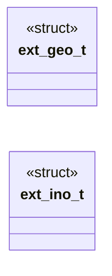
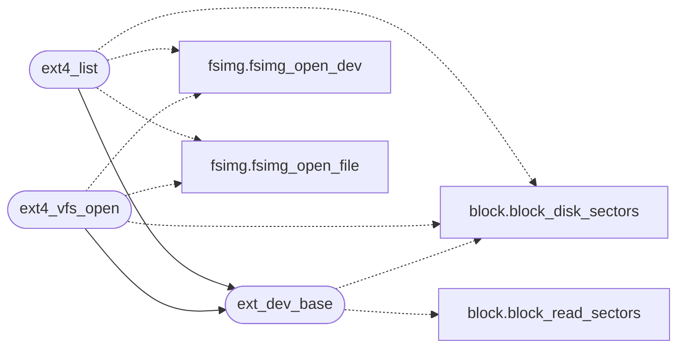

# `fs/ext4.c`

> Source: [fs/ext4.c:1](../../fs/ext4.c#L1) | language `c` | coverage 20.0% | [API index](../index.md)

================================================================

## Contents

- **Structs:** [`ext_geo_t`](#ext_geo_t), [`ext_ino_t`](#ext_ino_t)
- **Functions:** [`only`](#only), [`ext4_list`](#ext4_list), [`ext4_vfs_open`](#ext4_vfs_open), [`ext4_vfs_read`](#ext4_vfs_read), [`ext4_vfs_write`](#ext4_vfs_write), [`ext4_vfs_close`](#ext4_vfs_close), [`ext4_vfs_fstat`](#ext4_vfs_fstat), [`ext4_vfs_truncate`](#ext4_vfs_truncate), [`ext_dev_base`](#ext_dev_base)
- **Macros:** [`EXT4_SUPER_OFF`](#ext4_super_off), [`EXT4_MAGIC`](#ext4_magic), [`EXT4_EXT_MAGIC`](#ext4_ext_magic), [`EXT4_S_IFMT`](#ext4_s_ifmt), [`EXT4_S_IFREG`](#ext4_s_ifreg), [`EXT4_S_IFDIR`](#ext4_s_ifdir), [`EXT4_S_IFLNK`](#ext4_s_iflnk), [`EXT4_EXTENTS_FL`](#ext4_extents_fl), [`EXT4_INDEX_FL`](#ext4_index_fl), [`EXT4_ENCRYPT_FL`](#ext4_encrypt_fl), [`EXT4_INLINE_FL`](#ext4_inline_fl), [`EXT4_EXT_UNINIT`](#ext4_ext_uninit), [`EXT4_MBR_LINUX`](#ext4_mbr_linux)

## Type Diagram



## Call Graph

Solid arrows stay in this module, dashed arrows leave it.



## Structs

<a id="ext_geo_t"></a>

### `ext_geo_t`

`struct` | [fs/ext4.c:44](../../fs/ext4.c#L44)

```c
typedef struct
```

Filesystem geometry from the superblock.

64-bit block counts ride along (real disks use them) but every byte offset is fenced to the image size before use.

---

<a id="ext_ino_t"></a>

### `ext_ino_t`

`struct` | [fs/ext4.c:115](../../fs/ext4.c#L115)

```c
typedef struct
```

Decoded inode: kind (0 file, 1 dir), size, extent root or legacy block list (copied, so later reads never re-parse the inode).

---

## Functions

<a id="only"></a>

### `only`

`function` | [fs/ext4.c:352](../../fs/ext4.c#L352)

```c
* listings only ('.' skipped, '..' refused). "" or "/" is root (2). */ static int ext_file_block(const fsimg_t *img, const ext_geo_t *g, const ext_ino_t *st, unsigned long lblk, unsigned char *blk, un
```

**Parameters**

| Name | Type | Default | Description |
|---|---|---|---|
| `skipped` |  |  |  |
| `refused` |  |  |  |

**Returns:** `* listings`

---

<a id="ext4_list"></a>

### `ext4_list`

`function` | [fs/ext4.c:485](../../fs/ext4.c#L485)

```c
int ext4_list(const char *imgpath, const char *dirpath, char names[][EXT4_NAME_MAX + 1], int *isdir, int cap)
```

List one directory: names (dirs with trailing '/') up to cap.

Returns the entry count, or -1 when the image, path or walk fails.

**Parameters**

| Name | Type | Default | Description |
|---|---|---|---|
| `imgpath` | `char *` |  |  |
| `dirpath` | `char *` |  |  |
| `EXT4_NAME_MAX` | `char names[][ + 1]` |  |  |
| `isdir` | `int *` |  |  |
| `cap` | `int` |  |  |

**Returns:** `int`

> **Inherited:** Documentation from [`ext4_list`](#ext4_list) (headers/ext4.h:35).

*Calls:* [`ext_dev_base`](#ext_dev_base), [`block_disk_sectors`](headers.block.h.md#block_disk_sectors), [`fsimg_open_dev`](headers.fsimg.h.md#fsimg_open_dev), [`fsimg_open_file`](headers.fsimg.h.md#fsimg_open_file)

---

<a id="ext4_vfs_open"></a>

### `ext4_vfs_open`

`function` | [fs/ext4.c:585](../../fs/ext4.c#L585)

```c
int ext4_vfs_open(const char *path, int mode, void **handle)
```

VFS verbs: open "imgpath:extpath" (first ':' splits), read, close, fstat.

Write/truncate refuse. All fail closed with -1.

**Parameters**

| Name | Type | Default | Description |
|---|---|---|---|
| `path` | `char *` |  |  |
| `mode` | `int` |  |  |
| `handle` | `void **` |  |  |

**Returns:** `int`

> **Inherited:** Documentation from [`ext4_vfs_open`](#ext4_vfs_open) (headers/ext4.h:40).

*Calls:* [`ext_dev_base`](#ext_dev_base), [`block_disk_sectors`](headers.block.h.md#block_disk_sectors), [`fsimg_open_dev`](headers.fsimg.h.md#fsimg_open_dev), [`fsimg_open_file`](headers.fsimg.h.md#fsimg_open_file)

---

<a id="ext4_vfs_read"></a>

### `ext4_vfs_read`

`function` | [fs/ext4.c:626](../../fs/ext4.c#L626)

```c
int ext4_vfs_read(void *handle, void *buf, unsigned long pos, unsigned long len)
```

**Parameters**

| Name | Type | Default | Description |
|---|---|---|---|
| `handle` | `void *` |  |  |
| `buf` | `void *` |  |  |
| `pos` | `unsigned long` |  |  |
| `len` | `unsigned long` |  |  |

**Returns:** `int`

---

<a id="ext4_vfs_write"></a>

### `ext4_vfs_write`

`function` | [fs/ext4.c:666](../../fs/ext4.c#L666)

```c
int ext4_vfs_write(void *handle, const void *buf, unsigned long pos, unsigned long len)
```

**Parameters**

| Name | Type | Default | Description |
|---|---|---|---|
| `handle` | `void *` |  |  |
| `buf` | `void *` |  |  |
| `pos` | `unsigned long` |  |  |
| `len` | `unsigned long` |  |  |

**Returns:** `int`

---

<a id="ext4_vfs_close"></a>

### `ext4_vfs_close`

`function` | [fs/ext4.c:675](../../fs/ext4.c#L675)

```c
int ext4_vfs_close(void *handle)
```

**Parameters**

| Name | Type | Default | Description |
|---|---|---|---|
| `handle` | `void *` |  |  |

**Returns:** `int`

---

<a id="ext4_vfs_fstat"></a>

### `ext4_vfs_fstat`

`function` | [fs/ext4.c:680](../../fs/ext4.c#L680)

```c
int ext4_vfs_fstat(void *handle, unsigned long *size_out)
```

**Parameters**

| Name | Type | Default | Description |
|---|---|---|---|
| `handle` | `void *` |  |  |
| `size_out` | `unsigned long *` |  |  |

**Returns:** `int`

---

<a id="ext4_vfs_truncate"></a>

### `ext4_vfs_truncate`

`function` | [fs/ext4.c:687](../../fs/ext4.c#L687)

```c
int ext4_vfs_truncate(void *handle, unsigned long size)
```

**Parameters**

| Name | Type | Default | Description |
|---|---|---|---|
| `handle` | `void *` |  |  |
| `size` | `unsigned long` |  |  |

**Returns:** `int`

---

<a id="ext_dev_base"></a>

### `ext_dev_base`

`function` | [fs/ext4.c:791](../../fs/ext4.c#L791)

```c
long ext_dev_base(void)
```

**Returns:** `long`

*Calls:* [`block_disk_sectors`](headers.block.h.md#block_disk_sectors), [`block_read_sectors`](headers.block.h.md#block_read_sectors)

*Called by:* [`ext4_list`](#ext4_list), [`ext4_vfs_open`](#ext4_vfs_open)

---

## Macros

<a id="ext4_super_off"></a>

### `EXT4_SUPER_OFF`

`macro` | [fs/ext4.c:18](../../fs/ext4.c#L18)

```c
#define EXT4_SUPER_OFF
```

---

<a id="ext4_magic"></a>

### `EXT4_MAGIC`

`macro` | [fs/ext4.c:19](../../fs/ext4.c#L19)

```c
#define EXT4_MAGIC
```

---

<a id="ext4_ext_magic"></a>

### `EXT4_EXT_MAGIC`

`macro` | [fs/ext4.c:20](../../fs/ext4.c#L20)

```c
#define EXT4_EXT_MAGIC
```

---

<a id="ext4_s_ifmt"></a>

### `EXT4_S_IFMT`

`macro` | [fs/ext4.c:21](../../fs/ext4.c#L21)

```c
#define EXT4_S_IFMT
```

---

<a id="ext4_s_ifreg"></a>

### `EXT4_S_IFREG`

`macro` | [fs/ext4.c:22](../../fs/ext4.c#L22)

```c
#define EXT4_S_IFREG
```

---

<a id="ext4_s_ifdir"></a>

### `EXT4_S_IFDIR`

`macro` | [fs/ext4.c:23](../../fs/ext4.c#L23)

```c
#define EXT4_S_IFDIR
```

---

<a id="ext4_s_iflnk"></a>

### `EXT4_S_IFLNK`

`macro` | [fs/ext4.c:24](../../fs/ext4.c#L24)

```c
#define EXT4_S_IFLNK
```

---

<a id="ext4_extents_fl"></a>

### `EXT4_EXTENTS_FL`

`macro` | [fs/ext4.c:25](../../fs/ext4.c#L25)

```c
#define EXT4_EXTENTS_FL
```

---

<a id="ext4_index_fl"></a>

### `EXT4_INDEX_FL`

`macro` | [fs/ext4.c:26](../../fs/ext4.c#L26)

```c
#define EXT4_INDEX_FL
```

---

<a id="ext4_encrypt_fl"></a>

### `EXT4_ENCRYPT_FL`

`macro` | [fs/ext4.c:27](../../fs/ext4.c#L27)

```c
#define EXT4_ENCRYPT_FL
```

---

<a id="ext4_inline_fl"></a>

### `EXT4_INLINE_FL`

`macro` | [fs/ext4.c:28](../../fs/ext4.c#L28)

```c
#define EXT4_INLINE_FL
```

---

<a id="ext4_ext_uninit"></a>

### `EXT4_EXT_UNINIT`

`macro` | [fs/ext4.c:29](../../fs/ext4.c#L29)

```c
#define EXT4_EXT_UNINIT
```

---

<a id="ext4_mbr_linux"></a>

### `EXT4_MBR_LINUX`

`macro` | [fs/ext4.c:30](../../fs/ext4.c#L30)

```c
#define EXT4_MBR_LINUX
```

---
