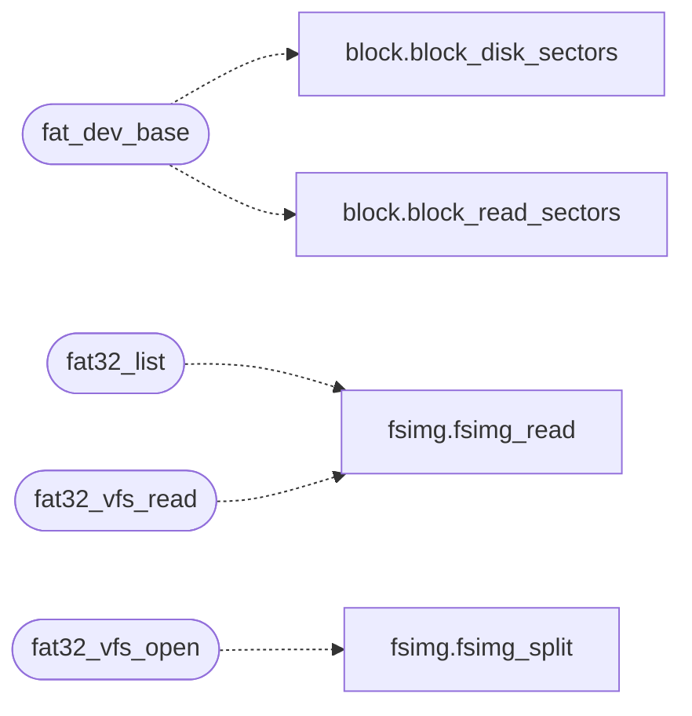

# `fs/fat32.c`

> Source: [fs/fat32.c:1](../../fs/fat32.c#L1) | language `c` | coverage 33.3% | [API index](../index.md)

================================================================

## Contents

- **Structs:** [`fat_geo_t`](#fat_geo_t)
- **Functions:** [`fat_dev_base`](#fat_dev_base), [`fat32_list`](#fat32_list), [`fat32_vfs_open`](#fat32_vfs_open), [`fat32_vfs_read`](#fat32_vfs_read), [`fat32_vfs_write`](#fat32_vfs_write), [`fat32_vfs_close`](#fat32_vfs_close), [`fat32_vfs_fstat`](#fat32_vfs_fstat), [`fat32_vfs_truncate`](#fat32_vfs_truncate)
- **Macros:** [`FAT_MBR_SIG_OFF`](#fat_mbr_sig_off), [`FAT_MBR_TAB_OFF`](#fat_mbr_tab_off), [`FAT_MBR_ENTRY_SZ`](#fat_mbr_entry_sz), [`FAT_MBR_NENTRY`](#fat_mbr_nentry), [`FAT_MBR_TYPE_OFF`](#fat_mbr_type_off), [`FAT_MBR_START_OFF`](#fat_mbr_start_off), [`FAT_MBR_COUNT_OFF`](#fat_mbr_count_off), [`FAT_MBR_GPT_PROT`](#fat_mbr_gpt_prot)

## Call Graph

Solid arrows stay in this module, dashed arrows leave it.



## Structs

<a id="fat_geo_t"></a>

### `fat_geo_t`

`struct` | [fs/fat32.c:51](../../fs/fat32.c#L51)

```c
typedef struct
```

Parsed BPB plus derived geometry. secs = total data clusters + 2 (cluster numbers 0/1 are reserved), so a valid cluster is 2 <= c < nclus + 2.

---

## Functions

<a id="fat_dev_base"></a>

### `fat_dev_base`

`function` | [fs/fat32.c:192](../../fs/fat32.c#L192)

```c
long fat_dev_base(void)
```

Locate the first FAT32 partition on the primary IDE master: a real MBR FAT32 entry first (real hardware with a partition table), then a magic scan over 2048-aligned LBAs (superfloppy images with no table, like the os.img tail).

Returns the base LBA, or -1 when no FAT32 is present. Result is cached; the disk never changes under a running guest.

**Returns:** `long`

> **Inherited:** Documentation from [`fat_dev_base`](#fat_dev_base) (headers/fat32.h:54).

*Calls:* [`block_disk_sectors`](headers.block.h.md#block_disk_sectors), [`block_read_sectors`](headers.block.h.md#block_read_sectors)

---

<a id="fat32_list"></a>

### `fat32_list`

`function` | [fs/fat32.c:421](../../fs/fat32.c#L421)

```c
int fat32_list(const char *imgpath, const char *dirpath, char names[][FAT32_NAME_MAX], int *isdir, int cap)
```

List one directory: names (dirs with trailing '/') up to cap.

Returns the entry count, or -1 when the image, path or walk fails.

**Parameters**

| Name | Type | Default | Description |
|---|---|---|---|
| `imgpath` | `char *` |  |  |
| `dirpath` | `char *` |  |  |
| `FAT32_NAME_MAX` | `char names[][ ]` |  |  |
| `isdir` | `int *` |  |  |
| `cap` | `int` |  |  |

**Returns:** `int`

> **Inherited:** Documentation from [`fat32_list`](#fat32_list) (headers/fat32.h:45).

*Calls:* [`fsimg_read`](headers.fsimg.h.md#fsimg_read)

---

<a id="fat32_vfs_open"></a>

### `fat32_vfs_open`

`function` | [fs/fat32.c:496](../../fs/fat32.c#L496)

```c
int fat32_vfs_open(const char *path, int mode, void **handle)
```

VFS verbs: open "imgpath:fatpath" (first ':' splits), read, close, fstat.

Write/truncate refuse. All fail closed with -1.

**Parameters**

| Name | Type | Default | Description |
|---|---|---|---|
| `path` | `char *` |  |  |
| `mode` | `int` |  |  |
| `handle` | `void **` |  |  |

**Returns:** `int`

> **Inherited:** Documentation from [`fat32_vfs_open`](#fat32_vfs_open) (headers/fat32.h:58).

*Calls:* [`fsimg_split`](headers.fsimg.h.md#fsimg_split)

---

<a id="fat32_vfs_read"></a>

### `fat32_vfs_read`

`function` | [fs/fat32.c:581](../../fs/fat32.c#L581)

```c
int fat32_vfs_read(void *handle, void *buf, unsigned long pos, unsigned long len)
```

**Parameters**

| Name | Type | Default | Description |
|---|---|---|---|
| `handle` | `void *` |  |  |
| `buf` | `void *` |  |  |
| `pos` | `unsigned long` |  |  |
| `len` | `unsigned long` |  |  |

**Returns:** `int`

*Calls:* [`fsimg_read`](headers.fsimg.h.md#fsimg_read)

---

<a id="fat32_vfs_write"></a>

### `fat32_vfs_write`

`function` | [fs/fat32.c:621](../../fs/fat32.c#L621)

```c
int fat32_vfs_write(void *handle, const void *buf, unsigned long pos, unsigned long len)
```

**Parameters**

| Name | Type | Default | Description |
|---|---|---|---|
| `handle` | `void *` |  |  |
| `buf` | `void *` |  |  |
| `pos` | `unsigned long` |  |  |
| `len` | `unsigned long` |  |  |

**Returns:** `int`

---

<a id="fat32_vfs_close"></a>

### `fat32_vfs_close`

`function` | [fs/fat32.c:630](../../fs/fat32.c#L630)

```c
int fat32_vfs_close(void *handle)
```

**Parameters**

| Name | Type | Default | Description |
|---|---|---|---|
| `handle` | `void *` |  |  |

**Returns:** `int`

---

<a id="fat32_vfs_fstat"></a>

### `fat32_vfs_fstat`

`function` | [fs/fat32.c:635](../../fs/fat32.c#L635)

```c
int fat32_vfs_fstat(void *handle, unsigned long *size_out)
```

**Parameters**

| Name | Type | Default | Description |
|---|---|---|---|
| `handle` | `void *` |  |  |
| `size_out` | `unsigned long *` |  |  |

**Returns:** `int`

---

<a id="fat32_vfs_truncate"></a>

### `fat32_vfs_truncate`

`function` | [fs/fat32.c:642](../../fs/fat32.c#L642)

```c
int fat32_vfs_truncate(void *handle, unsigned long size)
```

**Parameters**

| Name | Type | Default | Description |
|---|---|---|---|
| `handle` | `void *` |  |  |
| `size` | `unsigned long` |  |  |

**Returns:** `int`

---

## Macros

<a id="fat_mbr_sig_off"></a>

### `FAT_MBR_SIG_OFF`

`macro` | [fs/fat32.c:111](../../fs/fat32.c#L111)

```c
#define FAT_MBR_SIG_OFF
```

MBR partition entry offsets and the FAT32 type bytes, including hidden variants real dual-boot setups carry.

Extended types are deliberately absent: v1 serves primaries, logical volumes wait for an EBR follower.

---

<a id="fat_mbr_tab_off"></a>

### `FAT_MBR_TAB_OFF`

`macro` | [fs/fat32.c:112](../../fs/fat32.c#L112)

```c
#define FAT_MBR_TAB_OFF
```

---

<a id="fat_mbr_entry_sz"></a>

### `FAT_MBR_ENTRY_SZ`

`macro` | [fs/fat32.c:113](../../fs/fat32.c#L113)

```c
#define FAT_MBR_ENTRY_SZ
```

---

<a id="fat_mbr_nentry"></a>

### `FAT_MBR_NENTRY`

`macro` | [fs/fat32.c:114](../../fs/fat32.c#L114)

```c
#define FAT_MBR_NENTRY
```

---

<a id="fat_mbr_type_off"></a>

### `FAT_MBR_TYPE_OFF`

`macro` | [fs/fat32.c:115](../../fs/fat32.c#L115)

```c
#define FAT_MBR_TYPE_OFF
```

---

<a id="fat_mbr_start_off"></a>

### `FAT_MBR_START_OFF`

`macro` | [fs/fat32.c:116](../../fs/fat32.c#L116)

```c
#define FAT_MBR_START_OFF
```

---

<a id="fat_mbr_count_off"></a>

### `FAT_MBR_COUNT_OFF`

`macro` | [fs/fat32.c:117](../../fs/fat32.c#L117)

```c
#define FAT_MBR_COUNT_OFF
```

---

<a id="fat_mbr_gpt_prot"></a>

### `FAT_MBR_GPT_PROT`

`macro` | [fs/fat32.c:118](../../fs/fat32.c#L118)

```c
#define FAT_MBR_GPT_PROT
```

---
