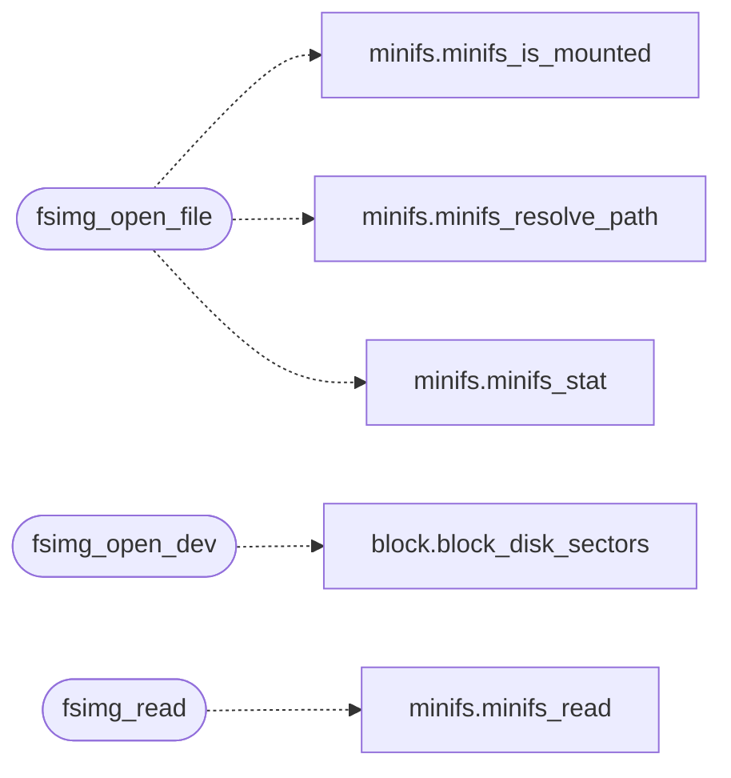

# `fs/fsimg.c`

> Source: [fs/fsimg.c:1](../../fs/fsimg.c#L1) | language `c` | coverage 100.0% | [API index](../index.md)

================================================================

## Contents

- **Functions:** [`fsimg_open_file`](#fsimg_open_file), [`fsimg_open_dev`](#fsimg_open_dev), [`fsimg_read`](#fsimg_read), [`fsimg_split`](#fsimg_split)

## Call Graph

Solid arrows stay in this module, dashed arrows leave it.



## Functions

<a id="fsimg_open_file"></a>

### `fsimg_open_file`

`function` | [fs/fsimg.c:15](../../fs/fsimg.c#L15)

```c
int fsimg_open_file(const char *resolved, fsimg_t *img)
```

Open a resolved path as a loopback image.

Refuses past 4 GB (all sector math below is 32-bit).

**Parameters**

| Name | Type | Default | Description |
|---|---|---|---|
| `resolved` | `char *` |  |  |
| `img` | `fsimg_t *` |  |  |

**Returns:** `int`

> **Inherited:** Documentation from [`fsimg_open_file`](#fsimg_open_file) (headers/fsimg.h:23).

*Calls:* [`minifs_is_mounted`](headers.minifs.h.md#minifs_is_mounted), [`minifs_resolve_path`](headers.minifs.h.md#minifs_resolve_path), [`minifs_stat`](headers.minifs.h.md#minifs_stat)

---

<a id="fsimg_open_dev"></a>

### `fsimg_open_dev`

`function` | [fs/fsimg.c:51](../../fs/fsimg.c#L51)

```c
int fsimg_open_dev(unsigned long base_lba, unsigned long nsec, fsimg_t *img)
```

Open an absolute disk region [base_lba, base_lba + nsec) as an image.

Bounds are 64-bit and fenced to the drive size.

**Parameters**

| Name | Type | Default | Description |
|---|---|---|---|
| `base_lba` | `unsigned long` |  |  |
| `nsec` | `unsigned long` |  |  |
| `img` | `fsimg_t *` |  |  |

**Returns:** `int`

> **Inherited:** Documentation from [`fsimg_open_dev`](#fsimg_open_dev) (headers/fsimg.h:27).

*Calls:* [`block_disk_sectors`](headers.block.h.md#block_disk_sectors)

---

<a id="fsimg_read"></a>

### `fsimg_read`

`function` | [fs/fsimg.c:96](../../fs/fsimg.c#L96)

```c
int fsimg_read(const fsimg_t *img, unsigned long off, void *buf, unsigned long len)
```

Read len bytes at off into buf.

Fails closed on any bound violation, short backend transfer, or missing device.

**Parameters**

| Name | Type | Default | Description |
|---|---|---|---|
| `img` | `fsimg_t *` |  |  |
| `off` | `unsigned long` |  |  |
| `buf` | `void *` |  |  |
| `len` | `unsigned long` |  |  |

**Returns:** `int`

> **Inherited:** Documentation from [`fsimg_read`](#fsimg_read) (headers/fsimg.h:32).

*Calls:* [`minifs_read`](headers.minifs.h.md#minifs_read)

---

<a id="fsimg_split"></a>

### `fsimg_split`

`function` | [fs/fsimg.c:112](../../fs/fsimg.c#L112)

```c
int fsimg_split(const char *path, char *left, unsigned llen, char *right, unsigned rlen)
```

Split "left:right" at the first ':' (image names never carry one).

Bounds are per side: image paths resolve under RAMDISK_FNAME_LEN, in-image paths may run deeper. Refuses empty sides and overlong parts. Shared by the fat: and ext4: VFS addressings, which have the same shape.

**Parameters**

| Name | Type | Default | Description |
|---|---|---|---|
| `path` | `char *` |  |  |
| `left` | `char *` |  |  |
| `llen` | `unsigned` |  |  |
| `right` | `char *` |  |  |
| `rlen` | `unsigned` |  |  |

**Returns:** `int`

> **Inherited:** Documentation from [`fsimg_split`](#fsimg_split) (headers/fsimg.h:40).

---
