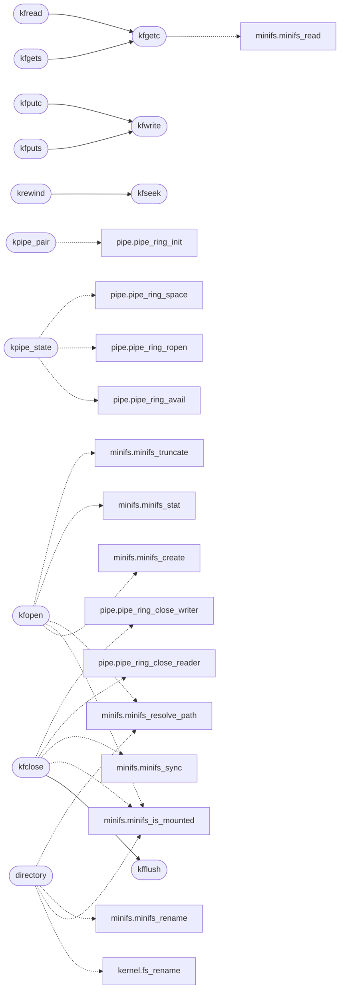

# `fs/kfile.c`

> Source: [fs/kfile.c:1](../../fs/kfile.c#L1) | language `c` | coverage 33.3% | [API index](../index.md)

================================================================

## Contents

- **Functions:** [`kfile_stdin`](#kfile_stdin), [`kfile_stdout`](#kfile_stdout), [`kfile_stderr`](#kfile_stderr), [`recovery`](#recovery), [`kpipe_pair`](#kpipe_pair), [`kpipe_state`](#kpipe_state), [`kevent_create`](#kevent_create), [`kevent_read`](#kevent_read), [`kevent_readable`](#kevent_readable), [`kevent_writable`](#kevent_writable), [`kpipe_is_write_end`](#kpipe_is_write_end), [`kfopen_dir`](#kfopen_dir), [`kfopen`](#kfopen), [`directory`](#directory), [`kfclose`](#kfclose), [`kfgetc`](#kfgetc), [`kfgets`](#kfgets), [`kfungetc`](#kfungetc), [`kfread`](#kfread), [`kfwrite`](#kfwrite), [`kfseek`](#kfseek), [`kftell`](#kftell), [`kfflush`](#kfflush), [`kfputs`](#kfputs), [`kfputc`](#kfputc), [`krewind`](#krewind)

## Call Graph

Solid arrows stay in this module, dashed arrows leave it.



## Functions

<a id="kfile_stdin"></a>

### `kfile_stdin`

`function` | [fs/kfile.c:15](../../fs/kfile.c#L15)

```c
KFILE *kfile_stdin(void)
```

**Returns:** `KFILE *`

---

<a id="kfile_stdout"></a>

### `kfile_stdout`

`function` | [fs/kfile.c:16](../../fs/kfile.c#L16)

```c
KFILE *kfile_stdout(void)
```

**Returns:** `KFILE *`

---

<a id="kfile_stderr"></a>

### `kfile_stderr`

`function` | [fs/kfile.c:17](../../fs/kfile.c#L17)

```c
KFILE *kfile_stderr(void)
```

**Returns:** `KFILE *`

---

<a id="recovery"></a>

### `recovery`

`function` | [fs/kfile.c:28](../../fs/kfile.c#L28)

```c
* halts the machine with no recovery (the DOOM ABI-drift black screen), * so every public KFILE ...
```

**Parameters**

| Name | Type | Default | Description |
|---|---|---|---|
| `screen` | `the DOOM ABI-drift black` |  |  |

**Returns:** `* halts the machine with no`

---

<a id="kpipe_pair"></a>

### `kpipe_pair`

`function` | [fs/kfile.c:78](../../fs/kfile.c#L78)

```c
int kpipe_pair(KFILE **rend_out, KFILE **wend_out)
```

Docstring: Create a connected pipe pair sharing one ring.

The read end drains, the write end appends; the ring (and its refcount) dies with the last closed end. Fail-closed: any allocation failure frees what was taken and returns -1 with both outs zeroed.

**Parameters**

| Name | Type | Default | Description |
|---|---|---|---|
| `rend_out` | `KFILE **` |  |  |
| `wend_out` | `KFILE **` |  |  |

**Returns:** `int`

*Calls:* [`pipe_ring_init`](headers.pipe.h.md#pipe_ring_init)

---

<a id="kpipe_state"></a>

### `kpipe_state`

`function` | [fs/kfile.c:130](../../fs/kfile.c#L130)

```c
int kpipe_state(KFILE *f, unsigned *avail, unsigned *space, int *wopen, int *ropen)
```

Docstring: Snapshot a pipe's ring under fs_lock (see kernel.h).

**Parameters**

| Name | Type | Default | Description |
|---|---|---|---|
| `f` | `KFILE *` |  |  |
| `avail` | `unsigned *` |  |  |
| `space` | `unsigned *` |  |  |
| `wopen` | `int *` |  |  |
| `ropen` | `int *` |  |  |

**Returns:** `int`

*Calls:* [`pipe_ring_avail`](headers.pipe.h.md#pipe_ring_avail), [`pipe_ring_ropen`](headers.pipe.h.md#pipe_ring_ropen), [`pipe_ring_space`](headers.pipe.h.md#pipe_ring_space)

---

<a id="kevent_create"></a>

### `kevent_create`

`function` | [fs/kfile.c:148](../../fs/kfile.c#L148)

```c
KFILE *kevent_create(unsigned long long initval, int semaphore)
```

Docstring: New eventfd description with counter initval.

NULL on OOM or an initial value past KEVENT_MAX.

**Parameters**

| Name | Type | Default | Description |
|---|---|---|---|
| `initval` | `unsigned long long` |  |  |
| `semaphore` | `int` |  |  |

**Returns:** `KFILE *`

---

<a id="kevent_read"></a>

### `kevent_read`

`function` | [fs/kfile.c:163](../../fs/kfile.c#L163)

```c
long kevent_read(KFILE *f, unsigned long long *out)
```

Docstring: Take the counter (or 1 in semaphore mode). -EAGAIN at 0.

**Parameters**

| Name | Type | Default | Description |
|---|---|---|---|
| `f` | `KFILE *` |  |  |
| `out` | `unsigned long long *` |  |  |

**Returns:** `long`

---

<a id="kevent_readable"></a>

### `kevent_readable`

`function` | [fs/kfile.c:199](../../fs/kfile.c#L199)

```c
int kevent_readable(KFILE *f)
```

Docstring: 1 when a read would not block.

**Parameters**

| Name | Type | Default | Description |
|---|---|---|---|
| `f` | `KFILE *` |  |  |

**Returns:** `int`

---

<a id="kevent_writable"></a>

### `kevent_writable`

`function` | [fs/kfile.c:204](../../fs/kfile.c#L204)

```c
int kevent_writable(KFILE *f)
```

Docstring: 1 when a write of 1 would not block.

**Parameters**

| Name | Type | Default | Description |
|---|---|---|---|
| `f` | `KFILE *` |  |  |

**Returns:** `int`

---

<a id="kpipe_is_write_end"></a>

### `kpipe_is_write_end`

`function` | [fs/kfile.c:209](../../fs/kfile.c#L209)

```c
int kpipe_is_write_end(KFILE *f)
```

Docstring: True when f is the write end of a pipe.

**Parameters**

| Name | Type | Default | Description |
|---|---|---|---|
| `f` | `KFILE *` |  |  |

**Returns:** `int`

---

<a id="kfopen_dir"></a>

### `kfopen_dir`

`function` | [fs/kfile.c:243](../../fs/kfile.c#L243)

```c
KFILE *kfopen_dir(const char *resolved)
```

Directory open for getdents64 (kernel/syscalls.c 217): kfopen refuses directories, so open(2) on one lands here.

The handle stores the resolved path (with the trailing slash the listing walks) and the next-entry index; everything else is enumerated on demand.

**Parameters**

| Name | Type | Default | Description |
|---|---|---|---|
| `resolved` | `char *` |  |  |

**Returns:** `KFILE *`

---

<a id="kfopen"></a>

### `kfopen`

`function` | [fs/kfile.c:264](../../fs/kfile.c#L264)

```c
KFILE *kfopen(const char *path, const char *mode)
```

**Parameters**

| Name | Type | Default | Description |
|---|---|---|---|
| `path` | `char *` |  |  |
| `mode` | `char *` |  |  |

**Returns:** `KFILE *`

*Calls:* [`minifs_create`](headers.minifs.h.md#minifs_create), [`minifs_is_mounted`](headers.minifs.h.md#minifs_is_mounted), [`minifs_resolve_path`](headers.minifs.h.md#minifs_resolve_path), [`minifs_stat`](headers.minifs.h.md#minifs_stat), [`minifs_truncate`](headers.minifs.h.md#minifs_truncate)

---

<a id="directory"></a>

### `directory`

`function` | [fs/kfile.c:379](../../fs/kfile.c#L379)

```c
* empty directory by a directory (-20/-21 for a kind mismatch, -39 for a * non-empty directory)....
```

**Parameters**

| Name | Type | Default | Description |
|---|---|---|---|
| `mismatch` | `-20/-21 for a kind` |  |  |
| `directory` | `-39 for a * non-empty` |  |  |

**Returns:** `* empty`

*Calls:* [`fs_rename`](headers.kernel.h.md#fs_rename), [`minifs_is_mounted`](headers.minifs.h.md#minifs_is_mounted), [`minifs_rename`](headers.minifs.h.md#minifs_rename), [`minifs_resolve_path`](headers.minifs.h.md#minifs_resolve_path)

---

<a id="kfclose"></a>

### `kfclose`

`function` | [fs/kfile.c:432](../../fs/kfile.c#L432)

```c
int kfclose(KFILE *f)
```

**Parameters**

| Name | Type | Default | Description |
|---|---|---|---|
| `f` | `KFILE *` |  |  |

**Returns:** `int`

*Calls:* [`kfflush`](#kfflush), [`minifs_is_mounted`](headers.minifs.h.md#minifs_is_mounted), [`minifs_sync`](headers.minifs.h.md#minifs_sync), [`pipe_ring_close_reader`](headers.pipe.h.md#pipe_ring_close_reader), [`pipe_ring_close_writer`](headers.pipe.h.md#pipe_ring_close_writer)

---

<a id="kfgetc"></a>

### `kfgetc`

`function` | [fs/kfile.c:477](../../fs/kfile.c#L477)

```c
int kfgetc(KFILE *f)
```

**Parameters**

| Name | Type | Default | Description |
|---|---|---|---|
| `f` | `KFILE *` |  |  |

**Returns:** `int`

*Calls:* [`minifs_read`](headers.minifs.h.md#minifs_read)

*Called by:* [`kfgets`](#kfgets), [`kfread`](#kfread)

---

<a id="kfgets"></a>

### `kfgets`

`function` | [fs/kfile.c:518](../../fs/kfile.c#L518)

```c
char *kfgets(char *buf, int size, KFILE *f)
```

**Parameters**

| Name | Type | Default | Description |
|---|---|---|---|
| `buf` | `char *` |  |  |
| `size` | `int` |  |  |
| `f` | `KFILE *` |  |  |

**Returns:** `char *`

*Calls:* [`kfgetc`](#kfgetc)

---

<a id="kfungetc"></a>

### `kfungetc`

`function` | [fs/kfile.c:532](../../fs/kfile.c#L532)

```c
int kfungetc(int c, KFILE *f)
```

**Parameters**

| Name | Type | Default | Description |
|---|---|---|---|
| `c` | `int` |  |  |
| `f` | `KFILE *` |  |  |

**Returns:** `int`

---

<a id="kfread"></a>

### `kfread`

`function` | [fs/kfile.c:539](../../fs/kfile.c#L539)

```c
unsigned long kfread(void *ptr, unsigned long size, unsigned long n, KFILE *f)
```

**Parameters**

| Name | Type | Default | Description |
|---|---|---|---|
| `ptr` | `void *` |  |  |
| `size` | `unsigned long` |  |  |
| `n` | `unsigned long` |  |  |
| `f` | `KFILE *` |  |  |

**Returns:** `unsigned long`

*Calls:* [`kfgetc`](#kfgetc), [`minifs_read`](headers.minifs.h.md#minifs_read)

---

<a id="kfwrite"></a>

### `kfwrite`

`function` | [fs/kfile.c:585](../../fs/kfile.c#L585)

```c
unsigned long kfwrite(const void *ptr, unsigned long size, unsigned long n, KFILE *f)
```

**Parameters**

| Name | Type | Default | Description |
|---|---|---|---|
| `ptr` | `void *` |  |  |
| `size` | `unsigned long` |  |  |
| `n` | `unsigned long` |  |  |
| `f` | `KFILE *` |  |  |

**Returns:** `unsigned long`

*Calls:* [`pipe_ring_write`](headers.pipe.h.md#pipe_ring_write)

*Called by:* [`kfputc`](#kfputc), [`kfputs`](#kfputs)

---

<a id="kfseek"></a>

### `kfseek`

`function` | [fs/kfile.c:651](../../fs/kfile.c#L651)

```c
int kfseek(KFILE *f, long offset, int whence)
```

**Parameters**

| Name | Type | Default | Description |
|---|---|---|---|
| `f` | `KFILE *` |  |  |
| `offset` | `long` |  |  |
| `whence` | `int` |  |  |

**Returns:** `int`

*Called by:* [`krewind`](#krewind)

---

<a id="kftell"></a>

### `kftell`

`function` | [fs/kfile.c:672](../../fs/kfile.c#L672)

```c
long kftell(KFILE *f)
```

**Parameters**

| Name | Type | Default | Description |
|---|---|---|---|
| `f` | `KFILE *` |  |  |

**Returns:** `long`

---

<a id="kfflush"></a>

### `kfflush`

`function` | [fs/kfile.c:676](../../fs/kfile.c#L676)

```c
int kfflush(KFILE *f)
```

**Parameters**

| Name | Type | Default | Description |
|---|---|---|---|
| `f` | `KFILE *` |  |  |

**Returns:** `int`

*Calls:* [`minifs_write`](headers.minifs.h.md#minifs_write)

*Called by:* [`kfclose`](#kfclose)

---

<a id="kfputs"></a>

### `kfputs`

`function` | [fs/kfile.c:702](../../fs/kfile.c#L702)

```c
int kfputs(const char *s, KFILE *f)
```

**Parameters**

| Name | Type | Default | Description |
|---|---|---|---|
| `s` | `char *` |  |  |
| `f` | `KFILE *` |  |  |

**Returns:** `int`

*Calls:* [`kfwrite`](#kfwrite)

---

<a id="kfputc"></a>

### `kfputc`

`function` | [fs/kfile.c:708](../../fs/kfile.c#L708)

```c
int kfputc(int c, KFILE *f)
```

**Parameters**

| Name | Type | Default | Description |
|---|---|---|---|
| `c` | `int` |  |  |
| `f` | `KFILE *` |  |  |

**Returns:** `int`

*Calls:* [`kfwrite`](#kfwrite)

---

<a id="krewind"></a>

### `krewind`

`function` | [fs/kfile.c:713](../../fs/kfile.c#L713)

```c
void krewind(KFILE *f)
```

**Parameters**

| Name | Type | Default | Description |
|---|---|---|---|
| `f` | `KFILE *` |  |  |

*Calls:* [`kfseek`](#kfseek)

---
