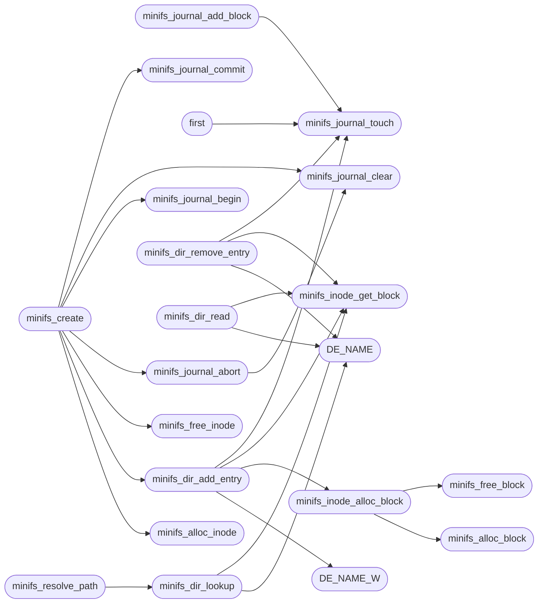

# `fs/minifs.c`

> Source: [fs/minifs.c:1](../../fs/minifs.c#L1) | language `c` | coverage 23.4% | [API index](../index.md)

MiniFS: minimal Unix-like filesystem for MiniOS.

## Contents

- **Functions:** [`minifs_journal_touch`](#minifs_journal_touch), [`minifs_compress`](#minifs_compress), [`minifs_decompress`](#minifs_decompress), [`returns`](#returns), [`instead`](#instead), [`minifs_alloc_block`](#minifs_alloc_block), [`minifs_free_block`](#minifs_free_block), [`minifs_alloc_inode`](#minifs_alloc_inode), [`minifs_free_inode`](#minifs_free_inode), [`minifs_inode_get_block`](#minifs_inode_get_block), [`minifs_inode_alloc_block`](#minifs_inode_alloc_block), [`minifs_journal_begin`](#minifs_journal_begin), [`minifs_journal_add_block`](#minifs_journal_add_block), [`minifs_journal_commit`](#minifs_journal_commit), [`minifs_journal_clear`](#minifs_journal_clear), [`minifs_journal_abort`](#minifs_journal_abort), [`blocks`](#blocks), [`first`](#first), [`minifs_journal_recover`](#minifs_journal_recover), [`minifs_dir_lookup`](#minifs_dir_lookup), [`minifs_dir_add_entry`](#minifs_dir_add_entry), [`minifs_dir_remove_entry`](#minifs_dir_remove_entry), [`minifs_dir_read`](#minifs_dir_read), [`minifs_resolve_path`](#minifs_resolve_path), [`minifs_create`](#minifs_create), [`minifs_mkdir`](#minifs_mkdir), [`minifs_unlink`](#minifs_unlink), [`minifs_rename`](#minifs_rename), [`minifs_rmdir`](#minifs_rmdir), [`minifs_read`](#minifs_read), [`minifs_write`](#minifs_write), [`minifs_truncate`](#minifs_truncate), [`minifs_stat`](#minifs_stat), [`minifs_access`](#minifs_access), [`minifs_init`](#minifs_init), [`minifs_get_lba_start`](#minifs_get_lba_start), [`minifs_is_mounted`](#minifs_is_mounted), [`minifs_mount`](#minifs_mount), [`minifs_sync`](#minifs_sync), [`minifs_file_open`](#minifs_file_open), [`minifs_file_close`](#minifs_file_close), [`minifs_get_total_blocks`](#minifs_get_total_blocks), [`minifs_usage`](#minifs_usage)
- **Macros:** [`DE_NAME`](#de_name), [`DE_NAME_W`](#de_name_w), [`MINIFS_INODE_CRC_OFF`](#minifs_inode_crc_off)

## Call Graph

Solid arrows stay in this module, dashed arrows leave it.



## Functions

<a id="minifs_journal_touch"></a>

### `minifs_journal_touch`

`function` | [fs/minifs.c:16](../../fs/minifs.c#L16)

```c
void minifs_journal_touch(unsigned int phys);
```

**Parameters**

| Name | Type | Default | Description |
|---|---|---|---|
| `phys` | `unsigned int` |  |  |

*Called by:* [`first`](#first), [`minifs_dir_add_entry`](#minifs_dir_add_entry), [`minifs_dir_remove_entry`](#minifs_dir_remove_entry), [`minifs_journal_add_block`](#minifs_journal_add_block)

---

<a id="minifs_compress"></a>

### `minifs_compress`

`function` | [fs/minifs.c:35](../../fs/minifs.c#L35)

```c
unsigned int minifs_compress(const void *src, unsigned int src_len, void *dst, unsigned int dst_cap)
```

---- Compression wrappers ----

**Parameters**

| Name | Type | Default | Description |
|---|---|---|---|
| `src` | `void *` |  |  |
| `src_len` | `unsigned int` |  |  |
| `dst` | `void *` |  |  |
| `dst_cap` | `unsigned int` |  |  |

**Returns:** `unsigned int`

*Calls:* [`LZ4_compress_default`](headers.lz4_kernel.h.md#lz4_compress_default)

---

<a id="minifs_decompress"></a>

### `minifs_decompress`

`function` | [fs/minifs.c:46](../../fs/minifs.c#L46)

```c
unsigned int minifs_decompress(const void *src, unsigned int src_len, void *dst, unsigned int dst_cap)
```

**Parameters**

| Name | Type | Default | Description |
|---|---|---|---|
| `src` | `void *` |  |  |
| `src_len` | `unsigned int` |  |  |
| `dst` | `void *` |  |  |
| `dst_cap` | `unsigned int` |  |  |

**Returns:** `unsigned int`

*Calls:* [`LZ4_decompress_safe`](headers.lz4_kernel.h.md#lz4_decompress_safe)

*Called by:* [`minifs_read`](#minifs_read)

---

<a id="returns"></a>

### `returns`

`function` | [fs/minifs.c:92](../../fs/minifs.c#L92)

```c
* overflowed the slot and smashed returns (measured ring-0 #UD on * lua->lua->cp). Every scratch...
```

**Parameters**

| Name | Type | Default | Description |
|---|---|---|---|
| `cp` | `measured ring-0 #UD on * lua->lua->` |  |  |

**Returns:** `* overflowed the slot and smashed`

---

<a id="instead"></a>

### `instead`

`function` | [fs/minifs.c:127](../../fs/minifs.c#L127)

```c
* kernel stored the same crc at offset 76 instead (byte order the old * write path used), so a r...
```

**Parameters**

| Name | Type | Default | Description |
|---|---|---|---|
| `used` | `byte order the old * write path` |  |  |

**Returns:** `* kernel stored the same crc at offset 76`

---

<a id="minifs_alloc_block"></a>

### `minifs_alloc_block`

`function` | [fs/minifs.c:215](../../fs/minifs.c#L215)

```c
int minifs_alloc_block(void)
```

**Returns:** `int`

*Called by:* [`minifs_inode_alloc_block`](#minifs_inode_alloc_block)

---

<a id="minifs_free_block"></a>

### `minifs_free_block`

`function` | [fs/minifs.c:232](../../fs/minifs.c#L232)

```c
void minifs_free_block(unsigned int block)
```

**Parameters**

| Name | Type | Default | Description |
|---|---|---|---|
| `block` | `unsigned int` |  |  |

*Called by:* [`minifs_inode_alloc_block`](#minifs_inode_alloc_block), [`minifs_truncate`](#minifs_truncate)

---

<a id="minifs_alloc_inode"></a>

### `minifs_alloc_inode`

`function` | [fs/minifs.c:240](../../fs/minifs.c#L240)

```c
int minifs_alloc_inode(void)
```

**Returns:** `int`

*Called by:* [`minifs_create`](#minifs_create), [`minifs_mkdir`](#minifs_mkdir)

---

<a id="minifs_free_inode"></a>

### `minifs_free_inode`

`function` | [fs/minifs.c:252](../../fs/minifs.c#L252)

```c
void minifs_free_inode(int num)
```

**Parameters**

| Name | Type | Default | Description |
|---|---|---|---|
| `num` | `int` |  |  |

*Called by:* [`minifs_create`](#minifs_create), [`minifs_mkdir`](#minifs_mkdir), [`minifs_rmdir`](#minifs_rmdir), [`minifs_unlink`](#minifs_unlink)

---

<a id="minifs_inode_get_block"></a>

### `minifs_inode_get_block`

`function` | [fs/minifs.c:260](../../fs/minifs.c#L260)

```c
int minifs_inode_get_block(MiniFSInode *inode, unsigned int logblk, unsigned int *phys)
```

**Parameters**

| Name | Type | Default | Description |
|---|---|---|---|
| `inode` | `MiniFSInode *` |  |  |
| `logblk` | `unsigned int` |  |  |
| `phys` | `unsigned int *` |  |  |

**Returns:** `int`

*Calls:* [`block_read`](headers.block.h.md#block_read)

*Called by:* [`minifs_dir_add_entry`](#minifs_dir_add_entry), [`minifs_dir_lookup`](#minifs_dir_lookup), [`minifs_dir_read`](#minifs_dir_read), [`minifs_dir_remove_entry`](#minifs_dir_remove_entry), [`minifs_read`](#minifs_read), [`minifs_write`](#minifs_write)

---

<a id="minifs_inode_alloc_block"></a>

### `minifs_inode_alloc_block`

`function` | [fs/minifs.c:343](../../fs/minifs.c#L343)

```c
int minifs_inode_alloc_block(MiniFSInode *inode, unsigned int logblk)
```

**Parameters**

| Name | Type | Default | Description |
|---|---|---|---|
| `inode` | `MiniFSInode *` |  |  |
| `logblk` | `unsigned int` |  |  |

**Returns:** `int`

*Calls:* [`minifs_alloc_block`](#minifs_alloc_block), [`minifs_free_block`](#minifs_free_block), [`block_write`](headers.block.h.md#block_write)

*Called by:* [`minifs_dir_add_entry`](#minifs_dir_add_entry), [`minifs_write`](#minifs_write)

---

<a id="minifs_journal_begin"></a>

### `minifs_journal_begin`

`function` | [fs/minifs.c:495](../../fs/minifs.c#L495)

```c
void minifs_journal_begin(unsigned int txn_id)
```

**Parameters**

| Name | Type | Default | Description |
|---|---|---|---|
| `txn_id` | `unsigned int` |  |  |

*Called by:* [`minifs_create`](#minifs_create), [`minifs_mkdir`](#minifs_mkdir), [`minifs_rename`](#minifs_rename), [`minifs_rmdir`](#minifs_rmdir), [`minifs_unlink`](#minifs_unlink)

---

<a id="minifs_journal_add_block"></a>

### `minifs_journal_add_block`

`function` | [fs/minifs.c:504](../../fs/minifs.c#L504)

```c
void minifs_journal_add_block(unsigned int block)
```

Deprecated alias: historically took an inode number (wrong layer).

Takes a physical block now; prefer minifs_journal_touch.

**Parameters**

| Name | Type | Default | Description |
|---|---|---|---|
| `block` | `unsigned int` |  |  |

*Calls:* [`minifs_journal_touch`](#minifs_journal_touch)

---

<a id="minifs_journal_commit"></a>

### `minifs_journal_commit`

`function` | [fs/minifs.c:511](../../fs/minifs.c#L511)

```c
int minifs_journal_commit(unsigned int txn_id)
```

Pre-write barrier: persist the entry array and mark the journal DIRTY before any protected data block is modified.

A crash after this point replays the undo log in minifs_journal_recover.

**Parameters**

| Name | Type | Default | Description |
|---|---|---|---|
| `txn_id` | `unsigned int` |  |  |

**Returns:** `int`

*Called by:* [`minifs_create`](#minifs_create), [`minifs_mkdir`](#minifs_mkdir), [`minifs_rename`](#minifs_rename), [`minifs_rmdir`](#minifs_rmdir), [`minifs_unlink`](#minifs_unlink)

---

<a id="minifs_journal_clear"></a>

### `minifs_journal_clear`

`function` | [fs/minifs.c:521](../../fs/minifs.c#L521)

```c
void minifs_journal_clear(void)
```

Post-write barrier: the protected writes are all on disk, so the undo log is no longer needed.

*Called by:* [`minifs_create`](#minifs_create), [`minifs_journal_abort`](#minifs_journal_abort), [`minifs_mkdir`](#minifs_mkdir), [`minifs_rename`](#minifs_rename), [`minifs_rmdir`](#minifs_rmdir), [`minifs_unlink`](#minifs_unlink)

---

<a id="minifs_journal_abort"></a>

### `minifs_journal_abort`

`function` | [fs/minifs.c:531](../../fs/minifs.c#L531)

```c
void minifs_journal_abort(void)
```

Error path after the DIRTY barrier: restore every snapshotted block from the journal data area, then clear.

Only undoes blocks recorded in the live in-RAM entry array.

*Calls:* [`minifs_journal_clear`](#minifs_journal_clear), [`block_read`](headers.block.h.md#block_read), [`block_write`](headers.block.h.md#block_write)

*Called by:* [`minifs_create`](#minifs_create), [`minifs_mkdir`](#minifs_mkdir), [`minifs_rename`](#minifs_rename)

---

<a id="blocks"></a>

### `blocks`

`function` | [fs/minifs.c:555](../../fs/minifs.c#L555)

```c
* blocks (self-protection);
```

**Parameters**

| Name | Type | Default | Description |
|---|---|---|---|
| `protection` | `self-` |  |  |

**Returns:** `*`

---

<a id="first"></a>

### `first`

`function` | [fs/minifs.c:556](../../fs/minifs.c#L556)

```c
* keep the first (oldest) snapshot. */ void minifs_journal_touch(unsigned int phys)
```

**Returns:** `* keep the`

*Calls:* [`minifs_journal_touch`](#minifs_journal_touch), [`block_read`](headers.block.h.md#block_read), [`block_write`](headers.block.h.md#block_write)

---

<a id="minifs_journal_recover"></a>

### `minifs_journal_recover`

`function` | [fs/minifs.c:597](../../fs/minifs.c#L597)

```c
void minifs_journal_recover(void)
```

Mount-time recovery: replays the undo log left by a crash between the DIRTY barrier and the CLEAN mark.

Every on-disk field is hostile data (a crafted image must not cause arbitrary block overwrites): super checksum, entry count bound, per-entry checksum and the target block range are all validated; invalid entries are skipped and counted, never applied.

*Calls:* [`block_read`](headers.block.h.md#block_read), [`block_write`](headers.block.h.md#block_write)

*Called by:* [`minifs_mount`](#minifs_mount)

---

<a id="minifs_dir_lookup"></a>

### `minifs_dir_lookup`

`function` | [fs/minifs.c:692](../../fs/minifs.c#L692)

```c
int minifs_dir_lookup(int dir_ino, const char *name)
```

**Parameters**

| Name | Type | Default | Description |
|---|---|---|---|
| `dir_ino` | `int` |  |  |
| `name` | `char *` |  |  |

**Returns:** `int`

*Calls:* [`DE_NAME`](#de_name), [`minifs_inode_get_block`](#minifs_inode_get_block), [`block_read`](headers.block.h.md#block_read)

*Called by:* [`minifs_rename`](#minifs_rename), [`minifs_resolve_path`](#minifs_resolve_path)

---

<a id="minifs_dir_add_entry"></a>

### `minifs_dir_add_entry`

`function` | [fs/minifs.c:722](../../fs/minifs.c#L722)

```c
int minifs_dir_add_entry(int dir_ino, const char *name, int child_ino, unsigned char type)
```

**Parameters**

| Name | Type | Default | Description |
|---|---|---|---|
| `dir_ino` | `int` |  |  |
| `name` | `char *` |  |  |
| `child_ino` | `int` |  |  |
| `type` | `unsigned char` |  |  |

**Returns:** `int`

*Calls:* [`DE_NAME_W`](#de_name_w), [`minifs_inode_alloc_block`](#minifs_inode_alloc_block), [`minifs_inode_get_block`](#minifs_inode_get_block), [`minifs_journal_touch`](#minifs_journal_touch), [`block_read`](headers.block.h.md#block_read), [`block_write`](headers.block.h.md#block_write), [`roundup4`](tools.mkfs.minifs.py.md#roundup4)

*Called by:* [`minifs_create`](#minifs_create), [`minifs_mkdir`](#minifs_mkdir), [`minifs_rename`](#minifs_rename)

---

<a id="minifs_dir_remove_entry"></a>

### `minifs_dir_remove_entry`

`function` | [fs/minifs.c:860](../../fs/minifs.c#L860)

```c
int minifs_dir_remove_entry(int dir_ino, const char *name)
```

**Parameters**

| Name | Type | Default | Description |
|---|---|---|---|
| `dir_ino` | `int` |  |  |
| `name` | `char *` |  |  |

**Returns:** `int`

*Calls:* [`DE_NAME`](#de_name), [`minifs_inode_get_block`](#minifs_inode_get_block), [`minifs_journal_touch`](#minifs_journal_touch), [`block_read`](headers.block.h.md#block_read), [`block_write`](headers.block.h.md#block_write)

*Called by:* [`minifs_rename`](#minifs_rename), [`minifs_rmdir`](#minifs_rmdir), [`minifs_unlink`](#minifs_unlink)

---

<a id="minifs_dir_read"></a>

### `minifs_dir_read`

`function` | [fs/minifs.c:891](../../fs/minifs.c#L891)

```c
int minifs_dir_read(int dir_ino, int index, MiniFSDirEntry *out, char *name_out)
```

**Parameters**

| Name | Type | Default | Description |
|---|---|---|---|
| `dir_ino` | `int` |  |  |
| `index` | `int` |  |  |
| `out` | `MiniFSDirEntry *` |  |  |
| `name_out` | `char *` |  |  |

**Returns:** `int`

*Calls:* [`DE_NAME`](#de_name), [`minifs_inode_get_block`](#minifs_inode_get_block), [`block_read`](headers.block.h.md#block_read)

---

<a id="minifs_resolve_path"></a>

### `minifs_resolve_path`

`function` | [fs/minifs.c:941](../../fs/minifs.c#L941)

```c
int minifs_resolve_path(const char *path)
```

**Parameters**

| Name | Type | Default | Description |
|---|---|---|---|
| `path` | `char *` |  |  |

**Returns:** `int`

*Calls:* [`minifs_dir_lookup`](#minifs_dir_lookup)

*Called by:* [`minifs_access`](#minifs_access), [`minifs_create`](#minifs_create), [`minifs_mkdir`](#minifs_mkdir), [`minifs_rename`](#minifs_rename), [`minifs_rmdir`](#minifs_rmdir), [`minifs_unlink`](#minifs_unlink)

---

<a id="minifs_create"></a>

### `minifs_create`

`function` | [fs/minifs.c:974](../../fs/minifs.c#L974)

```c
int minifs_create(const char *path, unsigned short mode)
```

**Parameters**

| Name | Type | Default | Description |
|---|---|---|---|
| `path` | `char *` |  |  |
| `mode` | `unsigned short` |  |  |

**Returns:** `int`

*Calls:* [`minifs_alloc_inode`](#minifs_alloc_inode), [`minifs_dir_add_entry`](#minifs_dir_add_entry), [`minifs_free_inode`](#minifs_free_inode), [`minifs_journal_abort`](#minifs_journal_abort), [`minifs_journal_begin`](#minifs_journal_begin), [`minifs_journal_clear`](#minifs_journal_clear), [`minifs_journal_commit`](#minifs_journal_commit), [`minifs_resolve_path`](#minifs_resolve_path)

---

<a id="minifs_mkdir"></a>

### `minifs_mkdir`

`function` | [fs/minifs.c:1027](../../fs/minifs.c#L1027)

```c
int minifs_mkdir(const char *path, unsigned short mode)
```

**Parameters**

| Name | Type | Default | Description |
|---|---|---|---|
| `path` | `char *` |  |  |
| `mode` | `unsigned short` |  |  |

**Returns:** `int`

*Calls:* [`minifs_alloc_inode`](#minifs_alloc_inode), [`minifs_dir_add_entry`](#minifs_dir_add_entry), [`minifs_free_inode`](#minifs_free_inode), [`minifs_journal_abort`](#minifs_journal_abort), [`minifs_journal_begin`](#minifs_journal_begin), [`minifs_journal_clear`](#minifs_journal_clear), [`minifs_journal_commit`](#minifs_journal_commit), [`minifs_resolve_path`](#minifs_resolve_path)

---

<a id="minifs_unlink"></a>

### `minifs_unlink`

`function` | [fs/minifs.c:1076](../../fs/minifs.c#L1076)

```c
int minifs_unlink(const char *path)
```

**Parameters**

| Name | Type | Default | Description |
|---|---|---|---|
| `path` | `char *` |  |  |

**Returns:** `int`

*Calls:* [`minifs_dir_remove_entry`](#minifs_dir_remove_entry), [`minifs_free_inode`](#minifs_free_inode), [`minifs_journal_begin`](#minifs_journal_begin), [`minifs_journal_clear`](#minifs_journal_clear), [`minifs_journal_commit`](#minifs_journal_commit), [`minifs_resolve_path`](#minifs_resolve_path), [`pcache_invalidate_ino`](headers.pcache.h.md#pcache_invalidate_ino)

---

<a id="minifs_rename"></a>

### `minifs_rename`

`function` | [fs/minifs.c:1144](../../fs/minifs.c#L1144)

```c
int minifs_rename(const char *oldpath, const char *newpath)
```

Docstring: Move one MiniFS directory entry to a new parent/name, keeping its inode (no data moves).

Files only; directories refuse. An existing file dst refuses (no silent overwrite); a missing dst parent refuses. Returns 0 on success, -1 on any failure.

**Parameters**

| Name | Type | Default | Description |
|---|---|---|---|
| `oldpath` | `char *` |  |  |
| `newpath` | `char *` |  |  |

**Returns:** `int`

> **Inherited:** Documentation from [`minifs_rename`](#minifs_rename) (headers/minifs.h:130).

*Calls:* [`minifs_dir_add_entry`](#minifs_dir_add_entry), [`minifs_dir_lookup`](#minifs_dir_lookup), [`minifs_dir_remove_entry`](#minifs_dir_remove_entry), [`minifs_journal_abort`](#minifs_journal_abort), [`minifs_journal_begin`](#minifs_journal_begin), [`minifs_journal_clear`](#minifs_journal_clear), [`minifs_journal_commit`](#minifs_journal_commit), [`minifs_resolve_path`](#minifs_resolve_path)

---

<a id="minifs_rmdir"></a>

### `minifs_rmdir`

`function` | [fs/minifs.c:1176](../../fs/minifs.c#L1176)

```c
int minifs_rmdir(const char *path)
```

**Parameters**

| Name | Type | Default | Description |
|---|---|---|---|
| `path` | `char *` |  |  |

**Returns:** `int`

*Calls:* [`minifs_dir_remove_entry`](#minifs_dir_remove_entry), [`minifs_free_inode`](#minifs_free_inode), [`minifs_journal_begin`](#minifs_journal_begin), [`minifs_journal_clear`](#minifs_journal_clear), [`minifs_journal_commit`](#minifs_journal_commit), [`minifs_resolve_path`](#minifs_resolve_path)

---

<a id="minifs_read"></a>

### `minifs_read`

`function` | [fs/minifs.c:1216](../../fs/minifs.c#L1216)

```c
int minifs_read(int inode_num, void *buf, unsigned int offset, unsigned int len)
```

**Parameters**

| Name | Type | Default | Description |
|---|---|---|---|
| `inode_num` | `int` |  |  |
| `buf` | `void *` |  |  |
| `offset` | `unsigned int` |  |  |
| `len` | `unsigned int` |  |  |

**Returns:** `int`

*Calls:* [`minifs_decompress`](#minifs_decompress), [`minifs_inode_get_block`](#minifs_inode_get_block), [`block_read`](headers.block.h.md#block_read)

---

<a id="minifs_write"></a>

### `minifs_write`

`function` | [fs/minifs.c:1287](../../fs/minifs.c#L1287)

```c
int minifs_write(int inode_num, const void *buf, unsigned int offset, unsigned int len)
```

**Parameters**

| Name | Type | Default | Description |
|---|---|---|---|
| `inode_num` | `int` |  |  |
| `buf` | `void *` |  |  |
| `offset` | `unsigned int` |  |  |
| `len` | `unsigned int` |  |  |

**Returns:** `int`

*Calls:* [`minifs_inode_alloc_block`](#minifs_inode_alloc_block), [`minifs_inode_get_block`](#minifs_inode_get_block), [`block_read`](headers.block.h.md#block_read), [`block_write`](headers.block.h.md#block_write)

---

<a id="minifs_truncate"></a>

### `minifs_truncate`

`function` | [fs/minifs.c:1374](../../fs/minifs.c#L1374)

```c
int minifs_truncate(int inode_num, unsigned int new_size)
```

**Parameters**

| Name | Type | Default | Description |
|---|---|---|---|
| `inode_num` | `int` |  |  |
| `new_size` | `unsigned int` |  |  |

**Returns:** `int`

*Calls:* [`minifs_free_block`](#minifs_free_block), [`pcache_invalidate_ino`](headers.pcache.h.md#pcache_invalidate_ino)

---

<a id="minifs_stat"></a>

### `minifs_stat`

`function` | [fs/minifs.c:1391](../../fs/minifs.c#L1391)

```c
int minifs_stat(int inode_num, MiniFSInode *out)
```

**Parameters**

| Name | Type | Default | Description |
|---|---|---|---|
| `inode_num` | `int` |  |  |
| `out` | `MiniFSInode *` |  |  |

**Returns:** `int`

---

<a id="minifs_access"></a>

### `minifs_access`

`function` | [fs/minifs.c:1395](../../fs/minifs.c#L1395)

```c
int minifs_access(const char *path)
```

**Parameters**

| Name | Type | Default | Description |
|---|---|---|---|
| `path` | `char *` |  |  |

**Returns:** `int`

*Calls:* [`minifs_resolve_path`](#minifs_resolve_path)

---

<a id="minifs_init"></a>

### `minifs_init`

`function` | [fs/minifs.c:1401](../../fs/minifs.c#L1401)

```c
void minifs_init(void)
```

---

<a id="minifs_get_lba_start"></a>

### `minifs_get_lba_start`

`function` | [fs/minifs.c:1409](../../fs/minifs.c#L1409)

```c
unsigned int minifs_get_lba_start(void)
```

**Returns:** `unsigned int`

---

<a id="minifs_is_mounted"></a>

### `minifs_is_mounted`

`function` | [fs/minifs.c:1410](../../fs/minifs.c#L1410)

```c
int minifs_is_mounted(void)
```

**Returns:** `int`

---

<a id="minifs_mount"></a>

### `minifs_mount`

`function` | [fs/minifs.c:1418](../../fs/minifs.c#L1418)

```c
int minifs_mount(void)
```

Boot-time exemption from the -Wframe-larger-than=2048 gate: mount and mkfs run once on deep boot stacks, never on 16 KB proc slots, so their single 4 KB probe scratch is safe and keeps heap pressure off the * early boot path. pragma GCC diagnostic push pragma GCC diagnostic ignored "-Wframe-larger-than="

**Returns:** `int`

*Calls:* [`minifs_journal_recover`](#minifs_journal_recover), [`block_disk_sectors`](headers.block.h.md#block_disk_sectors), [`block_read`](headers.block.h.md#block_read), [`block_set_base`](headers.block.h.md#block_set_base), [`div_round_up`](tools.mkfs.minifs.py.md#div_round_up)

---

<a id="minifs_sync"></a>

### `minifs_sync`

`function` | [fs/minifs.c:1568](../../fs/minifs.c#L1568)

```c
int minifs_sync(void)
```

**Returns:** `int`

*Calls:* [`block_write`](headers.block.h.md#block_write), [`div_round_up`](tools.mkfs.minifs.py.md#div_round_up)

---

<a id="minifs_file_open"></a>

### `minifs_file_open`

`function` | [fs/minifs.c:1583](../../fs/minifs.c#L1583)

```c
MiniFSFile *minifs_file_open(int inode_num, int flags)
```

**Parameters**

| Name | Type | Default | Description |
|---|---|---|---|
| `inode_num` | `int` |  |  |
| `flags` | `int` |  |  |

**Returns:** `MiniFSFile *`

---

<a id="minifs_file_close"></a>

### `minifs_file_close`

`function` | [fs/minifs.c:1597](../../fs/minifs.c#L1597)

```c
int minifs_file_close(MiniFSFile *f)
```

**Parameters**

| Name | Type | Default | Description |
|---|---|---|---|
| `f` | `MiniFSFile *` |  |  |

**Returns:** `int`

---

<a id="minifs_get_total_blocks"></a>

### `minifs_get_total_blocks`

`function` | [fs/minifs.c:1604](../../fs/minifs.c#L1604)

```c
unsigned int minifs_get_total_blocks(void)
```

**Returns:** `unsigned int`

---

<a id="minifs_usage"></a>

### `minifs_usage`

`function` | [fs/minifs.c:1609](../../fs/minifs.c#L1609)

```c
void minifs_usage(unsigned int *free_b, unsigned int *total_b, unsigned int *free_i, unsigned int *total_i)
```

Docstring: Filesystem usage snapshot for the mem builtin.

**Parameters**

| Name | Type | Default | Description |
|---|---|---|---|
| `free_b` | `unsigned int *` |  |  |
| `total_b` | `unsigned int *` |  |  |
| `free_i` | `unsigned int *` |  |  |
| `total_i` | `unsigned int *` |  |  |

---

## Macros

<a id="de_name"></a>

### `DE_NAME`

`macro` | [fs/minifs.c:13](../../fs/minifs.c#L13)

```c
#define DE_NAME(de)
```

*Called by:* [`minifs_dir_lookup`](#minifs_dir_lookup), [`minifs_dir_read`](#minifs_dir_read), [`minifs_dir_remove_entry`](#minifs_dir_remove_entry)

---

<a id="de_name_w"></a>

### `DE_NAME_W`

`macro` | [fs/minifs.c:14](../../fs/minifs.c#L14)

```c
#define DE_NAME_W(de)
```

*Called by:* [`minifs_dir_add_entry`](#minifs_dir_add_entry)

---

<a id="minifs_inode_crc_off"></a>

### `MINIFS_INODE_CRC_OFF`

`macro` | [fs/minifs.c:130](../../fs/minifs.c#L130)

```c
#define MINIFS_INODE_CRC_OFF
```

Inode integrity, mkfs-compatible: the crc32 over the first 124 bytes of the 128-byte slot lives at slot offset 124 (where mkfs/minifs_fsck read and write it).

The struct's legacy checksum field (offset 76) stays zero so both sides compute over identical bytes. A slot whose checksum does not verify fails closed on read: its block pointers can never reach a write, a free or a resolve. Images written by an older kernel stored the same crc at offset 76 instead (byte order the old write path used), so a read accepts either home: a foreign image stays readable, a freshly sealed one is still fully verified.

---
