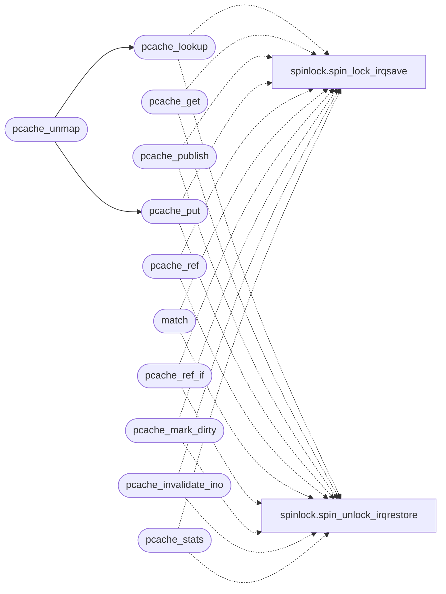

# `fs/pcache.c`

> Source: [fs/pcache.c:1](../../fs/pcache.c#L1) | language `c` | coverage 87.5% | [API index](../index.md)

Docstring: fs/pcache.c -- page cache store for MiniFS (T5 slice 1).

## Contents

- **Structs:** [`pcache_slot_t`](#pcache_slot_t)
- **Functions:** [`pcache_init`](#pcache_init), [`pcache_lookup`](#pcache_lookup), [`pcache_get`](#pcache_get), [`pcache_publish`](#pcache_publish), [`pcache_put`](#pcache_put), [`pcache_ref`](#pcache_ref), [`pcache_unmap`](#pcache_unmap), [`match`](#match), [`pcache_ref_if`](#pcache_ref_if), [`pcache_owns_phys`](#pcache_owns_phys), [`pcache_data`](#pcache_data), [`pcache_mark_dirty`](#pcache_mark_dirty), [`pcache_invalidate_ino`](#pcache_invalidate_ino), [`pcache_stats`](#pcache_stats)

## Call Graph

Solid arrows stay in this module, dashed arrows leave it.



## Structs

<a id="pcache_slot_t"></a>

### `pcache_slot_t`

`struct` | [fs/pcache.c:17](../../fs/pcache.c#L17)

```c
typedef struct
```

---

## Functions

<a id="pcache_init"></a>

### `pcache_init`

`function` | [fs/pcache.c:42](../../fs/pcache.c#L42)

```c
void pcache_init(void)
```

Docstring: Allocate the page pool; disabled (all calls fail closed) when the heap cannot spare it, exactly like the block cache.

Prints one boot marker either way.

> **Inherited:** Documentation from [`pcache_init`](#pcache_init) (headers/pcache.h:28).

---

<a id="pcache_lookup"></a>

### `pcache_lookup`

`function` | [fs/pcache.c:54](../../fs/pcache.c#L54)

```c
int pcache_lookup(int ino, unsigned index)
```

Docstring: Find a cached page without reserving.

Returns the slot or -1. Never allocates, never evicts.

**Parameters**

| Name | Type | Default | Description |
|---|---|---|---|
| `ino` | `int` |  |  |
| `index` | `unsigned` |  |  |

**Returns:** `int`

> **Inherited:** Documentation from [`pcache_lookup`](#pcache_lookup) (headers/pcache.h:32).

*Calls:* [`spin_lock_irqsave`](headers.spinlock.h.md#spin_lock_irqsave), [`spin_unlock_irqrestore`](headers.spinlock.h.md#spin_unlock_irqrestore)

*Called by:* [`pcache_unmap`](#pcache_unmap)

---

<a id="pcache_get"></a>

### `pcache_get`

`function` | [fs/pcache.c:71](../../fs/pcache.c#L71)

```c
int pcache_get(int ino, unsigned index, int *is_new)
```

Docstring: Get a page, pinned with one ref.

Hit returns the live slot; miss reserves an empty or evicted slot (ref 1, clean, *is_new 1, data uninitialized: the caller fills it before any reader sees it) or -1 when every slot is pinned or the pool is disabled, in which case the caller falls back to direct block I/O, fail-open correct. Racy fills must use publish below, never a reserved-then-filled get: a concurrent faulter would map the half-written page.

**Parameters**

| Name | Type | Default | Description |
|---|---|---|---|
| `ino` | `int` |  |  |
| `index` | `unsigned` |  |  |
| `is_new` | `int *` |  |  |

**Returns:** `int`

> **Inherited:** Documentation from [`pcache_get`](#pcache_get) (headers/pcache.h:42).

*Calls:* [`spin_lock_irqsave`](headers.spinlock.h.md#spin_lock_irqsave), [`spin_unlock_irqrestore`](headers.spinlock.h.md#spin_unlock_irqrestore)

---

<a id="pcache_publish"></a>

### `pcache_publish`

`function` | [fs/pcache.c:128](../../fs/pcache.c#L128)

```c
int pcache_publish(int ino, unsigned index, const unsigned char *data)
```

Docstring: Publish a privately filled page into the cache atomically.

Copies data into a reserved slot and marks it valid under one lock hold, or refs the slot a racing publisher won first; either way the returned slot is complete before any other holder can see it. Returns the slot (ref 1 for this mapping) or -1 when no slot is free, in which case the caller maps its private page and takes no ref.

**Parameters**

| Name | Type | Default | Description |
|---|---|---|---|
| `ino` | `int` |  |  |
| `index` | `unsigned` |  |  |
| `data` | `unsigned char *` |  |  |

**Returns:** `int`

*Calls:* [`spin_lock_irqsave`](headers.spinlock.h.md#spin_lock_irqsave), [`spin_unlock_irqrestore`](headers.spinlock.h.md#spin_unlock_irqrestore)

---

<a id="pcache_put"></a>

### `pcache_put`

`function` | [fs/pcache.c:179](../../fs/pcache.c#L179)

```c
void pcache_put(int slot)
```

Docstring: Drop one ref taken by get.

A zero ref is a no-op, never negative.

**Parameters**

| Name | Type | Default | Description |
|---|---|---|---|
| `slot` | `int` |  |  |

> **Inherited:** Documentation from [`pcache_put`](#pcache_put) (headers/pcache.h:55).

*Calls:* [`spin_lock_irqsave`](headers.spinlock.h.md#spin_lock_irqsave), [`spin_unlock_irqrestore`](headers.spinlock.h.md#spin_unlock_irqrestore)

*Called by:* [`pcache_unmap`](#pcache_unmap)

---

<a id="pcache_ref"></a>

### `pcache_ref`

`function` | [fs/pcache.c:192](../../fs/pcache.c#L192)

```c
int pcache_ref(int ino, unsigned index)
```

Docstring: Take one more ref on a cached page without allocating.

Fork uses this for every file-backed page the child inherits, so the child teardown drops exactly what the copy added. Returns the slot or -1 when the page is not cached.

**Parameters**

| Name | Type | Default | Description |
|---|---|---|---|
| `ino` | `int` |  |  |
| `index` | `unsigned` |  |  |

**Returns:** `int`

*Calls:* [`spin_lock_irqsave`](headers.spinlock.h.md#spin_lock_irqsave), [`spin_unlock_irqrestore`](headers.spinlock.h.md#spin_unlock_irqrestore)

---

<a id="pcache_unmap"></a>

### `pcache_unmap`

`function` | [fs/pcache.c:216](../../fs/pcache.c#L216)

```c
void pcache_unmap(int ino, unsigned index)
```

Docstring: Drop the ref a mapping holds on one cached page.

The munmap and teardown walks derive (ino, index) from the VMA node and call this per page; unknown pages are a silent no-op so a partially populated mapping unmaps cleanly. Prefer put_if below wherever the PTE is at hand: blind drops can steal another mapping's ref after a private fallback.

**Parameters**

| Name | Type | Default | Description |
|---|---|---|---|
| `ino` | `int` |  |  |
| `index` | `unsigned` |  |  |

*Calls:* [`pcache_lookup`](#pcache_lookup), [`pcache_put`](#pcache_put)

---

<a id="match"></a>

### `match`

`function` | [fs/pcache.c:230](../../fs/pcache.c#L230)

```c
* a phys match (owned, ref dropped unless already zero), 0 * otherwise. */ int pcache_put_if(int...
```

**Parameters**

| Name | Type | Default | Description |
|---|---|---|---|
| `zero` | `dropped unless already` |  |  |

**Returns:** `* a phys`

*Calls:* [`spin_lock_irqsave`](headers.spinlock.h.md#spin_lock_irqsave), [`spin_unlock_irqrestore`](headers.spinlock.h.md#spin_unlock_irqrestore)

---

<a id="pcache_ref_if"></a>

### `pcache_ref_if`

`function` | [fs/pcache.c:255](../../fs/pcache.c#L255)

```c
int pcache_ref_if(int ino, unsigned index, unsigned long phys)
```

Docstring: Take one more ref only when the cached page is the exact phys the caller shares.

Fork proves sharing through the parent PTE before inheriting, so a stale VMA tag never pins a recycled slot. Returns the slot or -1.

**Parameters**

| Name | Type | Default | Description |
|---|---|---|---|
| `ino` | `int` |  |  |
| `index` | `unsigned` |  |  |
| `phys` | `unsigned long` |  |  |

**Returns:** `int`

*Calls:* [`spin_lock_irqsave`](headers.spinlock.h.md#spin_lock_irqsave), [`spin_unlock_irqrestore`](headers.spinlock.h.md#spin_unlock_irqrestore)

---

<a id="pcache_owns_phys"></a>

### `pcache_owns_phys`

`function` | [fs/pcache.c:277](../../fs/pcache.c#L277)

```c
int pcache_owns_phys(unsigned long phys)
```

Docstring: True when phys is a cache pool page.

The teardown sweeper skips those instead of freeing pool memory as if it were a private data page.

**Parameters**

| Name | Type | Default | Description |
|---|---|---|---|
| `phys` | `unsigned long` |  |  |

**Returns:** `int`

---

<a id="pcache_data"></a>

### `pcache_data`

`function` | [fs/pcache.c:285](../../fs/pcache.c#L285)

```c
unsigned char *pcache_data(int slot)
```

Docstring: Page data for a slot from get/lookup, 0 on a bad slot.

The pointer stays valid until put drops the last ref and the slot is recycled.

**Parameters**

| Name | Type | Default | Description |
|---|---|---|---|
| `slot` | `int` |  |  |

**Returns:** `unsigned char *`

> **Inherited:** Documentation from [`pcache_data`](#pcache_data) (headers/pcache.h:93).

---

<a id="pcache_mark_dirty"></a>

### `pcache_mark_dirty`

`function` | [fs/pcache.c:291](../../fs/pcache.c#L291)

```c
void pcache_mark_dirty(int slot)
```

Docstring: Mark a pinned page dirty.

Slice 3 flushes it; slice 1 only records. Recycled slots bump a generation counter (slice 3 exposes it so holders can validate across put).

**Parameters**

| Name | Type | Default | Description |
|---|---|---|---|
| `slot` | `int` |  |  |

> **Inherited:** Documentation from [`pcache_mark_dirty`](#pcache_mark_dirty) (headers/pcache.h:98).

*Calls:* [`spin_lock_irqsave`](headers.spinlock.h.md#spin_lock_irqsave), [`spin_unlock_irqrestore`](headers.spinlock.h.md#spin_unlock_irqrestore)

---

<a id="pcache_invalidate_ino"></a>

### `pcache_invalidate_ino`

`function` | [fs/pcache.c:299](../../fs/pcache.c#L299)

```c
void pcache_invalidate_ino(int ino)
```

Docstring: Drop every page of an inode (truncate/unlink).

Dirty pages drop with them until slice 3 teaches writeback.

**Parameters**

| Name | Type | Default | Description |
|---|---|---|---|
| `ino` | `int` |  |  |

> **Inherited:** Documentation from [`pcache_invalidate_ino`](#pcache_invalidate_ino) (headers/pcache.h:102).

*Calls:* [`spin_lock_irqsave`](headers.spinlock.h.md#spin_lock_irqsave), [`spin_unlock_irqrestore`](headers.spinlock.h.md#spin_unlock_irqrestore)

---

<a id="pcache_stats"></a>

### `pcache_stats`

`function` | [fs/pcache.c:314](../../fs/pcache.c#L314)

```c
void pcache_stats(unsigned long *pages_out, unsigned long *hits_out, unsigned long *miss_out, unsigned long *evicted_out, unsigned long *dirty_out)
```

Docstring: Snapshot for the mem builtin and BDD: live pages, cumulative hits/misses/evictions, dirty count.

**Parameters**

| Name | Type | Default | Description |
|---|---|---|---|
| `pages_out` | `unsigned long *` |  |  |
| `hits_out` | `unsigned long *` |  |  |
| `miss_out` | `unsigned long *` |  |  |
| `evicted_out` | `unsigned long *` |  |  |
| `dirty_out` | `unsigned long *` |  |  |

> **Inherited:** Documentation from [`pcache_stats`](#pcache_stats) (headers/pcache.h:106).

*Calls:* [`spin_lock_irqsave`](headers.spinlock.h.md#spin_lock_irqsave), [`spin_unlock_irqrestore`](headers.spinlock.h.md#spin_unlock_irqrestore)

---
