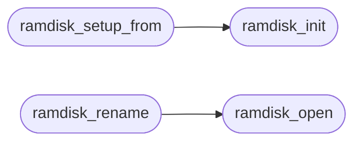

# `fs/ramdisk.c`

> Source: [fs/ramdisk.c:1](../../fs/ramdisk.c#L1) | language `c` | coverage 12.0% | [API index](../index.md)

================================================================

## Contents

- **Structs:** [`RDSuper`](#rdsuper)
- **Functions:** [`ramdisk_setup_from`](#ramdisk_setup_from), [`ramdisk_init`](#ramdisk_init), [`ramdisk_open`](#ramdisk_open), [`ramdisk_read`](#ramdisk_read), [`ramdisk_write`](#ramdisk_write), [`ramdisk_create`](#ramdisk_create), [`ramdisk_resize`](#ramdisk_resize), [`ramdisk_list`](#ramdisk_list), [`ramdisk_count`](#ramdisk_count), [`ramdisk_usage`](#ramdisk_usage), [`ramdisk_file_name`](#ramdisk_file_name), [`ramdisk_delete`](#ramdisk_delete), [`ramdisk_rename`](#ramdisk_rename)
- **Macros:** [`RD_MAGIC`](#rd_magic), [`RD_HEADER_SIZE`](#rd_header_size), [`RD_ENTRY_SIZE`](#rd_entry_size), [`RD_DATA_MIN`](#rd_data_min), [`RD_DATA_SPARE`](#rd_data_spare), [`RD_ENTRY_RAW_OFF`](#rd_entry_raw_off), [`RD_ENTRY_STO_OFF`](#rd_entry_sto_off), [`RD_ENTRY_OFF_OFF`](#rd_entry_off_off), [`RD_ENTRY_FLG_OFF`](#rd_entry_flg_off), [`RD_FLAG_DEFLATE`](#rd_flag_deflate)

## Call Graph

Solid arrows stay in this module, dashed arrows leave it.



## Structs

<a id="rdsuper"></a>

### `RDSuper`

`struct` | [fs/ramdisk.c:26](../../fs/ramdisk.c#L26)

```c
typedef struct
```

---

## Functions

<a id="ramdisk_setup_from"></a>

### `ramdisk_setup_from`

`function` | [fs/ramdisk.c:55](../../fs/ramdisk.c#L55)

```c
void ramdisk_setup_from(void *data, unsigned size)
```

**Parameters**

| Name | Type | Default | Description |
|---|---|---|---|
| `data` | `void *` |  |  |
| `size` | `unsigned` |  |  |

*Calls:* [`ramdisk_init`](#ramdisk_init)

---

<a id="ramdisk_init"></a>

### `ramdisk_init`

`function` | [fs/ramdisk.c:128](../../fs/ramdisk.c#L128)

```c
void ramdisk_init(void)
```

*Called by:* [`ramdisk_setup_from`](#ramdisk_setup_from)

---

<a id="ramdisk_open"></a>

### `ramdisk_open`

`function` | [fs/ramdisk.c:145](../../fs/ramdisk.c#L145)

```c
RDFile *ramdisk_open(const char *name)
```

**Parameters**

| Name | Type | Default | Description |
|---|---|---|---|
| `name` | `char *` |  |  |

**Returns:** `RDFile *`

*Called by:* [`ramdisk_rename`](#ramdisk_rename)

---

<a id="ramdisk_read"></a>

### `ramdisk_read`

`function` | [fs/ramdisk.c:155](../../fs/ramdisk.c#L155)

```c
int ramdisk_read(RDFile *f, void *buf, unsigned offset, unsigned len)
```

**Parameters**

| Name | Type | Default | Description |
|---|---|---|---|
| `f` | `RDFile *` |  |  |
| `buf` | `void *` |  |  |
| `offset` | `unsigned` |  |  |
| `len` | `unsigned` |  |  |

**Returns:** `int`

---

<a id="ramdisk_write"></a>

### `ramdisk_write`

`function` | [fs/ramdisk.c:163](../../fs/ramdisk.c#L163)

```c
int ramdisk_write(RDFile *f, const void *buf, unsigned offset, unsigned len)
```

**Parameters**

| Name | Type | Default | Description |
|---|---|---|---|
| `f` | `RDFile *` |  |  |
| `buf` | `void *` |  |  |
| `offset` | `unsigned` |  |  |
| `len` | `unsigned` |  |  |

**Returns:** `int`

---

<a id="ramdisk_create"></a>

### `ramdisk_create`

`function` | [fs/ramdisk.c:171](../../fs/ramdisk.c#L171)

```c
RDFile *ramdisk_create(const char *name, unsigned size)
```

**Parameters**

| Name | Type | Default | Description |
|---|---|---|---|
| `name` | `char *` |  |  |
| `size` | `unsigned` |  |  |

**Returns:** `RDFile *`

---

<a id="ramdisk_resize"></a>

### `ramdisk_resize`

`function` | [fs/ramdisk.c:185](../../fs/ramdisk.c#L185)

```c
int ramdisk_resize(RDFile *f, unsigned newsize)
```

**Parameters**

| Name | Type | Default | Description |
|---|---|---|---|
| `f` | `RDFile *` |  |  |
| `newsize` | `unsigned` |  |  |

**Returns:** `int`

---

<a id="ramdisk_list"></a>

### `ramdisk_list`

`function` | [fs/ramdisk.c:222](../../fs/ramdisk.c#L222)

```c
int ramdisk_list(RDFile **out, int max)
```

**Parameters**

| Name | Type | Default | Description |
|---|---|---|---|
| `out` | `RDFile **` |  |  |
| `max` | `int` |  |  |

**Returns:** `int`

---

<a id="ramdisk_count"></a>

### `ramdisk_count`

`function` | [fs/ramdisk.c:230](../../fs/ramdisk.c#L230)

```c
int ramdisk_count(void)
```

**Returns:** `int`

---

<a id="ramdisk_usage"></a>

### `ramdisk_usage`

`function` | [fs/ramdisk.c:236](../../fs/ramdisk.c#L236)

```c
void ramdisk_usage(unsigned *used, unsigned *cap, unsigned *max)
```

Docstring: Ramdisk usage snapshot for the mem builtin.

**Parameters**

| Name | Type | Default | Description |
|---|---|---|---|
| `used` | `unsigned *` |  |  |
| `cap` | `unsigned *` |  |  |
| `max` | `unsigned *` |  |  |

---

<a id="ramdisk_file_name"></a>

### `ramdisk_file_name`

`function` `const` | [fs/ramdisk.c:242](../../fs/ramdisk.c#L242)

```c
const char *ramdisk_file_name(int idx)
```

**Parameters**

| Name | Type | Default | Description |
|---|---|---|---|
| `idx` | `int` |  |  |

**Returns:** `char *`

---

<a id="ramdisk_delete"></a>

### `ramdisk_delete`

`function` | [fs/ramdisk.c:247](../../fs/ramdisk.c#L247)

```c
int ramdisk_delete(RDFile *f)
```

**Parameters**

| Name | Type | Default | Description |
|---|---|---|---|
| `f` | `RDFile *` |  |  |

**Returns:** `int`

---

<a id="ramdisk_rename"></a>

### `ramdisk_rename`

`function` | [fs/ramdisk.c:269](../../fs/ramdisk.c#L269)

```c
int ramdisk_rename(const char *oldname, const char *newname)
```

Docstring: In-place rename of one ramdisk entry.

Both names fit RAMDISK_FNAME_LEN (fs_resolve guarantees it); missing src or an existing dst refuses, never overwrites. Returns 0 on success.

**Parameters**

| Name | Type | Default | Description |
|---|---|---|---|
| `oldname` | `char *` |  |  |
| `newname` | `char *` |  |  |

**Returns:** `int`

> **Inherited:** Documentation from [`ramdisk_rename`](#ramdisk_rename) (headers/kernel.h:288).

*Calls:* [`ramdisk_open`](#ramdisk_open)

---

## Macros

<a id="rd_magic"></a>

### `RD_MAGIC`

`macro` | [fs/ramdisk.c:15](../../fs/ramdisk.c#L15)

```c
#define RD_MAGIC
```

---

<a id="rd_header_size"></a>

### `RD_HEADER_SIZE`

`macro` | [fs/ramdisk.c:16](../../fs/ramdisk.c#L16)

```c
#define RD_HEADER_SIZE
```

---

<a id="rd_entry_size"></a>

### `RD_ENTRY_SIZE`

`macro` | [fs/ramdisk.c:17](../../fs/ramdisk.c#L17)

```c
#define RD_ENTRY_SIZE
```

---

<a id="rd_data_min"></a>

### `RD_DATA_MIN`

`macro` | [fs/ramdisk.c:18](../../fs/ramdisk.c#L18)

```c
#define RD_DATA_MIN
```

---

<a id="rd_data_spare"></a>

### `RD_DATA_SPARE`

`macro` | [fs/ramdisk.c:19](../../fs/ramdisk.c#L19)

```c
#define RD_DATA_SPARE
```

---

<a id="rd_entry_raw_off"></a>

### `RD_ENTRY_RAW_OFF`

`macro` | [fs/ramdisk.c:20](../../fs/ramdisk.c#L20)

```c
#define RD_ENTRY_RAW_OFF
```

---

<a id="rd_entry_sto_off"></a>

### `RD_ENTRY_STO_OFF`

`macro` | [fs/ramdisk.c:21](../../fs/ramdisk.c#L21)

```c
#define RD_ENTRY_STO_OFF
```

---

<a id="rd_entry_off_off"></a>

### `RD_ENTRY_OFF_OFF`

`macro` | [fs/ramdisk.c:22](../../fs/ramdisk.c#L22)

```c
#define RD_ENTRY_OFF_OFF
```

---

<a id="rd_entry_flg_off"></a>

### `RD_ENTRY_FLG_OFF`

`macro` | [fs/ramdisk.c:23](../../fs/ramdisk.c#L23)

```c
#define RD_ENTRY_FLG_OFF
```

---

<a id="rd_flag_deflate"></a>

### `RD_FLAG_DEFLATE`

`macro` | [fs/ramdisk.c:24](../../fs/ramdisk.c#L24)

```c
#define RD_FLAG_DEFLATE
```

---
