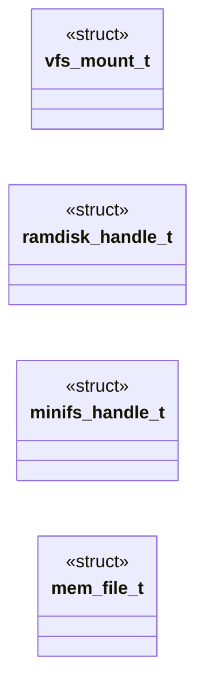
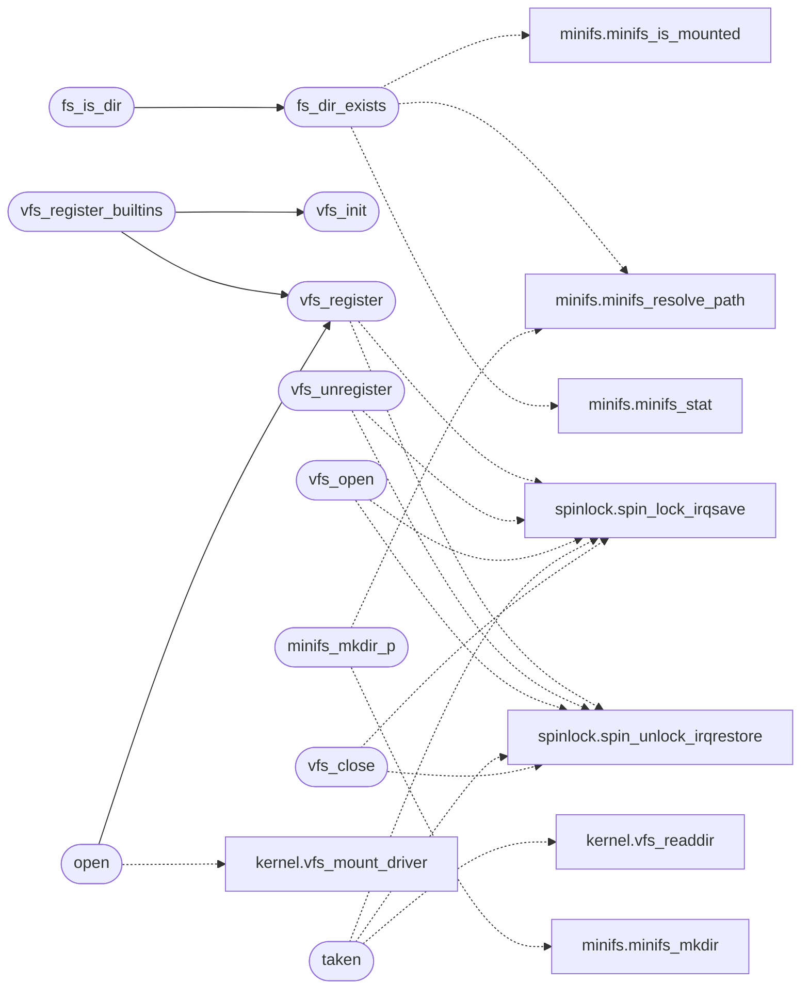

# `fs/vfs.c`

> Source: [fs/vfs.c:1](../../fs/vfs.c#L1) | language `c` | coverage 8.7% | [API index](../index.md)

================================================================

## Contents

- **Structs:** [`vfs_mount_t`](#vfs_mount_t), [`ramdisk_handle_t`](#ramdisk_handle_t), [`minifs_handle_t`](#minifs_handle_t), [`mem_file_t`](#mem_file_t)
- **Functions:** [`vfs_init`](#vfs_init), [`vfs_register`](#vfs_register), [`vfs_unregister`](#vfs_unregister), [`vfs_open`](#vfs_open), [`taken`](#taken), [`fs_resolve`](#fs_resolve), [`fs_dir_exists`](#fs_dir_exists), [`fs_is_dir`](#fs_is_dir), [`minifs_mkdir_p`](#minifs_mkdir_p), [`vfs_register_builtins`](#vfs_register_builtins), [`open`](#open), [`vfs_read`](#vfs_read), [`vfs_write`](#vfs_write), [`vfs_close`](#vfs_close), [`vfs_fstat`](#vfs_fstat)
- **Macros:** [`MEM_FILES`](#mem_files), [`MEM_FNAME`](#mem_fname), [`MEM_FSIZE`](#mem_fsize)

## Type Diagram



## Call Graph

Solid arrows stay in this module, dashed arrows leave it.



## Structs

<a id="vfs_mount_t"></a>

### `vfs_mount_t`

`struct` | [fs/vfs.c:10](../../fs/vfs.c#L10)

```c
typedef struct
```

---

<a id="ramdisk_handle_t"></a>

### `ramdisk_handle_t`

`struct` | [fs/vfs.c:196](../../fs/vfs.c#L196)

```c
typedef struct
```

---

<a id="minifs_handle_t"></a>

### `minifs_handle_t`

`struct` | [fs/vfs.c:346](../../fs/vfs.c#L346)

```c
typedef struct
```

---

<a id="mem_file_t"></a>

### `mem_file_t`

`struct` | [fs/vfs.c:461](../../fs/vfs.c#L461)

```c
typedef struct
```

---

## Functions

<a id="vfs_init"></a>

### `vfs_init`

`function` | [fs/vfs.c:22](../../fs/vfs.c#L22)

```c
void vfs_init(void)
```

*Called by:* [`vfs_register_builtins`](#vfs_register_builtins)

---

<a id="vfs_register"></a>

### `vfs_register`

`function` | [fs/vfs.c:27](../../fs/vfs.c#L27)

```c
int vfs_register(const char *prefix, const vfs_ops_t *ops, const char *driver)
```

**Parameters**

| Name | Type | Default | Description |
|---|---|---|---|
| `prefix` | `char *` |  |  |
| `ops` | `vfs_ops_t *` |  |  |
| `driver` | `char *` |  |  |

**Returns:** `int`

*Calls:* [`spin_lock_irqsave`](headers.spinlock.h.md#spin_lock_irqsave), [`spin_unlock_irqrestore`](headers.spinlock.h.md#spin_unlock_irqrestore)

*Called by:* [`open`](#open), [`vfs_register_builtins`](#vfs_register_builtins)

---

<a id="vfs_unregister"></a>

### `vfs_unregister`

`function` | [fs/vfs.c:62](../../fs/vfs.c#L62)

```c
int vfs_unregister(const char *prefix)
```

**Parameters**

| Name | Type | Default | Description |
|---|---|---|---|
| `prefix` | `char *` |  |  |

**Returns:** `int`

*Calls:* [`spin_lock_irqsave`](headers.spinlock.h.md#spin_lock_irqsave), [`spin_unlock_irqrestore`](headers.spinlock.h.md#spin_unlock_irqrestore)

---

<a id="vfs_open"></a>

### `vfs_open`

`function` | [fs/vfs.c:106](../../fs/vfs.c#L106)

```c
int vfs_open(const char *path, int mode, vfs_file_t *f)
```

**Parameters**

| Name | Type | Default | Description |
|---|---|---|---|
| `path` | `char *` |  |  |
| `mode` | `int` |  |  |
| `f` | `vfs_file_t *` |  |  |

**Returns:** `int`

*Calls:* [`spin_lock_irqsave`](headers.spinlock.h.md#spin_lock_irqsave), [`spin_unlock_irqrestore`](headers.spinlock.h.md#spin_unlock_irqrestore)

---

<a id="taken"></a>

### `taken`

`function` | [fs/vfs.c:160](../../fs/vfs.c#L160)

```c
* refcount is taken (ops tables are static, never freed), so a * listing can never pin an unmoun...
```

**Parameters**

| Name | Type | Default | Description |
|---|---|---|---|
| `static` | `ops tables are` |  |  |
| `freed` | `never` |  |  |

**Returns:** `* refcount is`

*Calls:* [`vfs_readdir`](headers.kernel.h.md#vfs_readdir), [`spin_lock_irqsave`](headers.spinlock.h.md#spin_lock_irqsave), [`spin_unlock_irqrestore`](headers.spinlock.h.md#spin_unlock_irqrestore)

---

<a id="fs_resolve"></a>

### `fs_resolve`

`function` | [fs/vfs.c:580](../../fs/vfs.c#L580)

```c
int fs_resolve(const char *path, char *out, unsigned cap)
```

Path resolution choke point shared by the shell builtins and the zip builtins. fs_resolve resolves a path against the cwd into `out` (cap >= RAMDISK_FNAME_LEN); a name that does not fit is rejected like a missing file, never truncated.

**Parameters**

| Name | Type | Default | Description |
|---|---|---|---|
| `path` | `char *` |  |  |
| `out` | `char *` |  |  |
| `cap` | `unsigned` |  |  |

**Returns:** `int`

> **Inherited:** Documentation from [`fs_resolve`](#fs_resolve) (headers/kernel.h:311).

---

<a id="fs_dir_exists"></a>

### `fs_dir_exists`

`function` | [fs/vfs.c:613](../../fs/vfs.c#L613)

```c
int fs_dir_exists(const char *dir)
```

**Parameters**

| Name | Type | Default | Description |
|---|---|---|---|
| `dir` | `char *` |  |  |

**Returns:** `int`

*Calls:* [`minifs_is_mounted`](headers.minifs.h.md#minifs_is_mounted), [`minifs_resolve_path`](headers.minifs.h.md#minifs_resolve_path), [`minifs_stat`](headers.minifs.h.md#minifs_stat)

*Called by:* [`fs_is_dir`](#fs_is_dir)

---

<a id="fs_is_dir"></a>

### `fs_is_dir`

`function` | [fs/vfs.c:638](../../fs/vfs.c#L638)

```c
int fs_is_dir(const char *resolved)
```

**Parameters**

| Name | Type | Default | Description |
|---|---|---|---|
| `resolved` | `char *` |  |  |

**Returns:** `int`

*Calls:* [`fs_dir_exists`](#fs_dir_exists)

---

<a id="minifs_mkdir_p"></a>

### `minifs_mkdir_p`

`function` | [fs/vfs.c:651](../../fs/vfs.c#L651)

```c
int minifs_mkdir_p(const char *resolved)
```

**Parameters**

| Name | Type | Default | Description |
|---|---|---|---|
| `resolved` | `char *` |  |  |

**Returns:** `int`

*Calls:* [`minifs_mkdir`](headers.minifs.h.md#minifs_mkdir), [`minifs_resolve_path`](headers.minifs.h.md#minifs_resolve_path)

---

<a id="vfs_register_builtins"></a>

### `vfs_register_builtins`

`function` | [fs/vfs.c:674](../../fs/vfs.c#L674)

```c
void vfs_register_builtins(void)
```

*Calls:* [`vfs_init`](#vfs_init), [`vfs_register`](#vfs_register)

---

<a id="open"></a>

### `open`

`function` | [fs/vfs.c:688](../../fs/vfs.c#L688)

```c
* open (loopback image file plus in-image path), so one registration * serves every image. */ in...
```

**Parameters**

| Name | Type | Default | Description |
|---|---|---|---|
| `path` | `loopback image file plus in-image` |  |  |

**Returns:** `*`

*Calls:* [`vfs_register`](#vfs_register), [`vfs_mount_driver`](headers.kernel.h.md#vfs_mount_driver)

---

<a id="vfs_read"></a>

### `vfs_read`

`function` | [fs/vfs.c:709](../../fs/vfs.c#L709)

```c
int vfs_read(vfs_file_t *f, void *buf, unsigned long len)
```

**Parameters**

| Name | Type | Default | Description |
|---|---|---|---|
| `f` | `vfs_file_t *` |  |  |
| `buf` | `void *` |  |  |
| `len` | `unsigned long` |  |  |

**Returns:** `int`

---

<a id="vfs_write"></a>

### `vfs_write`

`function` | [fs/vfs.c:718](../../fs/vfs.c#L718)

```c
int vfs_write(vfs_file_t *f, const void *buf, unsigned long len)
```

**Parameters**

| Name | Type | Default | Description |
|---|---|---|---|
| `f` | `vfs_file_t *` |  |  |
| `buf` | `void *` |  |  |
| `len` | `unsigned long` |  |  |

**Returns:** `int`

---

<a id="vfs_close"></a>

### `vfs_close`

`function` | [fs/vfs.c:734](../../fs/vfs.c#L734)

```c
int vfs_close(vfs_file_t *f)
```

**Parameters**

| Name | Type | Default | Description |
|---|---|---|---|
| `f` | `vfs_file_t *` |  |  |

**Returns:** `int`

*Calls:* [`spin_lock_irqsave`](headers.spinlock.h.md#spin_lock_irqsave), [`spin_unlock_irqrestore`](headers.spinlock.h.md#spin_unlock_irqrestore)

---

<a id="vfs_fstat"></a>

### `vfs_fstat`

`function` | [fs/vfs.c:752](../../fs/vfs.c#L752)

```c
int vfs_fstat(vfs_file_t *f, unsigned long *size_out)
```

**Parameters**

| Name | Type | Default | Description |
|---|---|---|---|
| `f` | `vfs_file_t *` |  |  |
| `size_out` | `unsigned long *` |  |  |

**Returns:** `int`

---

## Macros

<a id="mem_files"></a>

### `MEM_FILES`

`macro` | [fs/vfs.c:457](../../fs/vfs.c#L457)

```c
#define MEM_FILES
```

---

<a id="mem_fname"></a>

### `MEM_FNAME`

`macro` | [fs/vfs.c:458](../../fs/vfs.c#L458)

```c
#define MEM_FNAME
```

---

<a id="mem_fsize"></a>

### `MEM_FSIZE`

`macro` | [fs/vfs.c:459](../../fs/vfs.c#L459)

```c
#define MEM_FSIZE
```

---
