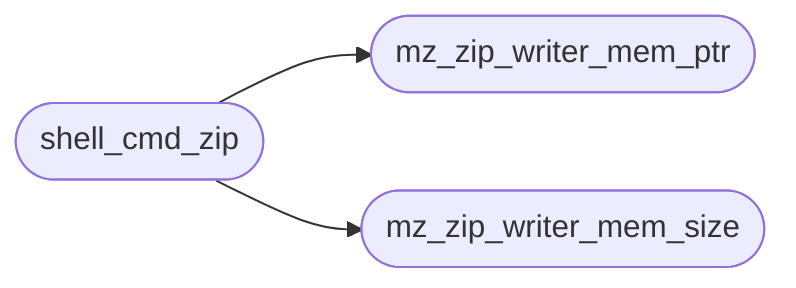

# `fs/zip.c`

> Source: [fs/zip.c:1](../../fs/zip.c#L1) | language `c` | coverage 42.9% | [API index](../index.md)

zip.c — the unzip/zip shell builtins over the miniz zip library.

## Contents

- **Functions:** [`root`](#root), [`mz_zip_writer_mem_ptr`](#mz_zip_writer_mem_ptr), [`mz_zip_writer_mem_size`](#mz_zip_writer_mem_size), [`marker`](#marker), [`shell_cmd_unzip`](#shell_cmd_unzip), [`shell_cmd_zip`](#shell_cmd_zip)

## Call Graph

Solid arrows stay in this module, dashed arrows leave it.



## Functions

<a id="root"></a>

### `root`

`function` | [fs/zip.c:8](../../fs/zip.c#L8)

```c
* names are hostile data: each is normalized to forward slashes and rejected * when it escapes the extraction root (absolute paths, '.'/'..' components, * empty names), so a crafted archive can never
```

**Parameters**

| Name | Type | Default | Description |
|---|---|---|---|
| `paths` | `absolute` |  |  |
| `components` |  |  |  |
| `names` | `* empty` |  |  |

**Returns:** `* names are hostile data: each is normalized to forward slashes and rejected * when it escapes the extraction`

---

<a id="mz_zip_writer_mem_ptr"></a>

### `mz_zip_writer_mem_ptr`

`function` | [fs/zip.c:18](../../fs/zip.c#L18)

```c
void *mz_zip_writer_mem_ptr(mz_zip_archive *pZip);
```

**Parameters**

| Name | Type | Default | Description |
|---|---|---|---|
| `pZip` | `mz_zip_archive *` |  |  |

**Returns:** `void *`

*Called by:* [`shell_cmd_zip`](#shell_cmd_zip)

---

<a id="mz_zip_writer_mem_size"></a>

### `mz_zip_writer_mem_size`

`function` | [fs/zip.c:19](../../fs/zip.c#L19)

```c
size_t mz_zip_writer_mem_size(mz_zip_archive *pZip);
```

**Parameters**

| Name | Type | Default | Description |
|---|---|---|---|
| `pZip` | `mz_zip_archive *` |  |  |

**Returns:** `size_t`

*Called by:* [`shell_cmd_zip`](#shell_cmd_zip)

---

<a id="marker"></a>

### `marker`

`function` | [fs/zip.c:50](../../fs/zip.c#L50)

```c
* marker (trailing '/') is preserved by the caller, not here. */ static int zip_sanitize_name(con...
```

**Parameters**

| Name | Type | Default | Description |
|---|---|---|---|
| `trailing` |  |  |  |

**Returns:** `*`

---

<a id="shell_cmd_unzip"></a>

### `shell_cmd_unzip`

`function` | [fs/zip.c:176](../../fs/zip.c#L176)

```c
void shell_cmd_unzip(int argc, char **argv)
```

unzip <archive.zip> [dir]  — extract;  unzip -l <archive.zip> — list.

**Parameters**

| Name | Type | Default | Description |
|---|---|---|---|
| `argc` | `int` |  |  |
| `argv` | `char **` |  |  |

---

<a id="shell_cmd_zip"></a>

### `shell_cmd_zip`

`function` | [fs/zip.c:254](../../fs/zip.c#L254)

```c
void shell_cmd_zip(int argc, char **argv)
```

zip <out.zip> <file...> — store each file (under its sanitized name) into a new archive.

**Parameters**

| Name | Type | Default | Description |
|---|---|---|---|
| `argc` | `int` |  |  |
| `argv` | `char **` |  |  |

*Calls:* [`mz_zip_writer_mem_ptr`](#mz_zip_writer_mem_ptr), [`mz_zip_writer_mem_size`](#mz_zip_writer_mem_size)

---
