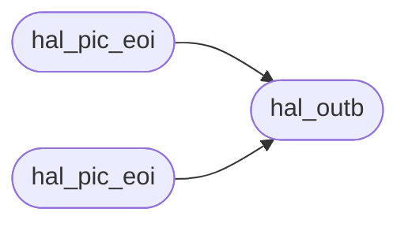

# `headers/arch/x86/hal_io.h`

> Source: [headers/arch/x86/hal_io.h:1](../../headers/arch/x86/hal_io.h#L1) | language `h` | coverage 100.0% | [API index](../index.md)

Docstring: x86 port I/O hardware abstraction contract.

## Contents

- **Functions:** [`hal_mmio_write32`](#hal_mmio_write32), [`hal_mmio_read64`](#hal_mmio_read64), [`hal_mmio_write64`](#hal_mmio_write64), [`hal_mmio_read16`](#hal_mmio_read16), [`hal_mmio_write16`](#hal_mmio_write16), [`hal_mmio_read8`](#hal_mmio_read8), [`hal_mmio_write8`](#hal_mmio_write8), [`hal_mmio_wmb`](#hal_mmio_wmb), [`hal_mmio_rmb`](#hal_mmio_rmb), [`hal_mmio_mb`](#hal_mmio_mb), [`hal_outb`](#hal_outb), [`hal_inb`](#hal_inb), [`hal_outw`](#hal_outw), [`hal_inw`](#hal_inw), [`hal_lapic_eoi`](#hal_lapic_eoi), [`hal_pic_eoi`](#hal_pic_eoi), [`hal_outb`](#hal_outb), [`hal_inb`](#hal_inb), [`hal_outw`](#hal_outw), [`hal_inw`](#hal_inw), [`hal_lapic_eoi`](#hal_lapic_eoi), [`hal_pic_eoi`](#hal_pic_eoi)
- **Macros:** [`HAL_PIC1_CMD`](#hal_pic1_cmd), [`HAL_PIC1_DATA`](#hal_pic1_data), [`HAL_PIC2_CMD`](#hal_pic2_cmd), [`HAL_PIC2_DATA`](#hal_pic2_data), [`HAL_PIC_EOI`](#hal_pic_eoi), [`HAL_PIT_CMD`](#hal_pit_cmd), [`HAL_PIT_CH0`](#hal_pit_ch0), [`HAL_PS2_STATUS`](#hal_ps2_status), [`HAL_PS2_DATA`](#hal_ps2_data), [`HAL_PS2_MOUSE_OBF`](#hal_ps2_mouse_obf), [`HAL_PS2_IBF_EMPTY`](#hal_ps2_ibf_empty), [`HAL_PS2_OBF_FULL`](#hal_ps2_obf_full), [`HAL_PS2_CMD_WRITE_MOUSE`](#hal_ps2_cmd_write_mouse), [`HAL_PS2_CMD_ENABLE_AUX`](#hal_ps2_cmd_enable_aux), [`HAL_PS2_CMD_DISABLE_AUX`](#hal_ps2_cmd_disable_aux), [`HAL_PS2_CMD_ENABLE_KBD`](#hal_ps2_cmd_enable_kbd), [`HAL_PS2_CMD_DISABLE_KBD`](#hal_ps2_cmd_disable_kbd), [`HAL_PS2_CMD_READ_CONFIG`](#hal_ps2_cmd_read_config), [`HAL_PS2_CMD_WRITE_CONFIG`](#hal_ps2_cmd_write_config), [`HAL_PS2_CONFIG_IRQ1`](#hal_ps2_config_irq1), [`HAL_PS2_CONFIG_IRQ12`](#hal_ps2_config_irq12), [`HAL_PS2_CONFIG_DISABLE_KBD`](#hal_ps2_config_disable_kbd), [`HAL_PS2_CONFIG_DISABLE_AUX`](#hal_ps2_config_disable_aux), [`HAL_PS2_CONFIG_TRANSLATE`](#hal_ps2_config_translate), [`HAL_MOUSE_CMD_RESET`](#hal_mouse_cmd_reset), [`HAL_MOUSE_CMD_SET_RATE`](#hal_mouse_cmd_set_rate), [`HAL_MOUSE_CMD_GET_ID`](#hal_mouse_cmd_get_id), [`HAL_MOUSE_CMD_DEFAULTS`](#hal_mouse_cmd_defaults), [`HAL_MOUSE_CMD_ENABLE`](#hal_mouse_cmd_enable), [`HAL_MOUSE_CMD_DISABLE`](#hal_mouse_cmd_disable), [`HAL_MOUSE_RATE_KNOCK_200`](#hal_mouse_rate_knock_200), [`HAL_MOUSE_RATE_KNOCK_100`](#hal_mouse_rate_knock_100), [`HAL_MOUSE_RATE_KNOCK_80`](#hal_mouse_rate_knock_80), [`HAL_MOUSE_ID_INTELLI`](#hal_mouse_id_intelli), [`HAL_MOUSE_HW_TIMEOUT`](#hal_mouse_hw_timeout), [`HAL_MOUSE_SYNC_BIT`](#hal_mouse_sync_bit), [`HAL_MOUSE_OVF_BITS`](#hal_mouse_ovf_bits), [`HAL_MOUSE_BUTTON_MASK`](#hal_mouse_button_mask), [`HAL_MOUSE_PACKET_LEN`](#hal_mouse_packet_len), [`HAL_MOUSE_SCALE`](#hal_mouse_scale), [`HAL_LAPIC_EOI_ADDR`](#hal_lapic_eoi_addr)
- **Variables:** [`hal_io_stub_writes`](#hal_io_stub_writes), [`hal_io_stub_last_port`](#hal_io_stub_last_port), [`hal_io_stub_last_val`](#hal_io_stub_last_val), [`hal_io_stub_lapic_eois`](#hal_io_stub_lapic_eois), [`hal_io_stub_read_val`](#hal_io_stub_read_val)

## Call Graph

Solid arrows stay in this module, dashed arrows leave it.



## Functions

<a id="hal_mmio_write32"></a>

### `hal_mmio_write32`

`function` `inline` `static` | [headers/arch/x86/hal_io.h:123](../../headers/arch/x86/hal_io.h#L123)

```c
static inline void hal_mmio_write32(volatile unsigned *addr, unsigned val)
```

Docstring: Write a 32-bit device register.

**Parameters**

| Name | Type | Default | Description |
|---|---|---|---|
| `addr` | `volatile unsigned *` |  |  |
| `val` | `unsigned` |  |  |

*Called by:* [`XHC_DB_COMMAND`](drivers.xhci.c.md#xhc_db_command), [`xhc_reset_endpoint`](drivers.xhci.c.md#xhc_reset_endpoint)

---

<a id="hal_mmio_read64"></a>

### `hal_mmio_read64`

`function` `inline` `static` | [headers/arch/x86/hal_io.h:128](../../headers/arch/x86/hal_io.h#L128)

```c
static inline unsigned long long hal_mmio_read64(const volatile unsigned long long *addr)
```

Docstring: Read a 64-bit device register.

**Parameters**

| Name | Type | Default | Description |
|---|---|---|---|
| `addr` | `volatile unsigned long long *` |  |  |

**Returns:** `unsigned long long`

---

<a id="hal_mmio_write64"></a>

### `hal_mmio_write64`

`function` `inline` `static` | [headers/arch/x86/hal_io.h:133](../../headers/arch/x86/hal_io.h#L133)

```c
static inline void hal_mmio_write64(volatile unsigned long long *addr, unsigned long long val)
```

Docstring: Write a 64-bit device register.

**Parameters**

| Name | Type | Default | Description |
|---|---|---|---|
| `addr` | `volatile unsigned long long *` |  |  |
| `val` | `unsigned long long` |  |  |

---

<a id="hal_mmio_read16"></a>

### `hal_mmio_read16`

`function` `inline` `static` | [headers/arch/x86/hal_io.h:139](../../headers/arch/x86/hal_io.h#L139)

```c
static inline unsigned short hal_mmio_read16(const volatile unsigned short *addr)
```

Docstring: Read a 16-bit device register.

**Parameters**

| Name | Type | Default | Description |
|---|---|---|---|
| `addr` | `volatile unsigned short *` |  |  |

**Returns:** `unsigned short`

---

<a id="hal_mmio_write16"></a>

### `hal_mmio_write16`

`function` `inline` `static` | [headers/arch/x86/hal_io.h:144](../../headers/arch/x86/hal_io.h#L144)

```c
static inline void hal_mmio_write16(volatile unsigned short *addr, unsigned short val)
```

Docstring: Write a 16-bit device register.

**Parameters**

| Name | Type | Default | Description |
|---|---|---|---|
| `addr` | `volatile unsigned short *` |  |  |
| `val` | `unsigned short` |  |  |

---

<a id="hal_mmio_read8"></a>

### `hal_mmio_read8`

`function` `inline` `static` | [headers/arch/x86/hal_io.h:150](../../headers/arch/x86/hal_io.h#L150)

```c
static inline unsigned char hal_mmio_read8(const volatile unsigned char *addr)
```

Docstring: Read an 8-bit device register.

**Parameters**

| Name | Type | Default | Description |
|---|---|---|---|
| `addr` | `volatile unsigned char *` |  |  |

**Returns:** `unsigned char`

---

<a id="hal_mmio_write8"></a>

### `hal_mmio_write8`

`function` `inline` `static` | [headers/arch/x86/hal_io.h:155](../../headers/arch/x86/hal_io.h#L155)

```c
static inline void hal_mmio_write8(volatile unsigned char *addr, unsigned char val)
```

Docstring: Write an 8-bit device register.

**Parameters**

| Name | Type | Default | Description |
|---|---|---|---|
| `addr` | `volatile unsigned char *` |  |  |
| `val` | `unsigned char` |  |  |

---

<a id="hal_mmio_wmb"></a>

### `hal_mmio_wmb`

`function` `inline` `static` | [headers/arch/x86/hal_io.h:161](../../headers/arch/x86/hal_io.h#L161)

```c
static inline void hal_mmio_wmb(void)
```

Docstring: Write memory barrier, orders prior stores before later stores.

*Called by:* [`XHC_DB_COMMAND`](drivers.xhci.c.md#xhc_db_command), [`xhc_configure_endpoint`](drivers.xhci.c.md#xhc_configure_endpoint), [`xhc_reset_endpoint`](drivers.xhci.c.md#xhc_reset_endpoint)

---

<a id="hal_mmio_rmb"></a>

### `hal_mmio_rmb`

`function` `inline` `static` | [headers/arch/x86/hal_io.h:166](../../headers/arch/x86/hal_io.h#L166)

```c
static inline void hal_mmio_rmb(void)
```

Docstring: Read memory barrier, orders prior loads before later loads.

---

<a id="hal_mmio_mb"></a>

### `hal_mmio_mb`

`function` `inline` `static` | [headers/arch/x86/hal_io.h:171](../../headers/arch/x86/hal_io.h#L171)

```c
static inline void hal_mmio_mb(void)
```

Docstring: Full memory barrier, orders every prior access before later ones.

---

<a id="hal_outb"></a>

### `hal_outb`

`function` `inline` `static` | [headers/arch/x86/hal_io.h:189](../../headers/arch/x86/hal_io.h#L189)

```c
static inline void hal_outb(unsigned short port, unsigned char val)
```

Docstring: Stub port byte write, records port and value.

**Parameters**

| Name | Type | Default | Description |
|---|---|---|---|
| `port` | `unsigned short` |  |  |
| `val` | `unsigned char` |  |  |

*Called by:* [`mouse_hw_init`](drivers.mouse.c.md#mouse_hw_init), [`hal_pic_eoi`](#hal_pic_eoi), [`hal_pic_eoi`](#hal_pic_eoi), [`isr_dispatch`](kernel.sched.c.md#isr_dispatch)

---

<a id="hal_inb"></a>

### `hal_inb`

`function` `inline` `static` | [headers/arch/x86/hal_io.h:196](../../headers/arch/x86/hal_io.h#L196)

```c
static inline unsigned char hal_inb(unsigned short port)
```

Docstring: Stub port byte read, returns the canned value.

**Parameters**

| Name | Type | Default | Description |
|---|---|---|---|
| `port` | `unsigned short` |  |  |

**Returns:** `unsigned char`

*Called by:* [`kbd_available`](drivers.kbd.c.md#kbd_available), [`kbd_read`](drivers.kbd.c.md#kbd_read), [`mouse_hw_init`](drivers.mouse.c.md#mouse_hw_init), [`isr_dispatch`](kernel.sched.c.md#isr_dispatch)

---

<a id="hal_outw"></a>

### `hal_outw`

`function` `inline` `static` | [headers/arch/x86/hal_io.h:202](../../headers/arch/x86/hal_io.h#L202)

```c
static inline void hal_outw(unsigned short port, unsigned short val)
```

Docstring: Stub port word write, records port and low byte.

**Parameters**

| Name | Type | Default | Description |
|---|---|---|---|
| `port` | `unsigned short` |  |  |
| `val` | `unsigned short` |  |  |

---

<a id="hal_inw"></a>

### `hal_inw`

`function` `inline` `static` | [headers/arch/x86/hal_io.h:209](../../headers/arch/x86/hal_io.h#L209)

```c
static inline unsigned short hal_inw(unsigned short port)
```

Docstring: Stub port word read, returns the canned value.

**Parameters**

| Name | Type | Default | Description |
|---|---|---|---|
| `port` | `unsigned short` |  |  |

**Returns:** `unsigned short`

---

<a id="hal_lapic_eoi"></a>

### `hal_lapic_eoi`

`function` `inline` `static` | [headers/arch/x86/hal_io.h:215](../../headers/arch/x86/hal_io.h#L215)

```c
static inline void hal_lapic_eoi(void)
```

Docstring: Stub LAPIC EOI, counts calls.

*Called by:* [`isr_dispatch`](kernel.sched.c.md#isr_dispatch)

---

<a id="hal_pic_eoi"></a>

### `hal_pic_eoi`

`function` `inline` `static` | [headers/arch/x86/hal_io.h:220](../../headers/arch/x86/hal_io.h#L220)

```c
static inline void hal_pic_eoi(int irq)
```

Docstring: Stub PIC EOI for an IRQ line.

**Parameters**

| Name | Type | Default | Description |
|---|---|---|---|
| `irq` | `int` |  |  |

*Calls:* [`hal_outb`](#hal_outb)

---

<a id="hal_outb"></a>

### `hal_outb`

`function` `inline` `static` | [headers/arch/x86/hal_io.h:230](../../headers/arch/x86/hal_io.h#L230)

```c
static inline void hal_outb(unsigned short port, unsigned char val)
```

Docstring: Emit a port byte write.

**Parameters**

| Name | Type | Default | Description |
|---|---|---|---|
| `port` | `unsigned short` |  |  |
| `val` | `unsigned char` |  |  |

---

<a id="hal_inb"></a>

### `hal_inb`

`function` `inline` `static` | [headers/arch/x86/hal_io.h:235](../../headers/arch/x86/hal_io.h#L235)

```c
static inline unsigned char hal_inb(unsigned short port)
```

Docstring: Emit a port byte read.

**Parameters**

| Name | Type | Default | Description |
|---|---|---|---|
| `port` | `unsigned short` |  |  |

**Returns:** `unsigned char`

---

<a id="hal_outw"></a>

### `hal_outw`

`function` `inline` `static` | [headers/arch/x86/hal_io.h:242](../../headers/arch/x86/hal_io.h#L242)

```c
static inline void hal_outw(unsigned short port, unsigned short val)
```

Docstring: Emit a port word write.

**Parameters**

| Name | Type | Default | Description |
|---|---|---|---|
| `port` | `unsigned short` |  |  |
| `val` | `unsigned short` |  |  |

---

<a id="hal_inw"></a>

### `hal_inw`

`function` `inline` `static` | [headers/arch/x86/hal_io.h:247](../../headers/arch/x86/hal_io.h#L247)

```c
static inline unsigned short hal_inw(unsigned short port)
```

Docstring: Emit a port word read.

**Parameters**

| Name | Type | Default | Description |
|---|---|---|---|
| `port` | `unsigned short` |  |  |

**Returns:** `unsigned short`

---

<a id="hal_lapic_eoi"></a>

### `hal_lapic_eoi`

`function` `inline` `static` | [headers/arch/x86/hal_io.h:254](../../headers/arch/x86/hal_io.h#L254)

```c
static inline void hal_lapic_eoi(void)
```

Docstring: Acknowledge the local APIC after an IPI-driven tick.

---

<a id="hal_pic_eoi"></a>

### `hal_pic_eoi`

`function` `inline` `static` | [headers/arch/x86/hal_io.h:259](../../headers/arch/x86/hal_io.h#L259)

```c
static inline void hal_pic_eoi(int irq)
```

Docstring: Send end-of-interrupt for an IRQ line.

**Parameters**

| Name | Type | Default | Description |
|---|---|---|---|
| `irq` | `int` |  |  |

*Calls:* [`hal_outb`](#hal_outb)

---

## Macros

<a id="hal_pic1_cmd"></a>

### `HAL_PIC1_CMD`

`macro` | [headers/arch/x86/hal_io.h:16](../../headers/arch/x86/hal_io.h#L16)

```c
#define HAL_PIC1_CMD
```

Docstring: Master PIC command port.

---

<a id="hal_pic1_data"></a>

### `HAL_PIC1_DATA`

`macro` | [headers/arch/x86/hal_io.h:18](../../headers/arch/x86/hal_io.h#L18)

```c
#define HAL_PIC1_DATA
```

Docstring: Master PIC data port.

---

<a id="hal_pic2_cmd"></a>

### `HAL_PIC2_CMD`

`macro` | [headers/arch/x86/hal_io.h:20](../../headers/arch/x86/hal_io.h#L20)

```c
#define HAL_PIC2_CMD
```

Docstring: Slave PIC command port.

---

<a id="hal_pic2_data"></a>

### `HAL_PIC2_DATA`

`macro` | [headers/arch/x86/hal_io.h:22](../../headers/arch/x86/hal_io.h#L22)

```c
#define HAL_PIC2_DATA
```

Docstring: Slave PIC data port.

---

<a id="hal_pic_eoi"></a>

### `HAL_PIC_EOI`

`macro` | [headers/arch/x86/hal_io.h:24](../../headers/arch/x86/hal_io.h#L24)

```c
#define HAL_PIC_EOI
```

Docstring: PIC end-of-interrupt command byte.

---

<a id="hal_pit_cmd"></a>

### `HAL_PIT_CMD`

`macro` | [headers/arch/x86/hal_io.h:27](../../headers/arch/x86/hal_io.h#L27)

```c
#define HAL_PIT_CMD
```

Docstring: PIT mode/command port.

---

<a id="hal_pit_ch0"></a>

### `HAL_PIT_CH0`

`macro` | [headers/arch/x86/hal_io.h:29](../../headers/arch/x86/hal_io.h#L29)

```c
#define HAL_PIT_CH0
```

Docstring: PIT channel 0 data port.

---

<a id="hal_ps2_status"></a>

### `HAL_PS2_STATUS`

`macro` | [headers/arch/x86/hal_io.h:32](../../headers/arch/x86/hal_io.h#L32)

```c
#define HAL_PS2_STATUS
```

Docstring: PS/2 controller status port.

---

<a id="hal_ps2_data"></a>

### `HAL_PS2_DATA`

`macro` | [headers/arch/x86/hal_io.h:34](../../headers/arch/x86/hal_io.h#L34)

```c
#define HAL_PS2_DATA
```

Docstring: PS/2 controller data port.

---

<a id="hal_ps2_mouse_obf"></a>

### `HAL_PS2_MOUSE_OBF`

`macro` | [headers/arch/x86/hal_io.h:36](../../headers/arch/x86/hal_io.h#L36)

```c
#define HAL_PS2_MOUSE_OBF
```

Docstring: PS/2 status bit for mouse output buffer full.

---

<a id="hal_ps2_ibf_empty"></a>

### `HAL_PS2_IBF_EMPTY`

`macro` | [headers/arch/x86/hal_io.h:38](../../headers/arch/x86/hal_io.h#L38)

```c
#define HAL_PS2_IBF_EMPTY
```

Docstring: PS/2 status bit for input buffer empty.

---

<a id="hal_ps2_obf_full"></a>

### `HAL_PS2_OBF_FULL`

`macro` | [headers/arch/x86/hal_io.h:40](../../headers/arch/x86/hal_io.h#L40)

```c
#define HAL_PS2_OBF_FULL
```

Docstring: PS/2 status bit for output buffer full.

---

<a id="hal_ps2_cmd_write_mouse"></a>

### `HAL_PS2_CMD_WRITE_MOUSE`

`macro` | [headers/arch/x86/hal_io.h:42](../../headers/arch/x86/hal_io.h#L42)

```c
#define HAL_PS2_CMD_WRITE_MOUSE
```

Docstring: PS/2 controller command: forward next byte to the mouse.

---

<a id="hal_ps2_cmd_enable_aux"></a>

### `HAL_PS2_CMD_ENABLE_AUX`

`macro` | [headers/arch/x86/hal_io.h:44](../../headers/arch/x86/hal_io.h#L44)

```c
#define HAL_PS2_CMD_ENABLE_AUX
```

Docstring: PS/2 controller command: enable the auxiliary (mouse) port.

---

<a id="hal_ps2_cmd_disable_aux"></a>

### `HAL_PS2_CMD_DISABLE_AUX`

`macro` | [headers/arch/x86/hal_io.h:46](../../headers/arch/x86/hal_io.h#L46)

```c
#define HAL_PS2_CMD_DISABLE_AUX
```

Docstring: PS/2 controller command: disable the auxiliary (mouse) port.

---

<a id="hal_ps2_cmd_enable_kbd"></a>

### `HAL_PS2_CMD_ENABLE_KBD`

`macro` | [headers/arch/x86/hal_io.h:48](../../headers/arch/x86/hal_io.h#L48)

```c
#define HAL_PS2_CMD_ENABLE_KBD
```

Docstring: PS/2 controller command: enable the keyboard port.

---

<a id="hal_ps2_cmd_disable_kbd"></a>

### `HAL_PS2_CMD_DISABLE_KBD`

`macro` | [headers/arch/x86/hal_io.h:50](../../headers/arch/x86/hal_io.h#L50)

```c
#define HAL_PS2_CMD_DISABLE_KBD
```

Docstring: PS/2 controller command: disable the keyboard port.

---

<a id="hal_ps2_cmd_read_config"></a>

### `HAL_PS2_CMD_READ_CONFIG`

`macro` | [headers/arch/x86/hal_io.h:52](../../headers/arch/x86/hal_io.h#L52)

```c
#define HAL_PS2_CMD_READ_CONFIG
```

Docstring: PS/2 controller command: read the config byte.

---

<a id="hal_ps2_cmd_write_config"></a>

### `HAL_PS2_CMD_WRITE_CONFIG`

`macro` | [headers/arch/x86/hal_io.h:54](../../headers/arch/x86/hal_io.h#L54)

```c
#define HAL_PS2_CMD_WRITE_CONFIG
```

Docstring: PS/2 controller command: write the config byte.

---

<a id="hal_ps2_config_irq1"></a>

### `HAL_PS2_CONFIG_IRQ1`

`macro` | [headers/arch/x86/hal_io.h:56](../../headers/arch/x86/hal_io.h#L56)

```c
#define HAL_PS2_CONFIG_IRQ1
```

Docstring: PS/2 config byte bit: enable IRQ1 keyboard interrupts.

---

<a id="hal_ps2_config_irq12"></a>

### `HAL_PS2_CONFIG_IRQ12`

`macro` | [headers/arch/x86/hal_io.h:58](../../headers/arch/x86/hal_io.h#L58)

```c
#define HAL_PS2_CONFIG_IRQ12
```

Docstring: PS/2 config byte bit: enable IRQ12 mouse interrupts.

---

<a id="hal_ps2_config_disable_kbd"></a>

### `HAL_PS2_CONFIG_DISABLE_KBD`

`macro` | [headers/arch/x86/hal_io.h:60](../../headers/arch/x86/hal_io.h#L60)

```c
#define HAL_PS2_CONFIG_DISABLE_KBD
```

Docstring: PS/2 config byte bit: disable the keyboard port when set.

---

<a id="hal_ps2_config_disable_aux"></a>

### `HAL_PS2_CONFIG_DISABLE_AUX`

`macro` | [headers/arch/x86/hal_io.h:62](../../headers/arch/x86/hal_io.h#L62)

```c
#define HAL_PS2_CONFIG_DISABLE_AUX
```

Docstring: PS/2 config byte bit: disable the mouse port when set.

---

<a id="hal_ps2_config_translate"></a>

### `HAL_PS2_CONFIG_TRANSLATE`

`macro` | [headers/arch/x86/hal_io.h:64](../../headers/arch/x86/hal_io.h#L64)

```c
#define HAL_PS2_CONFIG_TRANSLATE
```

Docstring: PS/2 config byte bit: translate set 2 to set 1.

---

<a id="hal_mouse_cmd_reset"></a>

### `HAL_MOUSE_CMD_RESET`

`macro` | [headers/arch/x86/hal_io.h:66](../../headers/arch/x86/hal_io.h#L66)

```c
#define HAL_MOUSE_CMD_RESET
```

Docstring: Mouse device command: reset.

---

<a id="hal_mouse_cmd_set_rate"></a>

### `HAL_MOUSE_CMD_SET_RATE`

`macro` | [headers/arch/x86/hal_io.h:68](../../headers/arch/x86/hal_io.h#L68)

```c
#define HAL_MOUSE_CMD_SET_RATE
```

Docstring: Mouse device command: set sample rate (next byte is the rate).

---

<a id="hal_mouse_cmd_get_id"></a>

### `HAL_MOUSE_CMD_GET_ID`

`macro` | [headers/arch/x86/hal_io.h:70](../../headers/arch/x86/hal_io.h#L70)

```c
#define HAL_MOUSE_CMD_GET_ID
```

Docstring: Mouse device command: report device id.

---

<a id="hal_mouse_cmd_defaults"></a>

### `HAL_MOUSE_CMD_DEFAULTS`

`macro` | [headers/arch/x86/hal_io.h:72](../../headers/arch/x86/hal_io.h#L72)

```c
#define HAL_MOUSE_CMD_DEFAULTS
```

Docstring: Mouse device command: restore defaults.

---

<a id="hal_mouse_cmd_enable"></a>

### `HAL_MOUSE_CMD_ENABLE`

`macro` | [headers/arch/x86/hal_io.h:74](../../headers/arch/x86/hal_io.h#L74)

```c
#define HAL_MOUSE_CMD_ENABLE
```

Docstring: Mouse device command: enable data reporting.

---

<a id="hal_mouse_cmd_disable"></a>

### `HAL_MOUSE_CMD_DISABLE`

`macro` | [headers/arch/x86/hal_io.h:76](../../headers/arch/x86/hal_io.h#L76)

```c
#define HAL_MOUSE_CMD_DISABLE
```

Docstring: Mouse device command: disable data reporting.

---

<a id="hal_mouse_rate_knock_200"></a>

### `HAL_MOUSE_RATE_KNOCK_200`

`macro` | [headers/arch/x86/hal_io.h:78](../../headers/arch/x86/hal_io.h#L78)

```c
#define HAL_MOUSE_RATE_KNOCK_200
```

Docstring: Intellimouse detect rate, first byte of the 200/100/80 knock.

---

<a id="hal_mouse_rate_knock_100"></a>

### `HAL_MOUSE_RATE_KNOCK_100`

`macro` | [headers/arch/x86/hal_io.h:80](../../headers/arch/x86/hal_io.h#L80)

```c
#define HAL_MOUSE_RATE_KNOCK_100
```

Docstring: Intellimouse detect rate, second byte of the knock.

---

<a id="hal_mouse_rate_knock_80"></a>

### `HAL_MOUSE_RATE_KNOCK_80`

`macro` | [headers/arch/x86/hal_io.h:82](../../headers/arch/x86/hal_io.h#L82)

```c
#define HAL_MOUSE_RATE_KNOCK_80
```

Docstring: Intellimouse detect rate, third byte of the knock.

---

<a id="hal_mouse_id_intelli"></a>

### `HAL_MOUSE_ID_INTELLI`

`macro` | [headers/arch/x86/hal_io.h:84](../../headers/arch/x86/hal_io.h#L84)

```c
#define HAL_MOUSE_ID_INTELLI
```

Docstring: Device id reported by a wheel (Intellimouse) mouse.

---

<a id="hal_mouse_hw_timeout"></a>

### `HAL_MOUSE_HW_TIMEOUT`

`macro` | [headers/arch/x86/hal_io.h:86](../../headers/arch/x86/hal_io.h#L86)

```c
#define HAL_MOUSE_HW_TIMEOUT
```

Docstring: Poll bound for mouse controller/data waits.

---

<a id="hal_mouse_sync_bit"></a>

### `HAL_MOUSE_SYNC_BIT`

`macro` | [headers/arch/x86/hal_io.h:89](../../headers/arch/x86/hal_io.h#L89)

```c
#define HAL_MOUSE_SYNC_BIT
```

Docstring: Mouse packet first-byte sync bit.

---

<a id="hal_mouse_ovf_bits"></a>

### `HAL_MOUSE_OVF_BITS`

`macro` | [headers/arch/x86/hal_io.h:91](../../headers/arch/x86/hal_io.h#L91)

```c
#define HAL_MOUSE_OVF_BITS
```

Docstring: Mouse packet first-byte overflow bits (X/Y counters wrapped).

---

<a id="hal_mouse_button_mask"></a>

### `HAL_MOUSE_BUTTON_MASK`

`macro` | [headers/arch/x86/hal_io.h:93](../../headers/arch/x86/hal_io.h#L93)

```c
#define HAL_MOUSE_BUTTON_MASK
```

Docstring: Mouse packet button mask.

---

<a id="hal_mouse_packet_len"></a>

### `HAL_MOUSE_PACKET_LEN`

`macro` | [headers/arch/x86/hal_io.h:95](../../headers/arch/x86/hal_io.h#L95)

```c
#define HAL_MOUSE_PACKET_LEN
```

Docstring: Mouse packet byte count for Intellimouse mode.

---

<a id="hal_mouse_scale"></a>

### `HAL_MOUSE_SCALE`

`macro` | [headers/arch/x86/hal_io.h:97](../../headers/arch/x86/hal_io.h#L97)

```c
#define HAL_MOUSE_SCALE
```

Docstring: Mouse motion scale factor.

---

<a id="hal_lapic_eoi_addr"></a>

### `HAL_LAPIC_EOI_ADDR`

`macro` | [headers/arch/x86/hal_io.h:100](../../headers/arch/x86/hal_io.h#L100)

```c
#define HAL_LAPIC_EOI_ADDR
```

Docstring: Local APIC end-of-interrupt MMIO address.

---

## Variables

<a id="hal_io_stub_writes"></a>

### `hal_io_stub_writes`

`variable` `extern` | [headers/arch/x86/hal_io.h:178](../../headers/arch/x86/hal_io.h#L178)

```c
extern unsigned hal_io_stub_writes;
```

Docstring: Stub log for host tests, counts port writes.

---

<a id="hal_io_stub_last_port"></a>

### `hal_io_stub_last_port`

`variable` `extern` | [headers/arch/x86/hal_io.h:180](../../headers/arch/x86/hal_io.h#L180)

```c
extern unsigned hal_io_stub_last_port;
```

Docstring: Stub log for host tests, last port written.

---

<a id="hal_io_stub_last_val"></a>

### `hal_io_stub_last_val`

`variable` `extern` | [headers/arch/x86/hal_io.h:182](../../headers/arch/x86/hal_io.h#L182)

```c
extern unsigned hal_io_stub_last_val;
```

Docstring: Stub log for host tests, last value written.

---

<a id="hal_io_stub_lapic_eois"></a>

### `hal_io_stub_lapic_eois`

`variable` `extern` | [headers/arch/x86/hal_io.h:184](../../headers/arch/x86/hal_io.h#L184)

```c
extern unsigned hal_io_stub_lapic_eois;
```

Docstring: Stub log for host tests, counts LAPIC EOI calls.

---

<a id="hal_io_stub_read_val"></a>

### `hal_io_stub_read_val`

`variable` `extern` | [headers/arch/x86/hal_io.h:186](../../headers/arch/x86/hal_io.h#L186)

```c
extern unsigned char hal_io_stub_read_val;
```

Docstring: Canned byte returned by stub port reads.

---
