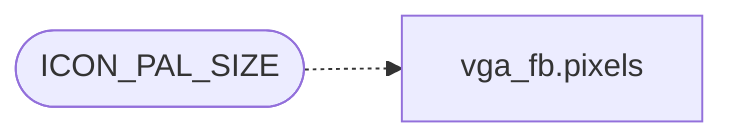

# `headers/desktop_shortcuts.h`

> Source: [headers/desktop_shortcuts.h:1](../../headers/desktop_shortcuts.h#L1) | language `h` | coverage 72.7% | [API index](../index.md)

desktop_shortcuts.h -- configurable desktop icon shortcuts.

## Contents

- **Structs:** [`desktop_shortcut`](#desktop_shortcut)
- **Functions:** [`desktop_shortcuts_load`](#desktop_shortcuts_load), [`desktop_shortcuts_draw`](#desktop_shortcuts_draw), [`desktop_shortcuts_hit_test`](#desktop_shortcuts_hit_test)
- **Macros:** [`MAX_SHORTCUTS`](#max_shortcuts), [`SHORTCUT_NAME_LEN`](#shortcut_name_len), [`SHORTCUT_CMD_LEN`](#shortcut_cmd_len), [`SHORTCUT_PATH_LEN`](#shortcut_path_len), [`ICON_W`](#icon_w), [`ICON_PAD_X`](#icon_pad_x), [`ICON_PAD_Y`](#icon_pad_y), [`DOCK_PAD_X`](#dock_pad_x), [`DOCK_PAD_Y`](#dock_pad_y), [`DOCK_GAP`](#dock_gap), [`DOCK_LABEL_GAP`](#dock_label_gap), [`DOCK_CRYSTAL_STEP`](#dock_crystal_step), [`DOCK_MAG_W`](#dock_mag_w), [`DOCK_NEAR_W`](#dock_near_w), [`DOCK_BOUNCE_TICKS`](#dock_bounce_ticks), [`ICON_PAL_BASE`](#icon_pal_base), [`ICON_PAL_SIZE`](#icon_pal_size)

## Call Graph

Solid arrows stay in this module, dashed arrows leave it.



## Structs

<a id="desktop_shortcut"></a>

### `desktop_shortcut`

`struct` | [headers/desktop_shortcuts.h:72](../../headers/desktop_shortcuts.h#L72)

```c
struct desktop_shortcut
```

A decoded+cached desktop shortcut.

Pixels are raw RGBA bytes (ICON_W*ICON_H*4): the PNG's own colors, alpha below 128 transparent. Embedded fallback icons arrive as palette indices and are expanded to RGBA at load time, so the renderer has a single code path.

---

## Functions

<a id="desktop_shortcuts_load"></a>

### `desktop_shortcuts_load`

`function` | [headers/desktop_shortcuts.h:82](../../headers/desktop_shortcuts.h#L82)

```c
void desktop_shortcuts_load(void);
```

Load shortcuts from etc/shortcuts, decode icons, compute layout.

Called once from vga_fb_draw_desktop on first draw.

---

<a id="desktop_shortcuts_draw"></a>

### `desktop_shortcuts_draw`

`function` | [headers/desktop_shortcuts.h:85](../../headers/desktop_shortcuts.h#L85)

```c
void desktop_shortcuts_draw(void);
```

Draw all shortcut icons and labels onto the framebuffer.

---

<a id="desktop_shortcuts_hit_test"></a>

### `desktop_shortcuts_hit_test`

`function` `const` | [headers/desktop_shortcuts.h:89](../../headers/desktop_shortcuts.h#L89)

```c
const char *desktop_shortcuts_hit_test(int mx, int my);
```

Handle a left-click at (mx, my).

Returns the command string if the click hit an icon, or NULL otherwise.

**Parameters**

| Name | Type | Default | Description |
|---|---|---|---|
| `mx` | `int` |  |  |
| `my` | `int` |  |  |

**Returns:** `char *`

---

## Macros

<a id="max_shortcuts"></a>

### `MAX_SHORTCUTS`

`macro` | [headers/desktop_shortcuts.h:18](../../headers/desktop_shortcuts.h#L18)

```c
#define MAX_SHORTCUTS
```

Maximum number of desktop shortcuts and label length.

---

<a id="shortcut_name_len"></a>

### `SHORTCUT_NAME_LEN`

`macro` | [headers/desktop_shortcuts.h:19](../../headers/desktop_shortcuts.h#L19)

```c
#define SHORTCUT_NAME_LEN
```

---

<a id="shortcut_cmd_len"></a>

### `SHORTCUT_CMD_LEN`

`macro` | [headers/desktop_shortcuts.h:20](../../headers/desktop_shortcuts.h#L20)

```c
#define SHORTCUT_CMD_LEN
```

12 chars + NUL

---

<a id="shortcut_path_len"></a>

### `SHORTCUT_PATH_LEN`

`macro` | [headers/desktop_shortcuts.h:21](../../headers/desktop_shortcuts.h#L21)

```c
#define SHORTCUT_PATH_LEN
```

---

<a id="icon_w"></a>

### `ICON_W`

`macro` | [headers/desktop_shortcuts.h:24](../../headers/desktop_shortcuts.h#L24)

```c
#define ICON_W
```

Icon geometry.

---

<a id="icon_pad_x"></a>

### `ICON_PAD_X`

`macro` | [headers/desktop_shortcuts.h:26](../../headers/desktop_shortcuts.h#L26)

```c
#define ICON_PAD_X
```

---

<a id="icon_pad_y"></a>

### `ICON_PAD_Y`

`macro` | [headers/desktop_shortcuts.h:27](../../headers/desktop_shortcuts.h#L27)

```c
#define ICON_PAD_Y
```

horizontal gap between icons

---

<a id="dock_pad_x"></a>

### `DOCK_PAD_X`

`macro` | [headers/desktop_shortcuts.h:33](../../headers/desktop_shortcuts.h#L33)

```c
#define DOCK_PAD_X
```

Dock geometry: icons sit in a centered bar just above the taskbar, Mac OS X style, so they float over the wallpaper with a dark backing for contrast instead of a left-edge column.

---

<a id="dock_pad_y"></a>

### `DOCK_PAD_Y`

`macro` | [headers/desktop_shortcuts.h:34](../../headers/desktop_shortcuts.h#L34)

```c
#define DOCK_PAD_Y
```

side padding inside the dock bar

---

<a id="dock_gap"></a>

### `DOCK_GAP`

`macro` | [headers/desktop_shortcuts.h:35](../../headers/desktop_shortcuts.h#L35)

```c
#define DOCK_GAP
```

top/bottom padding inside the dock bar

---

<a id="dock_label_gap"></a>

### `DOCK_LABEL_GAP`

`macro` | [headers/desktop_shortcuts.h:36](../../headers/desktop_shortcuts.h#L36)

```c
#define DOCK_LABEL_GAP
```

gap between dock bar and taskbar

---

<a id="dock_crystal_step"></a>

### `DOCK_CRYSTAL_STEP`

`macro` | [headers/desktop_shortcuts.h:41](../../headers/desktop_shortcuts.h#L41)

```c
#define DOCK_CRYSTAL_STEP
```

Crystal backing: the dock fill paints COL_SHADOW on a (x+y)&1 checker and leaves the wallpaper pixel elsewhere, so the bar reads as frosted glass on both 8-bit and true-color modes without any blending pass.

---

<a id="dock_mag_w"></a>

### `DOCK_MAG_W`

`macro` | [headers/desktop_shortcuts.h:48](../../headers/desktop_shortcuts.h#L48)

```c
#define DOCK_MAG_W
```

Hover magnification (Mac style): the icon under the cursor grows to DOCK_MAG, its immediate neighbours to DOCK_NEAR, bottom-aligned on the slot so the growth rises above the dock.

2x hot / 1.5x neighbours, so the effect reads at a glance. One scaled blit per icon per hover crossing, so the 25 Hz desktop tick never notices.

---

<a id="dock_near_w"></a>

### `DOCK_NEAR_W`

`macro` | [headers/desktop_shortcuts.h:50](../../headers/desktop_shortcuts.h#L50)

```c
#define DOCK_NEAR_W
```

---

<a id="dock_bounce_ticks"></a>

### `DOCK_BOUNCE_TICKS`

`macro` | [headers/desktop_shortcuts.h:58](../../headers/desktop_shortcuts.h#L58)

```c
#define DOCK_BOUNCE_TICKS
```

---

<a id="icon_pal_base"></a>

### `ICON_PAL_BASE`

`macro` | [headers/desktop_shortcuts.h:65](../../headers/desktop_shortcuts.h#L65)

```c
#define ICON_PAL_BASE
```

Icon palette: 16 colours loaded into VGA DAC indices 240-255 in the 8-bit fallback mode.

Indices 0-14 stay as the desktop palette; the icon palette gives enough range for simple pixel-art icons. In true color the cached icon pixels are raw RGBA and this palette only feeds the embedded fallback icons and the 8-bit quantizer.

---

<a id="icon_pal_size"></a>

### `ICON_PAL_SIZE`

`macro` | [headers/desktop_shortcuts.h:66](../../headers/desktop_shortcuts.h#L66)

```c
#define ICON_PAL_SIZE
```

*Calls:* [`pixels`](headers.vga_fb.h.md#pixels)

---
