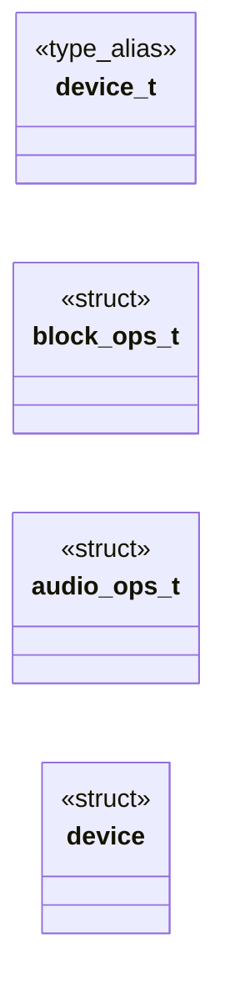

# `headers/driver.h`

> Source: [headers/driver.h:1](../../headers/driver.h#L1) | language `h` | coverage 12.5% | [API index](../index.md)

driver.h -- Strategy pattern for hardware drivers (thesis correction 2).

## Contents

- **Structs:** [`block_ops_t`](#block_ops_t), [`audio_ops_t`](#audio_ops_t), [`device`](#device)
- **Type Aliases:** [`device_t`](#device_t)
- **Functions:** [`device_register`](#device_register), [`device_find`](#device_find), [`device_find_by_type`](#device_find_by_type), [`device_count`](#device_count), [`device_reset`](#device_reset)
- **Macros:** [`DEV_NAME_LEN`](#dev_name_len), [`DEV_MAX`](#dev_max), [`DEV_TYPE_BLOCK`](#dev_type_block), [`DEV_TYPE_AUDIO`](#dev_type_audio), [`DEV_TYPE_NET`](#dev_type_net), [`DEV_TYPE_CHAR`](#dev_type_char)

## Type Diagram



## Structs

<a id="block_ops_t"></a>

### `block_ops_t`

`struct` | [headers/driver.h:28](../../headers/driver.h#L28)

```c
typedef struct
```

---

<a id="audio_ops_t"></a>

### `audio_ops_t`

`struct` | [headers/driver.h:37](../../headers/driver.h#L37)

```c
typedef struct
```

---

<a id="device"></a>

### `device`

`struct` | [headers/driver.h:48](../../headers/driver.h#L48)

```c
struct device
```

---

## Type Aliases

<a id="device_t"></a>

### `device_t`

`type_alias` | [headers/driver.h:25](../../headers/driver.h#L25)

```c
typedef struct device device_t;
```

define DEV_TYPE_BLOCK 1 define DEV_TYPE_AUDIO 2 define DEV_TYPE_NET   3 define DEV_TYPE_CHAR  4

---

## Functions

<a id="device_register"></a>

### `device_register`

`function` | [headers/driver.h:56](../../headers/driver.h#L56)

```c
int device_register(device_t *dev);
```

**Parameters**

| Name | Type | Default | Description |
|---|---|---|---|
| `dev` | `device_t *` |  |  |

**Returns:** `int`

*Called by:* [`ide_register_device`](drivers.ide.c.md#ide_register_device), [`pcspk_init`](drivers.pcspk.c.md#pcspk_init), [`sb16_init`](drivers.sb16.c.md#sb16_init), [`ubk_init`](drivers.usbblk.c.md#ubk_init), [`vblk_register_device`](drivers.virtio_blk.c.md#vblk_register_device)

---

<a id="device_find"></a>

### `device_find`

`function` | [headers/driver.h:57](../../headers/driver.h#L57)

```c
device_t *device_find(const char *name);
```

**Parameters**

| Name | Type | Default | Description |
|---|---|---|---|
| `name` | `char *` |  |  |

**Returns:** `device_t *`

*Called by:* [`table`](drivers.block.c.md#table)

---

<a id="device_find_by_type"></a>

### `device_find_by_type`

`function` | [headers/driver.h:58](../../headers/driver.h#L58)

```c
device_t *device_find_by_type(int type);
```

**Parameters**

| Name | Type | Default | Description |
|---|---|---|---|
| `type` | `int` |  |  |

**Returns:** `device_t *`

---

<a id="device_count"></a>

### `device_count`

`function` | [headers/driver.h:59](../../headers/driver.h#L59)

```c
int device_count(void);
```

**Returns:** `int`

---

<a id="device_reset"></a>

### `device_reset`

`function` | [headers/driver.h:60](../../headers/driver.h#L60)

```c
void device_reset(void);
```

---

## Macros

<a id="dev_name_len"></a>

### `DEV_NAME_LEN`

`macro` | [headers/driver.h:18](../../headers/driver.h#L18)

```c
#define DEV_NAME_LEN
```

---

<a id="dev_max"></a>

### `DEV_MAX`

`macro` | [headers/driver.h:19](../../headers/driver.h#L19)

```c
#define DEV_MAX
```

---

<a id="dev_type_block"></a>

### `DEV_TYPE_BLOCK`

`macro` | [headers/driver.h:21](../../headers/driver.h#L21)

```c
#define DEV_TYPE_BLOCK
```

---

<a id="dev_type_audio"></a>

### `DEV_TYPE_AUDIO`

`macro` | [headers/driver.h:22](../../headers/driver.h#L22)

```c
#define DEV_TYPE_AUDIO
```

---

<a id="dev_type_net"></a>

### `DEV_TYPE_NET`

`macro` | [headers/driver.h:23](../../headers/driver.h#L23)

```c
#define DEV_TYPE_NET
```

---

<a id="dev_type_char"></a>

### `DEV_TYPE_CHAR`

`macro` | [headers/driver.h:24](../../headers/driver.h#L24)

```c
#define DEV_TYPE_CHAR
```

---
