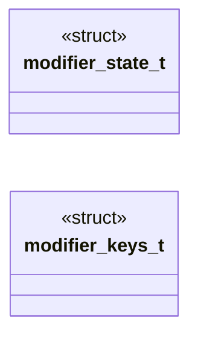

# `headers/drivers/modifiers.h`

> Source: [headers/drivers/modifiers.h:1](../../headers/drivers/modifiers.h#L1) | language `h` | coverage 45.5% | [API index](../index.md)

## Contents

- **Structs:** [`modifier_state_t`](#modifier_state_t), [`modifier_keys_t`](#modifier_keys_t)
- **Functions:** [`modifiers_init`](#modifiers_init), [`modifiers_update`](#modifiers_update), [`modifiers_match`](#modifiers_match)
- **Macros:** [`MOD_SHIFT`](#mod_shift), [`MOD_CTRL`](#mod_ctrl), [`MOD_ALT`](#mod_alt), [`MOD_ALTGR`](#mod_altgr), [`MOD_SUPER`](#mod_super)

## Type Diagram



## Structs

<a id="modifier_state_t"></a>

### `modifier_state_t`

`struct` | [headers/drivers/modifiers.h:5](../../headers/drivers/modifiers.h#L5)

```c
typedef struct
```

Docstring: Unified modifier tracking for cooked and raw paths.

---

<a id="modifier_keys_t"></a>

### `modifier_keys_t`

`struct` | [headers/drivers/modifiers.h:19](../../headers/drivers/modifiers.h#L19)

```c
typedef struct
```

Docstring: Key codes feeding the tracker, one config per layout.

The right-hand members are only recognised when the event carries the
0xE0 prefix, which is how scancode set 1 disambiguates the two halves of
each pair. Right Alt is the exception that proves the rule: on a Spanish
layout it is AltGr, so it feeds the separate altgr bit rather than alt.

---

## Functions

<a id="modifiers_init"></a>

### `modifiers_init`

`function` `inline` `static` | [headers/drivers/modifiers.h:37](../../headers/drivers/modifiers.h#L37)

```c
static inline void modifiers_init(modifier_state_t *st)
```

Docstring: Clear every modifier, shell reset path.

**Parameters**

| Name | Type | Default | Description |
|---|---|---|---|
| `st` | `modifier_state_t *` |  |  |

*Called by:* [`kbd_reset_for_shell`](drivers.kbd.c.md#kbd_reset_for_shell)

---

<a id="modifiers_update"></a>

### `modifiers_update`

`function` `inline` `static` | [headers/drivers/modifiers.h:54](../../headers/drivers/modifiers.h#L54)

```c
static inline int modifiers_update(const modifier_keys_t *keys, modifier_state_t *st, int code, int is_break, int e0)
```

Docstring: Track one make or break code, 1 when consumed.

Set 1 gives both halves of Ctrl, Alt and Super the same base code and
separates them with 0xE0, so an unprefixed code is always the left one.
Right Ctrl arrived from a PS/2 keyboard and from a USB HID report with no
prefix difference at all before this, and was silently dropped: the state
said Ctrl was up while a key was physically held.

**Parameters**

| Name | Type | Default | Description |
|---|---|---|---|
| `keys` | `modifier_keys_t *` |  |  |
| `st` | `modifier_state_t *` |  |  |
| `code` | `int` |  |  |
| `is_break` | `int` |  |  |
| `e0` | `int` |  |  |

**Returns:** `int`

*Called by:* [`key`](drivers.kbd.c.md#key)

---

<a id="modifiers_match"></a>

### `modifiers_match`

`function` `inline` `static` | [headers/drivers/modifiers.h:92](../../headers/drivers/modifiers.h#L92)

```c
static inline int modifiers_match(const modifier_state_t *st, int mask)
```

Docstring: True when the state covers every bit in mask.

**Parameters**

| Name | Type | Default | Description |
|---|---|---|---|
| `st` | `modifier_state_t *` |  |  |
| `mask` | `int` |  |  |

**Returns:** `int`

---

## Macros

<a id="mod_shift"></a>

### `MOD_SHIFT`

`macro` | [headers/drivers/modifiers.h:30](../../headers/drivers/modifiers.h#L30)

```c
#define MOD_SHIFT
```

---

<a id="mod_ctrl"></a>

### `MOD_CTRL`

`macro` | [headers/drivers/modifiers.h:31](../../headers/drivers/modifiers.h#L31)

```c
#define MOD_CTRL
```

---

<a id="mod_alt"></a>

### `MOD_ALT`

`macro` | [headers/drivers/modifiers.h:32](../../headers/drivers/modifiers.h#L32)

```c
#define MOD_ALT
```

---

<a id="mod_altgr"></a>

### `MOD_ALTGR`

`macro` | [headers/drivers/modifiers.h:33](../../headers/drivers/modifiers.h#L33)

```c
#define MOD_ALTGR
```

---

<a id="mod_super"></a>

### `MOD_SUPER`

`macro` | [headers/drivers/modifiers.h:34](../../headers/drivers/modifiers.h#L34)

```c
#define MOD_SUPER
```

---
