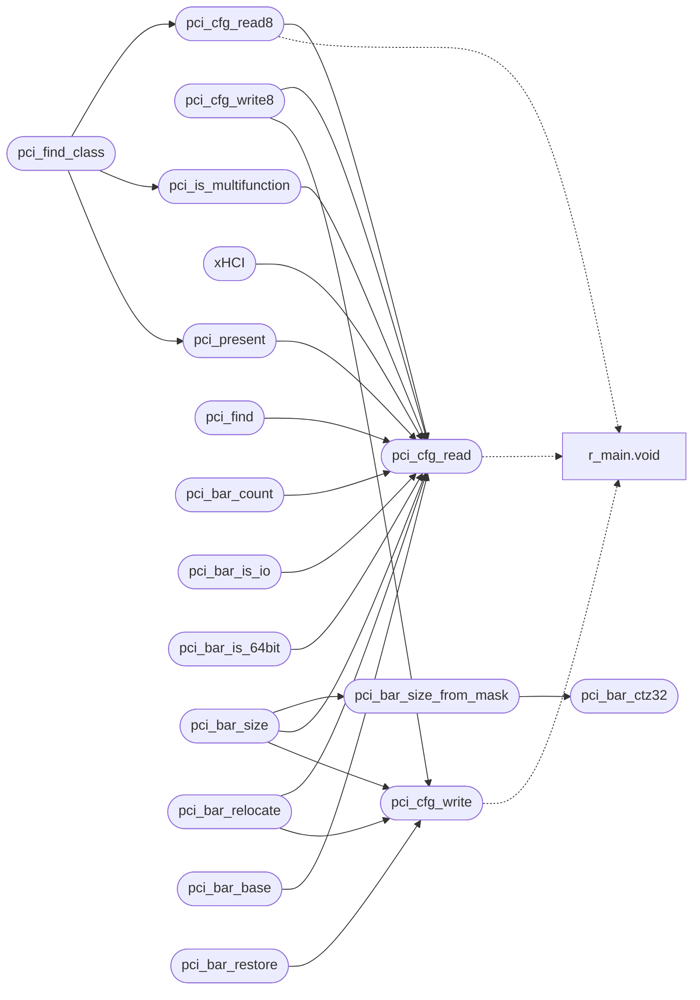

# `headers/drivers/pci.h`

> Source: [headers/drivers/pci.h:1](../../headers/drivers/pci.h#L1) | language `h` | coverage 48.1% | [API index](../index.md)

Docstring: drivers/pci.h -- PCI configuration-space access.

## Contents

- **Structs:** [`pci_bdf_t`](#pci_bdf_t)
- **Functions:** [`pci_cfg_read`](#pci_cfg_read), [`pci_cfg_write`](#pci_cfg_write), [`pci_cfg_read8`](#pci_cfg_read8), [`pci_cfg_write8`](#pci_cfg_write8), [`pci_present`](#pci_present), [`xHCI`](#xhci), [`pci_is_multifunction`](#pci_is_multifunction), [`pci_find`](#pci_find), [`pci_find_class`](#pci_find_class), [`pci_bar_count`](#pci_bar_count), [`pci_bar_is_io`](#pci_bar_is_io), [`pci_bar_is_64bit`](#pci_bar_is_64bit), [`pci_bar_ctz32`](#pci_bar_ctz32), [`pci_bar_size_from_mask`](#pci_bar_size_from_mask), [`pci_bar_size`](#pci_bar_size), [`pci_bar_relocate`](#pci_bar_relocate), [`pci_bar_base`](#pci_bar_base), [`pci_bar_restore`](#pci_bar_restore)
- **Macros:** [`PCI_CFG_ADDR`](#pci_cfg_addr), [`PCI_CFG_DATA`](#pci_cfg_data), [`PCI_MAX_BUS`](#pci_max_bus), [`PCI_MAX_DEV`](#pci_max_dev), [`PCI_MAX_FUNC`](#pci_max_func), [`PCI_REG_VENDOR_ID`](#pci_reg_vendor_id), [`PCI_REG_COMMAND`](#pci_reg_command), [`PCI_REG_CLASS_REV`](#pci_reg_class_rev), [`PCI_REG_CLASS_PROGIF`](#pci_reg_class_progif), [`PCI_REG_HEADER_TYPE`](#pci_reg_header_type), [`PCI_REG_BAR0`](#pci_reg_bar0), [`PCI_REG_CARD_BUS`](#pci_reg_card_bus), [`PCI_REG_BRIDGE_SECONDARY`](#pci_reg_bridge_secondary), [`PCI_REG_CAP_PTR`](#pci_reg_cap_ptr), [`PCI_REG_BAR_COUNT`](#pci_reg_bar_count), [`PCI_COMMAND_IO`](#pci_command_io), [`PCI_COMMAND_MEMORY`](#pci_command_memory), [`PCI_COMMAND_BUS_MASTER`](#pci_command_bus_master), [`PCI_BAR_TYPE_MASK`](#pci_bar_type_mask), [`PCI_BAR_IO`](#pci_bar_io), [`PCI_BAR_64BIT`](#pci_bar_64bit), [`PCI_BAR_PREFETCH`](#pci_bar_prefetch), [`PCI_BAR_ADDR_MASK`](#pci_bar_addr_mask), [`PCI_ABSENT_ID`](#pci_absent_id), [`PCI_HEADER_MULTIFUNC`](#pci_header_multifunc), [`PCI_HEADER_TYPE_MASK`](#pci_header_type_mask), [`PCI_HDR_TYPE_BRIDGE`](#pci_hdr_type_bridge), [`PCI_CLASS_BRIDGE`](#pci_class_bridge), [`PCI_SUBCLASS_PCI_BRIDGE`](#pci_subclass_pci_bridge), [`PCI_CLASS_XHCI`](#pci_class_xhci), [`PCI_SUBCLASS_XHCI`](#pci_subclass_xhci), [`PCI_PROGIF_XHCI`](#pci_progif_xhci), [`PCI_CLASS_ANY`](#pci_class_any), [`PCI_CLASS_MAX_PASSES`](#pci_class_max_passes)

## Call Graph

Solid arrows stay in this module, dashed arrows leave it.



## Structs

<a id="pci_bdf_t"></a>

### `pci_bdf_t`

`struct` | [headers/drivers/pci.h:71](../../headers/drivers/pci.h#L71)

```c
typedef struct
```

Docstring: Address of a device on the bus, as found by the walk.

---

## Functions

<a id="pci_cfg_read"></a>

### `pci_cfg_read`

`function` `inline` `static` | [headers/drivers/pci.h:80](../../headers/drivers/pci.h#L80)

```c
static inline unsigned pci_cfg_read(unsigned bus, unsigned dev, unsigned func, unsigned reg, void (*outl)(unsigned short, unsigned), unsigned (*inl)(unsigned short))
```

Docstring: Read one config dword.

(bus, dev, func, reg) with reg dword-aligned by construction (low two bits masked, never a misaligned access).

**Parameters**

| Name | Type | Default | Description |
|---|---|---|---|
| `bus` | `unsigned` |  |  |
| `dev` | `unsigned` |  |  |
| `func` | `unsigned` |  |  |
| `reg` | `unsigned` |  |  |
| `unsigned` | `void (*outl)(unsigned short, )` |  |  |
| `short` | `unsigned (*inl)(unsigned )` |  |  |

**Returns:** `unsigned`

*Calls:* [`void`](progs.doomgeneric.r_main.h.md#void)

*Called by:* [`nvme_init`](drivers.nvme.c.md#nvme_init), [`vblk_init`](drivers.virtio_blk.c.md#vblk_init), [`unusable`](drivers.virtio_net.c.md#unusable), [`xhc_init`](drivers.xhci.c.md#xhc_init), [`pci_bar_base`](#pci_bar_base), [`pci_bar_count`](#pci_bar_count), [`pci_bar_is_64bit`](#pci_bar_is_64bit), [`pci_bar_is_io`](#pci_bar_is_io), [`pci_bar_relocate`](#pci_bar_relocate), [`pci_bar_size`](#pci_bar_size), [`pci_cfg_read8`](#pci_cfg_read8), [`pci_cfg_write8`](#pci_cfg_write8) and 5 more

---

<a id="pci_cfg_write"></a>

### `pci_cfg_write`

`function` `inline` `static` | [headers/drivers/pci.h:90](../../headers/drivers/pci.h#L90)

```c
static inline void pci_cfg_write(unsigned bus, unsigned dev, unsigned func, unsigned reg, unsigned val, void (*outl)(unsigned short, unsigned))
```

Docstring: Write one config dword.

Same addressing as read.

**Parameters**

| Name | Type | Default | Description |
|---|---|---|---|
| `bus` | `unsigned` |  |  |
| `dev` | `unsigned` |  |  |
| `func` | `unsigned` |  |  |
| `reg` | `unsigned` |  |  |
| `val` | `unsigned` |  |  |
| `unsigned` | `void (*outl)(unsigned short, )` |  |  |

*Calls:* [`void`](progs.doomgeneric.r_main.h.md#void)

*Called by:* [`nvme_init`](drivers.nvme.c.md#nvme_init), [`xhc_init`](drivers.xhci.c.md#xhc_init), [`pci_bar_relocate`](#pci_bar_relocate), [`pci_bar_restore`](#pci_bar_restore), [`pci_bar_size`](#pci_bar_size), [`pci_cfg_write8`](#pci_cfg_write8), [`RTL_REG_CONFIG1`](net.rtl8139.c.md#rtl_reg_config1)

---

<a id="pci_cfg_read8"></a>

### `pci_cfg_read8`

`function` `inline` `static` | [headers/drivers/pci.h:100](../../headers/drivers/pci.h#L100)

```c
static inline unsigned char pci_cfg_read8(unsigned bus, unsigned dev, unsigned func, unsigned reg, void (*outl)(unsigned short, unsigned), unsigned (*inl)(unsigned short))
```

Docstring: Read a config byte.

The window is dword aligned once; the byte selector rides in the low address bits, never a byte port op.

**Parameters**

| Name | Type | Default | Description |
|---|---|---|---|
| `bus` | `unsigned` |  |  |
| `dev` | `unsigned` |  |  |
| `func` | `unsigned` |  |  |
| `reg` | `unsigned` |  |  |
| `unsigned` | `void (*outl)(unsigned short, )` |  |  |
| `short` | `unsigned (*inl)(unsigned )` |  |  |

**Returns:** `unsigned char`

*Calls:* [`pci_cfg_read`](#pci_cfg_read), [`void`](progs.doomgeneric.r_main.h.md#void)

*Called by:* [`pci_find_class`](#pci_find_class)

---

<a id="pci_cfg_write8"></a>

### `pci_cfg_write8`

`function` `inline` `static` | [headers/drivers/pci.h:109](../../headers/drivers/pci.h#L109)

```c
static inline void pci_cfg_write8(unsigned bus, unsigned dev, unsigned func, unsigned reg, unsigned char val, void (*outl)(unsigned short, unsigned), unsigned (*inl)(unsigned short))
```

Docstring: Write a config byte, read-modify-write on the window.

**Parameters**

| Name | Type | Default | Description |
|---|---|---|---|
| `bus` | `unsigned` |  |  |
| `dev` | `unsigned` |  |  |
| `func` | `unsigned` |  |  |
| `reg` | `unsigned` |  |  |
| `val` | `unsigned char` |  |  |
| `unsigned` | `void (*outl)(unsigned short, )` |  |  |
| `short` | `unsigned (*inl)(unsigned )` |  |  |

*Calls:* [`pci_cfg_read`](#pci_cfg_read), [`pci_cfg_write`](#pci_cfg_write), [`void`](progs.doomgeneric.r_main.h.md#void)

---

<a id="pci_present"></a>

### `pci_present`

`function` `inline` `static` | [headers/drivers/pci.h:122](../../headers/drivers/pci.h#L122)

```c
static inline int pci_present(unsigned bus, unsigned dev, unsigned func, void (*outl)(uns...
```

Docstring: True when a function is populated.

A dword read of vendor id returns all ones for an unpopulated function, which is also what a bus with nothing behind bridge 0 returns, so this doubles as a bus probe.

**Parameters**

| Name | Type | Default | Description |
|---|---|---|---|
| `bus` | `unsigned` |  |  |
| `dev` | `unsigned` |  |  |
| `func` | `unsigned` |  |  |
| `uns` | `void (*outl)( ...` |  |  |

**Returns:** `int`

*Calls:* [`pci_cfg_read`](#pci_cfg_read), [`void`](progs.doomgeneric.r_main.h.md#void)

*Called by:* [`pci_find_class`](#pci_find_class)

---

<a id="xhci"></a>

### `xHCI`

`function` | [headers/drivers/pci.h:134](../../headers/drivers/pci.h#L134)

```c
* base class: an xHCI (0x0C/0x03/0x30) would look for class 0x03, and a PCI * bridge (0x06/0x04)...
```

**Parameters**

| Name | Type | Default | Description |
|---|---|---|---|
| `x30` | `0x0C/0x03/0` |  |  |

**Returns:** `* base class: an`

*Calls:* [`pci_cfg_read`](#pci_cfg_read), [`void`](progs.doomgeneric.r_main.h.md#void)

---

<a id="pci_is_multifunction"></a>

### `pci_is_multifunction`

`function` `inline` `static` | [headers/drivers/pci.h:152](../../headers/drivers/pci.h#L152)

```c
static inline int pci_is_multifunction(unsigned bus, unsigned dev, void (*outl)(unsigned ...
```

Docstring: True when a function advertises more than one function in its slot, so the walk must visit every function number, not just function 0.

**Parameters**

| Name | Type | Default | Description |
|---|---|---|---|
| `bus` | `unsigned` |  |  |
| `dev` | `unsigned` |  |  |
| `unsigned` | `void (*outl)( ...` |  |  |

**Returns:** `int`

*Calls:* [`pci_cfg_read`](#pci_cfg_read), [`void`](progs.doomgeneric.r_main.h.md#void)

*Called by:* [`pci_find_class`](#pci_find_class)

---

<a id="pci_find"></a>

### `pci_find`

`function` `inline` `static` | [headers/drivers/pci.h:165](../../headers/drivers/pci.h#L165)

```c
static inline int pci_find(unsigned vendor, unsigned device, unsigned (*inl)(unsigned sho...
```

Docstring: Find a device by vendor/device ID on bus 0.

Returns the dev number, or -1 when absent. Bus-0 function-0 only: this is
the QEMU seabios/OVMF layout, which is all the emulated single-function
devices needed. A device that must also be found behind a chipset bridge
(any xHCI) uses pci_find_class, which walks.

**Parameters**

| Name | Type | Default | Description |
|---|---|---|---|
| `vendor` | `unsigned` |  |  |
| `device` | `unsigned` |  |  |
| `sho` | `unsigned (*inl)(unsigned ...` |  |  |

**Returns:** `int`

*Calls:* [`pci_cfg_read`](#pci_cfg_read), [`void`](progs.doomgeneric.r_main.h.md#void)

*Called by:* [`vblk_init`](drivers.virtio_blk.c.md#vblk_init), [`unusable`](drivers.virtio_net.c.md#unusable), [`RTL_REG_CONFIG1`](net.rtl8139.c.md#rtl_reg_config1)

---

<a id="pci_find_class"></a>

### `pci_find_class`

`function` `inline` `static` | [headers/drivers/pci.h:193](../../headers/drivers/pci.h#L193)

```c
static inline int pci_find_class(pci_bdf_t *out, unsigned cls, unsigned subclass, unsigned prog_if, void (*outl)(unsigned short, unsigned), unsigned (*inl)(unsigned short))
```

Docstring: Find the first function anywhere on the PCI tree matching a class triple, and report its bus/device/function.

The walk starts at bus 0 and follows each PCI-to-PCI bridge's secondary
bus number, so a controller behind a chipset bridge on real hardware is
found exactly as one on QEMU's bus 0. Two 256-bit masks, 32 bytes of stack
each: "reachable" (a bridge leads here) and "scanned" (already looked at).
Reachability and scanning are separate so a bus numbered *below* the bridge
that leads to it -- a forward reference, legal and real -- is still visited:
the sweep runs again while it keeps reaching unscanned buses, bounded by
PCI_CLASS_MAX_PASSES. A bus whose function 0 is empty is skipped whole,
which makes an unpopulated range cost two reads per bus. Any class
component may be PCI_CLASS_ANY.

Returns 1 and fills out on a hit, 0 when nothing matches (out is then
zeroed, so a caller that ignores the result still fails closed).

**Parameters**

| Name | Type | Default | Description |
|---|---|---|---|
| `out` | `pci_bdf_t *` |  |  |
| `cls` | `unsigned` |  |  |
| `subclass` | `unsigned` |  |  |
| `prog_if` | `unsigned` |  |  |
| `unsigned` | `void (*outl)(unsigned short, )` |  |  |
| `short` | `unsigned (*inl)(unsigned )` |  |  |

**Returns:** `int`

*Calls:* [`pci_cfg_read8`](#pci_cfg_read8), [`pci_is_multifunction`](#pci_is_multifunction), [`pci_present`](#pci_present), [`void`](progs.doomgeneric.r_main.h.md#void)

*Called by:* [`nvme_init`](drivers.nvme.c.md#nvme_init), [`xhc_init`](drivers.xhci.c.md#xhc_init)

---

<a id="pci_bar_count"></a>

### `pci_bar_count`

`function` `inline` `static` | [headers/drivers/pci.h:248](../../headers/drivers/pci.h#L248)

```c
static inline unsigned pci_bar_count(unsigned bus, unsigned dev, unsigned func, void (*outl)(unsigned short, unsigned), unsigned (*inl)(unsigned short))
```

Docstring: Number of 64-bit BARs in the bar/6 dword.

**Parameters**

| Name | Type | Default | Description |
|---|---|---|---|
| `bus` | `unsigned` |  |  |
| `dev` | `unsigned` |  |  |
| `func` | `unsigned` |  |  |
| `unsigned` | `void (*outl)(unsigned short, )` |  |  |
| `short` | `unsigned (*inl)(unsigned )` |  |  |

**Returns:** `unsigned`

*Calls:* [`pci_cfg_read`](#pci_cfg_read), [`void`](progs.doomgeneric.r_main.h.md#void)

---

<a id="pci_bar_is_io"></a>

### `pci_bar_is_io`

`function` `inline` `static` | [headers/drivers/pci.h:263](../../headers/drivers/pci.h#L263)

```c
static inline int pci_bar_is_io(unsigned bus, unsigned dev, unsigned func, unsigned bar, void (*outl)(unsigned short, unsigned), unsigned (*inl)(unsigned short))
```

Docstring: True when a BAR is an I/O port range rather than memory.

**Parameters**

| Name | Type | Default | Description |
|---|---|---|---|
| `bus` | `unsigned` |  |  |
| `dev` | `unsigned` |  |  |
| `func` | `unsigned` |  |  |
| `bar` | `unsigned` |  |  |
| `unsigned` | `void (*outl)(unsigned short, )` |  |  |
| `short` | `unsigned (*inl)(unsigned )` |  |  |

**Returns:** `int`

*Calls:* [`pci_cfg_read`](#pci_cfg_read), [`void`](progs.doomgeneric.r_main.h.md#void)

*Called by:* [`nvme_init`](drivers.nvme.c.md#nvme_init), [`xhc_init`](drivers.xhci.c.md#xhc_init)

---

<a id="pci_bar_is_64bit"></a>

### `pci_bar_is_64bit`

`function` `inline` `static` | [headers/drivers/pci.h:274](../../headers/drivers/pci.h#L274)

```c
static inline int pci_bar_is_64bit(unsigned bus, unsigned dev, unsigned func, unsigned bar, void (*outl)(unsigned short, unsigned), unsigned (*inl)(unsigned short))
```

Docstring: True when a BAR is a 64-bit memory BAR, so its high dword is the next BAR slot and must be programmed together with it.

**Parameters**

| Name | Type | Default | Description |
|---|---|---|---|
| `bus` | `unsigned` |  |  |
| `dev` | `unsigned` |  |  |
| `func` | `unsigned` |  |  |
| `bar` | `unsigned` |  |  |
| `unsigned` | `void (*outl)(unsigned short, )` |  |  |
| `short` | `unsigned (*inl)(unsigned )` |  |  |

**Returns:** `int`

*Calls:* [`pci_cfg_read`](#pci_cfg_read), [`void`](progs.doomgeneric.r_main.h.md#void)

---

<a id="pci_bar_ctz32"></a>

### `pci_bar_ctz32`

`function` `inline` `static` | [headers/drivers/pci.h:284](../../headers/drivers/pci.h#L284)

```c
static inline unsigned pci_bar_ctz32(unsigned val)
```

Docstring: Count of trailing zero bits in a 32-bit word, 32 for zero.

**Parameters**

| Name | Type | Default | Description |
|---|---|---|---|
| `val` | `unsigned` |  |  |

**Returns:** `unsigned`

*Called by:* [`pci_bar_size_from_mask`](#pci_bar_size_from_mask)

---

<a id="pci_bar_size_from_mask"></a>

### `pci_bar_size_from_mask`

`function` `inline` `static` | [headers/drivers/pci.h:315](../../headers/drivers/pci.h#L315)

```c
static inline unsigned long long pci_bar_size_from_mask(unsigned long long mask)
```

Docstring: Size in bytes a probed BAR address mask describes.

A BAR's address lines are contiguous, so the window is 2^(number of
unimplemented low-order address lines) and the mask's zero bits are exactly
those lines. For a 64-bit BAR the low-order lines come from BAR0 and the
next 32 from BAR1, which is what makes this subtler than it looks:

  A BAR that fits below 4 GB has its unimplemented lines in the low half and
  an all-ones high half. Reading the high half as the answer instead --
  because it is the half that looks non-empty -- reports 2^32 for a 64 KB
  window and refuses every controller.

  A BAR above 4 GB implements all 32 low lines, so the low half is all ones
  and the count comes from the high half.

Only the low half carries the type bits, which are fields rather than
address lines, so only the low half is masked. Applying the same nibble mask
to the high half invents four unimplemented lines there and reports a
window sixteen times too small. A mask with no unimplemented line in either
half describes no window and is refused, which is the fail-closed answer a
caller must refuse on.

**Parameters**

| Name | Type | Default | Description |
|---|---|---|---|
| `mask` | `unsigned long long` |  |  |

**Returns:** `unsigned long long`

*Calls:* [`pci_bar_ctz32`](#pci_bar_ctz32)

*Called by:* [`pci_bar_size`](#pci_bar_size)

---

<a id="pci_bar_size"></a>

### `pci_bar_size`

`function` `inline` `static` | [headers/drivers/pci.h:346](../../headers/drivers/pci.h#L346)

```c
static inline unsigned long long pci_bar_size(unsigned bus, unsigned dev, unsigned func, unsigned bar, void (*outl)(unsigned short, unsigned), unsigned (*inl)(unsigned short))
```

Docstring: Probed size in bytes of a memory BAR, restoring its value.

The mask is what proves the region is big enough; a size is never assumed
from a spec table because a wrong answer is a window overrun on hardware
that disagrees. Writing all ones makes the device drive its address lines
with the unmasked bits, so the read-back mask has zeroes exactly where
address lines exist. The original value is restored before returning, so
a caller that then relocates the BAR starts from the firmware assignment
rather than from all ones.

Returns 0 for an absent function, an I/O BAR, or a BAR with no address
bits at all -- all of which are hard failures for an MMIO driver.

The caller must clear PCI_COMMAND_MEMORY first: writing all ones leaves
the device decoding a different address than the one the command register
authorizes, and a device that is still decoding sees its own probe.

**Parameters**

| Name | Type | Default | Description |
|---|---|---|---|
| `bus` | `unsigned` |  |  |
| `dev` | `unsigned` |  |  |
| `func` | `unsigned` |  |  |
| `bar` | `unsigned` |  |  |
| `unsigned` | `void (*outl)(unsigned short, )` |  |  |
| `short` | `unsigned (*inl)(unsigned )` |  |  |

**Returns:** `unsigned long long`

*Calls:* [`pci_bar_size_from_mask`](#pci_bar_size_from_mask), [`pci_cfg_read`](#pci_cfg_read), [`pci_cfg_write`](#pci_cfg_write), [`void`](progs.doomgeneric.r_main.h.md#void)

*Called by:* [`nvme_init`](drivers.nvme.c.md#nvme_init), [`xhc_init`](drivers.xhci.c.md#xhc_init)

---

<a id="pci_bar_relocate"></a>

### `pci_bar_relocate`

`function` `inline` `static` | [headers/drivers/pci.h:382](../../headers/drivers/pci.h#L382)

```c
static inline int pci_bar_relocate(unsigned bus, unsigned dev, unsigned func, unsigned bar, unsigned long long base, void (*outl)(unsigned short, unsigned), unsigned (*inl)(unsigned short))
```

Docstring: Program a memory BAR with a physical base address.

Legal only while the command register's memory-space-enable bit is clear:
the device must not be decoding at the old address while the BAR changes.
A 64-bit BAR takes its high dword from base's upper half, so a caller
relocating into a 32-bit window must pass a base whose upper half is zero
rather than expecting truncation. Returns 1 on success, 0 when the device
is absent or the BAR is an I/O range.

**Parameters**

| Name | Type | Default | Description |
|---|---|---|---|
| `bus` | `unsigned` |  |  |
| `dev` | `unsigned` |  |  |
| `func` | `unsigned` |  |  |
| `bar` | `unsigned` |  |  |
| `base` | `unsigned long long` |  |  |
| `unsigned` | `void (*outl)(unsigned short, )` |  |  |
| `short` | `unsigned (*inl)(unsigned )` |  |  |

**Returns:** `int`

*Calls:* [`pci_cfg_read`](#pci_cfg_read), [`pci_cfg_write`](#pci_cfg_write), [`void`](progs.doomgeneric.r_main.h.md#void)

---

<a id="pci_bar_base"></a>

### `pci_bar_base`

`function` `inline` `static` | [headers/drivers/pci.h:406](../../headers/drivers/pci.h#L406)

```c
static inline unsigned long long pci_bar_base(unsigned bus, unsigned dev, unsigned func, unsigned bar, void (*outl)(unsigned short, unsigned), unsigned (*inl)(unsigned short))
```

Docstring: Physical base a memory BAR is programmed with, read back from the device.

Returns 0 for an absent function, an I/O BAR, or a BAR left unassigned, all of which a caller must refuse on.

A 64-bit BAR's high half is zero when the address fits below 4 GB, which is
the common case, so the two halves are combined by adding rather than by
choosing: a 32-bit BAR's second dword is not part of the BAR at all and
holds whatever the next BAR or a bridge window put there.

**Parameters**

| Name | Type | Default | Description |
|---|---|---|---|
| `bus` | `unsigned` |  |  |
| `dev` | `unsigned` |  |  |
| `func` | `unsigned` |  |  |
| `bar` | `unsigned` |  |  |
| `unsigned` | `void (*outl)(unsigned short, )` |  |  |
| `short` | `unsigned (*inl)(unsigned )` |  |  |

**Returns:** `unsigned long long`

*Calls:* [`pci_cfg_read`](#pci_cfg_read), [`void`](progs.doomgeneric.r_main.h.md#void)

*Called by:* [`nvme_init`](drivers.nvme.c.md#nvme_init), [`xhc_init`](drivers.xhci.c.md#xhc_init)

---

<a id="pci_bar_restore"></a>

### `pci_bar_restore`

`function` `inline` `static` | [headers/drivers/pci.h:424](../../headers/drivers/pci.h#L424)

```c
static inline void pci_bar_restore(unsigned bus, unsigned dev, unsigned func, unsigned bar, unsigned orig, unsigned orig_hi, void (*outl)(unsigned short, unsigned))
```

Docstring: Restore a BAR pair to previously saved raw values.

Used to put a device back exactly as firmware left it when a probe bails, so a later driver or a warm reboot sees the original assignment.

**Parameters**

| Name | Type | Default | Description |
|---|---|---|---|
| `bus` | `unsigned` |  |  |
| `dev` | `unsigned` |  |  |
| `func` | `unsigned` |  |  |
| `bar` | `unsigned` |  |  |
| `orig` | `unsigned` |  |  |
| `orig_hi` | `unsigned` |  |  |
| `unsigned` | `void (*outl)(unsigned short, )` |  |  |

*Calls:* [`pci_cfg_write`](#pci_cfg_write), [`void`](progs.doomgeneric.r_main.h.md#void)

*Called by:* [`nvme_init`](drivers.nvme.c.md#nvme_init), [`xhc_init`](drivers.xhci.c.md#xhc_init)

---

## Macros

<a id="pci_cfg_addr"></a>

### `PCI_CFG_ADDR`

`macro` | [headers/drivers/pci.h:13](../../headers/drivers/pci.h#L13)

```c
#define PCI_CFG_ADDR
```

---

<a id="pci_cfg_data"></a>

### `PCI_CFG_DATA`

`macro` | [headers/drivers/pci.h:14](../../headers/drivers/pci.h#L14)

```c
#define PCI_CFG_DATA
```

---

<a id="pci_max_bus"></a>

### `PCI_MAX_BUS`

`macro` | [headers/drivers/pci.h:15](../../headers/drivers/pci.h#L15)

```c
#define PCI_MAX_BUS
```

---

<a id="pci_max_dev"></a>

### `PCI_MAX_DEV`

`macro` | [headers/drivers/pci.h:16](../../headers/drivers/pci.h#L16)

```c
#define PCI_MAX_DEV
```

---

<a id="pci_max_func"></a>

### `PCI_MAX_FUNC`

`macro` | [headers/drivers/pci.h:17](../../headers/drivers/pci.h#L17)

```c
#define PCI_MAX_FUNC
```

---

<a id="pci_reg_vendor_id"></a>

### `PCI_REG_VENDOR_ID`

`macro` | [headers/drivers/pci.h:20](../../headers/drivers/pci.h#L20)

```c
#define PCI_REG_VENDOR_ID
```

---- Config space register offsets ----

---

<a id="pci_reg_command"></a>

### `PCI_REG_COMMAND`

`macro` | [headers/drivers/pci.h:21](../../headers/drivers/pci.h#L21)

```c
#define PCI_REG_COMMAND
```

---

<a id="pci_reg_class_rev"></a>

### `PCI_REG_CLASS_REV`

`macro` | [headers/drivers/pci.h:22](../../headers/drivers/pci.h#L22)

```c
#define PCI_REG_CLASS_REV
```

---

<a id="pci_reg_class_progif"></a>

### `PCI_REG_CLASS_PROGIF`

`macro` | [headers/drivers/pci.h:23](../../headers/drivers/pci.h#L23)

```c
#define PCI_REG_CLASS_PROGIF
```

---

<a id="pci_reg_header_type"></a>

### `PCI_REG_HEADER_TYPE`

`macro` | [headers/drivers/pci.h:24](../../headers/drivers/pci.h#L24)

```c
#define PCI_REG_HEADER_TYPE
```

---

<a id="pci_reg_bar0"></a>

### `PCI_REG_BAR0`

`macro` | [headers/drivers/pci.h:25](../../headers/drivers/pci.h#L25)

```c
#define PCI_REG_BAR0
```

---

<a id="pci_reg_card_bus"></a>

### `PCI_REG_CARD_BUS`

`macro` | [headers/drivers/pci.h:26](../../headers/drivers/pci.h#L26)

```c
#define PCI_REG_CARD_BUS
```

---

<a id="pci_reg_bridge_secondary"></a>

### `PCI_REG_BRIDGE_SECONDARY`

`macro` | [headers/drivers/pci.h:27](../../headers/drivers/pci.h#L27)

```c
#define PCI_REG_BRIDGE_SECONDARY
```

---

<a id="pci_reg_cap_ptr"></a>

### `PCI_REG_CAP_PTR`

`macro` | [headers/drivers/pci.h:28](../../headers/drivers/pci.h#L28)

```c
#define PCI_REG_CAP_PTR
```

---

<a id="pci_reg_bar_count"></a>

### `PCI_REG_BAR_COUNT`

`macro` | [headers/drivers/pci.h:29](../../headers/drivers/pci.h#L29)

```c
#define PCI_REG_BAR_COUNT
```

---

<a id="pci_command_io"></a>

### `PCI_COMMAND_IO`

`macro` | [headers/drivers/pci.h:32](../../headers/drivers/pci.h#L32)

```c
#define PCI_COMMAND_IO
```

---- Command register bits ----

---

<a id="pci_command_memory"></a>

### `PCI_COMMAND_MEMORY`

`macro` | [headers/drivers/pci.h:33](../../headers/drivers/pci.h#L33)

```c
#define PCI_COMMAND_MEMORY
```

---

<a id="pci_command_bus_master"></a>

### `PCI_COMMAND_BUS_MASTER`

`macro` | [headers/drivers/pci.h:34](../../headers/drivers/pci.h#L34)

```c
#define PCI_COMMAND_BUS_MASTER
```

---

<a id="pci_bar_type_mask"></a>

### `PCI_BAR_TYPE_MASK`

`macro` | [headers/drivers/pci.h:37](../../headers/drivers/pci.h#L37)

```c
#define PCI_BAR_TYPE_MASK
```

---- BAR type bits (low nibble) ----

---

<a id="pci_bar_io"></a>

### `PCI_BAR_IO`

`macro` | [headers/drivers/pci.h:38](../../headers/drivers/pci.h#L38)

```c
#define PCI_BAR_IO
```

---

<a id="pci_bar_64bit"></a>

### `PCI_BAR_64BIT`

`macro` | [headers/drivers/pci.h:39](../../headers/drivers/pci.h#L39)

```c
#define PCI_BAR_64BIT
```

---

<a id="pci_bar_prefetch"></a>

### `PCI_BAR_PREFETCH`

`macro` | [headers/drivers/pci.h:40](../../headers/drivers/pci.h#L40)

```c
#define PCI_BAR_PREFETCH
```

---

<a id="pci_bar_addr_mask"></a>

### `PCI_BAR_ADDR_MASK`

`macro` | [headers/drivers/pci.h:41](../../headers/drivers/pci.h#L41)

```c
#define PCI_BAR_ADDR_MASK
```

---

<a id="pci_absent_id"></a>

### `PCI_ABSENT_ID`

`macro` | [headers/drivers/pci.h:44](../../headers/drivers/pci.h#L44)

```c
#define PCI_ABSENT_ID
```

---- Device identity sentinels and shapes ----

---

<a id="pci_header_multifunc"></a>

### `PCI_HEADER_MULTIFUNC`

`macro` | [headers/drivers/pci.h:45](../../headers/drivers/pci.h#L45)

```c
#define PCI_HEADER_MULTIFUNC
```

---

<a id="pci_header_type_mask"></a>

### `PCI_HEADER_TYPE_MASK`

`macro` | [headers/drivers/pci.h:46](../../headers/drivers/pci.h#L46)

```c
#define PCI_HEADER_TYPE_MASK
```

---

<a id="pci_hdr_type_bridge"></a>

### `PCI_HDR_TYPE_BRIDGE`

`macro` | [headers/drivers/pci.h:47](../../headers/drivers/pci.h#L47)

```c
#define PCI_HDR_TYPE_BRIDGE
```

---

<a id="pci_class_bridge"></a>

### `PCI_CLASS_BRIDGE`

`macro` | [headers/drivers/pci.h:55](../../headers/drivers/pci.h#L55)

```c
#define PCI_CLASS_BRIDGE
```

---- Class codes this kernel matches on ----

Matching by class rather than vendor/device is what makes a driver work
on real silicon: xHCI is class 0x0C/0x03/0x30 on every Intel PCH, AMD
chipset and ASMedia bridge, so no vendor table is needed and no chipset
is missed.

---

<a id="pci_subclass_pci_bridge"></a>

### `PCI_SUBCLASS_PCI_BRIDGE`

`macro` | [headers/drivers/pci.h:56](../../headers/drivers/pci.h#L56)

```c
#define PCI_SUBCLASS_PCI_BRIDGE
```

---

<a id="pci_class_xhci"></a>

### `PCI_CLASS_XHCI`

`macro` | [headers/drivers/pci.h:57](../../headers/drivers/pci.h#L57)

```c
#define PCI_CLASS_XHCI
```

---

<a id="pci_subclass_xhci"></a>

### `PCI_SUBCLASS_XHCI`

`macro` | [headers/drivers/pci.h:58](../../headers/drivers/pci.h#L58)

```c
#define PCI_SUBCLASS_XHCI
```

---

<a id="pci_progif_xhci"></a>

### `PCI_PROGIF_XHCI`

`macro` | [headers/drivers/pci.h:59](../../headers/drivers/pci.h#L59)

```c
#define PCI_PROGIF_XHCI
```

---

<a id="pci_class_any"></a>

### `PCI_CLASS_ANY`

`macro` | [headers/drivers/pci.h:62](../../headers/drivers/pci.h#L62)

```c
#define PCI_CLASS_ANY
```

Docstring: Wildcard for a class-match component: any value matches.

---

<a id="pci_class_max_passes"></a>

### `PCI_CLASS_MAX_PASSES`

`macro` | [headers/drivers/pci.h:68](../../headers/drivers/pci.h#L68)

```c
#define PCI_CLASS_MAX_PASSES
```

Docstring: Sweeps of the bus walk before it gives up.

One sweep visits every bus number, so a second sweep only happens when a bridge led to a bus numbered below the bridge itself; four covers any real topology with room to spare and keeps the walk finite.

---
