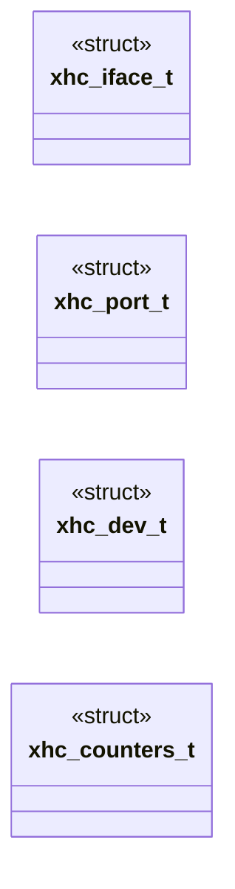

# `headers/drivers/xhci.h`

> Source: [headers/drivers/xhci.h:1](../../headers/drivers/xhci.h#L1) | language `h` | coverage 72.5% | [API index](../index.md)

Docstring: drivers/xhci.h -- boundary of the xHCI host controller driver.

## Contents

- **Structs:** [`xhc_iface_t`](#xhc_iface_t), [`xhc_port_t`](#xhc_port_t), [`xhc_dev_t`](#xhc_dev_t), [`xhc_counters_t`](#xhc_counters_t)
- **Functions:** [`xhc_init`](#xhc_init), [`xhc_poll`](#xhc_poll), [`xhc_port_count`](#xhc_port_count), [`xhc_port_state`](#xhc_port_state), [`xhc_port_reset`](#xhc_port_reset), [`xhc_enumerate`](#xhc_enumerate), [`xhc_enumerate_all`](#xhc_enumerate_all), [`xhc_device_count`](#xhc_device_count), [`xhc_device_info`](#xhc_device_info), [`xhc_open_interface`](#xhc_open_interface), [`xhc_control`](#xhc_control), [`xhc_configure_endpoint`](#xhc_configure_endpoint), [`xhc_transfer`](#xhc_transfer), [`xhc_reset_endpoint`](#xhc_reset_endpoint), [`xhc_transfer_async`](#xhc_transfer_async), [`xhc_poll_token_limit`](#xhc_poll_token_limit), [`xhc_poll_token`](#xhc_poll_token), [`xhc_counters`](#xhc_counters), [`xhc_probe_note`](#xhc_probe_note), [`xhc_info`](#xhc_info)
- **Macros:** [`XHC_MAX_DEVICES`](#xhc_max_devices), [`XHC_MAX_PORTS`](#xhc_max_ports), [`XHC_MAX_EPS`](#xhc_max_eps), [`XHC_EP_INDEX_LIMIT`](#xhc_ep_index_limit), [`XHC_MAX_PENDING`](#xhc_max_pending), [`XHC_MAX_CONFIG_DESC`](#xhc_max_config_desc), [`XHC_TRB_RING_TRBS`](#xhc_trb_ring_trbs), [`XHC_RESET_BUDGET_MS`](#xhc_reset_budget_ms), [`XHC_CMD_BUDGET_MS`](#xhc_cmd_budget_ms), [`XHC_XFER_BUDGET_MS`](#xhc_xfer_budget_ms), [`XHC_PORT_BUDGET_MS`](#xhc_port_budget_ms), [`XHC_CAPLENGTH_MIN`](#xhc_caplength_min), [`XHC_SPEED_FULL`](#xhc_speed_full), [`XHC_SPEED_LOW`](#xhc_speed_low), [`XHC_SPEED_HIGH`](#xhc_speed_high), [`XHC_SPEED_SUPER`](#xhc_speed_super), [`XHC_EP_CONTROL`](#xhc_ep_control), [`XHC_EP_ISOCHRONOUS`](#xhc_ep_isochronous), [`XHC_EP_BULK`](#xhc_ep_bulk), [`XHC_EP_INTERRUPT`](#xhc_ep_interrupt), [`XHC_EP_DIR_IN`](#xhc_ep_dir_in), [`XHC_CLASS_HID`](#xhc_class_hid), [`XHC_SUBCLASS_BOOT`](#xhc_subclass_boot), [`XHC_CLASS_MASS_STORAGE`](#xhc_class_mass_storage), [`XHC_SUBCLASS_SCSI`](#xhc_subclass_scsi), [`XHC_PROTOCOL_BULK_ONLY`](#xhc_protocol_bulk_only)

## Type Diagram



## Structs

<a id="xhc_iface_t"></a>

### `xhc_iface_t`

`struct` | [headers/drivers/xhci.h:94](../../headers/drivers/xhci.h#L94)

```c
typedef struct
```

Docstring: One interface of a device with its endpoints, recovered from a configuration descriptor.

Filled by xhc_open_interface.

---

<a id="xhc_port_t"></a>

### `xhc_port_t`

`struct` | [headers/drivers/xhci.h:107](../../headers/drivers/xhci.h#L107)

```c
typedef struct
```

Docstring: What one root port currently holds.

Every field is read from PORTSC, never inferred.

---

<a id="xhc_dev_t"></a>

### `xhc_dev_t`

`struct` | [headers/drivers/xhci.h:115](../../headers/drivers/xhci.h#L115)

```c
typedef struct
```

Docstring: Per-device state the class drivers read back.

---

<a id="xhc_counters_t"></a>

### `xhc_counters_t`

`struct` | [headers/drivers/xhci.h:124](../../headers/drivers/xhci.h#L124)

```c
typedef struct
```

Docstring: Counters, so a zero is attributable rather than mysterious.

Every field is incremented by the code path that did the work.

---

## Functions

<a id="xhc_init"></a>

### `xhc_init`

`function` | [headers/drivers/xhci.h:140](../../headers/drivers/xhci.h#L140)

```c
int xhc_init(void);
```

Docstring: Bring up the first xHCI controller found.

Returns 1 when a controller is running and xhc_poll will service it, 0 when there is none, which is the normal case on QEMU and on a machine whose firmware already owns the controller. Never leaves a half-mapped BAR behind: any failure restores the firmware's assignment.

**Returns:** `int`

*Called by:* [`tables`](kernel.c.md#tables)

---

<a id="xhc_poll"></a>

### `xhc_poll`

`function` | [headers/drivers/xhci.h:146](../../headers/drivers/xhci.h#L146)

```c
int xhc_poll(void);
```

Docstring: Service the event ring.

Drains every pending TRB and completes the matching transfer. Safe to call from any context, any number of times, with interrupts on or off; it allocates nothing and takes no lock. Returns 1 when it completed something.

**Returns:** `int`

---

<a id="xhc_port_count"></a>

### `xhc_port_count`

`function` | [headers/drivers/xhci.h:150](../../headers/drivers/xhci.h#L150)

```c
int xhc_port_count(void);
```

Docstring: Number of root ports the controller reports, bounded by XHC_MAX_PORTS.

**Returns:** `int`

---

<a id="xhc_port_state"></a>

### `xhc_port_state`

`function` | [headers/drivers/xhci.h:154](../../headers/drivers/xhci.h#L154)

```c
int xhc_port_state(int port, xhc_port_t *out);
```

Docstring: Read a root port's live state.

Returns 1 on a valid port number, 0 otherwise, and leaves out zeroed on refusal.

**Parameters**

| Name | Type | Default | Description |
|---|---|---|---|
| `port` | `int` |  |  |
| `out` | `xhc_port_t *` |  |  |

**Returns:** `int`

---

<a id="xhc_port_reset"></a>

### `xhc_port_reset`

`function` | [headers/drivers/xhci.h:159](../../headers/drivers/xhci.h#L159)

```c
int xhc_port_reset(int port);
```

Docstring: Reset a port and wait for the device on it to be addressable.

Returns 1 when the port reports a connected, powered, enabled device.

**Parameters**

| Name | Type | Default | Description |
|---|---|---|---|
| `port` | `int` |  |  |

**Returns:** `int`

---

<a id="xhc_enumerate"></a>

### `xhc_enumerate`

`function` | [headers/drivers/xhci.h:165](../../headers/drivers/xhci.h#L165)

```c
int xhc_enumerate(int port);
```

Docstring: Reset, address, describe and register the device on a port.

Returns its index, or -1 on any failure, in which case the slot is released and the error is counted. Idempotent per port: a port already holding a live device returns that device's index.

**Parameters**

| Name | Type | Default | Description |
|---|---|---|---|
| `port` | `int` |  |  |

**Returns:** `int`

---

<a id="xhc_enumerate_all"></a>

### `xhc_enumerate_all`

`function` | [headers/drivers/xhci.h:169](../../headers/drivers/xhci.h#L169)

```c
int xhc_enumerate_all(void);
```

Docstring: Enumerate every port that has something attached.

Returns the number of devices registered by this call.

**Returns:** `int`

*Called by:* [`tables`](kernel.c.md#tables)

---

<a id="xhc_device_count"></a>

### `xhc_device_count`

`function` | [headers/drivers/xhci.h:172](../../headers/drivers/xhci.h#L172)

```c
int xhc_device_count(void);
```

Docstring: Number of devices enumerated so far.

**Returns:** `int`

*Called by:* [`ubk_init`](drivers.usbblk.c.md#ubk_init), [`usbhid_init`](drivers.usbhid.c.md#usbhid_init)

---

<a id="xhc_device_info"></a>

### `xhc_device_info`

`function` | [headers/drivers/xhci.h:175](../../headers/drivers/xhci.h#L175)

```c
int xhc_device_info(int index, xhc_dev_t *out);
```

Docstring: Fetch one enumerated device's state.

**Parameters**

| Name | Type | Default | Description |
|---|---|---|---|
| `index` | `int` |  |  |
| `out` | `xhc_dev_t *` |  |  |

**Returns:** `int`

---

<a id="xhc_open_interface"></a>

### `xhc_open_interface`

`function` | [headers/drivers/xhci.h:186](../../headers/drivers/xhci.h#L186)

```c
int xhc_open_interface(int index, unsigned cls, unsigned sub, unsigned proto, xhc_iface_t *out);
```

Docstring: Find an interface of an enumerated device by class triple and copy out its endpoints.

A pure function over the cached configuration descriptor, with every
descriptor's bLength, type and remaining span checked before use: an
unterminated or zero-length descriptor ends the walk instead of looping,
and the endpoint count is capped by XHC_MAX_EPS. out is zeroed first, so
a caller that ignores the result sees a zeroed interface, never stale
stack. Returns 1 on a match with at least one endpoint, 0 otherwise.

**Parameters**

| Name | Type | Default | Description |
|---|---|---|---|
| `index` | `int` |  |  |
| `cls` | `unsigned` |  |  |
| `sub` | `unsigned` |  |  |
| `proto` | `unsigned` |  |  |
| `out` | `xhc_iface_t *` |  |  |

**Returns:** `int`

*Called by:* [`ubk_init`](drivers.usbblk.c.md#ubk_init), [`usbhid_init`](drivers.usbhid.c.md#usbhid_init)

---

<a id="xhc_control"></a>

### `xhc_control`

`function` | [headers/drivers/xhci.h:193](../../headers/drivers/xhci.h#L193)

```c
int xhc_control(int index, const unsigned char setup[8], void *data, unsigned len, int host_to_device);
```

Docstring: Issue a control transfer on the control endpoint of a device. setup is the eight setup bytes, already packed, including the direction bit of bmRequestType. host_to_device selects a write data stage.

Returns 1 on a completed transfer, 0 on a stall, a timeout or a short phase.

**Parameters**

| Name | Type | Default | Description |
|---|---|---|---|
| `index` | `int` |  |  |
| `setup` | `unsigned char [8]` |  |  |
| `data` | `void *` |  |  |
| `len` | `unsigned` |  |  |
| `host_to_device` | `int` |  |  |

**Returns:** `int`

*Called by:* [`UBK_ENDP_HALT`](drivers.usbblk.c.md#ubk_endp_halt)

---

<a id="xhc_configure_endpoint"></a>

### `xhc_configure_endpoint`

`function` | [headers/drivers/xhci.h:200](../../headers/drivers/xhci.h#L200)

```c
int xhc_configure_endpoint(int index, int ep_index, int ep_addr, int ep_type, int max_packet, int mult, int interval, int burst);
```

Docstring: Configure one non-control endpoint and give it a transfer ring. ep_index is the endpoint context index, 1..XHC_EP_INDEX_LIMIT-1. ep_addr carries the address and direction bits.

Returns 1 on success, 0 on a bad index, a device that is not addressed, or an allocation failure.

**Parameters**

| Name | Type | Default | Description |
|---|---|---|---|
| `index` | `int` |  |  |
| `ep_index` | `int` |  |  |
| `ep_addr` | `int` |  |  |
| `ep_type` | `int` |  |  |
| `max_packet` | `int` |  |  |
| `mult` | `int` |  |  |
| `interval` | `int` |  |  |
| `burst` | `int` |  |  |

**Returns:** `int`

---

<a id="xhc_transfer"></a>

### `xhc_transfer`

`function` | [headers/drivers/xhci.h:211](../../headers/drivers/xhci.h#L211)

```c
int xhc_transfer(int index, int ep_index, void *buf, unsigned len, int *got);
```

Docstring: Move data on a configured endpoint and wait for its transfer event. len must be exactly what the endpoint's protocol transfers: one HID report, or a whole number of 512-byte blocks. got receives the byte count only for the zero-length case, which is how a device reports "nothing new"; otherwise the transfer either completed at len or failed.

Returns 1 when the device completed the transfer, 0 on a stall, a transfer
error, or a timeout.

**Parameters**

| Name | Type | Default | Description |
|---|---|---|---|
| `index` | `int` |  |  |
| `ep_index` | `int` |  |  |
| `buf` | `void *` |  |  |
| `len` | `unsigned` |  |  |
| `got` | `int *` |  |  |

**Returns:** `int`

*Called by:* [`UBK_CDB6_LEN`](drivers.usbblk.c.md#ubk_cdb6_len)

---

<a id="xhc_reset_endpoint"></a>

### `xhc_reset_endpoint`

`function` | [headers/drivers/xhci.h:216](../../headers/drivers/xhci.h#L216)

```c
int xhc_reset_endpoint(int index, int ep_index);
```

Docstring: Stop, reset and re-point one endpoint's transfer ring after a stall or a timeout, so Bulk-Only recovery continues on the same ring.

Returns 1 when the endpoint is usable again.

**Parameters**

| Name | Type | Default | Description |
|---|---|---|---|
| `index` | `int` |  |  |
| `ep_index` | `int` |  |  |

**Returns:** `int`

*Called by:* [`UBK_ENDP_HALT`](drivers.usbblk.c.md#ubk_endp_halt)

---

<a id="xhc_transfer_async"></a>

### `xhc_transfer_async`

`function` | [headers/drivers/xhci.h:220](../../headers/drivers/xhci.h#L220)

```c
int xhc_transfer_async(int index, int ep_index, void *buf, unsigned len);
```

Docstring: Post one endpoint transfer without waiting.

Returns the token for xhc_poll_token, or 0 on refusal.

**Parameters**

| Name | Type | Default | Description |
|---|---|---|---|
| `index` | `int` |  |  |
| `ep_index` | `int` |  |  |
| `buf` | `void *` |  |  |
| `len` | `unsigned` |  |  |

**Returns:** `int`

---

<a id="xhc_poll_token_limit"></a>

### `xhc_poll_token_limit`

`function` | [headers/drivers/xhci.h:225](../../headers/drivers/xhci.h#L225)

```c
int xhc_poll_token_limit(int token, unsigned budget_ms);
```

Docstring: Non-blocking completion check: 1 on success, -1 on a failed completion, -2 past the transfer budget, 0 while outstanding.

A zero budget never expires, for interrupt endpoints whose silence is NAKs.

**Parameters**

| Name | Type | Default | Description |
|---|---|---|---|
| `token` | `int` |  |  |
| `budget_ms` | `unsigned` |  |  |

**Returns:** `int`

---

<a id="xhc_poll_token"></a>

### `xhc_poll_token`

`function` | [headers/drivers/xhci.h:226](../../headers/drivers/xhci.h#L226)

```c
int xhc_poll_token(int token);
```

**Parameters**

| Name | Type | Default | Description |
|---|---|---|---|
| `token` | `int` |  |  |

**Returns:** `int`

---

<a id="xhc_counters"></a>

### `xhc_counters`

`function` | [headers/drivers/xhci.h:229](../../headers/drivers/xhci.h#L229)

```c
void xhc_counters(xhc_counters_t *out);
```

Docstring: Snapshot the counters.

**Parameters**

| Name | Type | Default | Description |
|---|---|---|---|
| `out` | `xhc_counters_t *` |  |  |

---

<a id="xhc_probe_note"></a>

### `xhc_probe_note`

`function` `const` | [headers/drivers/xhci.h:234](../../headers/drivers/xhci.h#L234)

```c
const char *xhc_probe_note(void);
```

Docstring: Why the last xhc_init failed, or NULL when it succeeded.

Reported by the usb builtin so an absent controller and a refused one are distinguishable.

**Returns:** `char *`

---

<a id="xhc_info"></a>

### `xhc_info`

`function` | [headers/drivers/xhci.h:238](../../headers/drivers/xhci.h#L238)

```c
int xhc_info(unsigned *version, unsigned *slots, unsigned *ports, unsigned *caplength);
```

Docstring: Controller version and capability-derived limits for the usb builtin.

Returns 1 when a controller is present.

**Parameters**

| Name | Type | Default | Description |
|---|---|---|---|
| `version` | `unsigned *` |  |  |
| `slots` | `unsigned *` |  |  |
| `ports` | `unsigned *` |  |  |
| `caplength` | `unsigned *` |  |  |

**Returns:** `int`

*Called by:* [`tables`](kernel.c.md#tables)

---

## Macros

<a id="xhc_max_devices"></a>

### `XHC_MAX_DEVICES`

`macro` | [headers/drivers/xhci.h:29](../../headers/drivers/xhci.h#L29)

```c
#define XHC_MAX_DEVICES
```

Docstring: Concurrent device records.

Each holds a slot, a port and a heap configuration-descriptor block.

---

<a id="xhc_max_ports"></a>

### `XHC_MAX_PORTS`

`macro` | [headers/drivers/xhci.h:34](../../headers/drivers/xhci.h#L34)

```c
#define XHC_MAX_PORTS
```

Docstring: Concurrent root ports probed.

Below what HCCPARAMS1 reports, so a controller that claims more is truncated and reported, never trusted.

---

<a id="xhc_max_eps"></a>

### `XHC_MAX_EPS`

`macro` | [headers/drivers/xhci.h:38](../../headers/drivers/xhci.h#L38)

```c
#define XHC_MAX_EPS
```

Docstring: Endpoints tracked per interface.

A HID interface has two, a mass-storage interface has three.

---

<a id="xhc_ep_index_limit"></a>

### `XHC_EP_INDEX_LIMIT`

`macro` | [headers/drivers/xhci.h:43](../../headers/drivers/xhci.h#L43)

```c
#define XHC_EP_INDEX_LIMIT
```

Docstring: Highest endpoint context index this driver programs, exclusive.

Index 0 is always the control endpoint; one IN and one OUT index covers both device classes, which is why four is the bound.

---

<a id="xhc_max_pending"></a>

### `XHC_MAX_PENDING`

`macro` | [headers/drivers/xhci.h:47](../../headers/drivers/xhci.h#L47)

```c
#define XHC_MAX_PENDING
```

Docstring: Outstanding non-control transfers tracked at once: two for a HID keyboard and mouse, two for a mass-storage read or write.

---

<a id="xhc_max_config_desc"></a>

### `XHC_MAX_CONFIG_DESC`

`macro` | [headers/drivers/xhci.h:51](../../headers/drivers/xhci.h#L51)

```c
#define XHC_MAX_CONFIG_DESC
```

Docstring: Heap bytes for a configuration descriptor.

The largest real one (a HID plus a mass-storage interface) is well under 128.

---

<a id="xhc_trb_ring_trbs"></a>

### `XHC_TRB_RING_TRBS`

`macro` | [headers/drivers/xhci.h:56](../../headers/drivers/xhci.h#L56)

```c
#define XHC_TRB_RING_TRBS
```

Docstring: TRBs in the command ring and in each transfer ring.

A power of two so the cycle is a mask, and large enough that mass-storage bring-up across sixteen devices never wraps it.

---

<a id="xhc_reset_budget_ms"></a>

### `XHC_RESET_BUDGET_MS`

`macro` | [headers/drivers/xhci.h:61](../../headers/drivers/xhci.h#L61)

```c
#define XHC_RESET_BUDGET_MS
```

Docstring: Wait budgets in milliseconds, all enforced.

A driver that spins past one of these is a hung kernel, and on the tick bus a hung kernel takes the machine with it.

---

<a id="xhc_cmd_budget_ms"></a>

### `XHC_CMD_BUDGET_MS`

`macro` | [headers/drivers/xhci.h:62](../../headers/drivers/xhci.h#L62)

```c
#define XHC_CMD_BUDGET_MS
```

---

<a id="xhc_xfer_budget_ms"></a>

### `XHC_XFER_BUDGET_MS`

`macro` | [headers/drivers/xhci.h:63](../../headers/drivers/xhci.h#L63)

```c
#define XHC_XFER_BUDGET_MS
```

---

<a id="xhc_port_budget_ms"></a>

### `XHC_PORT_BUDGET_MS`

`macro` | [headers/drivers/xhci.h:64](../../headers/drivers/xhci.h#L64)

```c
#define XHC_PORT_BUDGET_MS
```

---

<a id="xhc_caplength_min"></a>

### `XHC_CAPLENGTH_MIN`

`macro` | [headers/drivers/xhci.h:68](../../headers/drivers/xhci.h#L68)

```c
#define XHC_CAPLENGTH_MIN
```

Docstring: Capability-register length below which the register layout is unknown.

The xHCI 1.0 minimum is 0x10.

---

<a id="xhc_speed_full"></a>

### `XHC_SPEED_FULL`

`macro` | [headers/drivers/xhci.h:71](../../headers/drivers/xhci.h#L71)

```c
#define XHC_SPEED_FULL
```

Docstring: Bus speed codes, as the PORTSC speed field reports them.

---

<a id="xhc_speed_low"></a>

### `XHC_SPEED_LOW`

`macro` | [headers/drivers/xhci.h:72](../../headers/drivers/xhci.h#L72)

```c
#define XHC_SPEED_LOW
```

---

<a id="xhc_speed_high"></a>

### `XHC_SPEED_HIGH`

`macro` | [headers/drivers/xhci.h:73](../../headers/drivers/xhci.h#L73)

```c
#define XHC_SPEED_HIGH
```

---

<a id="xhc_speed_super"></a>

### `XHC_SPEED_SUPER`

`macro` | [headers/drivers/xhci.h:74](../../headers/drivers/xhci.h#L74)

```c
#define XHC_SPEED_SUPER
```

---

<a id="xhc_ep_control"></a>

### `XHC_EP_CONTROL`

`macro` | [headers/drivers/xhci.h:77](../../headers/drivers/xhci.h#L77)

```c
#define XHC_EP_CONTROL
```

Docstring: USB endpoint transfer types from the endpoint descriptor.

---

<a id="xhc_ep_isochronous"></a>

### `XHC_EP_ISOCHRONOUS`

`macro` | [headers/drivers/xhci.h:78](../../headers/drivers/xhci.h#L78)

```c
#define XHC_EP_ISOCHRONOUS
```

---

<a id="xhc_ep_bulk"></a>

### `XHC_EP_BULK`

`macro` | [headers/drivers/xhci.h:79](../../headers/drivers/xhci.h#L79)

```c
#define XHC_EP_BULK
```

---

<a id="xhc_ep_interrupt"></a>

### `XHC_EP_INTERRUPT`

`macro` | [headers/drivers/xhci.h:80](../../headers/drivers/xhci.h#L80)

```c
#define XHC_EP_INTERRUPT
```

---

<a id="xhc_ep_dir_in"></a>

### `XHC_EP_DIR_IN`

`macro` | [headers/drivers/xhci.h:83](../../headers/drivers/xhci.h#L83)

```c
#define XHC_EP_DIR_IN
```

Docstring: Direction bit of an endpoint address.

---

<a id="xhc_class_hid"></a>

### `XHC_CLASS_HID`

`macro` | [headers/drivers/xhci.h:86](../../headers/drivers/xhci.h#L86)

```c
#define XHC_CLASS_HID
```

Docstring: USB interface classes this kernel looks for.

---

<a id="xhc_subclass_boot"></a>

### `XHC_SUBCLASS_BOOT`

`macro` | [headers/drivers/xhci.h:87](../../headers/drivers/xhci.h#L87)

```c
#define XHC_SUBCLASS_BOOT
```

---

<a id="xhc_class_mass_storage"></a>

### `XHC_CLASS_MASS_STORAGE`

`macro` | [headers/drivers/xhci.h:88](../../headers/drivers/xhci.h#L88)

```c
#define XHC_CLASS_MASS_STORAGE
```

---

<a id="xhc_subclass_scsi"></a>

### `XHC_SUBCLASS_SCSI`

`macro` | [headers/drivers/xhci.h:89](../../headers/drivers/xhci.h#L89)

```c
#define XHC_SUBCLASS_SCSI
```

---

<a id="xhc_protocol_bulk_only"></a>

### `XHC_PROTOCOL_BULK_ONLY`

`macro` | [headers/drivers/xhci.h:90](../../headers/drivers/xhci.h#L90)

```c
#define XHC_PROTOCOL_BULK_ONLY
```

---
