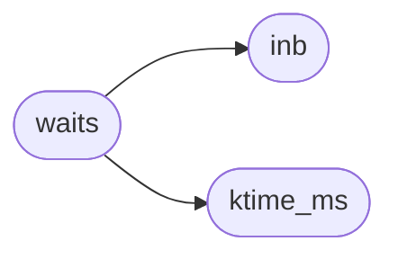

# `headers/kernel.h`

> Source: [headers/kernel.h:1](../../headers/kernel.h#L1) | language `h` | coverage 20.5% | [API index](../index.md)

The user-window memory layout (load base, stack, brk cap, graphics

## Contents

- **Structs:** [`RDFile`](#rdfile), [`vfs_dirent`](#vfs_dirent), [`vfs_ops`](#vfs_ops), [`vfs_file`](#vfs_file), [`KFILE`](#kfile), [`KSym`](#ksym), [`KProg`](#kprog), [`kjmpbuf`](#kjmpbuf), [`Elf64_Ehdr`](#elf64_ehdr), [`kfd_view`](#kfd_view)
- **Type Aliases:** [`name`](#name), [`file_operations`](#file_operations), [`vnode_t`](#vnode_t), [`Elf64_Addr`](#elf64_addr), [`Elf64_Off`](#elf64_off), [`Elf64_Word`](#elf64_word), [`Elf64_Half`](#elf64_half), [`Elf64_Xword`](#elf64_xword), [`Elf64_Sxword`](#elf64_sxword)
- **Functions:** [`ktime_ms`](#ktime_ms), [`outb`](#outb), [`inb`](#inb), [`outw`](#outw), [`inw`](#inw), [`insw`](#insw), [`outsw`](#outsw), [`waits`](#waits), [`vga_clear`](#vga_clear), [`vga_putc`](#vga_putc), [`vga_puts`](#vga_puts), [`vga_scroll`](#vga_scroll), [`vga_set_cursor`](#vga_set_cursor), [`vga_newline`](#vga_newline), [`vga_cursor_enable`](#vga_cursor_enable), [`vga_get_x`](#vga_get_x), [`vga_get_y`](#vga_get_y), [`vga_set_xy`](#vga_set_xy), [`vga_get_color`](#vga_get_color), [`minfo_sleep_init`](#minfo_sleep_init), [`minfo_tick_wake`](#minfo_tick_wake), [`sb_init`](#sb_init), [`sb_capture_row0`](#sb_capture_row0), [`sb_reset`](#sb_reset), [`sb_get_count`](#sb_get_count), [`sb_get_head`](#sb_get_head), [`sb_get_char`](#sb_get_char), [`serial_init`](#serial_init), [`serial_putc`](#serial_putc), [`serial_puts`](#serial_puts), [`sc_record_dump`](#sc_record_dump), [`serial_e_count`](#serial_e_count), [`serial_available`](#serial_available), [`serial_getc`](#serial_getc), [`kbd_read`](#kbd_read), [`kbd_available`](#kbd_available), [`kbd_reset_for_shell`](#kbd_reset_for_shell), [`kmalloc`](#kmalloc), [`kfree`](#kfree), [`kcalloc`](#kcalloc), [`krealloc`](#krealloc), [`kallocator_init`](#kallocator_init), [`kmalloc_aligned`](#kmalloc_aligned), [`kmalloc_page`](#kmalloc_page), [`kfree_aligned`](#kfree_aligned), [`dlmalloc_init`](#dlmalloc_init), [`dlmalloc_malloc`](#dlmalloc_malloc), [`dlmalloc_memalign`](#dlmalloc_memalign), [`dlmalloc_free`](#dlmalloc_free), [`dlmalloc_calloc`](#dlmalloc_calloc), [`dlmalloc_realloc`](#dlmalloc_realloc), [`dlmalloc_usage`](#dlmalloc_usage), [`ramdisk_init`](#ramdisk_init), [`ramdisk_open`](#ramdisk_open), [`ramdisk_read`](#ramdisk_read), [`ramdisk_write`](#ramdisk_write), [`ramdisk_create`](#ramdisk_create), [`ramdisk_resize`](#ramdisk_resize), [`ramdisk_delete`](#ramdisk_delete), [`RAMDISK_FNAME_LEN`](#ramdisk_fname_len), [`ramdisk_rename`](#ramdisk_rename), [`ramdisk_list`](#ramdisk_list), [`ramdisk_setup_from`](#ramdisk_setup_from), [`ramdisk_count`](#ramdisk_count), [`ramdisk_file_name`](#ramdisk_file_name), [`ramdisk_usage`](#ramdisk_usage), [`fs_resolve`](#fs_resolve), [`fs_dir_exists`](#fs_dir_exists), [`fs_is_dir`](#fs_is_dir), [`vfs_register`](#vfs_register), [`vfs_unregister`](#vfs_unregister), [`vfs_list`](#vfs_list), [`vfs_mount_driver`](#vfs_mount_driver), [`vfs_open`](#vfs_open), [`vfs_read`](#vfs_read), [`vfs_write`](#vfs_write), [`vfs_close`](#vfs_close), [`vfs_fstat`](#vfs_fstat), [`vfs_readdir`](#vfs_readdir), [`vfs_init`](#vfs_init), [`vfs_register_builtins`](#vfs_register_builtins), [`minifs_mkdir_p`](#minifs_mkdir_p), [`kfopen`](#kfopen), [`kfopen_dir`](#kfopen_dir), [`kfclose`](#kfclose), [`today`](#today), [`fs_rename`](#fs_rename), [`kfgetc`](#kfgetc), [`kfgets`](#kfgets), [`kfungetc`](#kfungetc), [`kfread`](#kfread), [`kfwrite`](#kfwrite), [`kfseek`](#kfseek), [`kftell`](#kftell), [`kfputs`](#kfputs), [`kfputc`](#kfputc), [`kfflush`](#kfflush), [`krewind`](#krewind), [`kfile_stdin`](#kfile_stdin), [`kfile_stdout`](#kfile_stdout), [`kfile_stderr`](#kfile_stderr), [`kstrlen`](#kstrlen), [`kstrcpy`](#kstrcpy), [`kstrncpy`](#kstrncpy), [`kstrncat`](#kstrncat), [`kstrcmp`](#kstrcmp), [`kstrncmp`](#kstrncmp), [`kstrchr`](#kstrchr), [`kstrstr`](#kstrstr), [`kmemcpy`](#kmemcpy), [`kmemset`](#kmemset), [`kmemcmp`](#kmemcmp), [`kmemmove`](#kmemmove), [`katol`](#katol), [`kprintf`](#kprintf), [`kfprintf`](#kfprintf), [`ksprintf`](#ksprintf), [`ksnprintf`](#ksnprintf), [`klog`](#klog), [`klog_hexdump`](#klog_hexdump), [`klog_set_level`](#klog_set_level), [`klog_set_subsys_level`](#klog_set_subsys_level), [`klog_disable`](#klog_disable), [`klog_enable`](#klog_enable), [`shell_init`](#shell_init), [`shell_run`](#shell_run), [`console_getc`](#console_getc), [`console_peek`](#console_peek), [`redirect_suspend`](#redirect_suspend), [`redirect_resume`](#redirect_resume), [`redirect_begin`](#redirect_begin), [`redirect_commit`](#redirect_commit), [`redirect_take`](#redirect_take), [`redirect_pending`](#redirect_pending), [`redirect_take_into`](#redirect_take_into), [`redirect_discard`](#redirect_discard), [`redirect_active`](#redirect_active), [`console_stdin_push`](#console_stdin_push), [`console_stdin_clear`](#console_stdin_clear), [`console_stdin_active`](#console_stdin_active), [`panic_screen`](#panic_screen), [`clip_set`](#clip_set), [`clip_get`](#clip_get), [`clip_clear`](#clip_clear), [`clip_len_get`](#clip_len_get), [`shell_take_redirect`](#shell_take_redirect), [`shell_run_any`](#shell_run_any), [`shell_exec_builtin`](#shell_exec_builtin), [`shell_report_exit`](#shell_report_exit), [`shell_report`](#shell_report), [`kprog_slot`](#kprog_slot), [`kprog_lookup`](#kprog_lookup), [`ksym_resolve`](#ksym_resolve), [`k_spawn`](#k_spawn), [`k_register_program`](#k_register_program), [`k_register_process`](#k_register_process), [`k_register_symbol`](#k_register_symbol), [`register_libc_symbols`](#register_libc_symbols), [`k_exec_user`](#k_exec_user), [`k_run_rel`](#k_run_rel), [`kexit`](#kexit), [`k_run_on_stack`](#k_run_on_stack), [`ksetjmp`](#ksetjmp), [`klongjmp`](#klongjmp), [`setup_user_stack`](#setup_user_stack), [`vga_mode_set`](#vga_mode_set), [`vga_mode_is_active`](#vga_mode_is_active), [`vga_gfx_ran_set`](#vga_gfx_ran_set), [`desktop_launch`](#desktop_launch), [`shell_queue_launch`](#shell_queue_launch), [`vga_fb_focus_next`](#vga_fb_focus_next), [`vga_fb_focus_id`](#vga_fb_focus_id), [`vga_fb_focus_get`](#vga_fb_focus_get), [`vga_fb_nterms_get`](#vga_fb_nterms_get), [`vga_fb_term_split`](#vga_fb_term_split), [`vga_fb_term_close_focused`](#vga_fb_term_close_focused), [`vga_fb_tile_all`](#vga_fb_tile_all), [`vga_fb_list_windows`](#vga_fb_list_windows), [`vga_fb_park_line`](#vga_fb_park_line), [`vga_fb_unpark_line`](#vga_fb_unpark_line), [`vga_fb_set_gfx_program`](#vga_fb_set_gfx_program), [`vga_fb_act_empty`](#vga_fb_act_empty), [`vga_fb_prompt_live`](#vga_fb_prompt_live), [`vga_fb_note_prompt`](#vga_fb_note_prompt), [`vga_fb_clear_prompt`](#vga_fb_clear_prompt), [`vga_fb_prompted`](#vga_fb_prompted), [`shell_readline_active`](#shell_readline_active), [`shell_focus_park`](#shell_focus_park), [`shell_focus_restore`](#shell_focus_restore), [`user_range_ok`](#user_range_ok), [`user_str_ok`](#user_str_ok), [`mm_setup_protections`](#mm_setup_protections), [`pt_page_alloc`](#pt_page_alloc), [`pt_page_free`](#pt_page_free), [`mm_user_pte_update`](#mm_user_pte_update), [`mm_user_set_exec`](#mm_user_set_exec), [`swap_out`](#swap_out), [`swap_in`](#swap_in), [`elf_load`](#elf_load), [`load_exec_elf`](#load_exec_elf), [`elf_wants_process`](#elf_wants_process), [`load_exec_elf_into`](#load_exec_elf_into), [`ldso_bind_into`](#ldso_bind_into), [`ldso_pseudo_stat`](#ldso_pseudo_stat), [`ldso_pseudo_read`](#ldso_pseudo_read), [`pt_clone_user_empty`](#pt_clone_user_empty), [`mm_user_ensure_page`](#mm_user_ensure_page), [`mm_user_map_page`](#mm_user_map_page), [`mm_file_fault`](#mm_file_fault), [`mm_file_break`](#mm_file_break), [`mm_file_page_phys`](#mm_file_page_phys), [`mm_file_range_release`](#mm_file_range_release), [`mm_demand_pte`](#mm_demand_pte), [`mm_anon_reserve`](#mm_anon_reserve), [`mm_anon_fault`](#mm_anon_fault), [`pt_page_owned`](#pt_page_owned), [`mm_anon_release`](#mm_anon_release), [`cow_drop_ref`](#cow_drop_ref), [`refused`](#refused), [`kmm_make_uncached`](#kmm_make_uncached), [`mm_copy_user_page`](#mm_copy_user_page), [`fault`](#fault), [`cow_resolve`](#cow_resolve), [`user_page_present`](#user_page_present), [`cow_release_window`](#cow_release_window), [`cow_shared`](#cow_shared), [`cow_page_shared`](#cow_page_shared), [`syscall_init`](#syscall_init), [`ksyscall`](#ksyscall), [`syscall_trace_enabled`](#syscall_trace_enabled), [`syscall_trace_set`](#syscall_trace_set), [`syscall_trace_verbose_enabled`](#syscall_trace_verbose_enabled), [`syscall_trace_verbose_set`](#syscall_trace_verbose_set), [`syscall_trace_shown`](#syscall_trace_shown), [`syscall_name`](#syscall_name), [`kfd_get`](#kfd_get), [`kfd_put`](#kfd_put), [`kfd_override`](#kfd_override), [`kpipe_pair`](#kpipe_pair), [`kpipe_empty_wopen`](#kpipe_empty_wopen), [`kpipe_is_write_end`](#kpipe_is_write_end), [`kpipe_state`](#kpipe_state), [`kfd_poll_revents`](#kfd_poll_revents), [`kevent_create`](#kevent_create), [`kevent_read`](#kevent_read), [`kevent_write`](#kevent_write), [`kevent_readable`](#kevent_readable), [`kevent_writable`](#kevent_writable), [`fd_lock`](#fd_lock), [`C`](#c), [`ktime_us`](#ktime_us), [`wall_us_now`](#wall_us_now), [`bootlog_mark`](#bootlog_mark), [`bootlog_report`](#bootlog_report), [`pcspk_init`](#pcspk_init), [`pcspk_tone`](#pcspk_tone), [`pcspk_off`](#pcspk_off), [`pcspk_set_volume`](#pcspk_set_volume), [`pcspk_get_volume`](#pcspk_get_volume), [`rtc_read_tod`](#rtc_read_tod), [`ide_init`](#ide_init), [`ide_read_sectors`](#ide_read_sectors), [`ide_write_sectors`](#ide_write_sectors), [`ide_read_sector`](#ide_read_sector), [`ide_write_sector`](#ide_write_sector), [`ide_total_sectors`](#ide_total_sectors), [`ide_present`](#ide_present), [`block_init`](#block_init), [`block_read`](#block_read), [`block_write`](#block_write), [`block_read_multi`](#block_read_multi), [`block_write_multi`](#block_write_multi), [`block_total`](#block_total), [`k_user_fault_return`](#k_user_fault_return)
- **Macros:** [`EFAULT`](#efault), [`ALIGN_UP`](#align_up), [`VGA_BASE`](#vga_base), [`VGA_COLS`](#vga_cols), [`VGA_ROWS`](#vga_rows), [`KEY_BACKSPACE`](#key_backspace), [`KEY_ENTER`](#key_enter), [`KEY_LSHIFT`](#key_lshift), [`KEY_RSHIFT`](#key_rshift), [`KEY_CAPS`](#key_caps), [`KEY_E0`](#key_e0), [`KEY_UP`](#key_up), [`KEY_DOWN`](#key_down), [`KEY_PGUP`](#key_pgup), [`KEY_PGDN`](#key_pgdn), [`KEY_ESC`](#key_esc), [`KEY_CSI`](#key_csi), [`KEY_ARR_UP`](#key_arr_up), [`KEY_ARR_DOWN`](#key_arr_down), [`KEY_ARR_RIGHT`](#key_arr_right), [`KEY_ARR_LEFT`](#key_arr_left), [`KEY_HOME_SEQ`](#key_home_seq), [`KEY_END_SEQ`](#key_end_seq), [`KEY_PGUP_SEQ`](#key_pgup_seq), [`KEY_PGDN_SEQ`](#key_pgdn_seq), [`KEY_LEFT`](#key_left), [`KEY_RIGHT`](#key_right), [`KEY_LCTRL`](#key_lctrl), [`KEY_RCTRL`](#key_rctrl), [`KEY_F5`](#key_f5), [`KEY_F11`](#key_f11), [`KEY_TILDE`](#key_tilde), [`KEY_LALT`](#key_lalt), [`KEY_RALT`](#key_ralt), [`KEY_HOME`](#key_home), [`KEY_END`](#key_end), [`KEY_TAB`](#key_tab), [`KEY_SUPER_L`](#key_super_l), [`KEY_SUPER_R`](#key_super_r), [`USER_LOAD_BASE`](#user_load_base), [`USER_LOAD_END`](#user_load_end), [`USER_STACK_SIZE`](#user_stack_size), [`USER_STACK_TOP`](#user_stack_top), [`USER_STACK_BASE`](#user_stack_base), [`USER_BRK_END`](#user_brk_end), [`LDSO_REGION_BASE`](#ldso_region_base), [`LDSO_REGION_SIZE`](#ldso_region_size), [`LDSO_REGION_END`](#ldso_region_end), [`SYS_KSTK_TOP`](#sys_kstk_top), [`SYS_KSTK_BASE`](#sys_kstk_base), [`HEAP_BASE`](#heap_base), [`HEAP_SIZE`](#heap_size), [`DEV_MMIO_VBASE`](#dev_mmio_vbase), [`PCI_MMIO_SIZE`](#pci_mmio_size), [`KMALLOC_PAGE`](#kmalloc_page), [`RAMDISK_MAX_FILES`](#ramdisk_max_files), [`RAMDISK_FNAME_LEN`](#ramdisk_fname_len), [`RD_DATA_MAX`](#rd_data_max), [`ETREL_TRUSTED_DIR`](#etrel_trusted_dir), [`ETREL_TRUSTED_LEN`](#etrel_trusted_len), [`VFS_NAME_MAX`](#vfs_name_max), [`VFS_MAX_MOUNTS`](#vfs_max_mounts), [`VFS_PREFIX_LEN`](#vfs_prefix_len), [`VFS_DRIVER_LEN`](#vfs_driver_len), [`EOF`](#eof), [`ENOENT`](#enoent), [`EIO`](#eio), [`EBADF`](#ebadf), [`ENOMEM`](#enomem), [`ENOTDIR`](#enotdir), [`EISDIR`](#eisdir), [`EINVAL`](#einval), [`EFBIG`](#efbig), [`ENOSPC`](#enospc), [`ESPIPE`](#espipe), [`ENAMETOOLONG`](#enametoolong), [`KSYM_MAX`](#ksym_max), [`KPROG_MAX`](#kprog_max), [`EI_NIDENT`](#ei_nident), [`ET_REL`](#et_rel), [`ET_EXEC`](#et_exec), [`ET_DYN`](#et_dyn), [`USER_HEAP_CEIL`](#user_heap_ceil), [`PTE_DEMAND`](#pte_demand), [`PTE_DEMAND_READ`](#pte_demand_read), [`PTE_DEMAND_WRITE`](#pte_demand_write), [`PTE_DEMAND_EXEC`](#pte_demand_exec), [`LINUX_PROT_READ`](#linux_prot_read), [`LINUX_PROT_WRITE`](#linux_prot_write), [`LINUX_PROT_EXEC`](#linux_prot_exec), [`KFD_MAX`](#kfd_max), [`KEVENT_MAX`](#kevent_max)
- **Variables:** [`console_lock`](#console_lock), [`ser_e_cpu`](#ser_e_cpu), [`kmalloc_fail_after`](#kmalloc_fail_after), [`kheap_size`](#kheap_size), [`fs_cwd`](#fs_cwd), [`kerrno`](#kerrno), [`kstdin`](#kstdin), [`kstdout`](#kstdout), [`kstderr`](#kstderr), [`ksym_table`](#ksym_table), [`ksym_count`](#ksym_count), [`kprog_table`](#kprog_table), [`kprog_count`](#kprog_count), [`exec_return`](#exec_return), [`exec_exit_code`](#exec_exit_code), [`shell_fg_active`](#shell_fg_active), [`g_brk`](#g_brk), [`g_brk_limit`](#g_brk_limit), [`user_mmap_cur`](#user_mmap_cur), [`fd_lock`](#fd_lock), [`fs_lock`](#fs_lock), [`kernel_end`](#kernel_end), [`ramdisk_start`](#ramdisk_start), [`ramdisk_end`](#ramdisk_end), [`ramdisk_size`](#ramdisk_size)

## Type Diagram


## Call Graph

Solid arrows stay in this module, dashed arrows leave it.



## Structs

<a id="rdfile"></a>

### `RDFile`

`struct` | [headers/kernel.h:281](../../headers/kernel.h#L281)

```c
typedef struct
```

---

<a id="vfs_dirent"></a>

### `vfs_dirent`

`struct` | [headers/kernel.h:383](../../headers/kernel.h#L383)

```c
typedef struct vfs_dirent
```

Docstring: one directory entry behind the readdir verb.

Defined * before vfs_ops_t so the verb names the type directly. define VFS_NAME_MAX 255

---

<a id="vfs_ops"></a>

### `vfs_ops`

`struct` | [headers/kernel.h:388](../../headers/kernel.h#L388)

```c
typedef struct vfs_ops
```

---

<a id="vfs_file"></a>

### `vfs_file`

`struct` | [headers/kernel.h:398](../../headers/kernel.h#L398)

```c
typedef struct vfs_file
```

---

<a id="kfile"></a>

### `KFILE`

`struct` | [headers/kernel.h:470](../../headers/kernel.h#L470)

```c
typedef struct
```

---

<a id="ksym"></a>

### `KSym`

`struct` | [headers/kernel.h:627](../../headers/kernel.h#L627)

```c
typedef struct
```

---

<a id="kprog"></a>

### `KProg`

`struct` | [headers/kernel.h:632](../../headers/kernel.h#L632)

```c
typedef struct
```

---

<a id="kjmpbuf"></a>

### `kjmpbuf`

`struct` | [headers/kernel.h:666](../../headers/kernel.h#L666)

```c
typedef struct { unsigned long v[8]; } kjmpbuf;
```

========== Execution infrastructure (kernel/exec.c) ==========

---

<a id="elf64_ehdr"></a>

### `Elf64_Ehdr`

`struct` | [headers/kernel.h:738](../../headers/kernel.h#L738)

```c
typedef struct
```

---

<a id="kfd_view"></a>

### `kfd_view`

`struct` | [headers/kernel.h:855](../../headers/kernel.h#L855)

```c
typedef struct kfd_view
```

Docstring: Per-process file-descriptor view.

Each process owns one view (heap-allocated, shared on CLONE_FILES with
a refcount, deep-copied on fork/spawn/exec-parent with one KFILE ref
bump per live entry). f[fd] is the table; cloexec carries one
close-on-exec bit per fd; ref counts view owners (never the entries:
those keep their own KFILE ref). The shell and every pid without its
own view (pid 0, AP idle) use the static root view, which is never
freed. All membership mutates only under fd_lock.

---

## Type Aliases

<a id="name"></a>

### `name`

`type_alias` | [headers/kernel.h:383](../../headers/kernel.h#L383)

```c
typedef struct vfs_dirent { char name[VFS_NAME_MAX + 1];
```

Docstring: one directory entry behind the readdir verb.

Defined * before vfs_ops_t so the verb names the type directly. define VFS_NAME_MAX 255

---

<a id="file_operations"></a>

### `file_operations`

`type_alias` | [headers/kernel.h:414](../../headers/kernel.h#L414)

```c
typedef vfs_ops_t file_operations;
```

Facade aliases (thesis correction 2B, 4.4BSD/Linux vnode model): vfs_ops_t IS the file_operations table, and vnode is the object it operates on.

New code uses these names; vfs_ops_t/vfs_file_t remain as compat aliases. Open/Closed Principle: adding a filesystem means registering a new ops table, never editing a dispatch cascade. No caller branches on which filesystem backs a handle; vfs_read/write/close/fstat dispatch purely through ops.

---

<a id="vnode_t"></a>

### `vnode_t`

`type_alias` | [headers/kernel.h:415](../../headers/kernel.h#L415)

```c
typedef vfs_file_t vnode_t;
```

---

<a id="elf64_addr"></a>

### `Elf64_Addr`

`type_alias` | [headers/kernel.h:731](../../headers/kernel.h#L731)

```c
typedef unsigned long long Elf64_Addr;
```

/* ========== Swap (kernel/mm/swap.c) ========== int   swap_out(unsigned long window_sz); int   swap_in(void); /* brk/mmap globals (loader.c) extern unsigned long g_brk; extern unsigned long g_brk_limit; extern unsigned long user_mmap_cur; /* ========== ELF loader (loader.c) ========== /* Minimal ELF64 definitions (used by shell_load, shell_run_elf_buf, SPAWN) define EI_NIDENT 16

---

<a id="elf64_off"></a>

### `Elf64_Off`

`type_alias` | [headers/kernel.h:732](../../headers/kernel.h#L732)

```c
typedef unsigned long long Elf64_Off;
```

---

<a id="elf64_word"></a>

### `Elf64_Word`

`type_alias` | [headers/kernel.h:733](../../headers/kernel.h#L733)

```c
typedef unsigned int Elf64_Word;
```

---

<a id="elf64_half"></a>

### `Elf64_Half`

`type_alias` | [headers/kernel.h:734](../../headers/kernel.h#L734)

```c
typedef unsigned short Elf64_Half;
```

---

<a id="elf64_xword"></a>

### `Elf64_Xword`

`type_alias` | [headers/kernel.h:735](../../headers/kernel.h#L735)

```c
typedef unsigned long long Elf64_Xword;
```

---

<a id="elf64_sxword"></a>

### `Elf64_Sxword`

`type_alias` | [headers/kernel.h:736](../../headers/kernel.h#L736)

```c
typedef long long Elf64_Sxword;
```

---

## Functions

<a id="ktime_ms"></a>

### `ktime_ms`

`function` | [headers/kernel.h:25](../../headers/kernel.h#L25)

```c
unsigned long ktime_ms(void);
```

Forward: PIT-calibrated wall clock (defined in kernel/time.c); valid once pit_init has run.

Used only by the deadline polls below.

**Returns:** `unsigned long`

*Called by:* [`waits`](#waits)

---

<a id="outb"></a>

### `outb`

`function` `inline` `static` | [headers/kernel.h:26](../../headers/kernel.h#L26)

```c
static inline void outb(unsigned short port, unsigned char val)
```

**Parameters**

| Name | Type | Default | Description |
|---|---|---|---|
| `port` | `unsigned short` |  |  |
| `val` | `unsigned char` |  |  |

*Called by:* [`ide_read_sectors`](drivers.ide.c.md#ide_read_sectors), [`ide_write_sectors`](drivers.ide.c.md#ide_write_sectors), [`pcspk_init`](drivers.pcspk.c.md#pcspk_init), [`pcspk_off`](drivers.pcspk.c.md#pcspk_off), [`pcspk_tone`](drivers.pcspk.c.md#pcspk_tone), [`RTC_UPDATE_WAIT`](drivers.rtc.c.md#rtc_update_wait), [`__attribute__`](kernel.c.md#__attribute__), [`vga_cursor_enable`](kernel.console.c.md#vga_cursor_enable), [`serial_init`](kernel.serial.c.md#serial_init), [`serial_putc`](kernel.serial.c.md#serial_putc), [`vga_fb_set_gfx_palette`](kernel.vga_fb.c.md#vga_fb_set_gfx_palette), [`qga_init`](qga.c.md#qga_init)

---

<a id="inb"></a>

### `inb`

`function` `inline` `static` | [headers/kernel.h:29](../../headers/kernel.h#L29)

```c
static inline unsigned char inb(unsigned short port)
```

**Parameters**

| Name | Type | Default | Description |
|---|---|---|---|
| `port` | `unsigned short` |  |  |

**Returns:** `unsigned char`

*Called by:* [`pcm2_irq`](drivers.pcm2.c.md#pcm2_irq), [`pcspk_init`](drivers.pcspk.c.md#pcspk_init), [`pcspk_off`](drivers.pcspk.c.md#pcspk_off), [`pcspk_tone`](drivers.pcspk.c.md#pcspk_tone), [`RTC_UPDATE_WAIT`](drivers.rtc.c.md#rtc_update_wait), [`sb16_irq`](drivers.sb16.c.md#sb16_irq), [`waits`](#waits), [`vga_cursor_enable`](kernel.console.c.md#vga_cursor_enable), [`serial_getc`](kernel.serial.c.md#serial_getc), [`qga_poll`](qga.c.md#qga_poll)

---

<a id="outw"></a>

### `outw`

`function` `inline` `static` | [headers/kernel.h:34](../../headers/kernel.h#L34)

```c
static inline void outw(unsigned short port, unsigned short val)
```

**Parameters**

| Name | Type | Default | Description |
|---|---|---|---|
| `port` | `unsigned short` |  |  |
| `val` | `unsigned short` |  |  |

---

<a id="inw"></a>

### `inw`

`function` `inline` `static` | [headers/kernel.h:37](../../headers/kernel.h#L37)

```c
static inline unsigned short inw(unsigned short port)
```

**Parameters**

| Name | Type | Default | Description |
|---|---|---|---|
| `port` | `unsigned short` |  |  |

**Returns:** `unsigned short`

---

<a id="insw"></a>

### `insw`

`function` `inline` `static` | [headers/kernel.h:47](../../headers/kernel.h#L47)

```c
static inline void insw(unsigned short port, unsigned short *buf, unsigned count)
```

String port I/O: one instruction moves `count` words between the port and the buffer.

Under KVM every port access is a VM-exit, so a 512 B sector costs 1 exit this way instead of 256 single-word inw/outw (measured: MiniFS reads ran at ~250 KB/s before, bulk ELF loads took minutes).  `cld` pins the direction; alignment is not required.

**Parameters**

| Name | Type | Default | Description |
|---|---|---|---|
| `port` | `unsigned short` |  |  |
| `buf` | `unsigned short *` |  |  |
| `count` | `unsigned` |  |  |

*Called by:* [`ide_read_sectors`](drivers.ide.c.md#ide_read_sectors)

---

<a id="outsw"></a>

### `outsw`

`function` `inline` `static` | [headers/kernel.h:54](../../headers/kernel.h#L54)

```c
static inline void outsw(unsigned short port, const unsigned short *buf, unsigned count)
```

**Parameters**

| Name | Type | Default | Description |
|---|---|---|---|
| `port` | `unsigned short` |  |  |
| `buf` | `unsigned short *` |  |  |
| `count` | `unsigned` |  |  |

*Called by:* [`ide_write_sectors`](drivers.ide.c.md#ide_write_sectors)

---

<a id="waits"></a>

### `waits`

`function` | [headers/kernel.h:64](../../headers/kernel.h#L64)

```c
* and mouse_hw_init issues dozens of waits (measured 5 s of boot). This * polls the port once p...
```

**Parameters**

| Name | Type | Default | Description |
|---|---|---|---|
| `boot` | `measured 5 s of` |  |  |

**Returns:** `* and mouse_hw_init issues dozens of`

*Calls:* [`inb`](#inb), [`ktime_ms`](#ktime_ms)

---

<a id="vga_clear"></a>

### `vga_clear`

`function` | [headers/kernel.h:94](../../headers/kernel.h#L94)

```c
void vga_clear(void);
```

---

<a id="vga_putc"></a>

### `vga_putc`

`function` | [headers/kernel.h:95](../../headers/kernel.h#L95)

```c
void vga_putc(char c);
```

**Parameters**

| Name | Type | Default | Description |
|---|---|---|---|
| `c` | `char` |  |  |

---

<a id="vga_puts"></a>

### `vga_puts`

`function` | [headers/kernel.h:96](../../headers/kernel.h#L96)

```c
void vga_puts(const char *s);
```

**Parameters**

| Name | Type | Default | Description |
|---|---|---|---|
| `s` | `char *` |  |  |

---

<a id="vga_scroll"></a>

### `vga_scroll`

`function` | [headers/kernel.h:97](../../headers/kernel.h#L97)

```c
void vga_scroll(void);
```

---

<a id="vga_set_cursor"></a>

### `vga_set_cursor`

`function` | [headers/kernel.h:98](../../headers/kernel.h#L98)

```c
void vga_set_cursor(int x, int y);
```

**Parameters**

| Name | Type | Default | Description |
|---|---|---|---|
| `x` | `int` |  |  |
| `y` | `int` |  |  |

---

<a id="vga_newline"></a>

### `vga_newline`

`function` | [headers/kernel.h:99](../../headers/kernel.h#L99)

```c
void vga_newline(void);
```

---

<a id="vga_cursor_enable"></a>

### `vga_cursor_enable`

`function` | [headers/kernel.h:100](../../headers/kernel.h#L100)

```c
void vga_cursor_enable(int on);
```

**Parameters**

| Name | Type | Default | Description |
|---|---|---|---|
| `on` | `int` |  |  |

---

<a id="vga_get_x"></a>

### `vga_get_x`

`function` | [headers/kernel.h:108](../../headers/kernel.h#L108)

```c
int vga_get_x(void);
```

VGA state getters (kernel/console.c, for scrollback renderer)

**Returns:** `int`

---

<a id="vga_get_y"></a>

### `vga_get_y`

`function` | [headers/kernel.h:109](../../headers/kernel.h#L109)

```c
int vga_get_y(void);
```

**Returns:** `int`

---

<a id="vga_set_xy"></a>

### `vga_set_xy`

`function` | [headers/kernel.h:110](../../headers/kernel.h#L110)

```c
void vga_set_xy(int x, int y);
```

**Parameters**

| Name | Type | Default | Description |
|---|---|---|---|
| `x` | `int` |  |  |
| `y` | `int` |  |  |

---

<a id="vga_get_color"></a>

### `vga_get_color`

`function` | [headers/kernel.h:111](../../headers/kernel.h#L111)

```c
char vga_get_color(void);
```

**Returns:** `char`

---

<a id="minfo_sleep_init"></a>

### `minfo_sleep_init`

`function` | [headers/kernel.h:116](../../headers/kernel.h#L116)

```c
void minfo_sleep_init(int tick_ok);
```

MINFO sleep support (kernel/syscalls.c): timed park for ring-3 monitors. sched_init passes the tick-registration result; without a registered waker sel 6 fails closed instead of hanging.

**Parameters**

| Name | Type | Default | Description |
|---|---|---|---|
| `tick_ok` | `int` |  |  |

---

<a id="minfo_tick_wake"></a>

### `minfo_tick_wake`

`function` | [headers/kernel.h:117](../../headers/kernel.h#L117)

```c
void minfo_tick_wake(void *ctx);
```

**Parameters**

| Name | Type | Default | Description |
|---|---|---|---|
| `ctx` | `void *` |  |  |

---

<a id="sb_init"></a>

### `sb_init`

`function` | [headers/kernel.h:120](../../headers/kernel.h#L120)

```c
void sb_init(void);
```

========== Scrollback ring (kernel/scrollback.c) ==========

---

<a id="sb_capture_row0"></a>

### `sb_capture_row0`

`function` | [headers/kernel.h:121](../../headers/kernel.h#L121)

```c
void sb_capture_row0(void);
```

---

<a id="sb_reset"></a>

### `sb_reset`

`function` | [headers/kernel.h:122](../../headers/kernel.h#L122)

```c
void sb_reset(void);
```

---

<a id="sb_get_count"></a>

### `sb_get_count`

`function` | [headers/kernel.h:123](../../headers/kernel.h#L123)

```c
int sb_get_count(void);
```

**Returns:** `int`

---

<a id="sb_get_head"></a>

### `sb_get_head`

`function` | [headers/kernel.h:124](../../headers/kernel.h#L124)

```c
int sb_get_head(void);
```

**Returns:** `int`

---

<a id="sb_get_char"></a>

### `sb_get_char`

`function` | [headers/kernel.h:125](../../headers/kernel.h#L125)

```c
char sb_get_char(int row, int col);
```

**Parameters**

| Name | Type | Default | Description |
|---|---|---|---|
| `row` | `int` |  |  |
| `col` | `int` |  |  |

**Returns:** `char`

---

<a id="serial_init"></a>

### `serial_init`

`function` | [headers/kernel.h:128](../../headers/kernel.h#L128)

```c
void serial_init(void);
```

========== Serial console (COM1) ==========

---

<a id="serial_putc"></a>

### `serial_putc`

`function` | [headers/kernel.h:129](../../headers/kernel.h#L129)

```c
void serial_putc(char c);
```

**Parameters**

| Name | Type | Default | Description |
|---|---|---|---|
| `c` | `char` |  |  |

---

<a id="serial_puts"></a>

### `serial_puts`

`function` | [headers/kernel.h:130](../../headers/kernel.h#L130)

```c
void serial_puts(const char *s);
```

**Parameters**

| Name | Type | Default | Description |
|---|---|---|---|
| `s` | `char *` |  |  |

---

<a id="sc_record_dump"></a>

### `sc_record_dump`

`function` | [headers/kernel.h:131](../../headers/kernel.h#L131)

```c
void sc_record_dump(int pid);
```

**Parameters**

| Name | Type | Default | Description |
|---|---|---|---|
| `pid` | `int` |  |  |

---

<a id="serial_e_count"></a>

### `serial_e_count`

`function` | [headers/kernel.h:132](../../headers/kernel.h#L132)

```c
unsigned long serial_e_count(void);
```

**Returns:** `unsigned long`

---

<a id="serial_available"></a>

### `serial_available`

`function` | [headers/kernel.h:134](../../headers/kernel.h#L134)

```c
int serial_available(void);
```

first 'E' writer's RA/CPU

**Returns:** `int`

---

<a id="serial_getc"></a>

### `serial_getc`

`function` | [headers/kernel.h:135](../../headers/kernel.h#L135)

```c
int serial_getc(void);
```

**Returns:** `int`

---

<a id="kbd_read"></a>

### `kbd_read`

`function` | [headers/kernel.h:173](../../headers/kernel.h#L173)

```c
int kbd_read(void);
```

**Returns:** `int`

---

<a id="kbd_available"></a>

### `kbd_available`

`function` | [headers/kernel.h:174](../../headers/kernel.h#L174)

```c
int kbd_available(void);
```

**Returns:** `int`

---

<a id="kbd_reset_for_shell"></a>

### `kbd_reset_for_shell`

`function` | [headers/kernel.h:175](../../headers/kernel.h#L175)

```c
void kbd_reset_for_shell(void);
```

---

<a id="kmalloc"></a>

### `kmalloc`

`function` | [headers/kernel.h:213](../../headers/kernel.h#L213)

```c
void *kmalloc(unsigned long size);
```

ifdef MINIOS_LK_KERNEL

**Parameters**

| Name | Type | Default | Description |
|---|---|---|---|
| `size` | `unsigned long` |  |  |

**Returns:** `void *`

> **Inherited:** Documentation from [`kmalloc`](#kmalloc) (headers/leakcheck.h:79).

---

<a id="kfree"></a>

### `kfree`

`function` | [headers/kernel.h:215](../../headers/kernel.h#L215)

```c
void kfree(void *ptr);
```

**Parameters**

| Name | Type | Default | Description |
|---|---|---|---|
| `ptr` | `void *` |  |  |

---

<a id="kcalloc"></a>

### `kcalloc`

`function` | [headers/kernel.h:216](../../headers/kernel.h#L216)

```c
void *kcalloc(unsigned long nmemb, unsigned long size);
```

**Parameters**

| Name | Type | Default | Description |
|---|---|---|---|
| `nmemb` | `unsigned long` |  |  |
| `size` | `unsigned long` |  |  |

**Returns:** `void *`

---

<a id="krealloc"></a>

### `krealloc`

`function` | [headers/kernel.h:217](../../headers/kernel.h#L217)

```c
void *krealloc(void *ptr, unsigned long size);
```

**Parameters**

| Name | Type | Default | Description |
|---|---|---|---|
| `ptr` | `void *` |  |  |
| `size` | `unsigned long` |  |  |

**Returns:** `void *`

---

<a id="kallocator_init"></a>

### `kallocator_init`

`function` | [headers/kernel.h:218](../../headers/kernel.h#L218)

```c
void kallocator_init(void);
```

---

<a id="kmalloc_aligned"></a>

### `kmalloc_aligned`

`function` | [headers/kernel.h:219](../../headers/kernel.h#L219)

```c
void *kmalloc_aligned(unsigned long size, unsigned long align);
```

**Parameters**

| Name | Type | Default | Description |
|---|---|---|---|
| `size` | `unsigned long` |  |  |
| `align` | `unsigned long` |  |  |

**Returns:** `void *`

---

<a id="kmalloc_page"></a>

### `kmalloc_page`

`function` | [headers/kernel.h:221](../../headers/kernel.h#L221)

```c
void *kmalloc_page(void);
```

define KMALLOC_PAGE 0x1000UL

**Returns:** `void *`

---

<a id="kfree_aligned"></a>

### `kfree_aligned`

`function` | [headers/kernel.h:222](../../headers/kernel.h#L222)

```c
void kfree_aligned(void *ptr);
```

**Parameters**

| Name | Type | Default | Description |
|---|---|---|---|
| `ptr` | `void *` |  |  |

---

<a id="dlmalloc_init"></a>

### `dlmalloc_init`

`function` | [headers/kernel.h:226](../../headers/kernel.h#L226)

```c
void dlmalloc_init(unsigned long size);
```

dlmalloc backend (third_party/dlmalloc): an mspace rooted over the fixed kernel heap.

The kernel's allocator delegates to these.

**Parameters**

| Name | Type | Default | Description |
|---|---|---|---|
| `size` | `unsigned long` |  |  |

*Called by:* [`kallocator_init`](kernel.mm.c.md#kallocator_init)

---

<a id="dlmalloc_malloc"></a>

### `dlmalloc_malloc`

`function` | [headers/kernel.h:230](../../headers/kernel.h#L230)

```c
void *dlmalloc_malloc(unsigned long size);
```

**Parameters**

| Name | Type | Default | Description |
|---|---|---|---|
| `size` | `unsigned long` |  |  |

**Returns:** `void *`

*Called by:* [`kmalloc`](kernel.mm.c.md#kmalloc)

---

<a id="dlmalloc_memalign"></a>

### `dlmalloc_memalign`

`function` | [headers/kernel.h:231](../../headers/kernel.h#L231)

```c
void *dlmalloc_memalign(unsigned long align, unsigned long size);
```

**Parameters**

| Name | Type | Default | Description |
|---|---|---|---|
| `align` | `unsigned long` |  |  |
| `size` | `unsigned long` |  |  |

**Returns:** `void *`

*Called by:* [`kmalloc_page`](kernel.mm.c.md#kmalloc_page)

---

<a id="dlmalloc_free"></a>

### `dlmalloc_free`

`function` | [headers/kernel.h:232](../../headers/kernel.h#L232)

```c
void dlmalloc_free(void *ptr);
```

**Parameters**

| Name | Type | Default | Description |
|---|---|---|---|
| `ptr` | `void *` |  |  |

*Called by:* [`kfree`](kernel.mm.c.md#kfree)

---

<a id="dlmalloc_calloc"></a>

### `dlmalloc_calloc`

`function` | [headers/kernel.h:233](../../headers/kernel.h#L233)

```c
void *dlmalloc_calloc(unsigned long nmemb, unsigned long size);
```

**Parameters**

| Name | Type | Default | Description |
|---|---|---|---|
| `nmemb` | `unsigned long` |  |  |
| `size` | `unsigned long` |  |  |

**Returns:** `void *`

*Called by:* [`kcalloc`](kernel.mm.c.md#kcalloc)

---

<a id="dlmalloc_realloc"></a>

### `dlmalloc_realloc`

`function` | [headers/kernel.h:234](../../headers/kernel.h#L234)

```c
void *dlmalloc_realloc(void *ptr, unsigned long size);
```

**Parameters**

| Name | Type | Default | Description |
|---|---|---|---|
| `ptr` | `void *` |  |  |
| `size` | `unsigned long` |  |  |

**Returns:** `void *`

*Called by:* [`krealloc`](kernel.mm.c.md#krealloc)

---

<a id="dlmalloc_usage"></a>

### `dlmalloc_usage`

`function` | [headers/kernel.h:236](../../headers/kernel.h#L236)

```c
void dlmalloc_usage(unsigned long *used, unsigned long *free_b, unsigned long *arena);
```

Docstring: Heap usage snapshot for the mem builtin.

**Parameters**

| Name | Type | Default | Description |
|---|---|---|---|
| `used` | `unsigned long *` |  |  |
| `free_b` | `unsigned long *` |  |  |
| `arena` | `unsigned long *` |  |  |

*Called by:* [`view`](kernel.syscalls.c.md#view)

---

<a id="ramdisk_init"></a>

### `ramdisk_init`

`function` | [headers/kernel.h:287](../../headers/kernel.h#L287)

```c
void ramdisk_init(void);
```

---

<a id="ramdisk_open"></a>

### `ramdisk_open`

`function` | [headers/kernel.h:288](../../headers/kernel.h#L288)

```c
RDFile *ramdisk_open(const char *name);
```

**Parameters**

| Name | Type | Default | Description |
|---|---|---|---|
| `name` | `char *` |  |  |

**Returns:** `RDFile *`

---

<a id="ramdisk_read"></a>

### `ramdisk_read`

`function` | [headers/kernel.h:289](../../headers/kernel.h#L289)

```c
int ramdisk_read(RDFile *f, void *buf, unsigned offset, unsigned len);
```

**Parameters**

| Name | Type | Default | Description |
|---|---|---|---|
| `f` | `RDFile *` |  |  |
| `buf` | `void *` |  |  |
| `offset` | `unsigned` |  |  |
| `len` | `unsigned` |  |  |

**Returns:** `int`

---

<a id="ramdisk_write"></a>

### `ramdisk_write`

`function` | [headers/kernel.h:290](../../headers/kernel.h#L290)

```c
int ramdisk_write(RDFile *f, const void *buf, unsigned offset, unsigned len);
```

**Parameters**

| Name | Type | Default | Description |
|---|---|---|---|
| `f` | `RDFile *` |  |  |
| `buf` | `void *` |  |  |
| `offset` | `unsigned` |  |  |
| `len` | `unsigned` |  |  |

**Returns:** `int`

---

<a id="ramdisk_create"></a>

### `ramdisk_create`

`function` | [headers/kernel.h:291](../../headers/kernel.h#L291)

```c
RDFile *ramdisk_create(const char *name, unsigned size);
```

**Parameters**

| Name | Type | Default | Description |
|---|---|---|---|
| `name` | `char *` |  |  |
| `size` | `unsigned` |  |  |

**Returns:** `RDFile *`

---

<a id="ramdisk_resize"></a>

### `ramdisk_resize`

`function` | [headers/kernel.h:292](../../headers/kernel.h#L292)

```c
int ramdisk_resize(RDFile *f, unsigned newsize);
```

**Parameters**

| Name | Type | Default | Description |
|---|---|---|---|
| `f` | `RDFile *` |  |  |
| `newsize` | `unsigned` |  |  |

**Returns:** `int`

---

<a id="ramdisk_delete"></a>

### `ramdisk_delete`

`function` | [headers/kernel.h:293](../../headers/kernel.h#L293)

```c
int ramdisk_delete(RDFile *f);
```

**Parameters**

| Name | Type | Default | Description |
|---|---|---|---|
| `f` | `RDFile *` |  |  |

**Returns:** `int`

---

<a id="ramdisk_fname_len"></a>

### `RAMDISK_FNAME_LEN`

`function` | [headers/kernel.h:295](../../headers/kernel.h#L295)

```c
* RAMDISK_FNAME_LEN (fs_resolve guarantees it);
```

Longest kernel-side path buffer (resolve, open, spawn, cwd).

96 covers the real Python layouts with the current prefix: the deepest module pip imports lives at /usr/local/lib/python3.12/site-packages/pip/_vendor/urllib3/contrib/ securetransport.py (82) and a wheel's dist-info RECORD lands at 65; the old 64 made every such open fail ENAMETOOLONG (docs/spec/python.md). Kept at 96, not 256, so stack frames stay inside the 2 KB gate. The ramdisk on-disk name slot (tools/mkramdisk.py) derives its width from this define, so the packer and RDFile can never drift.

**Parameters**

| Name | Type | Default | Description |
|---|---|---|---|
| `it` | `fs_resolve guarantees` |  |  |

**Returns:** `*`

> **Inherited:** Documentation from [`RAMDISK_FNAME_LEN`](#ramdisk_fname_len) (headers/kernel.h:279).

---

<a id="ramdisk_rename"></a>

### `ramdisk_rename`

`function` | [headers/kernel.h:297](../../headers/kernel.h#L297)

```c
int ramdisk_rename(const char *oldname, const char *newname);
```

Docstring: In-place rename of one ramdisk entry.

Both names fit RAMDISK_FNAME_LEN (fs_resolve guarantees it); missing src or an existing dst refuses, never overwrites. Returns 0 on success.

**Parameters**

| Name | Type | Default | Description |
|---|---|---|---|
| `oldname` | `char *` |  |  |
| `newname` | `char *` |  |  |

**Returns:** `int`

---

<a id="ramdisk_list"></a>

### `ramdisk_list`

`function` | [headers/kernel.h:298](../../headers/kernel.h#L298)

```c
int ramdisk_list(RDFile **out, int max);
```

**Parameters**

| Name | Type | Default | Description |
|---|---|---|---|
| `out` | `RDFile **` |  |  |
| `max` | `int` |  |  |

**Returns:** `int`

---

<a id="ramdisk_setup_from"></a>

### `ramdisk_setup_from`

`function` | [headers/kernel.h:299](../../headers/kernel.h#L299)

```c
void ramdisk_setup_from(void *data, unsigned size);
```

**Parameters**

| Name | Type | Default | Description |
|---|---|---|---|
| `data` | `void *` |  |  |
| `size` | `unsigned` |  |  |

---

<a id="ramdisk_count"></a>

### `ramdisk_count`

`function` | [headers/kernel.h:300](../../headers/kernel.h#L300)

```c
int ramdisk_count(void);
```

**Returns:** `int`

---

<a id="ramdisk_file_name"></a>

### `ramdisk_file_name`

`function` `const` | [headers/kernel.h:301](../../headers/kernel.h#L301)

```c
const char *ramdisk_file_name(int idx);
```

**Parameters**

| Name | Type | Default | Description |
|---|---|---|---|
| `idx` | `int` |  |  |

**Returns:** `char *`

---

<a id="ramdisk_usage"></a>

### `ramdisk_usage`

`function` | [headers/kernel.h:303](../../headers/kernel.h#L303)

```c
void ramdisk_usage(unsigned *used, unsigned *cap, unsigned *max);
```

Docstring: Ramdisk usage snapshot for the mem builtin.

**Parameters**

| Name | Type | Default | Description |
|---|---|---|---|
| `used` | `unsigned *` |  |  |
| `cap` | `unsigned *` |  |  |
| `max` | `unsigned *` |  |  |

---

<a id="fs_resolve"></a>

### `fs_resolve`

`function` | [headers/kernel.h:311](../../headers/kernel.h#L311)

```c
int fs_resolve(const char *path, char *out, unsigned cap);
```

Path resolution choke point shared by the shell builtins and the zip builtins. fs_resolve resolves a path against the cwd into `out` (cap >= RAMDISK_FNAME_LEN); a name that does not fit is rejected like a missing file, never truncated.

**Parameters**

| Name | Type | Default | Description |
|---|---|---|---|
| `path` | `char *` |  |  |
| `out` | `char *` |  |  |
| `cap` | `unsigned` |  |  |

**Returns:** `int`

---

<a id="fs_dir_exists"></a>

### `fs_dir_exists`

`function` | [headers/kernel.h:312](../../headers/kernel.h#L312)

```c
int fs_dir_exists(const char *dir);
```

**Parameters**

| Name | Type | Default | Description |
|---|---|---|---|
| `dir` | `char *` |  |  |

**Returns:** `int`

---

<a id="fs_is_dir"></a>

### `fs_is_dir`

`function` | [headers/kernel.h:313](../../headers/kernel.h#L313)

```c
int fs_is_dir(const char *resolved);
```

**Parameters**

| Name | Type | Default | Description |
|---|---|---|---|
| `resolved` | `char *` |  |  |

**Returns:** `int`

---

<a id="vfs_register"></a>

### `vfs_register`

`function` | [headers/kernel.h:417](../../headers/kernel.h#L417)

```c
int vfs_register(const char *prefix, const vfs_ops_t *ops, const char *driver);
```

**Parameters**

| Name | Type | Default | Description |
|---|---|---|---|
| `prefix` | `char *` |  |  |
| `ops` | `vfs_ops_t *` |  |  |
| `driver` | `char *` |  |  |

**Returns:** `int`

---

<a id="vfs_unregister"></a>

### `vfs_unregister`

`function` | [headers/kernel.h:418](../../headers/kernel.h#L418)

```c
int vfs_unregister(const char *prefix);
```

**Parameters**

| Name | Type | Default | Description |
|---|---|---|---|
| `prefix` | `char *` |  |  |

**Returns:** `int`

---

<a id="vfs_list"></a>

### `vfs_list`

`function` | [headers/kernel.h:422](../../headers/kernel.h#L422)

```c
int vfs_list(char prefixes[][VFS_PREFIX_LEN], char drivers[][VFS_DRIVER_LEN], int refs[], int cap);
```

define VFS_MAX_MOUNTS 8 define VFS_PREFIX_LEN 32 define VFS_DRIVER_LEN 16

**Parameters**

| Name | Type | Default | Description |
|---|---|---|---|
| `VFS_PREFIX_LEN` | `char prefixes[][ ]` |  |  |
| `VFS_DRIVER_LEN` | `char drivers[][ ]` |  |  |
| `refs` | `int []` |  |  |
| `cap` | `int` |  |  |

**Returns:** `int`

*Called by:* [`shell_exec_builtin`](kernel.shell.c.md#shell_exec_builtin)

---

<a id="vfs_mount_driver"></a>

### `vfs_mount_driver`

`function` | [headers/kernel.h:424](../../headers/kernel.h#L424)

```c
int vfs_mount_driver(const char *prefix, const char *driver);
```

**Parameters**

| Name | Type | Default | Description |
|---|---|---|---|
| `prefix` | `char *` |  |  |
| `driver` | `char *` |  |  |

**Returns:** `int`

*Called by:* [`open`](fs.vfs.c.md#open), [`shell_exec_builtin`](kernel.shell.c.md#shell_exec_builtin)

---

<a id="vfs_open"></a>

### `vfs_open`

`function` | [headers/kernel.h:425](../../headers/kernel.h#L425)

```c
int vfs_open(const char *path, int mode, vfs_file_t *f);
```

**Parameters**

| Name | Type | Default | Description |
|---|---|---|---|
| `path` | `char *` |  |  |
| `mode` | `int` |  |  |
| `f` | `vfs_file_t *` |  |  |

**Returns:** `int`

---

<a id="vfs_read"></a>

### `vfs_read`

`function` | [headers/kernel.h:426](../../headers/kernel.h#L426)

```c
int vfs_read(vfs_file_t *f, void *buf, unsigned long len);
```

**Parameters**

| Name | Type | Default | Description |
|---|---|---|---|
| `f` | `vfs_file_t *` |  |  |
| `buf` | `void *` |  |  |
| `len` | `unsigned long` |  |  |

**Returns:** `int`

---

<a id="vfs_write"></a>

### `vfs_write`

`function` | [headers/kernel.h:427](../../headers/kernel.h#L427)

```c
int vfs_write(vfs_file_t *f, const void *buf, unsigned long len);
```

**Parameters**

| Name | Type | Default | Description |
|---|---|---|---|
| `f` | `vfs_file_t *` |  |  |
| `buf` | `void *` |  |  |
| `len` | `unsigned long` |  |  |

**Returns:** `int`

---

<a id="vfs_close"></a>

### `vfs_close`

`function` | [headers/kernel.h:428](../../headers/kernel.h#L428)

```c
int vfs_close(vfs_file_t *f);
```

**Parameters**

| Name | Type | Default | Description |
|---|---|---|---|
| `f` | `vfs_file_t *` |  |  |

**Returns:** `int`

---

<a id="vfs_fstat"></a>

### `vfs_fstat`

`function` | [headers/kernel.h:429](../../headers/kernel.h#L429)

```c
int vfs_fstat(vfs_file_t *f, unsigned long *size_out);
```

**Parameters**

| Name | Type | Default | Description |
|---|---|---|---|
| `f` | `vfs_file_t *` |  |  |
| `size_out` | `unsigned long *` |  |  |

**Returns:** `int`

---

<a id="vfs_readdir"></a>

### `vfs_readdir`

`function` | [headers/kernel.h:430](../../headers/kernel.h#L430)

```c
int vfs_readdir(const char *path, vfs_dirent_t *ents, int cap);
```

**Parameters**

| Name | Type | Default | Description |
|---|---|---|---|
| `path` | `char *` |  |  |
| `ents` | `vfs_dirent_t *` |  |  |
| `cap` | `int` |  |  |

**Returns:** `int`

*Called by:* [`taken`](fs.vfs.c.md#taken), [`SHELL_LS_CAP`](kernel.shell.c.md#shell_ls_cap), [`shell_exec_builtin`](kernel.shell.c.md#shell_exec_builtin)

---

<a id="vfs_init"></a>

### `vfs_init`

`function` | [headers/kernel.h:431](../../headers/kernel.h#L431)

```c
void vfs_init(void);
```

---

<a id="vfs_register_builtins"></a>

### `vfs_register_builtins`

`function` | [headers/kernel.h:432](../../headers/kernel.h#L432)

```c
void vfs_register_builtins(void);
```

---

<a id="minifs_mkdir_p"></a>

### `minifs_mkdir_p`

`function` | [headers/kernel.h:433](../../headers/kernel.h#L433)

```c
int minifs_mkdir_p(const char *resolved);
```

**Parameters**

| Name | Type | Default | Description |
|---|---|---|---|
| `resolved` | `char *` |  |  |

**Returns:** `int`

---

<a id="kfopen"></a>

### `kfopen`

`function` | [headers/kernel.h:495](../../headers/kernel.h#L495)

```c
KFILE *kfopen(const char *path, const char *mode);
```

**Parameters**

| Name | Type | Default | Description |
|---|---|---|---|
| `path` | `char *` |  |  |
| `mode` | `char *` |  |  |

**Returns:** `KFILE *`

---

<a id="kfopen_dir"></a>

### `kfopen_dir`

`function` | [headers/kernel.h:499](../../headers/kernel.h#L499)

```c
KFILE *kfopen_dir(const char *resolved);
```

Directory handle for getdents64: kfopen refuses directories (EISDIR), so open(2) on a directory takes this path instead. resolved must be a directory path; trailing '/' is added by the helper.

**Parameters**

| Name | Type | Default | Description |
|---|---|---|---|
| `resolved` | `char *` |  |  |

**Returns:** `KFILE *`

---

<a id="kfclose"></a>

### `kfclose`

`function` | [headers/kernel.h:500](../../headers/kernel.h#L500)

```c
int kfclose(KFILE *f);
```

**Parameters**

| Name | Type | Default | Description |
|---|---|---|---|
| `f` | `KFILE *` |  |  |

**Returns:** `int`

---

<a id="today"></a>

### `today`

`function` | [headers/kernel.h:505](../../headers/kernel.h#L505)

```c
* cell is correct today (single shared ET_REL window, no miniGCC * threads);
```

**Parameters**

| Name | Type | Default | Description |
|---|---|---|---|
| `window` | `single shared ET_REL` |  |  |
| `threads` | `no miniGCC *` |  |  |

**Returns:** `* cell is correct`

---

<a id="fs_rename"></a>

### `fs_rename`

`function` | [headers/kernel.h:524](../../headers/kernel.h#L524)

```c
int fs_rename(const char *oldr, const char *newr);
```

Rename one file within its filesystem; see fs/kfile.c for the contract: 0 ok, -2 missing src, -21 directory, -17 existing dst, -18 cross-fs.

**Parameters**

| Name | Type | Default | Description |
|---|---|---|---|
| `oldr` | `char *` |  |  |
| `newr` | `char *` |  |  |

**Returns:** `int`

*Called by:* [`directory`](fs.kfile.c.md#directory), [`shell_exec_builtin`](kernel.shell.c.md#shell_exec_builtin)

---

<a id="kfgetc"></a>

### `kfgetc`

`function` | [headers/kernel.h:525](../../headers/kernel.h#L525)

```c
int kfgetc(KFILE *f);
```

**Parameters**

| Name | Type | Default | Description |
|---|---|---|---|
| `f` | `KFILE *` |  |  |

**Returns:** `int`

---

<a id="kfgets"></a>

### `kfgets`

`function` | [headers/kernel.h:526](../../headers/kernel.h#L526)

```c
char *kfgets(char *buf, int size, KFILE *f);
```

**Parameters**

| Name | Type | Default | Description |
|---|---|---|---|
| `buf` | `char *` |  |  |
| `size` | `int` |  |  |
| `f` | `KFILE *` |  |  |

**Returns:** `char *`

---

<a id="kfungetc"></a>

### `kfungetc`

`function` | [headers/kernel.h:527](../../headers/kernel.h#L527)

```c
int kfungetc(int c, KFILE *f);
```

**Parameters**

| Name | Type | Default | Description |
|---|---|---|---|
| `c` | `int` |  |  |
| `f` | `KFILE *` |  |  |

**Returns:** `int`

---

<a id="kfread"></a>

### `kfread`

`function` | [headers/kernel.h:528](../../headers/kernel.h#L528)

```c
unsigned long kfread(void *ptr, unsigned long size, unsigned long nmemb, KFILE *f);
```

**Parameters**

| Name | Type | Default | Description |
|---|---|---|---|
| `ptr` | `void *` |  |  |
| `size` | `unsigned long` |  |  |
| `nmemb` | `unsigned long` |  |  |
| `f` | `KFILE *` |  |  |

**Returns:** `unsigned long`

---

<a id="kfwrite"></a>

### `kfwrite`

`function` | [headers/kernel.h:529](../../headers/kernel.h#L529)

```c
unsigned long kfwrite(const void *ptr, unsigned long size, unsigned long nmemb, KFILE *f);
```

**Parameters**

| Name | Type | Default | Description |
|---|---|---|---|
| `ptr` | `void *` |  |  |
| `size` | `unsigned long` |  |  |
| `nmemb` | `unsigned long` |  |  |
| `f` | `KFILE *` |  |  |

**Returns:** `unsigned long`

---

<a id="kfseek"></a>

### `kfseek`

`function` | [headers/kernel.h:530](../../headers/kernel.h#L530)

```c
int kfseek(KFILE *f, long offset, int whence);
```

**Parameters**

| Name | Type | Default | Description |
|---|---|---|---|
| `f` | `KFILE *` |  |  |
| `offset` | `long` |  |  |
| `whence` | `int` |  |  |

**Returns:** `int`

---

<a id="kftell"></a>

### `kftell`

`function` | [headers/kernel.h:531](../../headers/kernel.h#L531)

```c
long kftell(KFILE *f);
```

**Parameters**

| Name | Type | Default | Description |
|---|---|---|---|
| `f` | `KFILE *` |  |  |

**Returns:** `long`

---

<a id="kfputs"></a>

### `kfputs`

`function` | [headers/kernel.h:532](../../headers/kernel.h#L532)

```c
int kfputs(const char *s, KFILE *f);
```

**Parameters**

| Name | Type | Default | Description |
|---|---|---|---|
| `s` | `char *` |  |  |
| `f` | `KFILE *` |  |  |

**Returns:** `int`

---

<a id="kfputc"></a>

### `kfputc`

`function` | [headers/kernel.h:533](../../headers/kernel.h#L533)

```c
int kfputc(int c, KFILE *f);
```

**Parameters**

| Name | Type | Default | Description |
|---|---|---|---|
| `c` | `int` |  |  |
| `f` | `KFILE *` |  |  |

**Returns:** `int`

---

<a id="kfflush"></a>

### `kfflush`

`function` | [headers/kernel.h:534](../../headers/kernel.h#L534)

```c
int kfflush(KFILE *f);
```

**Parameters**

| Name | Type | Default | Description |
|---|---|---|---|
| `f` | `KFILE *` |  |  |

**Returns:** `int`

---

<a id="krewind"></a>

### `krewind`

`function` | [headers/kernel.h:535](../../headers/kernel.h#L535)

```c
void krewind(KFILE *f);
```

**Parameters**

| Name | Type | Default | Description |
|---|---|---|---|
| `f` | `KFILE *` |  |  |

---

<a id="kfile_stdin"></a>

### `kfile_stdin`

`function` | [headers/kernel.h:540](../../headers/kernel.h#L540)

```c
KFILE *kfile_stdin(void);
```

**Returns:** `KFILE *`

---

<a id="kfile_stdout"></a>

### `kfile_stdout`

`function` | [headers/kernel.h:541](../../headers/kernel.h#L541)

```c
KFILE *kfile_stdout(void);
```

**Returns:** `KFILE *`

---

<a id="kfile_stderr"></a>

### `kfile_stderr`

`function` | [headers/kernel.h:542](../../headers/kernel.h#L542)

```c
KFILE *kfile_stderr(void);
```

**Returns:** `KFILE *`

---

<a id="kstrlen"></a>

### `kstrlen`

`function` | [headers/kernel.h:545](../../headers/kernel.h#L545)

```c
unsigned long kstrlen(const char *s);
```

========== String functions ==========

**Parameters**

| Name | Type | Default | Description |
|---|---|---|---|
| `s` | `char *` |  |  |

**Returns:** `unsigned long`

---

<a id="kstrcpy"></a>

### `kstrcpy`

`function` | [headers/kernel.h:546](../../headers/kernel.h#L546)

```c
char *kstrcpy(char *dst, const char *src);
```

**Parameters**

| Name | Type | Default | Description |
|---|---|---|---|
| `dst` | `char *` |  |  |
| `src` | `char *` |  |  |

**Returns:** `char *`

---

<a id="kstrncpy"></a>

### `kstrncpy`

`function` | [headers/kernel.h:547](../../headers/kernel.h#L547)

```c
char *kstrncpy(char *dst, const char *src, unsigned long n);
```

**Parameters**

| Name | Type | Default | Description |
|---|---|---|---|
| `dst` | `char *` |  |  |
| `src` | `char *` |  |  |
| `n` | `unsigned long` |  |  |

**Returns:** `char *`

---

<a id="kstrncat"></a>

### `kstrncat`

`function` | [headers/kernel.h:548](../../headers/kernel.h#L548)

```c
char *kstrncat(char *dst, const char *src, unsigned long n);
```

**Parameters**

| Name | Type | Default | Description |
|---|---|---|---|
| `dst` | `char *` |  |  |
| `src` | `char *` |  |  |
| `n` | `unsigned long` |  |  |

**Returns:** `char *`

---

<a id="kstrcmp"></a>

### `kstrcmp`

`function` | [headers/kernel.h:549](../../headers/kernel.h#L549)

```c
int kstrcmp(const char *a, const char *b);
```

**Parameters**

| Name | Type | Default | Description |
|---|---|---|---|
| `a` | `char *` |  |  |
| `b` | `char *` |  |  |

**Returns:** `int`

---

<a id="kstrncmp"></a>

### `kstrncmp`

`function` | [headers/kernel.h:550](../../headers/kernel.h#L550)

```c
int kstrncmp(const char *a, const char *b, unsigned long n);
```

**Parameters**

| Name | Type | Default | Description |
|---|---|---|---|
| `a` | `char *` |  |  |
| `b` | `char *` |  |  |
| `n` | `unsigned long` |  |  |

**Returns:** `int`

---

<a id="kstrchr"></a>

### `kstrchr`

`function` | [headers/kernel.h:551](../../headers/kernel.h#L551)

```c
char *kstrchr(const char *s, int c);
```

**Parameters**

| Name | Type | Default | Description |
|---|---|---|---|
| `s` | `char *` |  |  |
| `c` | `int` |  |  |

**Returns:** `char *`

---

<a id="kstrstr"></a>

### `kstrstr`

`function` | [headers/kernel.h:552](../../headers/kernel.h#L552)

```c
char *kstrstr(const char *hay, const char *ndl);
```

**Parameters**

| Name | Type | Default | Description |
|---|---|---|---|
| `hay` | `char *` |  |  |
| `ndl` | `char *` |  |  |

**Returns:** `char *`

---

<a id="kmemcpy"></a>

### `kmemcpy`

`function` | [headers/kernel.h:553](../../headers/kernel.h#L553)

```c
void *kmemcpy(void *dst, const void *src, unsigned long n);
```

**Parameters**

| Name | Type | Default | Description |
|---|---|---|---|
| `dst` | `void *` |  |  |
| `src` | `void *` |  |  |
| `n` | `unsigned long` |  |  |

**Returns:** `void *`

---

<a id="kmemset"></a>

### `kmemset`

`function` | [headers/kernel.h:554](../../headers/kernel.h#L554)

```c
void *kmemset(void *dst, int c, unsigned long n);
```

**Parameters**

| Name | Type | Default | Description |
|---|---|---|---|
| `dst` | `void *` |  |  |
| `c` | `int` |  |  |
| `n` | `unsigned long` |  |  |

**Returns:** `void *`

---

<a id="kmemcmp"></a>

### `kmemcmp`

`function` | [headers/kernel.h:555](../../headers/kernel.h#L555)

```c
int kmemcmp(const void *a, const void *b, unsigned long n);
```

**Parameters**

| Name | Type | Default | Description |
|---|---|---|---|
| `a` | `void *` |  |  |
| `b` | `void *` |  |  |
| `n` | `unsigned long` |  |  |

**Returns:** `int`

---

<a id="kmemmove"></a>

### `kmemmove`

`function` | [headers/kernel.h:556](../../headers/kernel.h#L556)

```c
void *kmemmove(void *dst, const void *src, unsigned long n);
```

**Parameters**

| Name | Type | Default | Description |
|---|---|---|---|
| `dst` | `void *` |  |  |
| `src` | `void *` |  |  |
| `n` | `unsigned long` |  |  |

**Returns:** `void *`

---

<a id="katol"></a>

### `katol`

`function` | [headers/kernel.h:557](../../headers/kernel.h#L557)

```c
long katol(const char *s);
```

**Parameters**

| Name | Type | Default | Description |
|---|---|---|---|
| `s` | `char *` |  |  |

**Returns:** `long`

---

<a id="kprintf"></a>

### `kprintf`

`function` | [headers/kernel.h:560](../../headers/kernel.h#L560)

```c
int kprintf(const char *fmt, ...);
```

========== printf ==========

**Parameters**

| Name | Type | Default | Description |
|---|---|---|---|
| `fmt` | `char *` |  |  |
| `...` |  |  |  |

**Returns:** `int`

---

<a id="kfprintf"></a>

### `kfprintf`

`function` | [headers/kernel.h:561](../../headers/kernel.h#L561)

```c
int kfprintf(KFILE *f, const char *fmt, ...);
```

**Parameters**

| Name | Type | Default | Description |
|---|---|---|---|
| `f` | `KFILE *` |  |  |
| `fmt` | `char *` |  |  |
| `...` |  |  |  |

**Returns:** `int`

---

<a id="ksprintf"></a>

### `ksprintf`

`function` | [headers/kernel.h:562](../../headers/kernel.h#L562)

```c
int ksprintf(char *buf, const char *fmt, ...);
```

**Parameters**

| Name | Type | Default | Description |
|---|---|---|---|
| `buf` | `char *` |  |  |
| `fmt` | `char *` |  |  |
| `...` |  |  |  |

**Returns:** `int`

---

<a id="ksnprintf"></a>

### `ksnprintf`

`function` | [headers/kernel.h:563](../../headers/kernel.h#L563)

```c
int ksnprintf(char *buf, unsigned long size, const char *fmt, ...);
```

**Parameters**

| Name | Type | Default | Description |
|---|---|---|---|
| `buf` | `char *` |  |  |
| `size` | `unsigned long` |  |  |
| `fmt` | `char *` |  |  |
| `...` |  |  |  |

**Returns:** `int`

---

<a id="klog"></a>

### `klog`

`function` | [headers/kernel.h:578](../../headers/kernel.h#L578)

```c
void klog(log_level_t level, log_subsystem_t subsys, const char *fmt, ...);
```

**Parameters**

| Name | Type | Default | Description |
|---|---|---|---|
| `level` | `log_level_t` |  |  |
| `subsys` | `log_subsystem_t` |  |  |
| `fmt` | `char *` |  |  |
| `...` |  |  |  |

---

<a id="klog_hexdump"></a>

### `klog_hexdump`

`function` | [headers/kernel.h:580](../../headers/kernel.h#L580)

```c
void klog_hexdump(log_level_t level, log_subsystem_t subsys, const void *data, unsigned long len, const char *label);
```

**Parameters**

| Name | Type | Default | Description |
|---|---|---|---|
| `level` | `log_level_t` |  |  |
| `subsys` | `log_subsystem_t` |  |  |
| `data` | `void *` |  |  |
| `len` | `unsigned long` |  |  |
| `label` | `char *` |  |  |

---

<a id="klog_set_level"></a>

### `klog_set_level`

`function` | [headers/kernel.h:582](../../headers/kernel.h#L582)

```c
void klog_set_level(log_level_t level);
```

**Parameters**

| Name | Type | Default | Description |
|---|---|---|---|
| `level` | `log_level_t` |  |  |

---

<a id="klog_set_subsys_level"></a>

### `klog_set_subsys_level`

`function` | [headers/kernel.h:583](../../headers/kernel.h#L583)

```c
void klog_set_subsys_level(log_subsystem_t subsys, log_level_t level);
```

**Parameters**

| Name | Type | Default | Description |
|---|---|---|---|
| `subsys` | `log_subsystem_t` |  |  |
| `level` | `log_level_t` |  |  |

---

<a id="klog_disable"></a>

### `klog_disable`

`function` | [headers/kernel.h:584](../../headers/kernel.h#L584)

```c
void klog_disable(void);
```

---

<a id="klog_enable"></a>

### `klog_enable`

`function` | [headers/kernel.h:585](../../headers/kernel.h#L585)

```c
void klog_enable(void);
```

---

<a id="shell_init"></a>

### `shell_init`

`function` | [headers/kernel.h:588](../../headers/kernel.h#L588)

```c
void shell_init(void);
```

========== Shell ==========

---

<a id="shell_run"></a>

### `shell_run`

`function` | [headers/kernel.h:589](../../headers/kernel.h#L589)

```c
void shell_run(void);
```

---

<a id="console_getc"></a>

### `console_getc`

`function` | [headers/kernel.h:590](../../headers/kernel.h#L590)

```c
int console_getc(void);
```

**Returns:** `int`

---

<a id="console_peek"></a>

### `console_peek`

`function` | [headers/kernel.h:591](../../headers/kernel.h#L591)

```c
int console_peek(void);
```

Docstring: Next buffered byte without consuming it, or -1.

**Returns:** `int`

> **Inherited:** Documentation from [`console_peek`](#console_peek) (headers/kernel/console_in.h:17).

---

<a id="redirect_suspend"></a>

### `redirect_suspend`

`function` | [headers/kernel.h:592](../../headers/kernel.h#L592)

```c
int redirect_suspend(void);
```

**Returns:** `int`

---

<a id="redirect_resume"></a>

### `redirect_resume`

`function` | [headers/kernel.h:593](../../headers/kernel.h#L593)

```c
void redirect_resume(int was);
```

**Parameters**

| Name | Type | Default | Description |
|---|---|---|---|
| `was` | `int` |  |  |

---

<a id="redirect_begin"></a>

### `redirect_begin`

`function` | [headers/kernel.h:594](../../headers/kernel.h#L594)

```c
int redirect_begin(void);
```

**Returns:** `int`

---

<a id="redirect_commit"></a>

### `redirect_commit`

`function` | [headers/kernel.h:595](../../headers/kernel.h#L595)

```c
int redirect_commit(const char *path, int append_mode);
```

**Parameters**

| Name | Type | Default | Description |
|---|---|---|---|
| `path` | `char *` |  |  |
| `append_mode` | `int` |  |  |

**Returns:** `int`

---

<a id="redirect_take"></a>

### `redirect_take`

`function` | [headers/kernel.h:596](../../headers/kernel.h#L596)

```c
char *redirect_take(unsigned long *len_out);
```

**Parameters**

| Name | Type | Default | Description |
|---|---|---|---|
| `len_out` | `unsigned long *` |  |  |

**Returns:** `char *`

---

<a id="redirect_pending"></a>

### `redirect_pending`

`function` | [headers/kernel.h:597](../../headers/kernel.h#L597)

```c
unsigned long redirect_pending(void);
```

**Returns:** `unsigned long`

---

<a id="redirect_take_into"></a>

### `redirect_take_into`

`function` | [headers/kernel.h:598](../../headers/kernel.h#L598)

```c
unsigned long redirect_take_into(char *dst, unsigned long cap, unsigned long *len_out);
```

**Parameters**

| Name | Type | Default | Description |
|---|---|---|---|
| `dst` | `char *` |  |  |
| `cap` | `unsigned long` |  |  |
| `len_out` | `unsigned long *` |  |  |

**Returns:** `unsigned long`

---

<a id="redirect_discard"></a>

### `redirect_discard`

`function` | [headers/kernel.h:600](../../headers/kernel.h#L600)

```c
void redirect_discard(void);
```

---

<a id="redirect_active"></a>

### `redirect_active`

`function` | [headers/kernel.h:601](../../headers/kernel.h#L601)

```c
int redirect_active(void);
```

**Returns:** `int`

---

<a id="console_stdin_push"></a>

### `console_stdin_push`

`function` | [headers/kernel.h:602](../../headers/kernel.h#L602)

```c
int console_stdin_push(const char *data, unsigned long len);
```

Docstring: Pipeline stdin override: the next console_getc calls serve len bytes from data, then report EOF (-1) instead of blocking on the live console until console_stdin_clear runs.

The shell pipeline runner owns this: stage N+1 reads stage N's captured output as its stdin. Bounded by PIPE_CAP_MAX, fail-closed (0) past it or on OOM.

**Parameters**

| Name | Type | Default | Description |
|---|---|---|---|
| `data` | `char *` |  |  |
| `len` | `unsigned long` |  |  |

**Returns:** `int`

> **Inherited:** Documentation from [`console_stdin_push`](#console_stdin_push) (headers/kernel/console_in.h:37).

---

<a id="console_stdin_clear"></a>

### `console_stdin_clear`

`function` | [headers/kernel.h:603](../../headers/kernel.h#L603)

```c
void console_stdin_clear(void);
```

---

<a id="console_stdin_active"></a>

### `console_stdin_active`

`function` | [headers/kernel.h:604](../../headers/kernel.h#L604)

```c
int console_stdin_active(void);
```

**Returns:** `int`

---

<a id="panic_screen"></a>

### `panic_screen`

`function` | [headers/kernel.h:607](../../headers/kernel.h#L607)

```c
void panic_screen(unsigned long vector, unsigned long err, unsigned long rip, unsigned long rsp, unsigned long rbp, int halt);
```

========== Panic screen (kernel/panic.c) ==========

**Parameters**

| Name | Type | Default | Description |
|---|---|---|---|
| `vector` | `unsigned long` |  |  |
| `err` | `unsigned long` |  |  |
| `rip` | `unsigned long` |  |  |
| `rsp` | `unsigned long` |  |  |
| `rbp` | `unsigned long` |  |  |
| `halt` | `int` |  |  |

---

<a id="clip_set"></a>

### `clip_set`

`function` | [headers/kernel.h:611](../../headers/kernel.h#L611)

```c
int clip_set(const char *data, unsigned long len);
```

========== Shared clipboard (kernel/clip.c) ==========

**Parameters**

| Name | Type | Default | Description |
|---|---|---|---|
| `data` | `char *` |  |  |
| `len` | `unsigned long` |  |  |

**Returns:** `int`

---

<a id="clip_get"></a>

### `clip_get`

`function` | [headers/kernel.h:612](../../headers/kernel.h#L612)

```c
int clip_get(char *out, unsigned long cap);
```

**Parameters**

| Name | Type | Default | Description |
|---|---|---|---|
| `out` | `char *` |  |  |
| `cap` | `unsigned long` |  |  |

**Returns:** `int`

*Called by:* [`shell_exec_builtin`](kernel.shell.c.md#shell_exec_builtin)

---

<a id="clip_clear"></a>

### `clip_clear`

`function` | [headers/kernel.h:613](../../headers/kernel.h#L613)

```c
void clip_clear(void);
```

---

<a id="clip_len_get"></a>

### `clip_len_get`

`function` | [headers/kernel.h:614](../../headers/kernel.h#L614)

```c
int clip_len_get(void);
```

**Returns:** `int`

---

<a id="shell_take_redirect"></a>

### `shell_take_redirect`

`function` | [headers/kernel.h:615](../../headers/kernel.h#L615)

```c
int shell_take_redirect(int *argc, char **argv, char **path, int *append_mode);
```

**Parameters**

| Name | Type | Default | Description |
|---|---|---|---|
| `argc` | `int *` |  |  |
| `argv` | `char **` |  |  |
| `path` | `char **` |  |  |
| `append_mode` | `int *` |  |  |

**Returns:** `int`

---

<a id="shell_run_any"></a>

### `shell_run_any`

`function` | [headers/kernel.h:616](../../headers/kernel.h#L616)

```c
int shell_run_any(const char *name, int argc, char **argv);
```

**Parameters**

| Name | Type | Default | Description |
|---|---|---|---|
| `name` | `char *` |  |  |
| `argc` | `int` |  |  |
| `argv` | `char **` |  |  |

**Returns:** `int`

---

<a id="shell_exec_builtin"></a>

### `shell_exec_builtin`

`function` | [headers/kernel.h:617](../../headers/kernel.h#L617)

```c
void shell_exec_builtin(int argc, char **argv);
```

**Parameters**

| Name | Type | Default | Description |
|---|---|---|---|
| `argc` | `int` |  |  |
| `argv` | `char **` |  |  |

---

<a id="shell_report_exit"></a>

### `shell_report_exit`

`function` | [headers/kernel.h:618](../../headers/kernel.h#L618)

```c
void shell_report_exit(int code);
```

**Parameters**

| Name | Type | Default | Description |
|---|---|---|---|
| `code` | `int` |  |  |

---

<a id="shell_report"></a>

### `shell_report`

`function` | [headers/kernel.h:619](../../headers/kernel.h#L619)

```c
void shell_report(const char *what, const char *detail);
```

**Parameters**

| Name | Type | Default | Description |
|---|---|---|---|
| `what` | `char *` |  |  |
| `detail` | `char *` |  |  |

---

<a id="kprog_slot"></a>

### `kprog_slot`

`function` | [headers/kernel.h:644](../../headers/kernel.h#L644)

```c
KProg *kprog_slot(const char *name);
```

**Parameters**

| Name | Type | Default | Description |
|---|---|---|---|
| `name` | `char *` |  |  |

**Returns:** `KProg *`

---

<a id="kprog_lookup"></a>

### `kprog_lookup`

`function` | [headers/kernel.h:645](../../headers/kernel.h#L645)

```c
KProg *kprog_lookup(const char *name);
```

**Parameters**

| Name | Type | Default | Description |
|---|---|---|---|
| `name` | `char *` |  |  |

**Returns:** `KProg *`

---

<a id="ksym_resolve"></a>

### `ksym_resolve`

`function` | [headers/kernel.h:646](../../headers/kernel.h#L646)

```c
void *ksym_resolve(const char *name);
```

**Parameters**

| Name | Type | Default | Description |
|---|---|---|---|
| `name` | `char *` |  |  |

**Returns:** `void *`

---

<a id="k_spawn"></a>

### `k_spawn`

`function` | [headers/kernel.h:647](../../headers/kernel.h#L647)

```c
int k_spawn(const char *name, int argc, char **argv);
```

**Parameters**

| Name | Type | Default | Description |
|---|---|---|---|
| `name` | `char *` |  |  |
| `argc` | `int` |  |  |
| `argv` | `char **` |  |  |

**Returns:** `int`

---

<a id="k_register_program"></a>

### `k_register_program`

`function` | [headers/kernel.h:648](../../headers/kernel.h#L648)

```c
void k_register_program(const char *name, prog_entry_t entry);
```

**Parameters**

| Name | Type | Default | Description |
|---|---|---|---|
| `name` | `char *` |  |  |
| `entry` | `prog_entry_t` |  |  |

---

<a id="k_register_process"></a>

### `k_register_process`

`function` | [headers/kernel.h:649](../../headers/kernel.h#L649)

```c
void k_register_process(const char *name, void *proc_entry);
```

**Parameters**

| Name | Type | Default | Description |
|---|---|---|---|
| `name` | `char *` |  |  |
| `proc_entry` | `void *` |  |  |

---

<a id="k_register_symbol"></a>

### `k_register_symbol`

`function` | [headers/kernel.h:650](../../headers/kernel.h#L650)

```c
void k_register_symbol(const char *name, void *addr);
```

**Parameters**

| Name | Type | Default | Description |
|---|---|---|---|
| `name` | `char *` |  |  |
| `addr` | `void *` |  |  |

---

<a id="register_libc_symbols"></a>

### `register_libc_symbols`

`function` | [headers/kernel.h:654](../../headers/kernel.h#L654)

```c
void register_libc_symbols(void);
```

Libc name table for ET_REL programs (kernel/console.c).

Called once from kmain; the table itself lives in kernel/symtab.c.

---

<a id="k_exec_user"></a>

### `k_exec_user`

`function` | [headers/kernel.h:657](../../headers/kernel.h#L657)

```c
int k_exec_user(void *entry, int argc, char **argv);
```

========== Process execution (Linux ELF binaries) ==========

**Parameters**

| Name | Type | Default | Description |
|---|---|---|---|
| `entry` | `void *` |  |  |
| `argc` | `int` |  |  |
| `argv` | `char **` |  |  |

**Returns:** `int`

*Called by:* [`ETREL_CHILD_STACK_SZ`](kernel.exec.c.md#etrel_child_stack_sz), [`shell_run_any`](kernel.shell.c.md#shell_run_any), [`k_spawn`](kernel.symtab.c.md#k_spawn)

---

<a id="k_run_rel"></a>

### `k_run_rel`

`function` | [headers/kernel.h:658](../../headers/kernel.h#L658)

```c
int k_run_rel(prog_entry_t entry, int argc, char **argv);
```

**Parameters**

| Name | Type | Default | Description |
|---|---|---|---|
| `entry` | `prog_entry_t` |  |  |
| `argc` | `int` |  |  |
| `argv` | `char **` |  |  |

**Returns:** `int`

---

<a id="kexit"></a>

### `kexit`

`function` | [headers/kernel.h:659](../../headers/kernel.h#L659)

```c
void kexit(int code);
```

**Parameters**

| Name | Type | Default | Description |
|---|---|---|---|
| `code` | `int` |  |  |

---

<a id="k_run_on_stack"></a>

### `k_run_on_stack`

`function` | [headers/kernel.h:662](../../headers/kernel.h#L662)

```c
int k_run_on_stack(void *stack_top, prog_entry_t entry, int argc, char **argv);
```

ET_REL stack switch (arch/x86/ctx_sw.S): runs entry(argc, argv) on the 64 KB stack ending at stack_top.

See the asm contract there.

**Parameters**

| Name | Type | Default | Description |
|---|---|---|---|
| `stack_top` | `void *` |  |  |
| `entry` | `prog_entry_t` |  |  |
| `argc` | `int` |  |  |
| `argv` | `char **` |  |  |

**Returns:** `int`

---

<a id="ksetjmp"></a>

### `ksetjmp`

`function` | [headers/kernel.h:667](../../headers/kernel.h#L667)

```c
int ksetjmp(void *buf) __attribute__((returns_twice));
```

**Parameters**

| Name | Type | Default | Description |
|---|---|---|---|
| `buf` | `void *` |  |  |

**Returns:** `int`

*Called by:* [`ETREL_CHILD_STACK_SZ`](kernel.exec.c.md#etrel_child_stack_sz), [`k_run_rel`](kernel.exec.c.md#k_run_rel)

---

<a id="klongjmp"></a>

### `klongjmp`

`function` | [headers/kernel.h:668](../../headers/kernel.h#L668)

```c
void klongjmp(void *buf, int val) __attribute__((noreturn));
```

**Parameters**

| Name | Type | Default | Description |
|---|---|---|---|
| `buf` | `void *` |  |  |
| `val` | `int` |  |  |

*Called by:* [`k_user_fault_return`](kernel.exec.c.md#k_user_fault_return), [`kexit`](kernel.exec.c.md#kexit)

---

<a id="setup_user_stack"></a>

### `setup_user_stack`

`function` | [headers/kernel.h:671](../../headers/kernel.h#L671)

```c
unsigned long *setup_user_stack(char *sbase, unsigned long ssize, int argc, char **argv);
```

**Parameters**

| Name | Type | Default | Description |
|---|---|---|---|
| `sbase` | `char *` |  |  |
| `ssize` | `unsigned long` |  |  |
| `argc` | `int` |  |  |
| `argv` | `char **` |  |  |

**Returns:** `unsigned long *`

---

<a id="vga_mode_set"></a>

### `vga_mode_set`

`function` | [headers/kernel.h:673](../../headers/kernel.h#L673)

```c
void vga_mode_set(int on);
```

**Parameters**

| Name | Type | Default | Description |
|---|---|---|---|
| `on` | `int` |  |  |

---

<a id="vga_mode_is_active"></a>

### `vga_mode_is_active`

`function` | [headers/kernel.h:674](../../headers/kernel.h#L674)

```c
int vga_mode_is_active(void);
```

**Returns:** `int`

---

<a id="vga_gfx_ran_set"></a>

### `vga_gfx_ran_set`

`function` | [headers/kernel.h:675](../../headers/kernel.h#L675)

```c
void vga_gfx_ran_set(int on);
```

**Parameters**

| Name | Type | Default | Description |
|---|---|---|---|
| `on` | `int` |  |  |

---

<a id="desktop_launch"></a>

### `desktop_launch`

`function` | [headers/kernel.h:678](../../headers/kernel.h#L678)

```c
void desktop_launch(const char *cmd);
```

========== Desktop shortcut launch ==========

**Parameters**

| Name | Type | Default | Description |
|---|---|---|---|
| `cmd` | `char *` |  |  |

*Called by:* [`shell_run`](kernel.shell.c.md#shell_run), [`state`](kernel.vga_fb.c.md#state), [`vga_fb_mouse_tick`](kernel.vga_fb.c.md#vga_fb_mouse_tick)

---

<a id="shell_queue_launch"></a>

### `shell_queue_launch`

`function` | [headers/kernel.h:679](../../headers/kernel.h#L679)

```c
void shell_queue_launch(const char *cmd);
```

**Parameters**

| Name | Type | Default | Description |
|---|---|---|---|
| `cmd` | `char *` |  |  |

---

<a id="vga_fb_focus_next"></a>

### `vga_fb_focus_next`

`function` | [headers/kernel.h:682](../../headers/kernel.h#L682)

```c
void vga_fb_focus_next(void);
```

========== Multi-window manager (vga_fb.c) ==========

---

<a id="vga_fb_focus_id"></a>

### `vga_fb_focus_id`

`function` | [headers/kernel.h:683](../../headers/kernel.h#L683)

```c
int vga_fb_focus_id(int id);
```

**Parameters**

| Name | Type | Default | Description |
|---|---|---|---|
| `id` | `int` |  |  |

**Returns:** `int`

---

<a id="vga_fb_focus_get"></a>

### `vga_fb_focus_get`

`function` | [headers/kernel.h:684](../../headers/kernel.h#L684)

```c
int vga_fb_focus_get(void);
```

**Returns:** `int`

---

<a id="vga_fb_nterms_get"></a>

### `vga_fb_nterms_get`

`function` | [headers/kernel.h:685](../../headers/kernel.h#L685)

```c
int vga_fb_nterms_get(void);
```

**Returns:** `int`

---

<a id="vga_fb_term_split"></a>

### `vga_fb_term_split`

`function` | [headers/kernel.h:686](../../headers/kernel.h#L686)

```c
int vga_fb_term_split(void);
```

**Returns:** `int`

---

<a id="vga_fb_term_close_focused"></a>

### `vga_fb_term_close_focused`

`function` | [headers/kernel.h:687](../../headers/kernel.h#L687)

```c
int vga_fb_term_close_focused(void);
```

**Returns:** `int`

---

<a id="vga_fb_tile_all"></a>

### `vga_fb_tile_all`

`function` | [headers/kernel.h:688](../../headers/kernel.h#L688)

```c
void vga_fb_tile_all(void);
```

---

<a id="vga_fb_list_windows"></a>

### `vga_fb_list_windows`

`function` | [headers/kernel.h:689](../../headers/kernel.h#L689)

```c
void vga_fb_list_windows(void);
```

---

<a id="vga_fb_park_line"></a>

### `vga_fb_park_line`

`function` | [headers/kernel.h:690](../../headers/kernel.h#L690)

```c
void vga_fb_park_line(const char *b, int p);
```

**Parameters**

| Name | Type | Default | Description |
|---|---|---|---|
| `b` | `char *` |  |  |
| `p` | `int` |  |  |

---

<a id="vga_fb_unpark_line"></a>

### `vga_fb_unpark_line`

`function` | [headers/kernel.h:691](../../headers/kernel.h#L691)

```c
int vga_fb_unpark_line(char *b, int *p);
```

**Parameters**

| Name | Type | Default | Description |
|---|---|---|---|
| `b` | `char *` |  |  |
| `p` | `int *` |  |  |

**Returns:** `int`

---

<a id="vga_fb_set_gfx_program"></a>

### `vga_fb_set_gfx_program`

`function` | [headers/kernel.h:692](../../headers/kernel.h#L692)

```c
void vga_fb_set_gfx_program(const char *name);
```

**Parameters**

| Name | Type | Default | Description |
|---|---|---|---|
| `name` | `char *` |  |  |

---

<a id="vga_fb_act_empty"></a>

### `vga_fb_act_empty`

`function` | [headers/kernel.h:693](../../headers/kernel.h#L693)

```c
int vga_fb_act_empty(void);
```

**Returns:** `int`

---

<a id="vga_fb_prompt_live"></a>

### `vga_fb_prompt_live`

`function` | [headers/kernel.h:694](../../headers/kernel.h#L694)

```c
int vga_fb_prompt_live(void);
```

**Returns:** `int`

---

<a id="vga_fb_note_prompt"></a>

### `vga_fb_note_prompt`

`function` | [headers/kernel.h:695](../../headers/kernel.h#L695)

```c
void vga_fb_note_prompt(void);
```

---

<a id="vga_fb_clear_prompt"></a>

### `vga_fb_clear_prompt`

`function` | [headers/kernel.h:696](../../headers/kernel.h#L696)

```c
void vga_fb_clear_prompt(void);
```

---

<a id="vga_fb_prompted"></a>

### `vga_fb_prompted`

`function` | [headers/kernel.h:697](../../headers/kernel.h#L697)

```c
int vga_fb_prompted(void);
```

**Returns:** `int`

---

<a id="shell_readline_active"></a>

### `shell_readline_active`

`function` | [headers/kernel.h:701](../../headers/kernel.h#L701)

```c
int shell_readline_active(void);
```

Shell side of window focus: park/restore the half-typed input line so it travels with its window.

Implemented in shell.c, called from vga_fb.c.

**Returns:** `int`

---

<a id="shell_focus_park"></a>

### `shell_focus_park`

`function` | [headers/kernel.h:702](../../headers/kernel.h#L702)

```c
void shell_focus_park(void);
```

---

<a id="shell_focus_restore"></a>

### `shell_focus_restore`

`function` | [headers/kernel.h:703](../../headers/kernel.h#L703)

```c
void shell_focus_restore(void);
```

---

<a id="user_range_ok"></a>

### `user_range_ok`

`function` | [headers/kernel.h:708](../../headers/kernel.h#L708)

```c
int user_range_ok(unsigned long p, unsigned long len);
```

========== User-pointer validation (kernel.c) ==========

**Parameters**

| Name | Type | Default | Description |
|---|---|---|---|
| `p` | `unsigned long` |  |  |
| `len` | `unsigned long` |  |  |

**Returns:** `int`

---

<a id="user_str_ok"></a>

### `user_str_ok`

`function` | [headers/kernel.h:709](../../headers/kernel.h#L709)

```c
int user_str_ok(unsigned long p, unsigned long maxlen);
```

**Parameters**

| Name | Type | Default | Description |
|---|---|---|---|
| `p` | `unsigned long` |  |  |
| `maxlen` | `unsigned long` |  |  |

**Returns:** `int`

*Called by:* [`SANITIZE_STR`](headers.sanitize.h.md#sanitize_str), [`spawn_validate_argv`](kernel.spawn.c.md#spawn_validate_argv), [`TRACE_HINT_PATH`](kernel.syscalls.c.md#trace_hint_path), [`products`](kernel.syscalls.c.md#products)

---

<a id="mm_setup_protections"></a>

### `mm_setup_protections`

`function` | [headers/kernel.h:712](../../headers/kernel.h#L712)

```c
void mm_setup_protections(void);
```

========== Page table helpers (kernel/mm/paging.c) ==========

---

<a id="pt_page_alloc"></a>

### `pt_page_alloc`

`function` | [headers/kernel.h:713](../../headers/kernel.h#L713)

```c
void *pt_page_alloc(void);
```

**Returns:** `void *`

---

<a id="pt_page_free"></a>

### `pt_page_free`

`function` | [headers/kernel.h:714](../../headers/kernel.h#L714)

```c
void pt_page_free(void *ptr);
```

**Parameters**

| Name | Type | Default | Description |
|---|---|---|---|
| `ptr` | `void *` |  |  |

---

<a id="mm_user_pte_update"></a>

### `mm_user_pte_update`

`function` | [headers/kernel.h:715](../../headers/kernel.h#L715)

```c
void mm_user_pte_update(unsigned long vaddr, int exec, unsigned long cr3);
```

**Parameters**

| Name | Type | Default | Description |
|---|---|---|---|
| `vaddr` | `unsigned long` |  |  |
| `exec` | `int` |  |  |
| `cr3` | `unsigned long` |  |  |

---

<a id="mm_user_set_exec"></a>

### `mm_user_set_exec`

`function` | [headers/kernel.h:716](../../headers/kernel.h#L716)

```c
void mm_user_set_exec(unsigned long start, unsigned long end, unsigned long cr3);
```

**Parameters**

| Name | Type | Default | Description |
|---|---|---|---|
| `start` | `unsigned long` |  |  |
| `end` | `unsigned long` |  |  |
| `cr3` | `unsigned long` |  |  |

---

<a id="swap_out"></a>

### `swap_out`

`function` | [headers/kernel.h:719](../../headers/kernel.h#L719)

```c
int swap_out(unsigned long window_sz);
```

========== Swap (kernel/mm/swap.c) ==========

**Parameters**

| Name | Type | Default | Description |
|---|---|---|---|
| `window_sz` | `unsigned long` |  |  |

**Returns:** `int`

---

<a id="swap_in"></a>

### `swap_in`

`function` | [headers/kernel.h:720](../../headers/kernel.h#L720)

```c
int swap_in(void);
```

**Returns:** `int`

---

<a id="elf_load"></a>

### `elf_load`

`function` | [headers/kernel.h:766](../../headers/kernel.h#L766)

```c
void *elf_load(void *data, unsigned size, void **base_out);
```

**Parameters**

| Name | Type | Default | Description |
|---|---|---|---|
| `data` | `void *` |  |  |
| `size` | `unsigned` |  |  |
| `base_out` | `void **` |  |  |

**Returns:** `void *`

---

<a id="load_exec_elf"></a>

### `load_exec_elf`

`function` | [headers/kernel.h:767](../../headers/kernel.h#L767)

```c
void *load_exec_elf(void *data, unsigned size);
```

ET_REL relocatable .o

**Parameters**

| Name | Type | Default | Description |
|---|---|---|---|
| `data` | `void *` |  |  |
| `size` | `unsigned` |  |  |

**Returns:** `void *`

---

<a id="elf_wants_process"></a>

### `elf_wants_process`

`function` | [headers/kernel.h:768](../../headers/kernel.h#L768)

```c
int elf_wants_process(const void *data, unsigned size);
```

ET_EXEC / ET_DYN

**Parameters**

| Name | Type | Default | Description |
|---|---|---|---|
| `data` | `void *` |  |  |
| `size` | `unsigned` |  |  |

**Returns:** `int`

---

<a id="load_exec_elf_into"></a>

### `load_exec_elf_into`

`function` | [headers/kernel.h:769](../../headers/kernel.h#L769)

```c
void *load_exec_elf_into(void *data, unsigned size, unsigned long cr3, unsigned long *brk_out, unsigned long *base_out);
```

process note

**Parameters**

| Name | Type | Default | Description |
|---|---|---|---|
| `data` | `void *` |  |  |
| `size` | `unsigned` |  |  |
| `cr3` | `unsigned long` |  |  |
| `brk_out` | `unsigned long *` |  |  |
| `base_out` | `unsigned long *` |  |  |

**Returns:** `void *`

---

<a id="ldso_bind_into"></a>

### `ldso_bind_into`

`function` | [headers/kernel.h:778](../../headers/kernel.h#L778)

```c
int ldso_bind_into(void *data, unsigned size, unsigned long base, unsigned long cr3, vma_ctx_t *vma);
```

Minimal dynamic linker (T8 ld.so, kernel/loader.c). bind_into maps the DT_NEEDED libraries of an already-copied image into the target window (live legacy view when vma is 0 and cr3 is the current one, isolated window otherwise) and resolves its GLOB_DAT slots; the pseudo_* hooks serve registry file bytes to the page-fault path under ldso pseudo inodes, so text stays shared through the pcache.

**Parameters**

| Name | Type | Default | Description |
|---|---|---|---|
| `data` | `void *` |  |  |
| `size` | `unsigned` |  |  |
| `base` | `unsigned long` |  |  |
| `cr3` | `unsigned long` |  |  |
| `vma` | `vma_ctx_t *` |  |  |

**Returns:** `int`

---

<a id="ldso_pseudo_stat"></a>

### `ldso_pseudo_stat`

`function` | [headers/kernel.h:780](../../headers/kernel.h#L780)

```c
int ldso_pseudo_stat(int ino, unsigned long *size_out);
```

**Parameters**

| Name | Type | Default | Description |
|---|---|---|---|
| `ino` | `int` |  |  |
| `size_out` | `unsigned long *` |  |  |

**Returns:** `int`

---

<a id="ldso_pseudo_read"></a>

### `ldso_pseudo_read`

`function` | [headers/kernel.h:781](../../headers/kernel.h#L781)

```c
int ldso_pseudo_read(int ino, void *dst, unsigned long off, unsigned len);
```

**Parameters**

| Name | Type | Default | Description |
|---|---|---|---|
| `ino` | `int` |  |  |
| `dst` | `void *` |  |  |
| `off` | `unsigned long` |  |  |
| `len` | `unsigned` |  |  |

**Returns:** `int`

---

<a id="pt_clone_user_empty"></a>

### `pt_clone_user_empty`

`function` | [headers/kernel.h:782](../../headers/kernel.h#L782)

```c
unsigned long pt_clone_user_empty(void);
```

**Returns:** `unsigned long`

---

<a id="mm_user_ensure_page"></a>

### `mm_user_ensure_page`

`function` | [headers/kernel.h:783](../../headers/kernel.h#L783)

```c
int mm_user_ensure_page(unsigned long cr3, unsigned long va);
```

**Parameters**

| Name | Type | Default | Description |
|---|---|---|---|
| `cr3` | `unsigned long` |  |  |
| `va` | `unsigned long` |  |  |

**Returns:** `int`

---

<a id="mm_user_map_page"></a>

### `mm_user_map_page`

`function` | [headers/kernel.h:784](../../headers/kernel.h#L784)

```c
int mm_user_map_page(unsigned long cr3, unsigned long va, unsigned long phys, int write, int exec);
```

**Parameters**

| Name | Type | Default | Description |
|---|---|---|---|
| `cr3` | `unsigned long` |  |  |
| `va` | `unsigned long` |  |  |
| `phys` | `unsigned long` |  |  |
| `write` | `int` |  |  |
| `exec` | `int` |  |  |

**Returns:** `int`

*Called by:* [`consistent`](kernel.loader.c.md#consistent), [`honest`](kernel.mm.paging.c.md#honest), [`mm_file_break`](kernel.mm.paging.c.md#mm_file_break)

---

<a id="mm_file_fault"></a>

### `mm_file_fault`

`function` | [headers/kernel.h:786](../../headers/kernel.h#L786)

```c
int mm_file_fault(unsigned long cr3, unsigned long va);
```

**Parameters**

| Name | Type | Default | Description |
|---|---|---|---|
| `cr3` | `unsigned long` |  |  |
| `va` | `unsigned long` |  |  |

**Returns:** `int`

*Called by:* [`isr_dispatch`](kernel.sched.c.md#isr_dispatch)

---

<a id="mm_file_break"></a>

### `mm_file_break`

`function` | [headers/kernel.h:787](../../headers/kernel.h#L787)

```c
int mm_file_break(unsigned long cr3, unsigned long va);
```

**Parameters**

| Name | Type | Default | Description |
|---|---|---|---|
| `cr3` | `unsigned long` |  |  |
| `va` | `unsigned long` |  |  |

**Returns:** `int`

---

<a id="mm_file_page_phys"></a>

### `mm_file_page_phys`

`function` | [headers/kernel.h:788](../../headers/kernel.h#L788)

```c
unsigned long mm_file_page_phys(unsigned long cr3, unsigned long va);
```

**Parameters**

| Name | Type | Default | Description |
|---|---|---|---|
| `cr3` | `unsigned long` |  |  |
| `va` | `unsigned long` |  |  |

**Returns:** `unsigned long`

---

<a id="mm_file_range_release"></a>

### `mm_file_range_release`

`function` | [headers/kernel.h:789](../../headers/kernel.h#L789)

```c
void mm_file_range_release(unsigned long cr3, unsigned long base, unsigned long len, int ino, unsigned long off, int unmap);
```

**Parameters**

| Name | Type | Default | Description |
|---|---|---|---|
| `cr3` | `unsigned long` |  |  |
| `base` | `unsigned long` |  |  |
| `len` | `unsigned long` |  |  |
| `ino` | `int` |  |  |
| `off` | `unsigned long` |  |  |
| `unmap` | `int` |  |  |

*Called by:* [`PTE`](kernel.mm.paging.c.md#pte), [`node`](kernel.syscalls.c.md#node), [`split`](kernel.syscalls.c.md#split)

---

<a id="mm_demand_pte"></a>

### `mm_demand_pte`

`function` | [headers/kernel.h:805](../../headers/kernel.h#L805)

```c
unsigned long mm_demand_pte(unsigned long prot);
```

Anonymous demand paging (docs/spec/kernel.md): a reserved page is a non-present PTE carrying PTE_DEMAND and the protection the mapping asked for, in bits the MMU ignores while the present bit is clear (bits 0 and 1 stay clear, so every "present" test keeps reading it as absent).

The first touch, from ring 3 or a kernel copy into a user buffer, maps a * zeroed page with that protection; PROT_NONE never maps. define PTE_DEMAND        0x200UL define PTE_DEMAND_READ   0x100UL define PTE_DEMAND_WRITE  0x400UL define PTE_DEMAND_EXEC   0x800UL define LINUX_PROT_READ   1UL define LINUX_PROT_WRITE  2UL define LINUX_PROT_EXEC   4UL

**Parameters**

| Name | Type | Default | Description |
|---|---|---|---|
| `prot` | `unsigned long` |  |  |

**Returns:** `unsigned long`

---

<a id="mm_anon_reserve"></a>

### `mm_anon_reserve`

`function` | [headers/kernel.h:806](../../headers/kernel.h#L806)

```c
int mm_anon_reserve(unsigned long cr3, unsigned long base, unsigned long len, unsigned long prot);
```

**Parameters**

| Name | Type | Default | Description |
|---|---|---|---|
| `cr3` | `unsigned long` |  |  |
| `base` | `unsigned long` |  |  |
| `len` | `unsigned long` |  |  |
| `prot` | `unsigned long` |  |  |

**Returns:** `int`

---

<a id="mm_anon_fault"></a>

### `mm_anon_fault`

`function` | [headers/kernel.h:808](../../headers/kernel.h#L808)

```c
int mm_anon_fault(unsigned long cr3, unsigned long va, int write);
```

**Parameters**

| Name | Type | Default | Description |
|---|---|---|---|
| `cr3` | `unsigned long` |  |  |
| `va` | `unsigned long` |  |  |
| `write` | `int` |  |  |

**Returns:** `int`

---

<a id="pt_page_owned"></a>

### `pt_page_owned`

`function` | [headers/kernel.h:809](../../headers/kernel.h#L809)

```c
int pt_page_owned(unsigned long phys);
```

**Parameters**

| Name | Type | Default | Description |
|---|---|---|---|
| `phys` | `unsigned long` |  |  |

**Returns:** `int`

---

<a id="mm_anon_release"></a>

### `mm_anon_release`

`function` | [headers/kernel.h:810](../../headers/kernel.h#L810)

```c
void mm_anon_release(unsigned long cr3, unsigned long base, unsigned long len);
```

**Parameters**

| Name | Type | Default | Description |
|---|---|---|---|
| `cr3` | `unsigned long` |  |  |
| `base` | `unsigned long` |  |  |
| `len` | `unsigned long` |  |  |

*Called by:* [`node`](kernel.syscalls.c.md#node), [`split`](kernel.syscalls.c.md#split)

---

<a id="cow_drop_ref"></a>

### `cow_drop_ref`

`function` | [headers/kernel.h:811](../../headers/kernel.h#L811)

```c
int cow_drop_ref(unsigned long phys);
```

**Parameters**

| Name | Type | Default | Description |
|---|---|---|---|
| `phys` | `unsigned long` |  |  |

**Returns:** `int`

---

<a id="refused"></a>

### `refused`

`function` | [headers/kernel.h:817](../../headers/kernel.h#L817)

```c
* refused (see kernel/mm/paging.c for the fail-closed list). */ unsigned long kmm_map_device(unsigned long phys, unsigned long len);
```

**Parameters**

| Name | Type | Default | Description |
|---|---|---|---|
| `list` | `see kernel/mm/paging.c for the fail-closed` |  |  |

**Returns:** `*`

*Called by:* [`q2snd_probe`](progs.quake2generic.snddma_minios.c.md#q2snd_probe)

---

<a id="kmm_make_uncached"></a>

### `kmm_make_uncached`

`function` | [headers/kernel.h:819](../../headers/kernel.h#L819)

```c
int kmm_make_uncached(unsigned long phys, unsigned long len);
```

**Parameters**

| Name | Type | Default | Description |
|---|---|---|---|
| `phys` | `unsigned long` |  |  |
| `len` | `unsigned long` |  |  |

**Returns:** `int`

*Called by:* [`ubk_init`](drivers.usbblk.c.md#ubk_init), [`xhc_configure_endpoint`](drivers.xhci.c.md#xhc_configure_endpoint), [`xhc_enumerate`](drivers.xhci.c.md#xhc_enumerate), [`coherent`](kernel.mm.paging.c.md#coherent)

---

<a id="mm_copy_user_page"></a>

### `mm_copy_user_page`

`function` | [headers/kernel.h:820](../../headers/kernel.h#L820)

```c
int mm_copy_user_page(unsigned long dst_cr3, unsigned long src_cr3, unsigned long va);
```

**Parameters**

| Name | Type | Default | Description |
|---|---|---|---|
| `dst_cr3` | `unsigned long` |  |  |
| `src_cr3` | `unsigned long` |  |  |
| `va` | `unsigned long` |  |  |

**Returns:** `int`

---

<a id="fault"></a>

### `fault`

`function` | [headers/kernel.h:824](../../headers/kernel.h#L824)

```c
* fixes one write fault (0 = resume), cow_release_window drops a * dying window's shares ahead of pt_free_user. */ unsigned long cow_fork_window(unsigned long parent_cr3);
```

**Parameters**

| Name | Type | Default | Description |
|---|---|---|---|
| `0` |  | `resume` |  |

**Returns:** `* fixes one write`

---

<a id="cow_resolve"></a>

### `cow_resolve`

`function` | [headers/kernel.h:827](../../headers/kernel.h#L827)

```c
int cow_resolve(unsigned long cr3, unsigned long va);
```

**Parameters**

| Name | Type | Default | Description |
|---|---|---|---|
| `cr3` | `unsigned long` |  |  |
| `va` | `unsigned long` |  |  |

**Returns:** `int`

---

<a id="user_page_present"></a>

### `user_page_present`

`function` | [headers/kernel.h:828](../../headers/kernel.h#L828)

```c
int user_page_present(unsigned long cr3, unsigned long va);
```

**Parameters**

| Name | Type | Default | Description |
|---|---|---|---|
| `cr3` | `unsigned long` |  |  |
| `va` | `unsigned long` |  |  |

**Returns:** `int`

*Called by:* [`do_exit`](kernel.sched.c.md#do_exit), [`fork_child_settid`](kernel.sched.c.md#fork_child_settid)

---

<a id="cow_release_window"></a>

### `cow_release_window`

`function` | [headers/kernel.h:829](../../headers/kernel.h#L829)

```c
void cow_release_window(unsigned long cr3);
```

**Parameters**

| Name | Type | Default | Description |
|---|---|---|---|
| `cr3` | `unsigned long` |  |  |

---

<a id="cow_shared"></a>

### `cow_shared`

`function` | [headers/kernel.h:830](../../headers/kernel.h#L830)

```c
int cow_shared(void);
```

**Returns:** `int`

---

<a id="cow_page_shared"></a>

### `cow_page_shared`

`function` | [headers/kernel.h:831](../../headers/kernel.h#L831)

```c
int cow_page_shared(unsigned long phys);
```

**Parameters**

| Name | Type | Default | Description |
|---|---|---|---|
| `phys` | `unsigned long` |  |  |

**Returns:** `int`

---

<a id="syscall_init"></a>

### `syscall_init`

`function` | [headers/kernel.h:834](../../headers/kernel.h#L834)

```c
void syscall_init(void);
```

========== Linux syscall interface ==========

---

<a id="ksyscall"></a>

### `ksyscall`

`function` | [headers/kernel.h:838](../../headers/kernel.h#L838)

```c
long ksyscall(long n, long a1, long a2, long a3, long a4, long a5, long a6);
```

**Parameters**

| Name | Type | Default | Description |
|---|---|---|---|
| `n` | `long` |  |  |
| `a1` | `long` |  |  |
| `a2` | `long` |  |  |
| `a3` | `long` |  |  |
| `a4` | `long` |  |  |
| `a5` | `long` |  |  |
| `a6` | `long` |  |  |

**Returns:** `long`

---

<a id="syscall_trace_enabled"></a>

### `syscall_trace_enabled`

`function` | [headers/kernel.h:839](../../headers/kernel.h#L839)

```c
long syscall_trace_enabled(void);
```

**Returns:** `long`

---

<a id="syscall_trace_set"></a>

### `syscall_trace_set`

`function` | [headers/kernel.h:840](../../headers/kernel.h#L840)

```c
void syscall_trace_set(int on);
```

**Parameters**

| Name | Type | Default | Description |
|---|---|---|---|
| `on` | `int` |  |  |

---

<a id="syscall_trace_verbose_enabled"></a>

### `syscall_trace_verbose_enabled`

`function` | [headers/kernel.h:841](../../headers/kernel.h#L841)

```c
long syscall_trace_verbose_enabled(void);
```

**Returns:** `long`

---

<a id="syscall_trace_verbose_set"></a>

### `syscall_trace_verbose_set`

`function` | [headers/kernel.h:842](../../headers/kernel.h#L842)

```c
void syscall_trace_verbose_set(int on);
```

**Parameters**

| Name | Type | Default | Description |
|---|---|---|---|
| `on` | `int` |  |  |

---

<a id="syscall_trace_shown"></a>

### `syscall_trace_shown`

`function` | [headers/kernel.h:843](../../headers/kernel.h#L843)

```c
unsigned long syscall_trace_shown(void);
```

**Returns:** `unsigned long`

---

<a id="syscall_name"></a>

### `syscall_name`

`function` `const` | [headers/kernel.h:844](../../headers/kernel.h#L844)

```c
const char *syscall_name(long n);
```

**Parameters**

| Name | Type | Default | Description |
|---|---|---|---|
| `n` | `long` |  |  |

**Returns:** `char *`

---

<a id="kfd_get"></a>

### `kfd_get`

`function` | [headers/kernel.h:865](../../headers/kernel.h#L865)

```c
KFILE *kfd_get(int fd);
```

**Parameters**

| Name | Type | Default | Description |
|---|---|---|---|
| `fd` | `int` |  |  |

**Returns:** `KFILE *`

---

<a id="kfd_put"></a>

### `kfd_put`

`function` | [headers/kernel.h:866](../../headers/kernel.h#L866)

```c
void kfd_put(KFILE *f);
```

**Parameters**

| Name | Type | Default | Description |
|---|---|---|---|
| `f` | `KFILE *` |  |  |

---

<a id="kfd_override"></a>

### `kfd_override`

`function` | [headers/kernel.h:867](../../headers/kernel.h#L867)

```c
KFILE *kfd_override(int fd, KFILE *f);
```

**Parameters**

| Name | Type | Default | Description |
|---|---|---|---|
| `fd` | `int` |  |  |
| `f` | `KFILE *` |  |  |

**Returns:** `KFILE *`

---

<a id="kpipe_pair"></a>

### `kpipe_pair`

`function` | [headers/kernel.h:868](../../headers/kernel.h#L868)

```c
int kpipe_pair(KFILE **rend_out, KFILE **wend_out);
```

**Parameters**

| Name | Type | Default | Description |
|---|---|---|---|
| `rend_out` | `KFILE **` |  |  |
| `wend_out` | `KFILE **` |  |  |

**Returns:** `int`

---

<a id="kpipe_empty_wopen"></a>

### `kpipe_empty_wopen`

`function` | [headers/kernel.h:869](../../headers/kernel.h#L869)

```c
int kpipe_empty_wopen(KFILE *f);
```

**Parameters**

| Name | Type | Default | Description |
|---|---|---|---|
| `f` | `KFILE *` |  |  |

**Returns:** `int`

---

<a id="kpipe_is_write_end"></a>

### `kpipe_is_write_end`

`function` | [headers/kernel.h:870](../../headers/kernel.h#L870)

```c
int kpipe_is_write_end(KFILE *f);
```

**Parameters**

| Name | Type | Default | Description |
|---|---|---|---|
| `f` | `KFILE *` |  |  |

**Returns:** `int`

---

<a id="kpipe_state"></a>

### `kpipe_state`

`function` | [headers/kernel.h:873](../../headers/kernel.h#L873)

```c
int kpipe_state(KFILE *f, unsigned *avail, unsigned *space, int *wopen, int *ropen);
```

Pipe snapshot for poll and the blocking syscall layer: bytes waiting, free space, writer open, reader open. -1 on a non-pipe file.

**Parameters**

| Name | Type | Default | Description |
|---|---|---|---|
| `f` | `KFILE *` |  |  |
| `avail` | `unsigned *` |  |  |
| `space` | `unsigned *` |  |  |
| `wopen` | `int *` |  |  |
| `ropen` | `int *` |  |  |

**Returns:** `int`

---

<a id="kfd_poll_revents"></a>

### `kfd_poll_revents`

`function` | [headers/kernel.h:876](../../headers/kernel.h#L876)

```c
int kfd_poll_revents(int fd);
```

poll(2) readiness bits of a non-socket descriptor (kernel/syscalls.c): pipes, eventfds, files and the console; POLLNVAL for a closed fd.

**Parameters**

| Name | Type | Default | Description |
|---|---|---|---|
| `fd` | `int` |  |  |

**Returns:** `int`

---

<a id="kevent_create"></a>

### `kevent_create`

`function` | [headers/kernel.h:882](../../headers/kernel.h#L882)

```c
KFILE *kevent_create(unsigned long long initval, int semaphore);
```

eventfd(2) descriptions (docs/spec/smp-sched.md): create with an initial counter, read (0 or -EAGAIN when the counter is 0), write (0, -EAGAIN on overflow past KEVENT_MAX, -EINVAL for the all-ones value), and the * readiness poll consults. define KEVENT_MAX 0xfffffffffffffffeULL

**Parameters**

| Name | Type | Default | Description |
|---|---|---|---|
| `initval` | `unsigned long long` |  |  |
| `semaphore` | `int` |  |  |

**Returns:** `KFILE *`

---

<a id="kevent_read"></a>

### `kevent_read`

`function` | [headers/kernel.h:883](../../headers/kernel.h#L883)

```c
long kevent_read(KFILE *f, unsigned long long *out);
```

**Parameters**

| Name | Type | Default | Description |
|---|---|---|---|
| `f` | `KFILE *` |  |  |
| `out` | `unsigned long long *` |  |  |

**Returns:** `long`

---

<a id="kevent_write"></a>

### `kevent_write`

`function` | [headers/kernel.h:884](../../headers/kernel.h#L884)

```c
long kevent_write(KFILE *f, unsigned long long v);
```

**Parameters**

| Name | Type | Default | Description |
|---|---|---|---|
| `f` | `KFILE *` |  |  |
| `v` | `unsigned long long` |  |  |

**Returns:** `long`

---

<a id="kevent_readable"></a>

### `kevent_readable`

`function` | [headers/kernel.h:885](../../headers/kernel.h#L885)

```c
int kevent_readable(KFILE *f);
```

**Parameters**

| Name | Type | Default | Description |
|---|---|---|---|
| `f` | `KFILE *` |  |  |

**Returns:** `int`

---

<a id="kevent_writable"></a>

### `kevent_writable`

`function` | [headers/kernel.h:886](../../headers/kernel.h#L886)

```c
int kevent_writable(KFILE *f);
```

**Parameters**

| Name | Type | Default | Description |
|---|---|---|---|
| `f` | `KFILE *` |  |  |

**Returns:** `int`

---

<a id="fd_lock"></a>

### `fd_lock`

`function` | [headers/kernel.h:889](../../headers/kernel.h#L889)

```c
* fd_lock (never nested, never held across yields);
```

**Parameters**

| Name | Type | Default | Description |
|---|---|---|---|
| `nested` | `never` |  |  |
| `yields` | `never held across` |  |  |

**Returns:** `*`

---

<a id="c"></a>

### `C`

`function` | [headers/kernel.h:903](../../headers/kernel.h#L903)

```c
* it with pointer subtraction in C (undefined behaviour). The value is * a link-time difference,...
```

**Parameters**

| Name | Type | Default | Description |
|---|---|---|---|
| `behaviour` | `undefined` |  |  |

**Returns:** `* it with pointer subtraction in`

---

<a id="ktime_us"></a>

### `ktime_us`

`function` | [headers/kernel.h:913](../../headers/kernel.h#L913)

```c
unsigned long ktime_us(void);
```

**Returns:** `unsigned long`

---

<a id="wall_us_now"></a>

### `wall_us_now`

`function` | [headers/kernel.h:914](../../headers/kernel.h#L914)

```c
unsigned long wall_us_now(void);
```

**Returns:** `unsigned long`

---

<a id="bootlog_mark"></a>

### `bootlog_mark`

`function` | [headers/kernel.h:917](../../headers/kernel.h#L917)

```c
void bootlog_mark(const char *name);
```

========== Boot-phase log (kernel.c, `bootlog` builtin) ==========

**Parameters**

| Name | Type | Default | Description |
|---|---|---|---|
| `name` | `char *` |  |  |

---

<a id="bootlog_report"></a>

### `bootlog_report`

`function` | [headers/kernel.h:918](../../headers/kernel.h#L918)

```c
void bootlog_report(void);
```

---

<a id="pcspk_init"></a>

### `pcspk_init`

`function` | [headers/kernel.h:921](../../headers/kernel.h#L921)

```c
void pcspk_init(void);
```

========== PC speaker ==========

---

<a id="pcspk_tone"></a>

### `pcspk_tone`

`function` | [headers/kernel.h:922](../../headers/kernel.h#L922)

```c
void pcspk_tone(unsigned freq);
```

**Parameters**

| Name | Type | Default | Description |
|---|---|---|---|
| `freq` | `unsigned` |  |  |

---

<a id="pcspk_off"></a>

### `pcspk_off`

`function` | [headers/kernel.h:923](../../headers/kernel.h#L923)

```c
void pcspk_off(void);
```

---

<a id="pcspk_set_volume"></a>

### `pcspk_set_volume`

`function` | [headers/kernel.h:924](../../headers/kernel.h#L924)

```c
void pcspk_set_volume(unsigned volume);
```

**Parameters**

| Name | Type | Default | Description |
|---|---|---|---|
| `volume` | `unsigned` |  |  |

---

<a id="pcspk_get_volume"></a>

### `pcspk_get_volume`

`function` | [headers/kernel.h:925](../../headers/kernel.h#L925)

```c
unsigned pcspk_get_volume(void);
```

**Returns:** `unsigned`

---

<a id="rtc_read_tod"></a>

### `rtc_read_tod`

`function` | [headers/kernel.h:928](../../headers/kernel.h#L928)

```c
int rtc_read_tod(int *hour, int *min, int *sec);
```

========== RTC time-of-day ==========

**Parameters**

| Name | Type | Default | Description |
|---|---|---|---|
| `hour` | `int *` |  |  |
| `min` | `int *` |  |  |
| `sec` | `int *` |  |  |

**Returns:** `int`

---

<a id="ide_init"></a>

### `ide_init`

`function` | [headers/kernel.h:931](../../headers/kernel.h#L931)

```c
void ide_init(void);
```

========== IDE driver ==========

---

<a id="ide_read_sectors"></a>

### `ide_read_sectors`

`function` | [headers/kernel.h:932](../../headers/kernel.h#L932)

```c
int ide_read_sectors(unsigned int lba, unsigned int count, void *buf);
```

Read/write sectors using 28-bit LBA.

Returns 0 on success, -1 on error.

**Parameters**

| Name | Type | Default | Description |
|---|---|---|---|
| `lba` | `unsigned int` |  |  |
| `count` | `unsigned int` |  |  |
| `buf` | `void *` |  |  |

**Returns:** `int`

> **Inherited:** Documentation from [`ide_read_sectors`](#ide_read_sectors) (headers/ide.h:53).

---

<a id="ide_write_sectors"></a>

### `ide_write_sectors`

`function` | [headers/kernel.h:933](../../headers/kernel.h#L933)

```c
int ide_write_sectors(unsigned int lba, unsigned int count, const void *buf);
```

**Parameters**

| Name | Type | Default | Description |
|---|---|---|---|
| `lba` | `unsigned int` |  |  |
| `count` | `unsigned int` |  |  |
| `buf` | `void *` |  |  |

**Returns:** `int`

---

<a id="ide_read_sector"></a>

### `ide_read_sector`

`function` | [headers/kernel.h:934](../../headers/kernel.h#L934)

```c
int ide_read_sector(unsigned int lba, void *buf);
```

Convenience: single sector read/write.

**Parameters**

| Name | Type | Default | Description |
|---|---|---|---|
| `lba` | `unsigned int` |  |  |
| `buf` | `void *` |  |  |

**Returns:** `int`

> **Inherited:** Documentation from [`ide_read_sector`](#ide_read_sector) (headers/ide.h:57).

---

<a id="ide_write_sector"></a>

### `ide_write_sector`

`function` | [headers/kernel.h:935](../../headers/kernel.h#L935)

```c
int ide_write_sector(unsigned int lba, const void *buf);
```

**Parameters**

| Name | Type | Default | Description |
|---|---|---|---|
| `lba` | `unsigned int` |  |  |
| `buf` | `void *` |  |  |

**Returns:** `int`

---

<a id="ide_total_sectors"></a>

### `ide_total_sectors`

`function` | [headers/kernel.h:936](../../headers/kernel.h#L936)

```c
unsigned int ide_total_sectors(void);
```

Returns total sectors on the disk, or 0 if not detected.

**Returns:** `unsigned int`

> **Inherited:** Documentation from [`ide_total_sectors`](#ide_total_sectors) (headers/ide.h:61).

---

<a id="ide_present"></a>

### `ide_present`

`function` | [headers/kernel.h:937](../../headers/kernel.h#L937)

```c
int ide_present(void);
```

Returns 1 if a disk was successfully detected.

**Returns:** `int`

> **Inherited:** Documentation from [`ide_present`](#ide_present) (headers/ide.h:64).

---

<a id="block_init"></a>

### `block_init`

`function` | [headers/kernel.h:940](../../headers/kernel.h#L940)

```c
void block_init(void);
```

========== Block device layer ==========

---

<a id="block_read"></a>

### `block_read`

`function` | [headers/kernel.h:941](../../headers/kernel.h#L941)

```c
int block_read(unsigned int block_num, void *buf);
```

Read/write one 4096-byte block.

Returns 0 on success.

**Parameters**

| Name | Type | Default | Description |
|---|---|---|---|
| `block_num` | `unsigned int` |  |  |
| `buf` | `void *` |  |  |

**Returns:** `int`

> **Inherited:** Documentation from [`block_read`](#block_read) (headers/block.h:18).

---

<a id="block_write"></a>

### `block_write`

`function` | [headers/kernel.h:942](../../headers/kernel.h#L942)

```c
int block_write(unsigned int block_num, const void *buf);
```

**Parameters**

| Name | Type | Default | Description |
|---|---|---|---|
| `block_num` | `unsigned int` |  |  |
| `buf` | `void *` |  |  |

**Returns:** `int`

---

<a id="block_read_multi"></a>

### `block_read_multi`

`function` | [headers/kernel.h:943](../../headers/kernel.h#L943)

```c
int block_read_multi(unsigned int block_num, unsigned int count, void *buf);
```

Read/write multiple contiguous blocks.

Returns 0 on success.

**Parameters**

| Name | Type | Default | Description |
|---|---|---|---|
| `block_num` | `unsigned int` |  |  |
| `count` | `unsigned int` |  |  |
| `buf` | `void *` |  |  |

**Returns:** `int`

> **Inherited:** Documentation from [`block_read_multi`](#block_read_multi) (headers/block.h:23).

---

<a id="block_write_multi"></a>

### `block_write_multi`

`function` | [headers/kernel.h:944](../../headers/kernel.h#L944)

```c
int block_write_multi(unsigned int block_num, unsigned int count, const void *buf);
```

**Parameters**

| Name | Type | Default | Description |
|---|---|---|---|
| `block_num` | `unsigned int` |  |  |
| `count` | `unsigned int` |  |  |
| `buf` | `void *` |  |  |

**Returns:** `int`

---

<a id="block_total"></a>

### `block_total`

`function` | [headers/kernel.h:945](../../headers/kernel.h#L945)

```c
unsigned int block_total(void);
```

Total blocks available, 0 if no disk.

**Returns:** `unsigned int`

> **Inherited:** Documentation from [`block_total`](#block_total) (headers/block.h:30).

---

<a id="k_user_fault_return"></a>

### `k_user_fault_return`

`function` | [headers/kernel.h:948](../../headers/kernel.h#L948)

```c
void k_user_fault_return(void);
```

========== User-mode fault recovery ==========

---

## Macros

<a id="efault"></a>

### `EFAULT`

`macro` | [headers/kernel.h:4](../../headers/kernel.h#L4)

```c
#define EFAULT
```

---

<a id="align_up"></a>

### `ALIGN_UP`

`macro` | [headers/kernel.h:20](../../headers/kernel.h#L20)

```c
#define ALIGN_UP(x, a)
```

========== Port I/O helpers ==========

*Called by:* [`load_exec_elf`](kernel.loader.c.md#load_exec_elf), [`load_exec_elf_into`](kernel.loader.c.md#load_exec_elf_into), [`mm_user_set_exec`](kernel.mm.paging.c.md#mm_user_set_exec), [`node`](kernel.syscalls.c.md#node), [`split`](kernel.syscalls.c.md#split)

---

<a id="vga_base"></a>

### `VGA_BASE`

`macro` | [headers/kernel.h:90](../../headers/kernel.h#L90)

```c
#define VGA_BASE
```

========== VGA text mode ==========

---

<a id="vga_cols"></a>

### `VGA_COLS`

`macro` | [headers/kernel.h:91](../../headers/kernel.h#L91)

```c
#define VGA_COLS
```

---

<a id="vga_rows"></a>

### `VGA_ROWS`

`macro` | [headers/kernel.h:92](../../headers/kernel.h#L92)

```c
#define VGA_ROWS
```

---

<a id="key_backspace"></a>

### `KEY_BACKSPACE`

`macro` | [headers/kernel.h:138](../../headers/kernel.h#L138)

```c
#define KEY_BACKSPACE
```

========== Keyboard (PS/2) ==========

---

<a id="key_enter"></a>

### `KEY_ENTER`

`macro` | [headers/kernel.h:139](../../headers/kernel.h#L139)

```c
#define KEY_ENTER
```

---

<a id="key_lshift"></a>

### `KEY_LSHIFT`

`macro` | [headers/kernel.h:140](../../headers/kernel.h#L140)

```c
#define KEY_LSHIFT
```

---

<a id="key_rshift"></a>

### `KEY_RSHIFT`

`macro` | [headers/kernel.h:141](../../headers/kernel.h#L141)

```c
#define KEY_RSHIFT
```

---

<a id="key_caps"></a>

### `KEY_CAPS`

`macro` | [headers/kernel.h:142](../../headers/kernel.h#L142)

```c
#define KEY_CAPS
```

---

<a id="key_e0"></a>

### `KEY_E0`

`macro` | [headers/kernel.h:143](../../headers/kernel.h#L143)

```c
#define KEY_E0
```

---

<a id="key_up"></a>

### `KEY_UP`

`macro` | [headers/kernel.h:144](../../headers/kernel.h#L144)

```c
#define KEY_UP
```

---

<a id="key_down"></a>

### `KEY_DOWN`

`macro` | [headers/kernel.h:145](../../headers/kernel.h#L145)

```c
#define KEY_DOWN
```

---

<a id="key_pgup"></a>

### `KEY_PGUP`

`macro` | [headers/kernel.h:146](../../headers/kernel.h#L146)

```c
#define KEY_PGUP
```

---

<a id="key_pgdn"></a>

### `KEY_PGDN`

`macro` | [headers/kernel.h:147](../../headers/kernel.h#L147)

```c
#define KEY_PGDN
```

---

<a id="key_esc"></a>

### `KEY_ESC`

`macro` | [headers/kernel.h:148](../../headers/kernel.h#L148)

```c
#define KEY_ESC
```

---

<a id="key_csi"></a>

### `KEY_CSI`

`macro` | [headers/kernel.h:149](../../headers/kernel.h#L149)

```c
#define KEY_CSI
```

---

<a id="key_arr_up"></a>

### `KEY_ARR_UP`

`macro` | [headers/kernel.h:150](../../headers/kernel.h#L150)

```c
#define KEY_ARR_UP
```

---

<a id="key_arr_down"></a>

### `KEY_ARR_DOWN`

`macro` | [headers/kernel.h:151](../../headers/kernel.h#L151)

```c
#define KEY_ARR_DOWN
```

---

<a id="key_arr_right"></a>

### `KEY_ARR_RIGHT`

`macro` | [headers/kernel.h:152](../../headers/kernel.h#L152)

```c
#define KEY_ARR_RIGHT
```

---

<a id="key_arr_left"></a>

### `KEY_ARR_LEFT`

`macro` | [headers/kernel.h:153](../../headers/kernel.h#L153)

```c
#define KEY_ARR_LEFT
```

---

<a id="key_home_seq"></a>

### `KEY_HOME_SEQ`

`macro` | [headers/kernel.h:154](../../headers/kernel.h#L154)

```c
#define KEY_HOME_SEQ
```

---

<a id="key_end_seq"></a>

### `KEY_END_SEQ`

`macro` | [headers/kernel.h:155](../../headers/kernel.h#L155)

```c
#define KEY_END_SEQ
```

---

<a id="key_pgup_seq"></a>

### `KEY_PGUP_SEQ`

`macro` | [headers/kernel.h:156](../../headers/kernel.h#L156)

```c
#define KEY_PGUP_SEQ
```

---

<a id="key_pgdn_seq"></a>

### `KEY_PGDN_SEQ`

`macro` | [headers/kernel.h:157](../../headers/kernel.h#L157)

```c
#define KEY_PGDN_SEQ
```

---

<a id="key_left"></a>

### `KEY_LEFT`

`macro` | [headers/kernel.h:158](../../headers/kernel.h#L158)

```c
#define KEY_LEFT
```

---

<a id="key_right"></a>

### `KEY_RIGHT`

`macro` | [headers/kernel.h:159](../../headers/kernel.h#L159)

```c
#define KEY_RIGHT
```

---

<a id="key_lctrl"></a>

### `KEY_LCTRL`

`macro` | [headers/kernel.h:160](../../headers/kernel.h#L160)

```c
#define KEY_LCTRL
```

---

<a id="key_rctrl"></a>

### `KEY_RCTRL`

`macro` | [headers/kernel.h:161](../../headers/kernel.h#L161)

```c
#define KEY_RCTRL
```

---

<a id="key_f5"></a>

### `KEY_F5`

`macro` | [headers/kernel.h:162](../../headers/kernel.h#L162)

```c
#define KEY_F5
```

---

<a id="key_f11"></a>

### `KEY_F11`

`macro` | [headers/kernel.h:163](../../headers/kernel.h#L163)

```c
#define KEY_F11
```

---

<a id="key_tilde"></a>

### `KEY_TILDE`

`macro` | [headers/kernel.h:164](../../headers/kernel.h#L164)

```c
#define KEY_TILDE
```

---

<a id="key_lalt"></a>

### `KEY_LALT`

`macro` | [headers/kernel.h:165](../../headers/kernel.h#L165)

```c
#define KEY_LALT
```

---

<a id="key_ralt"></a>

### `KEY_RALT`

`macro` | [headers/kernel.h:166](../../headers/kernel.h#L166)

```c
#define KEY_RALT
```

---

<a id="key_home"></a>

### `KEY_HOME`

`macro` | [headers/kernel.h:167](../../headers/kernel.h#L167)

```c
#define KEY_HOME
```

---

<a id="key_end"></a>

### `KEY_END`

`macro` | [headers/kernel.h:168](../../headers/kernel.h#L168)

```c
#define KEY_END
```

---

<a id="key_tab"></a>

### `KEY_TAB`

`macro` | [headers/kernel.h:169](../../headers/kernel.h#L169)

```c
#define KEY_TAB
```

---

<a id="key_super_l"></a>

### `KEY_SUPER_L`

`macro` | [headers/kernel.h:170](../../headers/kernel.h#L170)

```c
#define KEY_SUPER_L
```

---

<a id="key_super_r"></a>

### `KEY_SUPER_R`

`macro` | [headers/kernel.h:171](../../headers/kernel.h#L171)

```c
#define KEY_SUPER_R
```

---

<a id="user_load_base"></a>

### `USER_LOAD_BASE`

`macro` | [headers/kernel.h:185](../../headers/kernel.h#L185)

```c
#define USER_LOAD_BASE
```

========== User window and memory allocator ========== All values derive from progs/minios_abi.h (single source of truth for the kernel-ABI memory layout).

USER_WIN_LO/HI are the asm-safe (no UL suffix) mirrors the syscall return discriminator string-literal needs; static asserts in kernel.c prove they cannot drift from the ABI header.

---

<a id="user_load_end"></a>

### `USER_LOAD_END`

`macro` | [headers/kernel.h:186](../../headers/kernel.h#L186)

```c
#define USER_LOAD_END
```

---

<a id="user_stack_size"></a>

### `USER_STACK_SIZE`

`macro` | [headers/kernel.h:187](../../headers/kernel.h#L187)

```c
#define USER_STACK_SIZE
```

---

<a id="user_stack_top"></a>

### `USER_STACK_TOP`

`macro` | [headers/kernel.h:188](../../headers/kernel.h#L188)

```c
#define USER_STACK_TOP
```

---

<a id="user_stack_base"></a>

### `USER_STACK_BASE`

`macro` | [headers/kernel.h:189](../../headers/kernel.h#L189)

```c
#define USER_STACK_BASE
```

---

<a id="user_brk_end"></a>

### `USER_BRK_END`

`macro` | [headers/kernel.h:190](../../headers/kernel.h#L190)

```c
#define USER_BRK_END
```

---

<a id="ldso_region_base"></a>

### `LDSO_REGION_BASE`

`macro` | [headers/kernel.h:194](../../headers/kernel.h#L194)

```c
#define LDSO_REGION_BASE
```

Shared-library region (T8 ld.so): mirrors of the ABI header, the same drift-proof pattern as the user-window defines above.

---

<a id="ldso_region_size"></a>

### `LDSO_REGION_SIZE`

`macro` | [headers/kernel.h:195](../../headers/kernel.h#L195)

```c
#define LDSO_REGION_SIZE
```

---

<a id="ldso_region_end"></a>

### `LDSO_REGION_END`

`macro` | [headers/kernel.h:196](../../headers/kernel.h#L196)

```c
#define LDSO_REGION_END
```

---

<a id="sys_kstk_top"></a>

### `SYS_KSTK_TOP`

`macro` | [headers/kernel.h:201](../../headers/kernel.h#L201)

```c
#define SYS_KSTK_TOP
```

Syscall kernel stack: a dedicated region below the kernel image, exchanged on syscall entry so the kernel never runs on a user stack.

The 32 KB region [0x80000, 0x88000) also holds the per-SPAWN-child stack carved by k_exec_user.

---

<a id="sys_kstk_base"></a>

### `SYS_KSTK_BASE`

`macro` | [headers/kernel.h:202](../../headers/kernel.h#L202)

```c
#define SYS_KSTK_BASE
```

---

<a id="heap_base"></a>

### `HEAP_BASE`

`macro` | [headers/kernel.h:204](../../headers/kernel.h#L204)

```c
#define HEAP_BASE
```

---

<a id="heap_size"></a>

### `HEAP_SIZE`

`macro` | [headers/kernel.h:205](../../headers/kernel.h#L205)

```c
#define HEAP_SIZE
```

---

<a id="dev_mmio_vbase"></a>

### `DEV_MMIO_VBASE`

`macro` | [headers/kernel.h:210](../../headers/kernel.h#L210)

```c
#define DEV_MMIO_VBASE
```

Kernel-owned virtual window for PCI MMIO BARs, and the largest BAR the window can hold.

The BAR's physical address is firmware's choice; this is where the kernel maps it.

---

<a id="pci_mmio_size"></a>

### `PCI_MMIO_SIZE`

`macro` | [headers/kernel.h:211](../../headers/kernel.h#L211)

```c
#define PCI_MMIO_SIZE
```

---

<a id="kmalloc_page"></a>

### `KMALLOC_PAGE`

`macro` | [headers/kernel.h:220](../../headers/kernel.h#L220)

```c
#define KMALLOC_PAGE
```

---

<a id="ramdisk_max_files"></a>

### `RAMDISK_MAX_FILES`

`macro` | [headers/kernel.h:269](../../headers/kernel.h#L269)

```c
#define RAMDISK_MAX_FILES
```

========================================================================= Ramdisk file system ========================================================================= Flat namespace: files are identified by name (including path separators).

The ramdisk is a contiguous region in memory with a header, entry table, and data area.  File names are at most RAMDISK_FNAME_LEN - 1 characters.

Boot image: tools/mkramdisk.py writes each payload deflate compressed
(zlib stream) when that is smaller, with a raw flag otherwise; the
entry carries raw_size, stored_size, data_offset and flags.
ramdisk_setup_from decompresses every entry once at boot into the
working rd_data area, so open/read/write/resize below always see
plain bytes and the runtime pays nothing per access: only the
embedded image shrinks. A payload that fails to inflate aborts the
whole setup (count 0) instead of publishing a torn file.

Contract (RDFile):
  name:   NUL-terminated file name, at most RAMDISK_FNAME_LEN - 1 chars.
  size:   file size in bytes.  0 for empty files.
  offset: byte offset into the ramdisk data area.  Validated at load time
          to lie within [RD_DATA_START, RD_DATA_START + RD_DATA_MAX).

Invariants:
  1. ramdisk_open returns a valid RDFile on success, NULL on failure.
  2. ramdisk_read/write validate offset + len against size before access.
  3. ramdisk_create allocates from the data area; returns NULL if full.
  4. ramdisk_delete marks the entry as free; the name is zeroed.
  5. ramdisk_setup_from validates the entire image before publishing.
  6. RAMDISK_MAX_FILES (128) limits concurrent entries.
  7. RAMDISK_FNAME_LEN (below) limits name length; truncation is a bug.
=========================================================================

---

<a id="ramdisk_fname_len"></a>

### `RAMDISK_FNAME_LEN`

`macro` | [headers/kernel.h:279](../../headers/kernel.h#L279)

```c
#define RAMDISK_FNAME_LEN
```

Longest kernel-side path buffer (resolve, open, spawn, cwd).

96 covers the real Python layouts with the current prefix: the deepest module pip imports lives at /usr/local/lib/python3.12/site-packages/pip/_vendor/urllib3/contrib/ securetransport.py (82) and a wheel's dist-info RECORD lands at 65; the old 64 made every such open fail ENAMETOOLONG (docs/spec/python.md). Kept at 96, not 256, so stack frames stay inside the 2 KB gate. The ramdisk on-disk name slot (tools/mkramdisk.py) derives its width from this define, so the packer and RDFile can never drift.

---

<a id="rd_data_max"></a>

### `RD_DATA_MAX`

`macro` | [headers/kernel.h:305](../../headers/kernel.h#L305)

```c
#define RD_DATA_MAX
```

---

<a id="etrel_trusted_dir"></a>

### `ETREL_TRUSTED_DIR`

`macro` | [headers/kernel.h:322](../../headers/kernel.h#L322)

```c
#define ETREL_TRUSTED_DIR
```

ET_REL trust root (single source of truth for the ring-0 trust gate).

Relocatables execute as kernel extensions, so only this ramdisk prefix owns them. shell.c, syscalls.c (SPAWN) and docs/ABI.md all reference this macro; fs_resolve() normalises "..", "." and duplicate slashes before the gate ever sees a path, so "objects/../../x" collapses and cannot escape. MiniFS carries no symlinks (readlink returns -EINVAL), so there is no alias the prefix check can miss.

---

<a id="etrel_trusted_len"></a>

### `ETREL_TRUSTED_LEN`

`macro` | [headers/kernel.h:323](../../headers/kernel.h#L323)

```c
#define ETREL_TRUSTED_LEN
```

---

<a id="vfs_name_max"></a>

### `VFS_NAME_MAX`

`macro` | [headers/kernel.h:382](../../headers/kernel.h#L382)

```c
#define VFS_NAME_MAX
```

Docstring: one directory entry behind the readdir verb.

Defined before vfs_ops_t so the verb names the type directly.

---

<a id="vfs_max_mounts"></a>

### `VFS_MAX_MOUNTS`

`macro` | [headers/kernel.h:419](../../headers/kernel.h#L419)

```c
#define VFS_MAX_MOUNTS
```

---

<a id="vfs_prefix_len"></a>

### `VFS_PREFIX_LEN`

`macro` | [headers/kernel.h:420](../../headers/kernel.h#L420)

```c
#define VFS_PREFIX_LEN
```

---

<a id="vfs_driver_len"></a>

### `VFS_DRIVER_LEN`

`macro` | [headers/kernel.h:421](../../headers/kernel.h#L421)

```c
#define VFS_DRIVER_LEN
```

---

<a id="eof"></a>

### `EOF`

`macro` | [headers/kernel.h:468](../../headers/kernel.h#L468)

```c
#define EOF
```

========================================================================= Simple FILE interface (for libc compat) ========================================================================= Contract: KFILE wraps either a ramdisk file, a MiniFS file, or a VFS-backed file.

Exactly one of {rf, vfs, minifs_ino} is active per open file.

rf:          non-NULL when backed by ramdisk.  NULL otherwise.
  pos:         current file position.  Updated by read/write/seek.
  wbuf/wsize:  write buffer for created files.  Flushed on close.
               NULL when reading or when backed by MiniFS/VFS.
  mode:        0=read, 1=write (truncate), 2=append.
  is_console:  1 for stdin/stdout/stderr.  Routed to console I/O.
  minifs_ino:  >= 0 when backed by MiniFS.  -1 when ramdisk or VFS.
  minifs_size: cached file size for MiniFS files.
  vfs:         non-NULL when backed by VFS driver.  When non-NULL,
               dispatch goes through vfs->ops instead of ramdisk/MiniFS.

Invariants:
  1. kfopen returns a valid KFILE on success, NULL on failure.
  2. Every successful kfopen must be paired with exactly one kfclose.
  3. After kfclose, the KFILE is invalid and must not be reused.
  4. wbuf is allocated on write-mode open, freed on kfclose.
  5. For VFS-backed files, pos tracks the logical offset, not the
     driver's internal position (driver maintains its own state).
  6. ref counts table membership plus live users: kfopen sets 1,
     kfd_get adds one per snapshot, kfd_put drops one and frees
     through kfclose at zero. Direct kernel users (never in the
     table) keep the plain open/close pairing; only the syscall
     layer uses get/put, so a close racing a read can never free
     under it. The table itself mutates only under fd_lock.
=========================================================================

---

<a id="enoent"></a>

### `ENOENT`

`macro` | [headers/kernel.h:509](../../headers/kernel.h#L509)

```c
#define ENOENT
```

---

<a id="eio"></a>

### `EIO`

`macro` | [headers/kernel.h:510](../../headers/kernel.h#L510)

```c
#define EIO
```

---

<a id="ebadf"></a>

### `EBADF`

`macro` | [headers/kernel.h:511](../../headers/kernel.h#L511)

```c
#define EBADF
```

---

<a id="enomem"></a>

### `ENOMEM`

`macro` | [headers/kernel.h:512](../../headers/kernel.h#L512)

```c
#define ENOMEM
```

---

<a id="enotdir"></a>

### `ENOTDIR`

`macro` | [headers/kernel.h:513](../../headers/kernel.h#L513)

```c
#define ENOTDIR
```

---

<a id="eisdir"></a>

### `EISDIR`

`macro` | [headers/kernel.h:514](../../headers/kernel.h#L514)

```c
#define EISDIR
```

---

<a id="einval"></a>

### `EINVAL`

`macro` | [headers/kernel.h:515](../../headers/kernel.h#L515)

```c
#define EINVAL
```

---

<a id="efbig"></a>

### `EFBIG`

`macro` | [headers/kernel.h:516](../../headers/kernel.h#L516)

```c
#define EFBIG
```

---

<a id="enospc"></a>

### `ENOSPC`

`macro` | [headers/kernel.h:517](../../headers/kernel.h#L517)

```c
#define ENOSPC
```

---

<a id="espipe"></a>

### `ESPIPE`

`macro` | [headers/kernel.h:518](../../headers/kernel.h#L518)

```c
#define ESPIPE
```

---

<a id="enametoolong"></a>

### `ENAMETOOLONG`

`macro` | [headers/kernel.h:519](../../headers/kernel.h#L519)

```c
#define ENAMETOOLONG
```

---

<a id="ksym_max"></a>

### `KSYM_MAX`

`macro` | [headers/kernel.h:624](../../headers/kernel.h#L624)

```c
#define KSYM_MAX
```

---

<a id="kprog_max"></a>

### `KPROG_MAX`

`macro` | [headers/kernel.h:625](../../headers/kernel.h#L625)

```c
#define KPROG_MAX
```

---

<a id="ei_nident"></a>

### `EI_NIDENT`

`macro` | [headers/kernel.h:730](../../headers/kernel.h#L730)

```c
#define EI_NIDENT
```

Minimal ELF64 definitions (used by shell_load, shell_run_elf_buf, SPAWN)

---

<a id="et_rel"></a>

### `ET_REL`

`macro` | [headers/kernel.h:755](../../headers/kernel.h#L755)

```c
#define ET_REL
```

---

<a id="et_exec"></a>

### `ET_EXEC`

`macro` | [headers/kernel.h:756](../../headers/kernel.h#L756)

```c
#define ET_EXEC
```

---

<a id="et_dyn"></a>

### `ET_DYN`

`macro` | [headers/kernel.h:757](../../headers/kernel.h#L757)

```c
#define ET_DYN
```

---

<a id="user_heap_ceil"></a>

### `USER_HEAP_CEIL`

`macro` | [headers/kernel.h:764](../../headers/kernel.h#L764)

```c
#define USER_HEAP_CEIL
```

Heap/mmap ceiling: the shared-library region starts here with the graphics tail above it, so brk growth and the mmap cursor can reach neither.

Replaces bare USER_BRK_END wherever a fresh user view is seeded; the DOOM_BACKBUF_ADDR clamp stays alongside as the graphics pin, a no-op today and a guard if the region ever moves.

---

<a id="pte_demand"></a>

### `PTE_DEMAND`

`macro` | [headers/kernel.h:798](../../headers/kernel.h#L798)

```c
#define PTE_DEMAND
```

Anonymous demand paging (docs/spec/kernel.md): a reserved page is a non-present PTE carrying PTE_DEMAND and the protection the mapping asked for, in bits the MMU ignores while the present bit is clear (bits 0 and 1 stay clear, so every "present" test keeps reading it as absent).

The first touch, from ring 3 or a kernel copy into a user buffer, maps a zeroed page with that protection; PROT_NONE never maps.

---

<a id="pte_demand_read"></a>

### `PTE_DEMAND_READ`

`macro` | [headers/kernel.h:799](../../headers/kernel.h#L799)

```c
#define PTE_DEMAND_READ
```

---

<a id="pte_demand_write"></a>

### `PTE_DEMAND_WRITE`

`macro` | [headers/kernel.h:800](../../headers/kernel.h#L800)

```c
#define PTE_DEMAND_WRITE
```

---

<a id="pte_demand_exec"></a>

### `PTE_DEMAND_EXEC`

`macro` | [headers/kernel.h:801](../../headers/kernel.h#L801)

```c
#define PTE_DEMAND_EXEC
```

---

<a id="linux_prot_read"></a>

### `LINUX_PROT_READ`

`macro` | [headers/kernel.h:802](../../headers/kernel.h#L802)

```c
#define LINUX_PROT_READ
```

---

<a id="linux_prot_write"></a>

### `LINUX_PROT_WRITE`

`macro` | [headers/kernel.h:803](../../headers/kernel.h#L803)

```c
#define LINUX_PROT_WRITE
```

---

<a id="linux_prot_exec"></a>

### `LINUX_PROT_EXEC`

`macro` | [headers/kernel.h:804](../../headers/kernel.h#L804)

```c
#define LINUX_PROT_EXEC
```

---

<a id="kfd_max"></a>

### `KFD_MAX`

`macro` | [headers/kernel.h:845](../../headers/kernel.h#L845)

```c
#define KFD_MAX
```

---

<a id="kevent_max"></a>

### `KEVENT_MAX`

`macro` | [headers/kernel.h:881](../../headers/kernel.h#L881)

```c
#define KEVENT_MAX
```

eventfd(2) descriptions (docs/spec/smp-sched.md): create with an initial counter, read (0 or -EAGAIN when the counter is 0), write (0, -EAGAIN on overflow past KEVENT_MAX, -EINVAL for the all-ones value), and the readiness poll consults.

---

## Variables

<a id="console_lock"></a>

### `console_lock`

`variable` `extern` | [headers/kernel.h:105](../../headers/kernel.h#L105)

```c
extern spinlock_t console_lock;
```

Console output lock (kernel/console.c): serializes SMP console output across CPUs.

Held across the whole vga_putc body; try-or-race so an ISR dump prints rather than deadlocks on a lock held by interrupted context.

---

<a id="ser_e_cpu"></a>

### `ser_e_cpu`

`variable` `extern` | [headers/kernel.h:133](../../headers/kernel.h#L133)

```c
extern unsigned long ser_e_ra, ser_e_cpu;
```

E-flood tracer (serial.c)

---

<a id="kmalloc_fail_after"></a>

### `kmalloc_fail_after`

`variable` `extern` | [headers/kernel.h:214](../../headers/kernel.h#L214)

```c
extern long kmalloc_fail_after;
```

---

<a id="kheap_size"></a>

### `kheap_size`

`variable` `extern` | [headers/kernel.h:229](../../headers/kernel.h#L229)

```c
extern unsigned long kheap_size;
```

Bytes of kernel heap actually in use as the dlmalloc space: HEAP_SIZE clamped to the RAM installed above HEAP_BASE.

---

<a id="fs_cwd"></a>

### `fs_cwd`

`variable` `extern` | [headers/kernel.h:434](../../headers/kernel.h#L434)

```c
extern char fs_cwd[];
```

---

<a id="kerrno"></a>

### `kerrno`

`variable` `extern` | [headers/kernel.h:521](../../headers/kernel.h#L521)

```c
extern int kerrno;
```

Guarded: host test TUs include system headers beside kernel.h. ifndef ENOENT define ENOENT 2 define EIO 5 define EBADF 9 define ENOMEM 12 define ENOTDIR 20 define EISDIR 21 define EINVAL 22 define EFBIG 27 define ENOSPC 28 define ESPIPE 29 define ENAMETOOLONG 36 endif

---

<a id="kstdin"></a>

### `kstdin`

`variable` `extern` | [headers/kernel.h:537](../../headers/kernel.h#L537)

```c
extern KFILE *kstdin;
```

---

<a id="kstdout"></a>

### `kstdout`

`variable` `extern` | [headers/kernel.h:538](../../headers/kernel.h#L538)

```c
extern KFILE *kstdout;
```

---

<a id="kstderr"></a>

### `kstderr`

`variable` `extern` | [headers/kernel.h:539](../../headers/kernel.h#L539)

```c
extern KFILE *kstderr;
```

---

<a id="ksym_table"></a>

### `ksym_table`

`variable` `extern` | [headers/kernel.h:639](../../headers/kernel.h#L639)

```c
extern KSym ksym_table[];
```

---

<a id="ksym_count"></a>

### `ksym_count`

`variable` `extern` | [headers/kernel.h:640](../../headers/kernel.h#L640)

```c
extern int ksym_count;
```

---

<a id="kprog_table"></a>

### `kprog_table`

`variable` `extern` | [headers/kernel.h:641](../../headers/kernel.h#L641)

```c
extern KProg kprog_table[];
```

---

<a id="kprog_count"></a>

### `kprog_count`

`variable` `extern` | [headers/kernel.h:642](../../headers/kernel.h#L642)

```c
extern int kprog_count;
```

---

<a id="exec_return"></a>

### `exec_return`

`variable` `extern` | [headers/kernel.h:669](../../headers/kernel.h#L669)

```c
extern kjmpbuf exec_return;
```

---

<a id="exec_exit_code"></a>

### `exec_exit_code`

`variable` `extern` | [headers/kernel.h:670](../../headers/kernel.h#L670)

```c
extern int exec_exit_code;
```

---

<a id="shell_fg_active"></a>

### `shell_fg_active`

`variable` `extern` | [headers/kernel.h:705](../../headers/kernel.h#L705)

```c
extern volatile int shell_fg_active;
```

Docstring: Nonzero while the shell blocks in a foreground wait.

---

<a id="g_brk"></a>

### `g_brk`

`variable` `extern` | [headers/kernel.h:723](../../headers/kernel.h#L723)

```c
extern unsigned long g_brk;
```

brk/mmap globals (loader.c)

---

<a id="g_brk_limit"></a>

### `g_brk_limit`

`variable` `extern` | [headers/kernel.h:724](../../headers/kernel.h#L724)

```c
extern unsigned long g_brk_limit;
```

---

<a id="user_mmap_cur"></a>

### `user_mmap_cur`

`variable` `extern` | [headers/kernel.h:725](../../headers/kernel.h#L725)

```c
extern unsigned long user_mmap_cur;
```

---

<a id="fd_lock"></a>

### `fd_lock`

`variable` `extern` | [headers/kernel.h:864](../../headers/kernel.h#L864)

```c
extern spinlock_t fd_lock;
```

Leaf lock for every view's membership plus KFILE refcounts (never nested, never held across yields); heavy IO may delay a tick, which beats torn metadata.

Lock order: sched_lock -> fd_lock (views are attached under sched_lock, mutated under fd_lock alone).

---

<a id="fs_lock"></a>

### `fs_lock`

`variable` `extern` | [headers/kernel.h:891](../../headers/kernel.h#L891)

```c
extern spinlock_t fs_lock;
```

Big filesystem lock, defined in fs/kfile.c: serializes whole kf* bodies plus unlink and dir_list against each other.

Leaf like fd_lock (never nested, never held across yields); heavy IO may delay a tick, which beats torn metadata.

---

<a id="kernel_end"></a>

### `kernel_end`

`variable` `extern` | [headers/kernel.h:894](../../headers/kernel.h#L894)

```c
extern unsigned long kernel_end;
```

========== Kernel info ==========

---

<a id="ramdisk_start"></a>

### `ramdisk_start`

`variable` `extern` | [headers/kernel.h:895](../../headers/kernel.h#L895)

```c
extern char ramdisk_start[];
```

---

<a id="ramdisk_end"></a>

### `ramdisk_end`

`variable` `extern` | [headers/kernel.h:896](../../headers/kernel.h#L896)

```c
extern char ramdisk_end[];
```

---

<a id="ramdisk_size"></a>

### `ramdisk_size`

`variable` `extern` | [headers/kernel.h:897](../../headers/kernel.h#L897)

```c
extern char ramdisk_size[];
```

---
