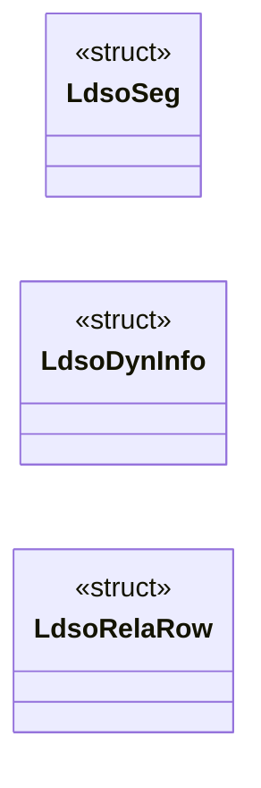

# `headers/ldso.h`

> Source: [headers/ldso.h:1](../../headers/ldso.h#L1) | language `h` | coverage 24.4% | [API index](../index.md)

Docstring: headers/ldso.h -- minimal dynamic-linking (T8 ld.so) contract.

## Contents

- **Structs:** [`LdsoSeg`](#ldsoseg), [`LdsoDynInfo`](#ldsodyninfo), [`LdsoRelaRow`](#ldsorelarow)
- **Functions:** [`ldso_find_dynamic`](#ldso_find_dynamic), [`ldso_vaddr_to_offset`](#ldso_vaddr_to_offset), [`ldso_segments`](#ldso_segments), [`ldso_scan_dynamic`](#ldso_scan_dynamic), [`ldso_sym_count`](#ldso_sym_count), [`ldso_copy_str`](#ldso_copy_str), [`ldso_sym_lookup`](#ldso_sym_lookup), [`ldso_rela_count`](#ldso_rela_count), [`ldso_read_rela`](#ldso_read_rela), [`ldso_basename`](#ldso_basename)
- **Macros:** [`LDSO_MAX_LIBS`](#ldso_max_libs), [`LDSO_MAX_NEEDED`](#ldso_max_needed), [`LDSO_NAME_LEN`](#ldso_name_len), [`LDSO_MAX_DYN`](#ldso_max_dyn), [`LDSO_FILE_MAX`](#ldso_file_max), [`LDSO_INO_BASE`](#ldso_ino_base), [`LDSO_ET_EXEC`](#ldso_et_exec), [`LDSO_ET_DYN`](#ldso_et_dyn), [`LDSO_EM_X86_64`](#ldso_em_x86_64), [`LDSO_PT_LOAD`](#ldso_pt_load), [`LDSO_PT_DYNAMIC`](#ldso_pt_dynamic), [`LDSO_PF_X`](#ldso_pf_x), [`LDSO_DT_NULL`](#ldso_dt_null), [`LDSO_DT_NEEDED`](#ldso_dt_needed), [`LDSO_DT_HASH`](#ldso_dt_hash), [`LDSO_DT_STRTAB`](#ldso_dt_strtab), [`LDSO_DT_SYMTAB`](#ldso_dt_symtab), [`LDSO_DT_RELA`](#ldso_dt_rela), [`LDSO_DT_RELASZ`](#ldso_dt_relasz), [`LDSO_DT_RELAENT`](#ldso_dt_relaent), [`LDSO_DT_STRSZ`](#ldso_dt_strsz), [`LDSO_DT_SYMENT`](#ldso_dt_syment), [`LDSO_DT_SONAME`](#ldso_dt_soname), [`LDSO_R_GLOB_DAT`](#ldso_r_glob_dat), [`LDSO_R_JUMP_SLOT`](#ldso_r_jump_slot), [`LDSO_STB_GLOBAL`](#ldso_stb_global), [`LDSO_STT_NOTYPE`](#ldso_stt_notype), [`LDSO_STT_FUNC`](#ldso_stt_func), [`LDSO_SHN_UNDEF`](#ldso_shn_undef), [`LDSO_SYM_SIZE`](#ldso_sym_size), [`LDSO_RELA_SIZE`](#ldso_rela_size)

## Type Diagram



## Structs

<a id="ldsoseg"></a>

### `LdsoSeg`

`struct` | [headers/ldso.h:53](../../headers/ldso.h#L53)

```c
typedef struct
```

---

<a id="ldsodyninfo"></a>

### `LdsoDynInfo`

`struct` | [headers/ldso.h:61](../../headers/ldso.h#L61)

```c
typedef struct
```

---

<a id="ldsorelarow"></a>

### `LdsoRelaRow`

`struct` | [headers/ldso.h:77](../../headers/ldso.h#L77)

```c
typedef struct
```

---

## Functions

<a id="ldso_find_dynamic"></a>

### `ldso_find_dynamic`

`function` | [headers/ldso.h:86](../../headers/ldso.h#L86)

```c
int ldso_find_dynamic(const unsigned char *file, unsigned long long fsize, unsigned long long *dyn_off, unsigned long long *dyn_size);
```

Docstring: Locate the PT_DYNAMIC file range.

Returns 1 with offsets on success, 0 when the image carries no dynamic section (static binary, not an error), -1 when any header, count or bound is corrupt.

**Parameters**

| Name | Type | Default | Description |
|---|---|---|---|
| `file` | `unsigned char *` |  |  |
| `fsize` | `unsigned long long` |  |  |
| `dyn_off` | `unsigned long long *` |  |  |
| `dyn_size` | `unsigned long long *` |  |  |

**Returns:** `int`

*Called by:* [`ldso_bind_into`](kernel.loader.c.md#ldso_bind_into)

---

<a id="ldso_vaddr_to_offset"></a>

### `ldso_vaddr_to_offset`

`function` | [headers/ldso.h:92](../../headers/ldso.h#L92)

```c
int ldso_vaddr_to_offset(const unsigned char *file, unsigned long long fsize, unsigned long long va, unsigned long long *off);
```

Docstring: Translate a link VA through PT_LOAD into a file offset.

Returns 0 with the offset on success, -1 when no segment contains it or any arithmetic overflows.

**Parameters**

| Name | Type | Default | Description |
|---|---|---|---|
| `file` | `unsigned char *` |  |  |
| `fsize` | `unsigned long long` |  |  |
| `va` | `unsigned long long` |  |  |
| `off` | `unsigned long long *` |  |  |

**Returns:** `int`

*Called by:* [`ldso_bind_into`](kernel.loader.c.md#ldso_bind_into)

---

<a id="ldso_segments"></a>

### `ldso_segments`

`function` | [headers/ldso.h:97](../../headers/ldso.h#L97)

```c
int ldso_segments(const unsigned char *file, unsigned long long fsize, LdsoSeg *segs, unsigned ncap, unsigned *nseg);
```

Docstring: Collect PT_LOAD spans (at most ncap) for reservation and GOT-range checks.

Returns 0 with the count, -1 on corrupt headers.

**Parameters**

| Name | Type | Default | Description |
|---|---|---|---|
| `file` | `unsigned char *` |  |  |
| `fsize` | `unsigned long long` |  |  |
| `segs` | `LdsoSeg *` |  |  |
| `ncap` | `unsigned` |  |  |
| `nseg` | `unsigned *` |  |  |

**Returns:** `int`

*Called by:* [`consistent`](kernel.loader.c.md#consistent), [`ldso_bind_into`](kernel.loader.c.md#ldso_bind_into)

---

<a id="ldso_scan_dynamic"></a>

### `ldso_scan_dynamic`

`function` | [headers/ldso.h:103](../../headers/ldso.h#L103)

```c
int ldso_scan_dynamic(const unsigned char *file, unsigned long long fsize, unsigned long long dyn_off, unsigned long long dyn_size, LdsoDynInfo *info);
```

Docstring: Walk the dynamic array into info.

Caps entries at LDSO_MAX_DYN, keeps the first SONAME, records up to LDSO_MAX_NEEDED NEEDED offsets. Returns 0 on success, -1 on truncation or overflow.

**Parameters**

| Name | Type | Default | Description |
|---|---|---|---|
| `file` | `unsigned char *` |  |  |
| `fsize` | `unsigned long long` |  |  |
| `dyn_off` | `unsigned long long` |  |  |
| `dyn_size` | `unsigned long long` |  |  |
| `info` | `LdsoDynInfo *` |  |  |

**Returns:** `int`

*Called by:* [`ldso_bind_into`](kernel.loader.c.md#ldso_bind_into)

---

<a id="ldso_sym_count"></a>

### `ldso_sym_count`

`function` | [headers/ldso.h:110](../../headers/ldso.h#L110)

```c
int ldso_sym_count(const unsigned char *file, unsigned long long fsize, unsigned long long hash_off, unsigned *nsyms);
```

Docstring: Read the SYSV hash header at a file offset into bucket and chain counts.

The chain count is the dynamic symbol count. Returns 0 on success, -1 when the table is truncated or claims no symbols.

**Parameters**

| Name | Type | Default | Description |
|---|---|---|---|
| `file` | `unsigned char *` |  |  |
| `fsize` | `unsigned long long` |  |  |
| `hash_off` | `unsigned long long` |  |  |
| `nsyms` | `unsigned *` |  |  |

**Returns:** `int`

*Called by:* [`ldso_bind_into`](kernel.loader.c.md#ldso_bind_into)

---

<a id="ldso_copy_str"></a>

### `ldso_copy_str`

`function` | [headers/ldso.h:116](../../headers/ldso.h#L116)

```c
int ldso_copy_str(const unsigned char *file, unsigned long long fsize, unsigned long long strtab_off, unsigned long long strsz, unsigned long long name_off, char *out, unsigned out_cap);
```

Docstring: Bounded copy of one dynamic string (NEEDED/SONAME/symbol).

The NUL must land inside strsz. Returns 0 with a terminated buffer, -1 on any out-of-range offset or missing terminator.

**Parameters**

| Name | Type | Default | Description |
|---|---|---|---|
| `file` | `unsigned char *` |  |  |
| `fsize` | `unsigned long long` |  |  |
| `strtab_off` | `unsigned long long` |  |  |
| `strsz` | `unsigned long long` |  |  |
| `name_off` | `unsigned long long` |  |  |
| `out` | `char *` |  |  |
| `out_cap` | `unsigned` |  |  |

**Returns:** `int`

*Called by:* [`ldso_bind_into`](kernel.loader.c.md#ldso_bind_into)

---

<a id="ldso_sym_lookup"></a>

### `ldso_sym_lookup`

`function` | [headers/ldso.h:124](../../headers/ldso.h#L124)

```c
int ldso_sym_lookup(const unsigned char *file, unsigned long long fsize, unsigned long long symtab_off, unsigned nsyms, unsigned long long strtab_off, unsigned long long strsz, const char *name, unsigned long long *value)
```

Docstring: Linear search of a dynamic symbol table by name.

Accepts GLOBAL FUNC/NOTYPE definitions only (v1 links functions, nothing else). Returns 1 with st_value on hit, 0 on clean miss, -1 on any corrupt table bound.

**Parameters**

| Name | Type | Default | Description |
|---|---|---|---|
| `file` | `unsigned char *` |  |  |
| `fsize` | `unsigned long long` |  |  |
| `symtab_off` | `unsigned long long` |  |  |
| `nsyms` | `unsigned` |  |  |
| `strtab_off` | `unsigned long long` |  |  |
| `strsz` | `unsigned long long` |  |  |
| `name` | `char *` |  |  |
| `value` | `unsigned long long *` |  |  |

**Returns:** `int`

---

<a id="ldso_rela_count"></a>

### `ldso_rela_count`

`function` | [headers/ldso.h:132](../../headers/ldso.h#L132)

```c
int ldso_rela_count(const LdsoDynInfo *info, unsigned *nrela);
```

Docstring: Validate the RELA header triple and report the row count.

Only 24-byte entries are supported (v1 emits exactly those). Returns 0 with the count, -1 on any mismatch or overflow.

**Parameters**

| Name | Type | Default | Description |
|---|---|---|---|
| `info` | `LdsoDynInfo *` |  |  |
| `nrela` | `unsigned *` |  |  |

**Returns:** `int`

*Called by:* [`ldso_bind_into`](kernel.loader.c.md#ldso_bind_into)

---

<a id="ldso_read_rela"></a>

### `ldso_read_rela`

`function` | [headers/ldso.h:137](../../headers/ldso.h#L137)

```c
int ldso_read_rela(const unsigned char *file, unsigned long long fsize, unsigned long long rela_off, unsigned nrela, unsigned idx, unsigned nsyms, LdsoRelaRow *row);
```

Docstring: Read one RELA row with full validation: row inside the table, type GLOB_DAT/JUMP_SLOT (anything else is -2, unsupported), symbol index below nsyms.

Returns 0 on success.

**Parameters**

| Name | Type | Default | Description |
|---|---|---|---|
| `file` | `unsigned char *` |  |  |
| `fsize` | `unsigned long long` |  |  |
| `rela_off` | `unsigned long long` |  |  |
| `nrela` | `unsigned` |  |  |
| `idx` | `unsigned` |  |  |
| `nsyms` | `unsigned` |  |  |
| `row` | `LdsoRelaRow *` |  |  |

**Returns:** `int`

*Called by:* [`ldso_bind_into`](kernel.loader.c.md#ldso_bind_into)

---

<a id="ldso_basename"></a>

### `ldso_basename`

`function` | [headers/ldso.h:144](../../headers/ldso.h#L144)

```c
void ldso_basename(char *out, const char *src);
```

Docstring: Basename normalization for registry keys ("a/b.so" to "b.so", bounded, always terminated).

Two spellings of one library share one registry slot and one load.

**Parameters**

| Name | Type | Default | Description |
|---|---|---|---|
| `out` | `char *` |  |  |
| `src` | `char *` |  |  |

---

## Macros

<a id="ldso_max_libs"></a>

### `LDSO_MAX_LIBS`

`macro` | [headers/ldso.h:17](../../headers/ldso.h#L17)

```c
#define LDSO_MAX_LIBS
```

---

<a id="ldso_max_needed"></a>

### `LDSO_MAX_NEEDED`

`macro` | [headers/ldso.h:18](../../headers/ldso.h#L18)

```c
#define LDSO_MAX_NEEDED
```

---

<a id="ldso_name_len"></a>

### `LDSO_NAME_LEN`

`macro` | [headers/ldso.h:19](../../headers/ldso.h#L19)

```c
#define LDSO_NAME_LEN
```

---

<a id="ldso_max_dyn"></a>

### `LDSO_MAX_DYN`

`macro` | [headers/ldso.h:20](../../headers/ldso.h#L20)

```c
#define LDSO_MAX_DYN
```

---

<a id="ldso_file_max"></a>

### `LDSO_FILE_MAX`

`macro` | [headers/ldso.h:21](../../headers/ldso.h#L21)

```c
#define LDSO_FILE_MAX
```

---

<a id="ldso_ino_base"></a>

### `LDSO_INO_BASE`

`macro` | [headers/ldso.h:22](../../headers/ldso.h#L22)

```c
#define LDSO_INO_BASE
```

---

<a id="ldso_et_exec"></a>

### `LDSO_ET_EXEC`

`macro` | [headers/ldso.h:24](../../headers/ldso.h#L24)

```c
#define LDSO_ET_EXEC
```

---

<a id="ldso_et_dyn"></a>

### `LDSO_ET_DYN`

`macro` | [headers/ldso.h:25](../../headers/ldso.h#L25)

```c
#define LDSO_ET_DYN
```

---

<a id="ldso_em_x86_64"></a>

### `LDSO_EM_X86_64`

`macro` | [headers/ldso.h:26](../../headers/ldso.h#L26)

```c
#define LDSO_EM_X86_64
```

---

<a id="ldso_pt_load"></a>

### `LDSO_PT_LOAD`

`macro` | [headers/ldso.h:27](../../headers/ldso.h#L27)

```c
#define LDSO_PT_LOAD
```

---

<a id="ldso_pt_dynamic"></a>

### `LDSO_PT_DYNAMIC`

`macro` | [headers/ldso.h:28](../../headers/ldso.h#L28)

```c
#define LDSO_PT_DYNAMIC
```

---

<a id="ldso_pf_x"></a>

### `LDSO_PF_X`

`macro` | [headers/ldso.h:29](../../headers/ldso.h#L29)

```c
#define LDSO_PF_X
```

---

<a id="ldso_dt_null"></a>

### `LDSO_DT_NULL`

`macro` | [headers/ldso.h:31](../../headers/ldso.h#L31)

```c
#define LDSO_DT_NULL
```

---

<a id="ldso_dt_needed"></a>

### `LDSO_DT_NEEDED`

`macro` | [headers/ldso.h:32](../../headers/ldso.h#L32)

```c
#define LDSO_DT_NEEDED
```

---

<a id="ldso_dt_hash"></a>

### `LDSO_DT_HASH`

`macro` | [headers/ldso.h:33](../../headers/ldso.h#L33)

```c
#define LDSO_DT_HASH
```

---

<a id="ldso_dt_strtab"></a>

### `LDSO_DT_STRTAB`

`macro` | [headers/ldso.h:34](../../headers/ldso.h#L34)

```c
#define LDSO_DT_STRTAB
```

---

<a id="ldso_dt_symtab"></a>

### `LDSO_DT_SYMTAB`

`macro` | [headers/ldso.h:35](../../headers/ldso.h#L35)

```c
#define LDSO_DT_SYMTAB
```

---

<a id="ldso_dt_rela"></a>

### `LDSO_DT_RELA`

`macro` | [headers/ldso.h:36](../../headers/ldso.h#L36)

```c
#define LDSO_DT_RELA
```

---

<a id="ldso_dt_relasz"></a>

### `LDSO_DT_RELASZ`

`macro` | [headers/ldso.h:37](../../headers/ldso.h#L37)

```c
#define LDSO_DT_RELASZ
```

---

<a id="ldso_dt_relaent"></a>

### `LDSO_DT_RELAENT`

`macro` | [headers/ldso.h:38](../../headers/ldso.h#L38)

```c
#define LDSO_DT_RELAENT
```

---

<a id="ldso_dt_strsz"></a>

### `LDSO_DT_STRSZ`

`macro` | [headers/ldso.h:39](../../headers/ldso.h#L39)

```c
#define LDSO_DT_STRSZ
```

---

<a id="ldso_dt_syment"></a>

### `LDSO_DT_SYMENT`

`macro` | [headers/ldso.h:40](../../headers/ldso.h#L40)

```c
#define LDSO_DT_SYMENT
```

---

<a id="ldso_dt_soname"></a>

### `LDSO_DT_SONAME`

`macro` | [headers/ldso.h:41](../../headers/ldso.h#L41)

```c
#define LDSO_DT_SONAME
```

---

<a id="ldso_r_glob_dat"></a>

### `LDSO_R_GLOB_DAT`

`macro` | [headers/ldso.h:43](../../headers/ldso.h#L43)

```c
#define LDSO_R_GLOB_DAT
```

---

<a id="ldso_r_jump_slot"></a>

### `LDSO_R_JUMP_SLOT`

`macro` | [headers/ldso.h:44](../../headers/ldso.h#L44)

```c
#define LDSO_R_JUMP_SLOT
```

---

<a id="ldso_stb_global"></a>

### `LDSO_STB_GLOBAL`

`macro` | [headers/ldso.h:46](../../headers/ldso.h#L46)

```c
#define LDSO_STB_GLOBAL
```

---

<a id="ldso_stt_notype"></a>

### `LDSO_STT_NOTYPE`

`macro` | [headers/ldso.h:47](../../headers/ldso.h#L47)

```c
#define LDSO_STT_NOTYPE
```

---

<a id="ldso_stt_func"></a>

### `LDSO_STT_FUNC`

`macro` | [headers/ldso.h:48](../../headers/ldso.h#L48)

```c
#define LDSO_STT_FUNC
```

---

<a id="ldso_shn_undef"></a>

### `LDSO_SHN_UNDEF`

`macro` | [headers/ldso.h:49](../../headers/ldso.h#L49)

```c
#define LDSO_SHN_UNDEF
```

---

<a id="ldso_sym_size"></a>

### `LDSO_SYM_SIZE`

`macro` | [headers/ldso.h:50](../../headers/ldso.h#L50)

```c
#define LDSO_SYM_SIZE
```

---

<a id="ldso_rela_size"></a>

### `LDSO_RELA_SIZE`

`macro` | [headers/ldso.h:51](../../headers/ldso.h#L51)

```c
#define LDSO_RELA_SIZE
```

---
