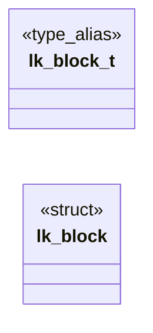
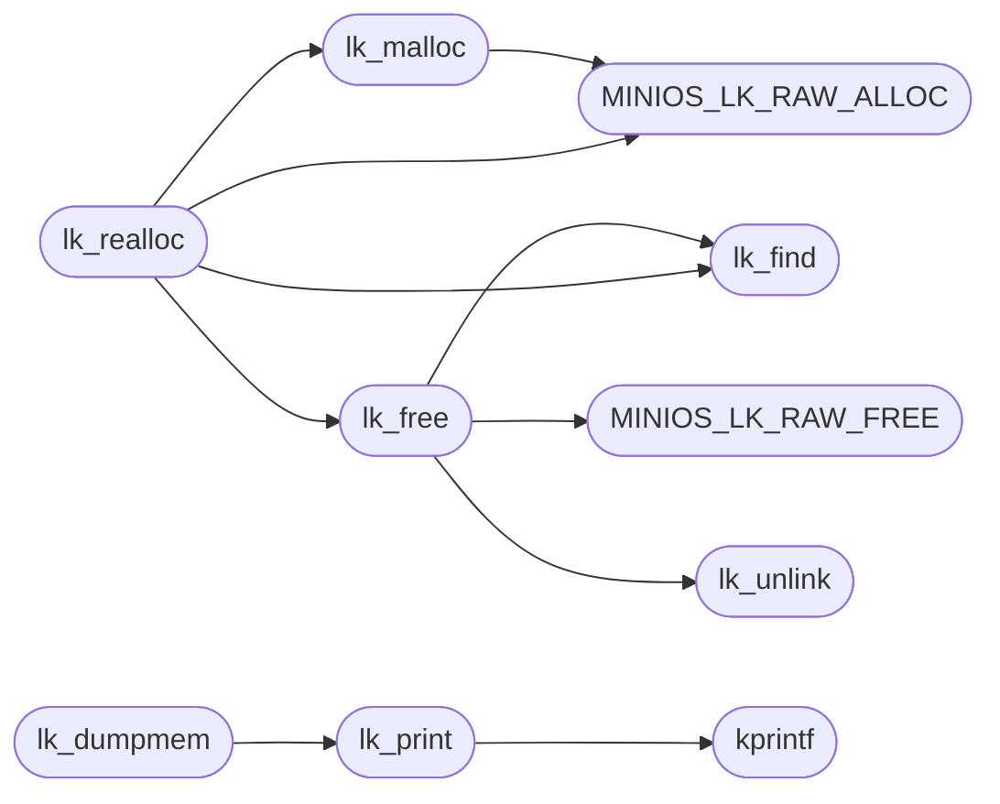

# `headers/leakcheck.h`

> Source: [headers/leakcheck.h:1](../../headers/leakcheck.h#L1) | language `h` | coverage 54.2% | [API index](../index.md)

Docstring: allocation tracker for MiniOS, STB leakcheck lineage.

## Contents

- **Structs:** [`lk_block`](#lk_block)
- **Type Aliases:** [`lk_block_t`](#lk_block_t)
- **Functions:** [`kmalloc`](#kmalloc), [`kfree`](#kfree), [`kprintf`](#kprintf), [`lk_malloc`](#lk_malloc), [`lk_unlink`](#lk_unlink), [`lk_find`](#lk_find), [`lk_free`](#lk_free), [`lk_realloc`](#lk_realloc), [`lk_print`](#lk_print), [`lk_dumpmem`](#lk_dumpmem), [`lk_live_count`](#lk_live_count), [`lk_live_bytes`](#lk_live_bytes)
- **Macros:** [`MINIOS_LK_PIPE`](#minios_lk_pipe), [`MINIOS_LK_PIPE`](#minios_lk_pipe), [`MINIOS_LK_RAW_ALLOC`](#minios_lk_raw_alloc), [`MINIOS_LK_RAW_FREE`](#minios_lk_raw_free), [`MINIOS_LK_RAW_ALLOC`](#minios_lk_raw_alloc), [`MINIOS_LK_RAW_FREE`](#minios_lk_raw_free), [`malloc`](#malloc), [`free`](#free), [`realloc`](#realloc)

## Type Diagram



## Call Graph

Solid arrows stay in this module, dashed arrows leave it.



## Structs

<a id="lk_block"></a>

### `lk_block`

`struct` | [headers/leakcheck.h:50](../../headers/leakcheck.h#L50)

```c
struct lk_block
```

---

## Type Aliases

<a id="lk_block_t"></a>

### `lk_block_t`

`type_alias` | [headers/leakcheck.h:49](../../headers/leakcheck.h#L49)

```c
typedef struct lk_block lk_block_t;
```

Docstring: one live allocation record, intrusive list node.

---

## Functions

<a id="kmalloc"></a>

### `kmalloc`

`function` `extern` | [headers/leakcheck.h:79](../../headers/leakcheck.h#L79)

```c
extern void *kmalloc(unsigned long size);
```

ifdef MINIOS_LK_KERNEL

**Parameters**

| Name | Type | Default | Description |
|---|---|---|---|
| `size` | `unsigned long` |  |  |

**Returns:** `void *`

---

<a id="kfree"></a>

### `kfree`

`function` `extern` | [headers/leakcheck.h:80](../../headers/leakcheck.h#L80)

```c
extern void kfree(void *ptr);
```

**Parameters**

| Name | Type | Default | Description |
|---|---|---|---|
| `ptr` | `void *` |  |  |

---

<a id="kprintf"></a>

### `kprintf`

`function` `extern` | [headers/leakcheck.h:81](../../headers/leakcheck.h#L81)

```c
extern int kprintf(const char *fmt, ...);
```

========== printf ==========

**Parameters**

| Name | Type | Default | Description |
|---|---|---|---|
| `fmt` | `char *` |  |  |
| `...` |  |  |  |

**Returns:** `int`

> **Inherited:** Documentation from [`kprintf`](#kprintf) (headers/kernel.h:544).

*Called by:* [`lk_print`](#lk_print)

---

<a id="lk_malloc"></a>

### `lk_malloc`

`function` | [headers/leakcheck.h:96](../../headers/leakcheck.h#L96)

```c
void *lk_malloc(size_t size, const char *file, int line)
```

Docstring: tracked malloc, records caller file and line.

**Parameters**

| Name | Type | Default | Description |
|---|---|---|---|
| `size` | `size_t` |  |  |
| `file` | `char *` |  |  |
| `line` | `int` |  |  |

**Returns:** `void *`

*Calls:* [`MINIOS_LK_RAW_ALLOC`](#minios_lk_raw_alloc)

*Called by:* [`lk_realloc`](#lk_realloc)

---

<a id="lk_unlink"></a>

### `lk_unlink`

`function` `static` | [headers/leakcheck.h:110](../../headers/leakcheck.h#L110)

```c
static void lk_unlink(lk_block_t *b)
```

Docstring: unlink one record from the live-block list.

**Parameters**

| Name | Type | Default | Description |
|---|---|---|---|
| `b` | `lk_block_t *` |  |  |

*Called by:* [`lk_free`](#lk_free)

---

<a id="lk_find"></a>

### `lk_find`

`function` `static` | [headers/leakcheck.h:120](../../headers/leakcheck.h#L120)

```c
static lk_block_t *lk_find(void *ptr)
```

Docstring: find the record owning ptr by scanning for its payload base.

**Parameters**

| Name | Type | Default | Description |
|---|---|---|---|
| `ptr` | `void *` |  |  |

**Returns:** `lk_block_t *`

*Called by:* [`lk_free`](#lk_free), [`lk_realloc`](#lk_realloc)

---

<a id="lk_free"></a>

### `lk_free`

`function` | [headers/leakcheck.h:130](../../headers/leakcheck.h#L130)

```c
void lk_free(void *ptr)
```

Docstring: tracked free, passes unknown blocks to the raw backend.

**Parameters**

| Name | Type | Default | Description |
|---|---|---|---|
| `ptr` | `void *` |  |  |

*Calls:* [`MINIOS_LK_RAW_FREE`](#minios_lk_raw_free), [`lk_find`](#lk_find), [`lk_unlink`](#lk_unlink)

*Called by:* [`lk_realloc`](#lk_realloc)

---

<a id="lk_realloc"></a>

### `lk_realloc`

`function` | [headers/leakcheck.h:143](../../headers/leakcheck.h#L143)

```c
void *lk_realloc(void *ptr, size_t size, const char *file, int line)
```

Docstring: tracked realloc, preserves bytes across a tracked move.

**Parameters**

| Name | Type | Default | Description |
|---|---|---|---|
| `ptr` | `void *` |  |  |
| `size` | `size_t` |  |  |
| `file` | `char *` |  |  |
| `line` | `int` |  |  |

**Returns:** `void *`

*Calls:* [`MINIOS_LK_RAW_ALLOC`](#minios_lk_raw_alloc), [`lk_find`](#lk_find), [`lk_free`](#lk_free), [`lk_malloc`](#lk_malloc)

---

<a id="lk_print"></a>

### `lk_print`

`function` `static` | [headers/leakcheck.h:186](../../headers/leakcheck.h#L186)

```c
static void lk_print(const char *reason, const lk_block_t *b)
```

Docstring: print one live record on the configured pipe.

**Parameters**

| Name | Type | Default | Description |
|---|---|---|---|
| `reason` | `char *` |  |  |
| `b` | `lk_block_t *` |  |  |

*Calls:* [`kprintf`](#kprintf)

*Called by:* [`lk_dumpmem`](#lk_dumpmem)

---

<a id="lk_dumpmem"></a>

### `lk_dumpmem`

`function` | [headers/leakcheck.h:197](../../headers/leakcheck.h#L197)

```c
void lk_dumpmem(void)
```

Docstring: report every block still live, newest first.

*Calls:* [`lk_print`](#lk_print)

---

<a id="lk_live_count"></a>

### `lk_live_count`

`function` | [headers/leakcheck.h:206](../../headers/leakcheck.h#L206)

```c
unsigned long lk_live_count(void)
```

Docstring: count of blocks still live.

**Returns:** `unsigned long`

---

<a id="lk_live_bytes"></a>

### `lk_live_bytes`

`function` | [headers/leakcheck.h:217](../../headers/leakcheck.h#L217)

```c
unsigned long lk_live_bytes(void)
```

Docstring: payload bytes still live.

**Returns:** `unsigned long`

---

## Macros

<a id="minios_lk_pipe"></a>

### `MINIOS_LK_PIPE`

`macro` | [headers/leakcheck.h:42](../../headers/leakcheck.h#L42)

```c
#define MINIOS_LK_PIPE
```

---

<a id="minios_lk_pipe"></a>

### `MINIOS_LK_PIPE`

`macro` | [headers/leakcheck.h:44](../../headers/leakcheck.h#L44)

```c
#define MINIOS_LK_PIPE
```

---

<a id="minios_lk_raw_alloc"></a>

### `MINIOS_LK_RAW_ALLOC`

`macro` | [headers/leakcheck.h:82](../../headers/leakcheck.h#L82)

```c
#define MINIOS_LK_RAW_ALLOC(sz)
```

*Called by:* [`lk_malloc`](#lk_malloc), [`lk_realloc`](#lk_realloc)

---

<a id="minios_lk_raw_free"></a>

### `MINIOS_LK_RAW_FREE`

`macro` | [headers/leakcheck.h:83](../../headers/leakcheck.h#L83)

```c
#define MINIOS_LK_RAW_FREE(p)
```

*Called by:* [`lk_free`](#lk_free)

---

<a id="minios_lk_raw_alloc"></a>

### `MINIOS_LK_RAW_ALLOC`

`macro` | [headers/leakcheck.h:88](../../headers/leakcheck.h#L88)

```c
#define MINIOS_LK_RAW_ALLOC(sz)
```

---

<a id="minios_lk_raw_free"></a>

### `MINIOS_LK_RAW_FREE`

`macro` | [headers/leakcheck.h:89](../../headers/leakcheck.h#L89)

```c
#define MINIOS_LK_RAW_FREE(p)
```

---

<a id="malloc"></a>

### `malloc`

`macro` | [headers/leakcheck.h:235](../../headers/leakcheck.h#L235)

```c
#define malloc(sz)
```

---

<a id="free"></a>

### `free`

`macro` | [headers/leakcheck.h:236](../../headers/leakcheck.h#L236)

```c
#define free(p)
```

---

<a id="realloc"></a>

### `realloc`

`macro` | [headers/leakcheck.h:237](../../headers/leakcheck.h#L237)

```c
#define realloc(p, sz)
```

*Called by:* [`fassoc_reserve`](progs.file.file_assoc.h.md#fassoc_reserve), [`wpix_ensure`](progs.wl.wl_pixbuf.h.md#wpix_ensure), [`wpix_tmp`](progs.wl.wl_pixbuf.h.md#wpix_tmp)

---
