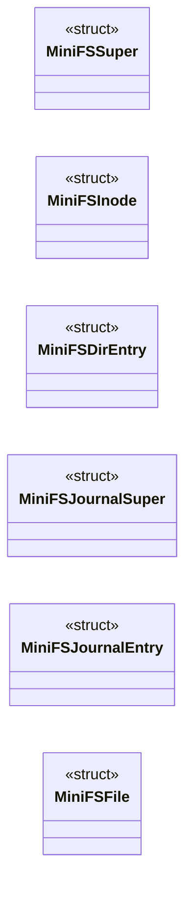

# `headers/minifs.h`

> Source: [headers/minifs.h:1](../../headers/minifs.h#L1) | language `h` | coverage 3.9% | [API index](../index.md)

MiniFS: a minimal Unix-like filesystem for MiniOS.

## Contents

- **Structs:** [`MiniFSSuper`](#minifssuper), [`MiniFSInode`](#minifsinode), [`MiniFSDirEntry`](#minifsdirentry), [`MiniFSJournalSuper`](#minifsjournalsuper), [`MiniFSJournalEntry`](#minifsjournalentry), [`MiniFSFile`](#minifsfile)
- **Functions:** [`minifs_compress`](#minifs_compress), [`minifs_decompress`](#minifs_decompress), [`minifs_init`](#minifs_init), [`minifs_mount`](#minifs_mount), [`minifs_sync`](#minifs_sync), [`minifs_is_mounted`](#minifs_is_mounted), [`minifs_create`](#minifs_create), [`minifs_mkdir`](#minifs_mkdir), [`minifs_unlink`](#minifs_unlink), [`minifs_rmdir`](#minifs_rmdir), [`refuses`](#refuses), [`minifs_rename`](#minifs_rename), [`minifs_read`](#minifs_read), [`minifs_write`](#minifs_write), [`minifs_truncate`](#minifs_truncate), [`minifs_stat`](#minifs_stat), [`minifs_access`](#minifs_access), [`minifs_resolve_path`](#minifs_resolve_path), [`minifs_dir_lookup`](#minifs_dir_lookup), [`minifs_dir_add_entry`](#minifs_dir_add_entry), [`minifs_dir_remove_entry`](#minifs_dir_remove_entry), [`minifs_dir_read`](#minifs_dir_read), [`minifs_alloc_block`](#minifs_alloc_block), [`minifs_free_block`](#minifs_free_block), [`minifs_alloc_inode`](#minifs_alloc_inode), [`minifs_free_inode`](#minifs_free_inode), [`minifs_inode_get_block`](#minifs_inode_get_block), [`minifs_inode_alloc_block`](#minifs_inode_alloc_block), [`minifs_journal_begin`](#minifs_journal_begin), [`minifs_journal_add_block`](#minifs_journal_add_block), [`minifs_journal_touch`](#minifs_journal_touch), [`minifs_journal_commit`](#minifs_journal_commit), [`minifs_journal_clear`](#minifs_journal_clear), [`minifs_journal_abort`](#minifs_journal_abort), [`minifs_journal_recover`](#minifs_journal_recover), [`minifs_file_open`](#minifs_file_open), [`minifs_file_close`](#minifs_file_close), [`minifs_get_lba_start`](#minifs_get_lba_start), [`minifs_get_total_blocks`](#minifs_get_total_blocks), [`minifs_usage`](#minifs_usage)
- **Macros:** [`MINIFS_MAGIC`](#minifs_magic), [`MINIFS_VERSION`](#minifs_version), [`MINIFS_BLOCK_SIZE`](#minifs_block_size), [`MINIFS_MAX_FILENAME`](#minifs_max_filename), [`MINIFS_ROOT_INODE`](#minifs_root_inode), [`MINIFS_INODES_PER_BLOCK`](#minifs_inodes_per_block), [`MINIFS_DIR_ENTRIES_PER_BLOCK`](#minifs_dir_entries_per_block), [`MINIFS_S_IFMT`](#minifs_s_ifmt), [`MINIFS_S_IFREG`](#minifs_s_ifreg), [`MINIFS_S_IFDIR`](#minifs_s_ifdir), [`MINIFS_S_IFLNK`](#minifs_s_iflnk), [`MINIFS_S_IRWXU`](#minifs_s_irwxu), [`MINIFS_S_IRWXG`](#minifs_s_irwxg), [`MINIFS_S_IRWXO`](#minifs_s_irwxo), [`MINIFS_FT_FILE`](#minifs_ft_file), [`MINIFS_FT_DIR`](#minifs_ft_dir), [`MINIFS_FT_SYMLINK`](#minifs_ft_symlink), [`MINIFS_INODE_COMPRESSED`](#minifs_inode_compressed), [`MINIFS_DIR_ENTRY_HDR_SIZE`](#minifs_dir_entry_hdr_size), [`MINIFS_JOURNAL_BLOCKS`](#minifs_journal_blocks), [`MINIFS_JOURNAL_MAX_ENTRIES`](#minifs_journal_max_entries), [`MINIFS_JOP_WRITE`](#minifs_jop_write), [`MINIFS_JOP_CREATE`](#minifs_jop_create), [`MINIFS_JOP_DELETE`](#minifs_jop_delete), [`MINIFS_JOP_MKDIR`](#minifs_jop_mkdir), [`MINIFS_JOP_RMDIR`](#minifs_jop_rmdir), [`MINIFS_JOP_TRUNCATE`](#minifs_jop_truncate), [`MINIFS_JOP_COMMIT`](#minifs_jop_commit), [`MINIFS_JSTATE_CLEAN`](#minifs_jstate_clean), [`MINIFS_JSTATE_DIRTY`](#minifs_jstate_dirty)

## Type Diagram



## Structs

<a id="minifssuper"></a>

### `MiniFSSuper`

`struct` | [headers/minifs.h:33](../../headers/minifs.h#L33)

```c
typedef struct
```

---

<a id="minifsinode"></a>

### `MiniFSInode`

`struct` | [headers/minifs.h:52](../../headers/minifs.h#L52)

```c
typedef struct
```

---

<a id="minifsdirentry"></a>

### `MiniFSDirEntry`

`struct` | [headers/minifs.h:68](../../headers/minifs.h#L68)

```c
typedef struct
```

---

<a id="minifsjournalsuper"></a>

### `MiniFSJournalSuper`

`struct` | [headers/minifs.h:90](../../headers/minifs.h#L90)

```c
typedef struct
```

---

<a id="minifsjournalentry"></a>

### `MiniFSJournalEntry`

`struct` | [headers/minifs.h:98](../../headers/minifs.h#L98)

```c
typedef struct
```

---

<a id="minifsfile"></a>

### `MiniFSFile`

`struct` | [headers/minifs.h:110](../../headers/minifs.h#L110)

```c
typedef struct
```

---

## Functions

<a id="minifs_compress"></a>

### `minifs_compress`

`function` | [headers/minifs.h:30](../../headers/minifs.h#L30)

```c
unsigned int minifs_compress(const void *src, unsigned int src_len, void *dst, unsigned int dst_cap);
```

**Parameters**

| Name | Type | Default | Description |
|---|---|---|---|
| `src` | `void *` |  |  |
| `src_len` | `unsigned int` |  |  |
| `dst` | `void *` |  |  |
| `dst_cap` | `unsigned int` |  |  |

**Returns:** `unsigned int`

---

<a id="minifs_decompress"></a>

### `minifs_decompress`

`function` | [headers/minifs.h:31](../../headers/minifs.h#L31)

```c
unsigned int minifs_decompress(const void *src, unsigned int src_len, void *dst, unsigned int dst_cap);
```

**Parameters**

| Name | Type | Default | Description |
|---|---|---|---|
| `src` | `void *` |  |  |
| `src_len` | `unsigned int` |  |  |
| `dst` | `void *` |  |  |
| `dst_cap` | `unsigned int` |  |  |

**Returns:** `unsigned int`

---

<a id="minifs_init"></a>

### `minifs_init`

`function` | [headers/minifs.h:117](../../headers/minifs.h#L117)

```c
void minifs_init(void);
```

*Called by:* [`__attribute__`](kernel.c.md#__attribute__)

---

<a id="minifs_mount"></a>

### `minifs_mount`

`function` | [headers/minifs.h:118](../../headers/minifs.h#L118)

```c
int minifs_mount(void);
```

**Returns:** `int`

*Called by:* [`__attribute__`](kernel.c.md#__attribute__)

---

<a id="minifs_sync"></a>

### `minifs_sync`

`function` | [headers/minifs.h:119](../../headers/minifs.h#L119)

```c
int minifs_sync(void);
```

**Returns:** `int`

*Called by:* [`kfclose`](fs.kfile.c.md#kfclose)

---

<a id="minifs_is_mounted"></a>

### `minifs_is_mounted`

`function` | [headers/minifs.h:120](../../headers/minifs.h#L120)

```c
int minifs_is_mounted(void);
```

**Returns:** `int`

*Called by:* [`fsimg_open_file`](fs.fsimg.c.md#fsimg_open_file), [`directory`](fs.kfile.c.md#directory), [`kfclose`](fs.kfile.c.md#kfclose), [`kfopen`](fs.kfile.c.md#kfopen), [`fs_dir_exists`](fs.vfs.c.md#fs_dir_exists), [`flows`](kernel.shell.c.md#flows), [`shell_exec_builtin`](kernel.shell.c.md#shell_exec_builtin), [`window`](kernel.shell.c.md#window), [`spawn_load_image`](kernel.spawn.c.md#spawn_load_image), [`view`](kernel.syscalls.c.md#view)

---

<a id="minifs_create"></a>

### `minifs_create`

`function` | [headers/minifs.h:122](../../headers/minifs.h#L122)

```c
int minifs_create(const char *path, unsigned short mode);
```

**Parameters**

| Name | Type | Default | Description |
|---|---|---|---|
| `path` | `char *` |  |  |
| `mode` | `unsigned short` |  |  |

**Returns:** `int`

*Called by:* [`kfopen`](fs.kfile.c.md#kfopen)

---

<a id="minifs_mkdir"></a>

### `minifs_mkdir`

`function` | [headers/minifs.h:123](../../headers/minifs.h#L123)

```c
int minifs_mkdir(const char *path, unsigned short mode);
```

**Parameters**

| Name | Type | Default | Description |
|---|---|---|---|
| `path` | `char *` |  |  |
| `mode` | `unsigned short` |  |  |

**Returns:** `int`

*Called by:* [`minifs_mkdir_p`](fs.vfs.c.md#minifs_mkdir_p)

---

<a id="minifs_unlink"></a>

### `minifs_unlink`

`function` | [headers/minifs.h:124](../../headers/minifs.h#L124)

```c
int minifs_unlink(const char *path);
```

**Parameters**

| Name | Type | Default | Description |
|---|---|---|---|
| `path` | `char *` |  |  |

**Returns:** `int`

*Called by:* [`flows`](kernel.shell.c.md#flows), [`shell_exec_builtin`](kernel.shell.c.md#shell_exec_builtin)

---

<a id="minifs_rmdir"></a>

### `minifs_rmdir`

`function` | [headers/minifs.h:125](../../headers/minifs.h#L125)

```c
int minifs_rmdir(const char *path);
```

**Parameters**

| Name | Type | Default | Description |
|---|---|---|---|
| `path` | `char *` |  |  |

**Returns:** `int`

---

<a id="refuses"></a>

### `refuses`

`function` | [headers/minifs.h:128](../../headers/minifs.h#L128)

```c
* An existing file dst refuses (no silent overwrite);
```

**Parameters**

| Name | Type | Default | Description |
|---|---|---|---|
| `overwrite` | `no silent` |  |  |

**Returns:** `* An existing file dst`

---

<a id="minifs_rename"></a>

### `minifs_rename`

`function` | [headers/minifs.h:130](../../headers/minifs.h#L130)

```c
int minifs_rename(const char *oldpath, const char *newpath);
```

Docstring: Move one MiniFS directory entry to a new parent/name, keeping its inode (no data moves).

Files only; directories refuse. An existing file dst refuses (no silent overwrite); a missing dst parent refuses. Returns 0 on success, -1 on any failure.

**Parameters**

| Name | Type | Default | Description |
|---|---|---|---|
| `oldpath` | `char *` |  |  |
| `newpath` | `char *` |  |  |

**Returns:** `int`

*Called by:* [`directory`](fs.kfile.c.md#directory)

---

<a id="minifs_read"></a>

### `minifs_read`

`function` | [headers/minifs.h:131](../../headers/minifs.h#L131)

```c
int minifs_read(int inode_num, void *buf, unsigned int offset, unsigned int len);
```

**Parameters**

| Name | Type | Default | Description |
|---|---|---|---|
| `inode_num` | `int` |  |  |
| `buf` | `void *` |  |  |
| `offset` | `unsigned int` |  |  |
| `len` | `unsigned int` |  |  |

**Returns:** `int`

*Called by:* [`fsimg_read`](fs.fsimg.c.md#fsimg_read), [`kfgetc`](fs.kfile.c.md#kfgetc), [`kfread`](fs.kfile.c.md#kfread), [`shell_exec_builtin`](kernel.shell.c.md#shell_exec_builtin), [`window`](kernel.shell.c.md#window), [`spawn_load_image`](kernel.spawn.c.md#spawn_load_image)

---

<a id="minifs_write"></a>

### `minifs_write`

`function` | [headers/minifs.h:132](../../headers/minifs.h#L132)

```c
int minifs_write(int inode_num, const void *buf, unsigned int offset, unsigned int len);
```

**Parameters**

| Name | Type | Default | Description |
|---|---|---|---|
| `inode_num` | `int` |  |  |
| `buf` | `void *` |  |  |
| `offset` | `unsigned int` |  |  |
| `len` | `unsigned int` |  |  |

**Returns:** `int`

*Called by:* [`kfflush`](fs.kfile.c.md#kfflush)

---

<a id="minifs_truncate"></a>

### `minifs_truncate`

`function` | [headers/minifs.h:133](../../headers/minifs.h#L133)

```c
int minifs_truncate(int inode_num, unsigned int new_size);
```

**Parameters**

| Name | Type | Default | Description |
|---|---|---|---|
| `inode_num` | `int` |  |  |
| `new_size` | `unsigned int` |  |  |

**Returns:** `int`

*Called by:* [`kfopen`](fs.kfile.c.md#kfopen)

---

<a id="minifs_stat"></a>

### `minifs_stat`

`function` | [headers/minifs.h:134](../../headers/minifs.h#L134)

```c
int minifs_stat(int inode_num, MiniFSInode *out);
```

**Parameters**

| Name | Type | Default | Description |
|---|---|---|---|
| `inode_num` | `int` |  |  |
| `out` | `MiniFSInode *` |  |  |

**Returns:** `int`

*Called by:* [`fsimg_open_file`](fs.fsimg.c.md#fsimg_open_file), [`kfopen`](fs.kfile.c.md#kfopen), [`fs_dir_exists`](fs.vfs.c.md#fs_dir_exists), [`shell_exec_builtin`](kernel.shell.c.md#shell_exec_builtin), [`window`](kernel.shell.c.md#window), [`spawn_load_image`](kernel.spawn.c.md#spawn_load_image)

---

<a id="minifs_access"></a>

### `minifs_access`

`function` | [headers/minifs.h:135](../../headers/minifs.h#L135)

```c
int minifs_access(const char *path);
```

**Parameters**

| Name | Type | Default | Description |
|---|---|---|---|
| `path` | `char *` |  |  |

**Returns:** `int`

---

<a id="minifs_resolve_path"></a>

### `minifs_resolve_path`

`function` | [headers/minifs.h:137](../../headers/minifs.h#L137)

```c
int minifs_resolve_path(const char *path);
```

**Parameters**

| Name | Type | Default | Description |
|---|---|---|---|
| `path` | `char *` |  |  |

**Returns:** `int`

*Called by:* [`fsimg_open_file`](fs.fsimg.c.md#fsimg_open_file), [`directory`](fs.kfile.c.md#directory), [`kfopen`](fs.kfile.c.md#kfopen), [`fs_dir_exists`](fs.vfs.c.md#fs_dir_exists), [`minifs_mkdir_p`](fs.vfs.c.md#minifs_mkdir_p), [`shell_exec_builtin`](kernel.shell.c.md#shell_exec_builtin), [`window`](kernel.shell.c.md#window), [`spawn_load_image`](kernel.spawn.c.md#spawn_load_image)

---

<a id="minifs_dir_lookup"></a>

### `minifs_dir_lookup`

`function` | [headers/minifs.h:138](../../headers/minifs.h#L138)

```c
int minifs_dir_lookup(int dir_inode, const char *name);
```

**Parameters**

| Name | Type | Default | Description |
|---|---|---|---|
| `dir_inode` | `int` |  |  |
| `name` | `char *` |  |  |

**Returns:** `int`

---

<a id="minifs_dir_add_entry"></a>

### `minifs_dir_add_entry`

`function` | [headers/minifs.h:139](../../headers/minifs.h#L139)

```c
int minifs_dir_add_entry(int dir_inode, const char *name, int child_inode, unsigned char type);
```

**Parameters**

| Name | Type | Default | Description |
|---|---|---|---|
| `dir_inode` | `int` |  |  |
| `name` | `char *` |  |  |
| `child_inode` | `int` |  |  |
| `type` | `unsigned char` |  |  |

**Returns:** `int`

---

<a id="minifs_dir_remove_entry"></a>

### `minifs_dir_remove_entry`

`function` | [headers/minifs.h:140](../../headers/minifs.h#L140)

```c
int minifs_dir_remove_entry(int dir_inode, const char *name);
```

**Parameters**

| Name | Type | Default | Description |
|---|---|---|---|
| `dir_inode` | `int` |  |  |
| `name` | `char *` |  |  |

**Returns:** `int`

---

<a id="minifs_dir_read"></a>

### `minifs_dir_read`

`function` | [headers/minifs.h:141](../../headers/minifs.h#L141)

```c
int minifs_dir_read(int dir_inode, int index, MiniFSDirEntry *out, char *name_out);
```

**Parameters**

| Name | Type | Default | Description |
|---|---|---|---|
| `dir_inode` | `int` |  |  |
| `index` | `int` |  |  |
| `out` | `MiniFSDirEntry *` |  |  |
| `name_out` | `char *` |  |  |

**Returns:** `int`

*Called by:* [`shell_exec_builtin`](kernel.shell.c.md#shell_exec_builtin)

---

<a id="minifs_alloc_block"></a>

### `minifs_alloc_block`

`function` | [headers/minifs.h:143](../../headers/minifs.h#L143)

```c
int minifs_alloc_block(void);
```

**Returns:** `int`

---

<a id="minifs_free_block"></a>

### `minifs_free_block`

`function` | [headers/minifs.h:144](../../headers/minifs.h#L144)

```c
void minifs_free_block(unsigned int block);
```

**Parameters**

| Name | Type | Default | Description |
|---|---|---|---|
| `block` | `unsigned int` |  |  |

---

<a id="minifs_alloc_inode"></a>

### `minifs_alloc_inode`

`function` | [headers/minifs.h:145](../../headers/minifs.h#L145)

```c
int minifs_alloc_inode(void);
```

**Returns:** `int`

---

<a id="minifs_free_inode"></a>

### `minifs_free_inode`

`function` | [headers/minifs.h:146](../../headers/minifs.h#L146)

```c
void minifs_free_inode(int inode_num);
```

**Parameters**

| Name | Type | Default | Description |
|---|---|---|---|
| `inode_num` | `int` |  |  |

---

<a id="minifs_inode_get_block"></a>

### `minifs_inode_get_block`

`function` | [headers/minifs.h:147](../../headers/minifs.h#L147)

```c
int minifs_inode_get_block(MiniFSInode *inode, unsigned int logical_block, unsigned int *phys_block);
```

**Parameters**

| Name | Type | Default | Description |
|---|---|---|---|
| `inode` | `MiniFSInode *` |  |  |
| `logical_block` | `unsigned int` |  |  |
| `phys_block` | `unsigned int *` |  |  |

**Returns:** `int`

---

<a id="minifs_inode_alloc_block"></a>

### `minifs_inode_alloc_block`

`function` | [headers/minifs.h:148](../../headers/minifs.h#L148)

```c
int minifs_inode_alloc_block(MiniFSInode *inode, unsigned int logical_block);
```

**Parameters**

| Name | Type | Default | Description |
|---|---|---|---|
| `inode` | `MiniFSInode *` |  |  |
| `logical_block` | `unsigned int` |  |  |

**Returns:** `int`

---

<a id="minifs_journal_begin"></a>

### `minifs_journal_begin`

`function` | [headers/minifs.h:150](../../headers/minifs.h#L150)

```c
void minifs_journal_begin(unsigned int txn_id);
```

**Parameters**

| Name | Type | Default | Description |
|---|---|---|---|
| `txn_id` | `unsigned int` |  |  |

---

<a id="minifs_journal_add_block"></a>

### `minifs_journal_add_block`

`function` | [headers/minifs.h:151](../../headers/minifs.h#L151)

```c
void minifs_journal_add_block(unsigned int block);
```

**Parameters**

| Name | Type | Default | Description |
|---|---|---|---|
| `block` | `unsigned int` |  |  |

---

<a id="minifs_journal_touch"></a>

### `minifs_journal_touch`

`function` | [headers/minifs.h:152](../../headers/minifs.h#L152)

```c
void minifs_journal_touch(unsigned int phys);
```

**Parameters**

| Name | Type | Default | Description |
|---|---|---|---|
| `phys` | `unsigned int` |  |  |

---

<a id="minifs_journal_commit"></a>

### `minifs_journal_commit`

`function` | [headers/minifs.h:153](../../headers/minifs.h#L153)

```c
int minifs_journal_commit(unsigned int txn_id);
```

**Parameters**

| Name | Type | Default | Description |
|---|---|---|---|
| `txn_id` | `unsigned int` |  |  |

**Returns:** `int`

---

<a id="minifs_journal_clear"></a>

### `minifs_journal_clear`

`function` | [headers/minifs.h:154](../../headers/minifs.h#L154)

```c
void minifs_journal_clear(void);
```

---

<a id="minifs_journal_abort"></a>

### `minifs_journal_abort`

`function` | [headers/minifs.h:155](../../headers/minifs.h#L155)

```c
void minifs_journal_abort(void);
```

---

<a id="minifs_journal_recover"></a>

### `minifs_journal_recover`

`function` | [headers/minifs.h:156](../../headers/minifs.h#L156)

```c
void minifs_journal_recover(void);
```

---

<a id="minifs_file_open"></a>

### `minifs_file_open`

`function` | [headers/minifs.h:158](../../headers/minifs.h#L158)

```c
MiniFSFile *minifs_file_open(int inode_num, int flags);
```

**Parameters**

| Name | Type | Default | Description |
|---|---|---|---|
| `inode_num` | `int` |  |  |
| `flags` | `int` |  |  |

**Returns:** `MiniFSFile *`

---

<a id="minifs_file_close"></a>

### `minifs_file_close`

`function` | [headers/minifs.h:159](../../headers/minifs.h#L159)

```c
int minifs_file_close(MiniFSFile *f);
```

**Parameters**

| Name | Type | Default | Description |
|---|---|---|---|
| `f` | `MiniFSFile *` |  |  |

**Returns:** `int`

---

<a id="minifs_get_lba_start"></a>

### `minifs_get_lba_start`

`function` | [headers/minifs.h:161](../../headers/minifs.h#L161)

```c
unsigned int minifs_get_lba_start(void);
```

**Returns:** `unsigned int`

---

<a id="minifs_get_total_blocks"></a>

### `minifs_get_total_blocks`

`function` | [headers/minifs.h:162](../../headers/minifs.h#L162)

```c
unsigned int minifs_get_total_blocks(void);
```

**Returns:** `unsigned int`

---

<a id="minifs_usage"></a>

### `minifs_usage`

`function` | [headers/minifs.h:164](../../headers/minifs.h#L164)

```c
void minifs_usage(unsigned int *free_b, unsigned int *total_b, unsigned int *free_i, unsigned int *total_i);
```

Docstring: Filesystem usage snapshot for the mem builtin.

**Parameters**

| Name | Type | Default | Description |
|---|---|---|---|
| `free_b` | `unsigned int *` |  |  |
| `total_b` | `unsigned int *` |  |  |
| `free_i` | `unsigned int *` |  |  |
| `total_i` | `unsigned int *` |  |  |

*Called by:* [`view`](kernel.syscalls.c.md#view)

---

## Macros

<a id="minifs_magic"></a>

### `MINIFS_MAGIC`

`macro` | [headers/minifs.h:8](../../headers/minifs.h#L8)

```c
#define MINIFS_MAGIC
```

---

<a id="minifs_version"></a>

### `MINIFS_VERSION`

`macro` | [headers/minifs.h:9](../../headers/minifs.h#L9)

```c
#define MINIFS_VERSION
```

---

<a id="minifs_block_size"></a>

### `MINIFS_BLOCK_SIZE`

`macro` | [headers/minifs.h:10](../../headers/minifs.h#L10)

```c
#define MINIFS_BLOCK_SIZE
```

---

<a id="minifs_max_filename"></a>

### `MINIFS_MAX_FILENAME`

`macro` | [headers/minifs.h:11](../../headers/minifs.h#L11)

```c
#define MINIFS_MAX_FILENAME
```

---

<a id="minifs_root_inode"></a>

### `MINIFS_ROOT_INODE`

`macro` | [headers/minifs.h:12](../../headers/minifs.h#L12)

```c
#define MINIFS_ROOT_INODE
```

---

<a id="minifs_inodes_per_block"></a>

### `MINIFS_INODES_PER_BLOCK`

`macro` | [headers/minifs.h:13](../../headers/minifs.h#L13)

```c
#define MINIFS_INODES_PER_BLOCK
```

---

<a id="minifs_dir_entries_per_block"></a>

### `MINIFS_DIR_ENTRIES_PER_BLOCK`

`macro` | [headers/minifs.h:14](../../headers/minifs.h#L14)

```c
#define MINIFS_DIR_ENTRIES_PER_BLOCK
```

---

<a id="minifs_s_ifmt"></a>

### `MINIFS_S_IFMT`

`macro` | [headers/minifs.h:16](../../headers/minifs.h#L16)

```c
#define MINIFS_S_IFMT
```

---

<a id="minifs_s_ifreg"></a>

### `MINIFS_S_IFREG`

`macro` | [headers/minifs.h:17](../../headers/minifs.h#L17)

```c
#define MINIFS_S_IFREG
```

---

<a id="minifs_s_ifdir"></a>

### `MINIFS_S_IFDIR`

`macro` | [headers/minifs.h:18](../../headers/minifs.h#L18)

```c
#define MINIFS_S_IFDIR
```

---

<a id="minifs_s_iflnk"></a>

### `MINIFS_S_IFLNK`

`macro` | [headers/minifs.h:19](../../headers/minifs.h#L19)

```c
#define MINIFS_S_IFLNK
```

---

<a id="minifs_s_irwxu"></a>

### `MINIFS_S_IRWXU`

`macro` | [headers/minifs.h:20](../../headers/minifs.h#L20)

```c
#define MINIFS_S_IRWXU
```

---

<a id="minifs_s_irwxg"></a>

### `MINIFS_S_IRWXG`

`macro` | [headers/minifs.h:21](../../headers/minifs.h#L21)

```c
#define MINIFS_S_IRWXG
```

---

<a id="minifs_s_irwxo"></a>

### `MINIFS_S_IRWXO`

`macro` | [headers/minifs.h:22](../../headers/minifs.h#L22)

```c
#define MINIFS_S_IRWXO
```

---

<a id="minifs_ft_file"></a>

### `MINIFS_FT_FILE`

`macro` | [headers/minifs.h:24](../../headers/minifs.h#L24)

```c
#define MINIFS_FT_FILE
```

---

<a id="minifs_ft_dir"></a>

### `MINIFS_FT_DIR`

`macro` | [headers/minifs.h:25](../../headers/minifs.h#L25)

```c
#define MINIFS_FT_DIR
```

---

<a id="minifs_ft_symlink"></a>

### `MINIFS_FT_SYMLINK`

`macro` | [headers/minifs.h:26](../../headers/minifs.h#L26)

```c
#define MINIFS_FT_SYMLINK
```

---

<a id="minifs_inode_compressed"></a>

### `MINIFS_INODE_COMPRESSED`

`macro` | [headers/minifs.h:28](../../headers/minifs.h#L28)

```c
#define MINIFS_INODE_COMPRESSED
```

---

<a id="minifs_dir_entry_hdr_size"></a>

### `MINIFS_DIR_ENTRY_HDR_SIZE`

`macro` | [headers/minifs.h:75](../../headers/minifs.h#L75)

```c
#define MINIFS_DIR_ENTRY_HDR_SIZE
```

---

<a id="minifs_journal_blocks"></a>

### `MINIFS_JOURNAL_BLOCKS`

`macro` | [headers/minifs.h:77](../../headers/minifs.h#L77)

```c
#define MINIFS_JOURNAL_BLOCKS
```

---

<a id="minifs_journal_max_entries"></a>

### `MINIFS_JOURNAL_MAX_ENTRIES`

`macro` | [headers/minifs.h:78](../../headers/minifs.h#L78)

```c
#define MINIFS_JOURNAL_MAX_ENTRIES
```

---

<a id="minifs_jop_write"></a>

### `MINIFS_JOP_WRITE`

`macro` | [headers/minifs.h:79](../../headers/minifs.h#L79)

```c
#define MINIFS_JOP_WRITE
```

---

<a id="minifs_jop_create"></a>

### `MINIFS_JOP_CREATE`

`macro` | [headers/minifs.h:80](../../headers/minifs.h#L80)

```c
#define MINIFS_JOP_CREATE
```

---

<a id="minifs_jop_delete"></a>

### `MINIFS_JOP_DELETE`

`macro` | [headers/minifs.h:81](../../headers/minifs.h#L81)

```c
#define MINIFS_JOP_DELETE
```

---

<a id="minifs_jop_mkdir"></a>

### `MINIFS_JOP_MKDIR`

`macro` | [headers/minifs.h:82](../../headers/minifs.h#L82)

```c
#define MINIFS_JOP_MKDIR
```

---

<a id="minifs_jop_rmdir"></a>

### `MINIFS_JOP_RMDIR`

`macro` | [headers/minifs.h:83](../../headers/minifs.h#L83)

```c
#define MINIFS_JOP_RMDIR
```

---

<a id="minifs_jop_truncate"></a>

### `MINIFS_JOP_TRUNCATE`

`macro` | [headers/minifs.h:84](../../headers/minifs.h#L84)

```c
#define MINIFS_JOP_TRUNCATE
```

---

<a id="minifs_jop_commit"></a>

### `MINIFS_JOP_COMMIT`

`macro` | [headers/minifs.h:85](../../headers/minifs.h#L85)

```c
#define MINIFS_JOP_COMMIT
```

---

<a id="minifs_jstate_clean"></a>

### `MINIFS_JSTATE_CLEAN`

`macro` | [headers/minifs.h:87](../../headers/minifs.h#L87)

```c
#define MINIFS_JSTATE_CLEAN
```

---

<a id="minifs_jstate_dirty"></a>

### `MINIFS_JSTATE_DIRTY`

`macro` | [headers/minifs.h:88](../../headers/minifs.h#L88)

```c
#define MINIFS_JSTATE_DIRTY
```

---
