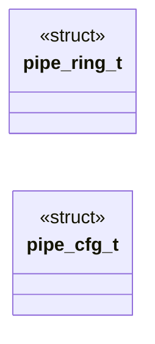

# `headers/pipe.h`

> Source: [headers/pipe.h:1](../../headers/pipe.h#L1) | language `h` | coverage 52.9% | [API index](../index.md)

Docstring: pipe.h -- Kernel pipe ring contract (header-only).

## Contents

- **Structs:** [`pipe_ring_t`](#pipe_ring_t), [`pipe_cfg_t`](#pipe_cfg_t)
- **Functions:** [`ends`](#ends), [`pipe_ring_init`](#pipe_ring_init), [`pipe_ring_avail`](#pipe_ring_avail), [`pipe_ring_space`](#pipe_ring_space), [`pipe_ring_write`](#pipe_ring_write), [`pipe_ring_close_writer`](#pipe_ring_close_writer), [`pipe_ring_close_reader`](#pipe_ring_close_reader), [`pipe_ring_ropen`](#pipe_ring_ropen), [`pipe_ring_stat`](#pipe_ring_stat)
- **Macros:** [`PIPE_CAP_DEFAULT`](#pipe_cap_default), [`PIPE_CAP_MAX`](#pipe_cap_max), [`PIPE_ERR_BOUND`](#pipe_err_bound), [`PIPE_EMPTY`](#pipe_empty), [`PIPE_CFG_DEFAULT`](#pipe_cfg_default)

## Type Diagram



## Structs

<a id="pipe_ring_t"></a>

### `pipe_ring_t`

`struct` | [headers/pipe.h:27](../../headers/pipe.h#L27)

```c
typedef struct
```

---

<a id="pipe_cfg_t"></a>

### `pipe_cfg_t`

`struct` | [headers/pipe.h:37](../../headers/pipe.h#L37)

```c
typedef struct
```

---

## Functions

<a id="ends"></a>

### `ends`

`function` | [headers/pipe.h:4](../../headers/pipe.h#L4)

```c
* * Single source of truth for the pipe byte ring shared by the kernel * pipe ends (fs/kfile.c), the pipe/dup/dup2 syscalls (kernel/syscalls.c) * and the shell pipeline runner (kernel/shell.c). Header
```

**Parameters**

| Name | Type | Default | Description |
|---|---|---|---|
| `c` | `fs/kfile.` |  |  |

**Returns:** `* * Single source of truth for the pipe byte ring shared by the kernel * pipe`

---

<a id="pipe_ring_init"></a>

### `pipe_ring_init`

`function` `inline` `static` | [headers/pipe.h:47](../../headers/pipe.h#L47)

```c
static inline int pipe_ring_init(pipe_ring_t *r, unsigned char *buf, unsigned cap)
```

Docstring: Bind a caller-owned buffer to a ring.

Fails closed on a null buffer or a zero/oversize capacity.

**Parameters**

| Name | Type | Default | Description |
|---|---|---|---|
| `r` | `pipe_ring_t *` |  |  |
| `buf` | `unsigned char *` |  |  |
| `cap` | `unsigned` |  |  |

**Returns:** `int`

*Called by:* [`kpipe_pair`](fs.kfile.c.md#kpipe_pair)

---

<a id="pipe_ring_avail"></a>

### `pipe_ring_avail`

`function` `inline` `static` | [headers/pipe.h:64](../../headers/pipe.h#L64)

```c
static inline unsigned pipe_ring_avail(const pipe_ring_t *r)
```

Docstring: Bytes available to read.

Zero on a null ring.

**Parameters**

| Name | Type | Default | Description |
|---|---|---|---|
| `r` | `pipe_ring_t *` |  |  |

**Returns:** `unsigned`

*Called by:* [`kpipe_state`](fs.kfile.c.md#kpipe_state)

---

<a id="pipe_ring_space"></a>

### `pipe_ring_space`

`function` `inline` `static` | [headers/pipe.h:71](../../headers/pipe.h#L71)

```c
static inline unsigned pipe_ring_space(const pipe_ring_t *r)
```

Docstring: Free space available to write.

Zero on a null ring.

**Parameters**

| Name | Type | Default | Description |
|---|---|---|---|
| `r` | `pipe_ring_t *` |  |  |

**Returns:** `unsigned`

*Called by:* [`kpipe_state`](fs.kfile.c.md#kpipe_state)

---

<a id="pipe_ring_write"></a>

### `pipe_ring_write`

`function` `inline` `static` | [headers/pipe.h:79](../../headers/pipe.h#L79)

```c
static inline unsigned pipe_ring_write(pipe_ring_t *r, const unsigned char *src, unsigned len)
```

Docstring: Append up to len bytes, return bytes stored.

Partial on a full ring, never overrun. Zero on null input or a closed writer.

**Parameters**

| Name | Type | Default | Description |
|---|---|---|---|
| `r` | `pipe_ring_t *` |  |  |
| `src` | `unsigned char *` |  |  |
| `len` | `unsigned` |  |  |

**Returns:** `unsigned`

*Called by:* [`kfwrite`](fs.kfile.c.md#kfwrite)

---

<a id="pipe_ring_close_writer"></a>

### `pipe_ring_close_writer`

`function` `inline` `static` | [headers/pipe.h:118](../../headers/pipe.h#L118)

```c
static inline int pipe_ring_close_writer(pipe_ring_t *r)
```

Docstring: Mark the writer closed.

Later reads drain then report EOF. Idempotent; null ring is a no-op returning PIPE_ERR_BOUND.

**Parameters**

| Name | Type | Default | Description |
|---|---|---|---|
| `r` | `pipe_ring_t *` |  |  |

**Returns:** `int`

*Called by:* [`kfclose`](fs.kfile.c.md#kfclose)

---

<a id="pipe_ring_close_reader"></a>

### `pipe_ring_close_reader`

`function` `inline` `static` | [headers/pipe.h:128](../../headers/pipe.h#L128)

```c
static inline int pipe_ring_close_reader(pipe_ring_t *r)
```

Docstring: Mark the reader closed.

Later writes store nothing (the syscall layer answers EPIPE). Idempotent; null ring is a no-op returning PIPE_ERR_BOUND.

**Parameters**

| Name | Type | Default | Description |
|---|---|---|---|
| `r` | `pipe_ring_t *` |  |  |

**Returns:** `int`

*Called by:* [`kfclose`](fs.kfile.c.md#kfclose)

---

<a id="pipe_ring_ropen"></a>

### `pipe_ring_ropen`

`function` `inline` `static` | [headers/pipe.h:135](../../headers/pipe.h#L135)

```c
static inline int pipe_ring_ropen(const pipe_ring_t *r)
```

Docstring: 1 while the read end is open, 0 once closed or on null.

**Parameters**

| Name | Type | Default | Description |
|---|---|---|---|
| `r` | `pipe_ring_t *` |  |  |

**Returns:** `int`

*Called by:* [`kpipe_state`](fs.kfile.c.md#kpipe_state)

---

<a id="pipe_ring_stat"></a>

### `pipe_ring_stat`

`function` `inline` `static` | [headers/pipe.h:140](../../headers/pipe.h#L140)

```c
static inline int pipe_ring_stat(const pipe_ring_t *r, pipe_cfg_t *out)
```

Docstring: Snapshot ring geometry into a caller struct.

Fail-closed on null input.

**Parameters**

| Name | Type | Default | Description |
|---|---|---|---|
| `r` | `pipe_ring_t *` |  |  |
| `out` | `pipe_cfg_t *` |  |  |

**Returns:** `int`

---

## Macros

<a id="pipe_cap_default"></a>

### `PIPE_CAP_DEFAULT`

`macro` | [headers/pipe.h:21](../../headers/pipe.h#L21)

```c
#define PIPE_CAP_DEFAULT
```

---

<a id="pipe_cap_max"></a>

### `PIPE_CAP_MAX`

`macro` | [headers/pipe.h:22](../../headers/pipe.h#L22)

```c
#define PIPE_CAP_MAX
```

---

<a id="pipe_err_bound"></a>

### `PIPE_ERR_BOUND`

`macro` | [headers/pipe.h:24](../../headers/pipe.h#L24)

```c
#define PIPE_ERR_BOUND
```

---

<a id="pipe_empty"></a>

### `PIPE_EMPTY`

`macro` | [headers/pipe.h:25](../../headers/pipe.h#L25)

```c
#define PIPE_EMPTY
```

---

<a id="pipe_cfg_default"></a>

### `PIPE_CFG_DEFAULT`

`macro` | [headers/pipe.h:43](../../headers/pipe.h#L43)

```c
#define PIPE_CFG_DEFAULT
```

---
