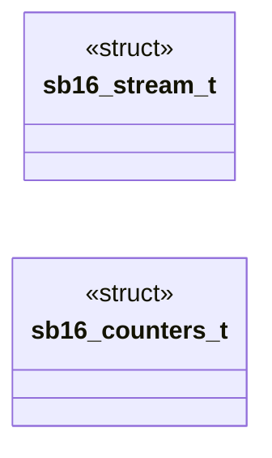
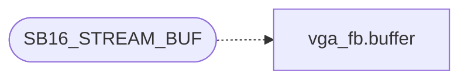

# `headers/sb16.h`

> Source: [headers/sb16.h:1](../../headers/sb16.h#L1) | language `h` | coverage 35.7% | [API index](../index.md)

Sound Blaster 16 DMA audio driver contract.

## Contents

- **Structs:** [`sb16_stream_t`](#sb16_stream_t), [`sb16_counters_t`](#sb16_counters_t)
- **Functions:** [`sb16_init`](#sb16_init), [`sb16_present`](#sb16_present), [`sb16_tone`](#sb16_tone), [`sb16_irq`](#sb16_irq), [`sb16_poll`](#sb16_poll), [`sb16_pcm_open`](#sb16_pcm_open), [`sb16_pcm_submit`](#sb16_pcm_submit), [`sb16_pcm_close`](#sb16_pcm_close), [`sb16_pump`](#sb16_pump), [`sb16_stream_open`](#sb16_stream_open), [`sb16_stream_close`](#sb16_stream_close), [`sb16_stream_submit`](#sb16_stream_submit), [`sb16_stream_volume`](#sb16_stream_volume), [`sb16_stream_count`](#sb16_stream_count), [`sb16_ring_free`](#sb16_ring_free), [`sb16_mode_active`](#sb16_mode_active), [`sb16_legacy_busy`](#sb16_legacy_busy), [`sb16_counters`](#sb16_counters)
- **Macros:** [`SB16_PCM_BUF`](#sb16_pcm_buf), [`SB16_PCM_RATE`](#sb16_pcm_rate), [`SB16_SLOTS`](#sb16_slots), [`SB16_RING_CAP`](#sb16_ring_cap), [`SB16_ARM_PERIOD_MS`](#sb16_arm_period_ms), [`SB16_STREAMS`](#sb16_streams), [`SB16_STREAM_BUF`](#sb16_stream_buf)

## Type Diagram



## Call Graph

Solid arrows stay in this module, dashed arrows leave it.



## Structs

<a id="sb16_stream_t"></a>

### `sb16_stream_t`

`struct` | [headers/sb16.h:46](../../headers/sb16.h#L46)

```c
typedef struct
```

Mixer stream state.

---

<a id="sb16_counters_t"></a>

### `sb16_counters_t`

`struct` | [headers/sb16.h:55](../../headers/sb16.h#L55)

```c
typedef struct
```

---

## Functions

<a id="sb16_init"></a>

### `sb16_init`

`function` | [headers/sb16.h:65](../../headers/sb16.h#L65)

```c
int sb16_init(void);
```

**Returns:** `int`

*Called by:* [`__attribute__`](kernel.c.md#__attribute__)

---

<a id="sb16_present"></a>

### `sb16_present`

`function` | [headers/sb16.h:66](../../headers/sb16.h#L66)

```c
int sb16_present(void);
```

**Returns:** `int`

*Called by:* [`pcm2_open`](drivers.pcm2.c.md#pcm2_open)

---

<a id="sb16_tone"></a>

### `sb16_tone`

`function` | [headers/sb16.h:67](../../headers/sb16.h#L67)

```c
void sb16_tone(unsigned freq);
```

**Parameters**

| Name | Type | Default | Description |
|---|---|---|---|
| `freq` | `unsigned` |  |  |

---

<a id="sb16_irq"></a>

### `sb16_irq`

`function` | [headers/sb16.h:68](../../headers/sb16.h#L68)

```c
void sb16_irq(void);
```

*Called by:* [`isr_dispatch`](kernel.sched.c.md#isr_dispatch)

---

<a id="sb16_poll"></a>

### `sb16_poll`

`function` | [headers/sb16.h:69](../../headers/sb16.h#L69)

```c
void sb16_poll(void);
```

---

<a id="sb16_pcm_open"></a>

### `sb16_pcm_open`

`function` | [headers/sb16.h:73](../../headers/sb16.h#L73)

```c
void sb16_pcm_open(void);
```

Legacy single-stream API (maps to mixer stream 0: pcm_open allocates it, pcm_submit forwards into it, pcm_close releases it).

---

<a id="sb16_pcm_submit"></a>

### `sb16_pcm_submit`

`function` | [headers/sb16.h:74](../../headers/sb16.h#L74)

```c
int sb16_pcm_submit(const unsigned char *pcm, unsigned len);
```

**Parameters**

| Name | Type | Default | Description |
|---|---|---|---|
| `pcm` | `unsigned char *` |  |  |
| `len` | `unsigned` |  |  |

**Returns:** `int`

---

<a id="sb16_pcm_close"></a>

### `sb16_pcm_close`

`function` | [headers/sb16.h:75](../../headers/sb16.h#L75)

```c
void sb16_pcm_close(void);
```

---

<a id="sb16_pump"></a>

### `sb16_pump`

`function` | [headers/sb16.h:76](../../headers/sb16.h#L76)

```c
void sb16_pump(void);
```

---

<a id="sb16_stream_open"></a>

### `sb16_stream_open`

`function` | [headers/sb16.h:79](../../headers/sb16.h#L79)

```c
int sb16_stream_open(void);
```

Mixer stream API.

**Returns:** `int`

---

<a id="sb16_stream_close"></a>

### `sb16_stream_close`

`function` | [headers/sb16.h:80](../../headers/sb16.h#L80)

```c
void sb16_stream_close(int id);
```

**Parameters**

| Name | Type | Default | Description |
|---|---|---|---|
| `id` | `int` |  |  |

---

<a id="sb16_stream_submit"></a>

### `sb16_stream_submit`

`function` | [headers/sb16.h:81](../../headers/sb16.h#L81)

```c
int sb16_stream_submit(int id, const unsigned char *pcm, unsigned len);
```

**Parameters**

| Name | Type | Default | Description |
|---|---|---|---|
| `id` | `int` |  |  |
| `pcm` | `unsigned char *` |  |  |
| `len` | `unsigned` |  |  |

**Returns:** `int`

---

<a id="sb16_stream_volume"></a>

### `sb16_stream_volume`

`function` | [headers/sb16.h:82](../../headers/sb16.h#L82)

```c
void sb16_stream_volume(int id, unsigned char vol);
```

**Parameters**

| Name | Type | Default | Description |
|---|---|---|---|
| `id` | `int` |  |  |
| `vol` | `unsigned char` |  |  |

---

<a id="sb16_stream_count"></a>

### `sb16_stream_count`

`function` | [headers/sb16.h:83](../../headers/sb16.h#L83)

```c
int sb16_stream_count(void);
```

**Returns:** `int`

---

<a id="sb16_ring_free"></a>

### `sb16_ring_free`

`function` | [headers/sb16.h:85](../../headers/sb16.h#L85)

```c
unsigned sb16_ring_free(void);
```

**Returns:** `unsigned`

---

<a id="sb16_mode_active"></a>

### `sb16_mode_active`

`function` | [headers/sb16.h:86](../../headers/sb16.h#L86)

```c
int sb16_mode_active(void);
```

**Returns:** `int`

---

<a id="sb16_legacy_busy"></a>

### `sb16_legacy_busy`

`function` | [headers/sb16.h:91](../../headers/sb16.h#L91)

```c
int sb16_legacy_busy(void);
```

True while the legacy engine audibly owns the DSP (PCM stream open or a tone sounding). pcm2_open consults it for the mutual -EBUSY; silent/idle legacy state never blocks the low-latency path.

**Returns:** `int`

*Called by:* [`pcm2_open`](drivers.pcm2.c.md#pcm2_open)

---

<a id="sb16_counters"></a>

### `sb16_counters`

`function` | [headers/sb16.h:93](../../headers/sb16.h#L93)

```c
void sb16_counters(sb16_counters_t *out);
```

**Parameters**

| Name | Type | Default | Description |
|---|---|---|---|
| `out` | `sb16_counters_t *` |  |  |

*Called by:* [`irqstat_report`](kernel.sched.c.md#irqstat_report)

---

## Macros

<a id="sb16_pcm_buf"></a>

### `SB16_PCM_BUF`

`macro` | [headers/sb16.h:32](../../headers/sb16.h#L32)

```c
#define SB16_PCM_BUF
```

---

<a id="sb16_pcm_rate"></a>

### `SB16_PCM_RATE`

`macro` | [headers/sb16.h:33](../../headers/sb16.h#L33)

```c
#define SB16_PCM_RATE
```

bytes per DMA buffer (2048)

---

<a id="sb16_slots"></a>

### `SB16_SLOTS`

`macro` | [headers/sb16.h:34](../../headers/sb16.h#L34)

```c
#define SB16_SLOTS
```

8-bit unsigned mono sample rate

---

<a id="sb16_ring_cap"></a>

### `SB16_RING_CAP`

`macro` | [headers/sb16.h:35](../../headers/sb16.h#L35)

```c
#define SB16_RING_CAP
```

DMA ring slots, one is permanent silence

---

<a id="sb16_arm_period_ms"></a>

### `SB16_ARM_PERIOD_MS`

`macro` | [headers/sb16.h:36](../../headers/sb16.h#L36)

```c
#define SB16_ARM_PERIOD_MS
```

---

<a id="sb16_streams"></a>

### `SB16_STREAMS`

`macro` | [headers/sb16.h:42](../../headers/sb16.h#L42)

```c
#define SB16_STREAMS
```

Per-stream ring buffer.

Each stream gets SB16_STREAM_BUF bytes of kernel-side buffering so multiple producers never interfere.  At 22050 Hz 8-bit mono that is ~366 ms per stream.

---

<a id="sb16_stream_buf"></a>

### `SB16_STREAM_BUF`

`macro` | [headers/sb16.h:43](../../headers/sb16.h#L43)

```c
#define SB16_STREAM_BUF
```

max concurrent mixer streams

*Calls:* [`buffer`](kernel.vga_fb.c.md#buffer)

---
