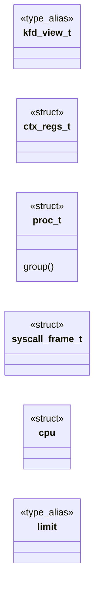

# `headers/sched.h`

> Source: [headers/sched.h:1](../../headers/sched.h#L1) | language `h` | coverage 29.3% | [API index](../index.md)

## Contents

- **Structs:** [`ctx_regs_t`](#ctx_regs_t), [`proc_t`](#proc_t), [`syscall_frame_t`](#syscall_frame_t), [`cpu`](#cpu)
- **Type Aliases:** [`kfd_view_t`](#kfd_view_t), [`limit`](#limit)
- **Functions:** [`kfd_view_copy`](#kfd_view_copy), [`kfd_view_release`](#kfd_view_release), [`kfd_view_cloexec`](#kfd_view_cloexec), [`kfd_view_root`](#kfd_view_root), [`bytes`](#bytes), [`first`](#first), [`syscall_frame_current`](#syscall_frame_current), [`sched_idle_on_kernel_cr3`](#sched_idle_on_kernel_cr3), [`__attribute__`](#__attribute__), [`sched_init`](#sched_init), [`kstack_report`](#kstack_report), [`schedtop_report`](#schedtop_report), [`irqstat_report`](#irqstat_report), [`gdb_regs_report`](#gdb_regs_report), [`gdb_dump_report`](#gdb_dump_report), [`tss_init_ap`](#tss_init_ap), [`smp_ap_idle_loop`](#smp_ap_idle_loop), [`proc_create`](#proc_create), [`proc_get`](#proc_get), [`schedule`](#schedule), [`sched_set_nice`](#sched_set_nice), [`seccomp_deny_one`](#seccomp_deny_one), [`seccomp_allow_one`](#seccomp_allow_one), [`seccomp_denied`](#seccomp_denied), [`rlimit_cpu_exceeded`](#rlimit_cpu_exceeded), [`rlimit_cpu_tick`](#rlimit_cpu_tick), [`switch_to`](#switch_to), [`switch_to_notrap`](#switch_to_notrap), [`switch_save_only`](#switch_save_only), [`resume_iretq`](#resume_iretq), [`yield`](#yield), [`do_exit`](#do_exit), [`do_clone`](#do_clone), [`do_fork`](#do_fork), [`do_fork_ex`](#do_fork_ex), [`do_linux_clone`](#do_linux_clone), [`do_group_exit`](#do_group_exit), [`mm_view_claim_current`](#mm_view_claim_current), [`do_kill_code`](#do_kill_code), [`fork_child_settid`](#fork_child_settid), [`aslr_stack_bytes`](#aslr_stack_bytes), [`aslr_brk_pages`](#aslr_brk_pages), [`aslr_mmap_pages`](#aslr_mmap_pages), [`aslr_dyn_base`](#aslr_dyn_base), [`failure`](#failure), [`do_execve`](#do_execve), [`do_thread_spawn`](#do_thread_spawn), [`do_waitpid`](#do_waitpid), [`do_waitpid_nb`](#do_waitpid_nb), [`shell_reap_nb`](#shell_reap_nb), [`shell_reap_one`](#shell_reap_one), [`shell_nchildren`](#shell_nchildren), [`do_waitpid_linux`](#do_waitpid_linux), [`do_kill`](#do_kill), [`timer_tick`](#timer_tick), [`pt_clone_user`](#pt_clone_user), [`pt_free_user`](#pt_free_user), [`caller`](#caller)
- **Macros:** [`PROC_FREE`](#proc_free), [`PROC_READY`](#proc_ready), [`PROC_RUNNING`](#proc_running), [`PROC_BLOCKED`](#proc_blocked), [`PROC_ZOMBIE`](#proc_zombie), [`PROC_SWITCHING`](#proc_switching), [`MAX_PROCS`](#max_procs), [`PROC_KSTACK_SZ`](#proc_kstack_sz), [`MAX_CPUS`](#max_cpus), [`BOOT_CPU`](#boot_cpu), [`CTX_RBP_OFF`](#ctx_rbp_off), [`CTX_RIP_OFF`](#ctx_rip_off), [`CTX_RSP_OFF`](#ctx_rsp_off), [`CTX_RFLAGS_OFF`](#ctx_rflags_off), [`PROC_T_SIZE`](#proc_t_size), [`PROC_KSTACK_OFF`](#proc_kstack_off), [`PROC_FPU_OFF`](#proc_fpu_off), [`PROC_PID_OFF`](#proc_pid_off), [`PROC_FSBASE_OFF`](#proc_fsbase_off), [`FPU_SAVE_SZ`](#fpu_save_sz), [`FPU_MXCSR_OFF`](#fpu_mxcsr_off), [`FPU_MXCSR_DEFAULT`](#fpu_mxcsr_default), [`SECCOMP_MIN`](#seccomp_min), [`SECCOMP_MAX`](#seccomp_max), [`SECCOMP_BIT`](#seccomp_bit), [`SECCOMP_OP_DENY_ONE`](#seccomp_op_deny_one), [`SECCOMP_OP_ALLOW_ONE`](#seccomp_op_allow_one), [`SECCOMP_OP_DENY_ALL`](#seccomp_op_deny_all), [`RLIM_OP_SET`](#rlim_op_set), [`RLIM_OP_GET`](#rlim_op_get), [`RLIM_AS`](#rlim_as), [`RLIM_CPU`](#rlim_cpu), [`RLIM_NOFILE`](#rlim_nofile), [`RLIM_EXIT_CPU`](#rlim_exit_cpu), [`NICE_MIN`](#nice_min), [`NICE_MAX`](#nice_max), [`NICE_DEFAULT`](#nice_default), [`SCHED_BASE_QUANTUM`](#sched_base_quantum), [`SCHED_NICE_MULT_KEY`](#sched_nice_mult_key), [`SCHED_NICE_MULT_CHARGE`](#sched_nice_mult_charge), [`SCHED_NICE_OFFSET`](#sched_nice_offset), [`CLONE_VM`](#clone_vm), [`CLONE_FILES`](#clone_files), [`LINUX_CLONE_SIGNAL_MASK`](#linux_clone_signal_mask), [`LINUX_CLONE_VM`](#linux_clone_vm), [`LINUX_CLONE_FS`](#linux_clone_fs), [`LINUX_CLONE_FILES`](#linux_clone_files), [`LINUX_CLONE_SIGHAND`](#linux_clone_sighand), [`LINUX_CLONE_PIDFD`](#linux_clone_pidfd), [`LINUX_CLONE_PTRACE`](#linux_clone_ptrace), [`LINUX_CLONE_VFORK`](#linux_clone_vfork), [`LINUX_CLONE_PARENT`](#linux_clone_parent), [`LINUX_CLONE_THREAD`](#linux_clone_thread), [`LINUX_CLONE_NEWNS`](#linux_clone_newns), [`LINUX_CLONE_SYSVSEM`](#linux_clone_sysvsem), [`LINUX_CLONE_SETTLS`](#linux_clone_settls), [`LINUX_CLONE_PARENT_SETTID`](#linux_clone_parent_settid), [`LINUX_CLONE_CHILD_CLEARTID`](#linux_clone_child_cleartid), [`LINUX_CLONE_DETACHED`](#linux_clone_detached), [`LINUX_CLONE_UNTRACED`](#linux_clone_untraced), [`LINUX_CLONE_CHILD_SETTID`](#linux_clone_child_settid), [`LINUX_CLONE_NEWNS_MASK`](#linux_clone_newns_mask), [`LINUX_CLONE_IO`](#linux_clone_io), [`LINUX_SIGCHLD`](#linux_sigchld), [`LINUX_CLONE_THREAD_OK`](#linux_clone_thread_ok), [`LINUX_CLONE_FORK_OK`](#linux_clone_fork_ok), [`current_pid`](#current_pid), [`DESKTOP_TICK_INTERVAL`](#desktop_tick_interval), [`TSS_SEL`](#tss_sel), [`USER_FAULT_SIGNAL`](#user_fault_signal), [`EXECVE_MAX_ARGS`](#execve_max_args), [`EXECVE_MAX_ARG`](#execve_max_arg), [`WAITPID_NONE`](#waitpid_none), [`WAITPID_NOCHILD`](#waitpid_nochild)
- **Variables:** [`cpus`](#cpus), [`cpu_count`](#cpu_count), [`procs`](#procs), [`proc_count`](#proc_count), [`sys_ticks`](#sys_ticks), [`user_program_active`](#user_program_active), [`sched_lock`](#sched_lock), [`sched_ready`](#sched_ready), [`ap_idle_proc`](#ap_idle_proc), [`smp_dispatches`](#smp_dispatches), [`smp_idle_polls`](#smp_idle_polls), [`cpu_idle_ticks`](#cpu_idle_ticks), [`smp_dbg_bad_gs`](#smp_dbg_bad_gs), [`bsp_idtr`](#bsp_idtr), [`isr_cnt_kbd`](#isr_cnt_kbd), [`isr_cnt_mouse`](#isr_cnt_mouse), [`isr_cnt_sb16`](#isr_cnt_sb16)

## Type Diagram



## Structs

<a id="ctx_regs_t"></a>

### `ctx_regs_t`

`struct` | [headers/sched.h:33](../../headers/sched.h#L33)

```c
typedef struct
```

---- Per-process saved registers (offsets must match ctx_sw.S) ----

---

<a id="proc_t"></a>

### `proc_t`

`struct` | [headers/sched.h:50](../../headers/sched.h#L50)

```c
typedef struct
```

---- Process Control Block ----

**Members**

| Member | Kind | Summary |
|---|---|---|
| [`group`](#proc_t-group) | method |  |

<a id="proc_t-group"></a>

#### `proc_t.group`

`method` | [headers/sched.h:108](../../headers/sched.h#L108)

```c
* process is its own group (tgid == pid);
```

**Returns:** `* process is its own`

---

<a id="syscall_frame_t"></a>

### `syscall_frame_t`

`struct` | [headers/sched.h:235](../../headers/sched.h#L235)

```c
typedef struct
```

The frame syscall_entry.S builds on the per-proc kernel stack, lowest address first (SYSCALL_FRAME_WORDS in syscall_asm.h).

It ends exactly at the saved top (sc_top_save[pid]); a fork or clone child copies the user registers from here so it resumes with the caller's full state.

---

<a id="cpu"></a>

### `cpu`

`struct` | [headers/sched.h:268](../../headers/sched.h#L268)

```c
typedef struct cpu
```

---- Per-CPU state ----

One instance per logical processor.  The BSP (boot processor) is always
cpus[0]; APs (application processors) receive their index from the AP
counter during smp_ap_entry.  The first qword of each cpu_t is a
self-pointer so that this_cpu() can dereference it via gs:0 without
knowing the CPU index at compile time.

---

## Type Aliases

<a id="kfd_view_t"></a>

### `kfd_view_t`

`type_alias` | [headers/sched.h:11](../../headers/sched.h#L11)

```c
typedef struct kfd_view kfd_view_t;
```

Forward: full view lives in kernel.h (needs KFILE first); the PCB only carries a pointer, so the incomplete type suffices here and sched.h stays includable without kernel.h.

---

<a id="limit"></a>

### `limit`

`type_alias` | [headers/sched.h:375](../../headers/sched.h#L375)

```c
typedef struct __attribute__((packed)) { uint16_t limit;
```

Exported IDTR for APs to load during SMP bring-up.

---

## Functions

<a id="kfd_view_copy"></a>

### `kfd_view_copy`

`function` | [headers/sched.h:138](../../headers/sched.h#L138)

```c
int kfd_view_copy(proc_t *child, proc_t *parent);
```

**Parameters**

| Name | Type | Default | Description |
|---|---|---|---|
| `child` | `proc_t *` |  |  |
| `parent` | `proc_t *` |  |  |

**Returns:** `int`

*Called by:* [`do_fork_ex`](kernel.sched.c.md#do_fork_ex), [`proc_create`](kernel.sched.c.md#proc_create), [`untouched`](kernel.syscalls.c.md#untouched)

---

<a id="kfd_view_release"></a>

### `kfd_view_release`

`function` | [headers/sched.h:139](../../headers/sched.h#L139)

```c
void kfd_view_release(proc_t *p);
```

**Parameters**

| Name | Type | Default | Description |
|---|---|---|---|
| `p` | `proc_t *` |  |  |

*Called by:* [`do_exit`](kernel.sched.c.md#do_exit), [`NULL`](kernel.syscalls.c.md#null)

---

<a id="kfd_view_cloexec"></a>

### `kfd_view_cloexec`

`function` | [headers/sched.h:140](../../headers/sched.h#L140)

```c
void kfd_view_cloexec(void);
```

*Called by:* [`do_execve`](kernel.sched.c.md#do_execve)

---

<a id="kfd_view_root"></a>

### `kfd_view_root`

`function` | [headers/sched.h:141](../../headers/sched.h#L141)

```c
kfd_view_t *kfd_view_root(void);
```

**Returns:** `kfd_view_t *`

*Called by:* [`spawn_restore`](kernel.spawn.c.md#spawn_restore)

---

<a id="bytes"></a>

### `bytes`

`function` | [headers/sched.h:173](../../headers/sched.h#L173)

```c
* RLIM_AS total user bytes (brk growth + mmap) beyond the load base * RLIM_CPU timer ticks of CPU time, then SIGKILL-equivalent (137) * RLIM_NOFILE open-file count in the process's own fd view (enforc
```

**Parameters**

| Name | Type | Default | Description |
|---|---|---|---|
| `mmap` | `brk growth +` |  |  |

**Returns:** `* RLIM_AS total user`

*Called by:* [`LogBuffer.bytes_from`](mcp.minios_mcp.py.md#logbuffer-bytes_from), [`SNDDMA_Shutdown`](progs.quake2generic.snddma_minios.c.md#snddma_shutdown), [`make_png`](tools.gen_icons.py.md#make_png), [`FS.read`](tools.minifs_dump.py.md#fs-read), [`FSCK.inode_crc_ok`](tools.minifs_fsck.py.md#fsck-inode_crc_ok), [`FSCK.read`](tools.minifs_fsck.py.md#fsck-read), [`FS.read_file`](tools.minifs_saves.py.md#fs-read_file), [`FS.read_file_raw`](tools.minifs_saves.py.md#fs-read_file_raw), [`MiniFS.add_dir_entry`](tools.mkfs.minifs.py.md#minifs-add_dir_entry), [`MiniFS.create_root`](tools.mkfs.minifs.py.md#minifs-create_root), [`MiniFS.inode_set_block`](tools.mkfs.minifs.py.md#minifs-inode_set_block), [`MiniFS.inode_set_size`](tools.mkfs.minifs.py.md#minifs-inode_set_size) and 6 more

---

<a id="first"></a>

### `first`

`function` | [headers/sched.h:232](../../headers/sched.h#L232)

```c
* address first (SYSCALL_FRAME_WORDS in syscall_asm.h). It ends exactly at * the saved top (sc_top_save[pid]);
```

**Parameters**

| Name | Type | Default | Description |
|---|---|---|---|
| `h` | `SYSCALL_FRAME_WORDS in syscall_asm.` |  |  |

**Returns:** `* address`

---

<a id="syscall_frame_current"></a>

### `syscall_frame_current`

`function` `const` | [headers/sched.h:245](../../headers/sched.h#L245)

```c
const syscall_frame_t *syscall_frame_current(void);
```

The current pid's frame, or 0 outside a ring-3 syscall.

**Returns:** `syscall_frame_t *`

*Called by:* [`proc_sec_filter`](kernel.proc_sec.c.md#proc_sec_filter), [`do_fork_ex`](kernel.sched.c.md#do_fork_ex), [`itself`](kernel.sched.c.md#itself)

---

<a id="sched_idle_on_kernel_cr3"></a>

### `sched_idle_on_kernel_cr3`

`function` | [headers/sched.h:359](../../headers/sched.h#L359)

```c
int sched_idle_on_kernel_cr3(int cpu);
```

1 when cpu's idle context is parked on the kernel page tables, never on a process's (whose tables are freed when it dies).

**Parameters**

| Name | Type | Default | Description |
|---|---|---|---|
| `cpu` | `int` |  |  |

**Returns:** `int`

---

<a id="__attribute__"></a>

### `__attribute__`

`function` | [headers/sched.h:375](../../headers/sched.h#L375)

```c
typedef struct __attribute__((packed))
```

Exported IDTR for APs to load during SMP bring-up.

**Parameters**

| Name | Type | Default | Description |
|---|---|---|---|
| `packed` |  |  |  |

**Returns:** `typedef`

---

<a id="sched_init"></a>

### `sched_init`

`function` | [headers/sched.h:379](../../headers/sched.h#L379)

```c
void sched_init(void);
```

---- Functions ----

*Called by:* [`__attribute__`](kernel.c.md#__attribute__)

---

<a id="kstack_report"></a>

### `kstack_report`

`function` | [headers/sched.h:380](../../headers/sched.h#L380)

```c
void kstack_report(void);
```

---

<a id="schedtop_report"></a>

### `schedtop_report`

`function` | [headers/sched.h:381](../../headers/sched.h#L381)

```c
void schedtop_report(void);
```

---

<a id="irqstat_report"></a>

### `irqstat_report`

`function` | [headers/sched.h:382](../../headers/sched.h#L382)

```c
void irqstat_report(void);
```

---

<a id="gdb_regs_report"></a>

### `gdb_regs_report`

`function` | [headers/sched.h:383](../../headers/sched.h#L383)

```c
void gdb_regs_report(int pid);
```

**Parameters**

| Name | Type | Default | Description |
|---|---|---|---|
| `pid` | `int` |  |  |

*Called by:* [`stub`](kernel.sched.c.md#stub)

---

<a id="gdb_dump_report"></a>

### `gdb_dump_report`

`function` | [headers/sched.h:384](../../headers/sched.h#L384)

```c
void gdb_dump_report(unsigned long addr, unsigned long len);
```

**Parameters**

| Name | Type | Default | Description |
|---|---|---|---|
| `addr` | `unsigned long` |  |  |
| `len` | `unsigned long` |  |  |

---

<a id="tss_init_ap"></a>

### `tss_init_ap`

`function` | [headers/sched.h:388](../../headers/sched.h#L388)

```c
void tss_init_ap(int cpu);
```

**Parameters**

| Name | Type | Default | Description |
|---|---|---|---|
| `cpu` | `int` |  |  |

---

<a id="smp_ap_idle_loop"></a>

### `smp_ap_idle_loop`

`function` | [headers/sched.h:389](../../headers/sched.h#L389)

```c
void smp_ap_idle_loop(void);
```

---

<a id="proc_create"></a>

### `proc_create`

`function` | [headers/sched.h:390](../../headers/sched.h#L390)

```c
int proc_create(const char *name, int parent_pid);
```

**Parameters**

| Name | Type | Default | Description |
|---|---|---|---|
| `name` | `char *` |  |  |
| `parent_pid` | `int` |  |  |

**Returns:** `int`

---

<a id="proc_get"></a>

### `proc_get`

`function` | [headers/sched.h:391](../../headers/sched.h#L391)

```c
proc_t *proc_get(int pid);
```

**Parameters**

| Name | Type | Default | Description |
|---|---|---|---|
| `pid` | `int` |  |  |

**Returns:** `proc_t *`

*Called by:* [`pcm2_open`](drivers.pcm2.c.md#pcm2_open), [`pcm2_write`](drivers.pcm2.c.md#pcm2_write), [`proc_sec_prctl`](kernel.proc_sec.c.md#proc_sec_prctl), [`sys_linux_getpid`](kernel.syscalls_proc.c.md#sys_linux_getpid), [`sys_linux_kill`](kernel.syscalls_proc.c.md#sys_linux_kill)

---

<a id="schedule"></a>

### `schedule`

`function` | [headers/sched.h:392](../../headers/sched.h#L392)

```c
void schedule(void);
```

*Called by:* [`pcm2_write`](drivers.pcm2.c.md#pcm2_write)

---

<a id="sched_set_nice"></a>

### `sched_set_nice`

`function` | [headers/sched.h:393](../../headers/sched.h#L393)

```c
int sched_set_nice(int pid, int nice);
```

**Parameters**

| Name | Type | Default | Description |
|---|---|---|---|
| `pid` | `int` |  |  |
| `nice` | `int` |  |  |

**Returns:** `int`

---

<a id="seccomp_deny_one"></a>

### `seccomp_deny_one`

`function` | [headers/sched.h:394](../../headers/sched.h#L394)

```c
int seccomp_deny_one(int pid, int n);
```

**Parameters**

| Name | Type | Default | Description |
|---|---|---|---|
| `pid` | `int` |  |  |
| `n` | `int` |  |  |

**Returns:** `int`

*Called by:* [`sys_minios_seccomp`](kernel.syscalls_proc.c.md#sys_minios_seccomp)

---

<a id="seccomp_allow_one"></a>

### `seccomp_allow_one`

`function` | [headers/sched.h:395](../../headers/sched.h#L395)

```c
int seccomp_allow_one(int pid, int n);
```

**Parameters**

| Name | Type | Default | Description |
|---|---|---|---|
| `pid` | `int` |  |  |
| `n` | `int` |  |  |

**Returns:** `int`

*Called by:* [`sys_minios_seccomp`](kernel.syscalls_proc.c.md#sys_minios_seccomp)

---

<a id="seccomp_denied"></a>

### `seccomp_denied`

`function` | [headers/sched.h:396](../../headers/sched.h#L396)

```c
int seccomp_denied(int pid, int n);
```

**Parameters**

| Name | Type | Default | Description |
|---|---|---|---|
| `pid` | `int` |  |  |
| `n` | `int` |  |  |

**Returns:** `int`

---

<a id="rlimit_cpu_exceeded"></a>

### `rlimit_cpu_exceeded`

`function` | [headers/sched.h:397](../../headers/sched.h#L397)

```c
int rlimit_cpu_exceeded(int pid);
```

**Parameters**

| Name | Type | Default | Description |
|---|---|---|---|
| `pid` | `int` |  |  |

**Returns:** `int`

---

<a id="rlimit_cpu_tick"></a>

### `rlimit_cpu_tick`

`function` | [headers/sched.h:398](../../headers/sched.h#L398)

```c
void rlimit_cpu_tick(int pid);
```

**Parameters**

| Name | Type | Default | Description |
|---|---|---|---|
| `pid` | `int` |  |  |

*Called by:* [`isr_dispatch`](kernel.sched.c.md#isr_dispatch)

---

<a id="switch_to"></a>

### `switch_to`

`function` | [headers/sched.h:399](../../headers/sched.h#L399)

```c
void switch_to(proc_t *prev, proc_t *next);
```

**Parameters**

| Name | Type | Default | Description |
|---|---|---|---|
| `prev` | `proc_t *` |  |  |
| `next` | `proc_t *` |  |  |

*Called by:* [`smp_ap_idle_loop`](kernel.sched.c.md#smp_ap_idle_loop)

---

<a id="switch_to_notrap"></a>

### `switch_to_notrap`

`function` | [headers/sched.h:400](../../headers/sched.h#L400)

```c
void switch_to_notrap(proc_t *prev, proc_t *next);
```

**Parameters**

| Name | Type | Default | Description |
|---|---|---|---|
| `prev` | `proc_t *` |  |  |
| `next` | `proc_t *` |  |  |

*Called by:* [`isr_dispatch`](kernel.sched.c.md#isr_dispatch), [`schedule`](kernel.sched.c.md#schedule)

---

<a id="switch_save_only"></a>

### `switch_save_only`

`function` | [headers/sched.h:401](../../headers/sched.h#L401)

```c
void switch_save_only(proc_t *prev);
```

**Parameters**

| Name | Type | Default | Description |
|---|---|---|---|
| `prev` | `proc_t *` |  |  |

*Called by:* [`schedule`](kernel.sched.c.md#schedule)

---

<a id="resume_iretq"></a>

### `resume_iretq`

`function` | [headers/sched.h:408](../../headers/sched.h#L408)

```c
void resume_iretq(void);
```

---

<a id="yield"></a>

### `yield`

`function` | [headers/sched.h:409](../../headers/sched.h#L409)

```c
void yield(void);
```

*Called by:* [`code`](kernel.shell.c.md#code), [`sys_linux_yield`](kernel.syscalls_proc.c.md#sys_linux_yield), [`net_sys_poll`](net.net.c.md#net_sys_poll), [`net_sys_recvfrom`](net.net.c.md#net_sys_recvfrom), [`RTL_TX_YIELD_EVERY`](net.rtl8139.c.md#rtl_tx_yield_every)

---

<a id="do_exit"></a>

### `do_exit`

`function` | [headers/sched.h:410](../../headers/sched.h#L410)

```c
void do_exit(int code);
```

**Parameters**

| Name | Type | Default | Description |
|---|---|---|---|
| `code` | `int` |  |  |

---

<a id="do_clone"></a>

### `do_clone`

`function` | [headers/sched.h:411](../../headers/sched.h#L411)

```c
long do_clone(long flags, long newsp);
```

**Parameters**

| Name | Type | Default | Description |
|---|---|---|---|
| `flags` | `long` |  |  |
| `newsp` | `long` |  |  |

**Returns:** `long`

*Called by:* [`sys_minios_clone`](kernel.syscalls_proc.c.md#sys_minios_clone)

---

<a id="do_fork"></a>

### `do_fork`

`function` | [headers/sched.h:412](../../headers/sched.h#L412)

```c
long do_fork(void);
```

**Returns:** `long`

*Called by:* [`sys_linux_fork`](kernel.syscalls_proc.c.md#sys_linux_fork)

---

<a id="do_fork_ex"></a>

### `do_fork_ex`

`function` | [headers/sched.h:413](../../headers/sched.h#L413)

```c
long do_fork_ex(uint64_t set_tid, uint64_t clear_tid);
```

**Parameters**

| Name | Type | Default | Description |
|---|---|---|---|
| `set_tid` | `uint64_t` |  |  |
| `clear_tid` | `uint64_t` |  |  |

**Returns:** `long`

---

<a id="do_linux_clone"></a>

### `do_linux_clone`

`function` | [headers/sched.h:414](../../headers/sched.h#L414)

```c
long do_linux_clone(unsigned long flags, unsigned long newsp, unsigned long ptid, unsigned long ctid, unsigned long tls);
```

**Parameters**

| Name | Type | Default | Description |
|---|---|---|---|
| `flags` | `unsigned long` |  |  |
| `newsp` | `unsigned long` |  |  |
| `ptid` | `unsigned long` |  |  |
| `ctid` | `unsigned long` |  |  |
| `tls` | `unsigned long` |  |  |

**Returns:** `long`

*Called by:* [`sys_linux_clone`](kernel.syscalls_proc.c.md#sys_linux_clone)

---

<a id="do_group_exit"></a>

### `do_group_exit`

`function` | [headers/sched.h:416](../../headers/sched.h#L416)

```c
void do_group_exit(int code);
```

**Parameters**

| Name | Type | Default | Description |
|---|---|---|---|
| `code` | `int` |  |  |

---

<a id="mm_view_claim_current"></a>

### `mm_view_claim_current`

`function` | [headers/sched.h:417](../../headers/sched.h#L417)

```c
void mm_view_claim_current(void);
```

*Called by:* [`spawn_restore`](kernel.spawn.c.md#spawn_restore)

---

<a id="do_kill_code"></a>

### `do_kill_code`

`function` | [headers/sched.h:418](../../headers/sched.h#L418)

```c
int do_kill_code(int pid, int code);
```

**Parameters**

| Name | Type | Default | Description |
|---|---|---|---|
| `pid` | `int` |  |  |
| `code` | `int` |  |  |

**Returns:** `int`

*Called by:* [`sys_linux_kill`](kernel.syscalls_proc.c.md#sys_linux_kill)

---

<a id="fork_child_settid"></a>

### `fork_child_settid`

`function` | [headers/sched.h:421](../../headers/sched.h#L421)

```c
void fork_child_settid(void);
```

void     sched_park_capture(proc_t *cur); void     resume_iretq(void); void     yield(void); void     do_exit(int code); long     do_clone(long flags, long newsp); long     do_fork(void); long     do_fork_ex(uint64_t set_tid, uint64_t clear_tid); long     do_linux_clone(unsigned long flags, unsigned long newsp, unsigned long ptid, unsigned long ctid, unsigned long tls); void     do_group_exit(int code); void     mm_view_claim_current(void); int      do_kill_code(int pid, int code); /* Signal a ring-3 fault reports through wait4 (SIGSEGV). define USER_FAULT_SIGNAL 11

---

<a id="aslr_stack_bytes"></a>

### `aslr_stack_bytes`

`function` | [headers/sched.h:431](../../headers/sched.h#L431)

```c
unsigned long aslr_stack_bytes(void);
```

ASLR jitter, fresh per exec (TSC + ticks + per-exec counter, never zero for stack/brk so consecutive execs differ observably): stack top slides 1..4096 bytes, brk start 1..256 pages past the image, mmap cursor up to 255 pages down, ET_DYN base up to 47 2 MB slots up.

**Returns:** `unsigned long`

*Called by:* [`ETREL_CHILD_STACK_SZ`](kernel.exec.c.md#etrel_child_stack_sz)

---

<a id="aslr_brk_pages"></a>

### `aslr_brk_pages`

`function` | [headers/sched.h:432](../../headers/sched.h#L432)

```c
unsigned long aslr_brk_pages(void);
```

**Returns:** `unsigned long`

*Called by:* [`load_exec_elf`](kernel.loader.c.md#load_exec_elf), [`load_exec_elf_into`](kernel.loader.c.md#load_exec_elf_into)

---

<a id="aslr_mmap_pages"></a>

### `aslr_mmap_pages`

`function` | [headers/sched.h:433](../../headers/sched.h#L433)

```c
unsigned long aslr_mmap_pages(void);
```

**Returns:** `unsigned long`

*Called by:* [`load_exec_elf`](kernel.loader.c.md#load_exec_elf)

---

<a id="aslr_dyn_base"></a>

### `aslr_dyn_base`

`function` | [headers/sched.h:434](../../headers/sched.h#L434)

```c
unsigned long aslr_dyn_base(void);
```

**Returns:** `unsigned long`

*Called by:* [`load_exec_elf`](kernel.loader.c.md#load_exec_elf), [`load_exec_elf_into`](kernel.loader.c.md#load_exec_elf_into)

---

<a id="failure"></a>

### `failure`

`function` | [headers/sched.h:439](../../headers/sched.h#L439)

```c
* failure (negative errno);
```

**Parameters**

| Name | Type | Default | Description |
|---|---|---|---|
| `errno` | `negative` |  |  |

**Returns:** `*`

---

<a id="do_execve"></a>

### `do_execve`

`function` | [headers/sched.h:440](../../headers/sched.h#L440)

```c
long do_execve(char *kpath, int kargc, char **kargv);
```

do_execve() - replace the caller's image with a fresh ET_EXEC/ET_DYN program (kernel/sched.c).

The caller keeps pid, parent, children, kstack slot family, fd table and limits; everything else (window, VMA, brk view, stack, FPU, FSBASE, name) is rebuilt. Returns only on failure (negative errno); success enters ring 3 and never returns.

**Parameters**

| Name | Type | Default | Description |
|---|---|---|---|
| `kpath` | `char *` |  |  |
| `kargc` | `int` |  |  |
| `kargv` | `char **` |  |  |

**Returns:** `long`

*Called by:* [`sys_linux_execve`](kernel.syscalls_proc.c.md#sys_linux_execve)

---

<a id="do_thread_spawn"></a>

### `do_thread_spawn`

`function` | [headers/sched.h:441](../../headers/sched.h#L441)

```c
long do_thread_spawn(unsigned long fn, unsigned long stack, unsigned long arg);
```

**Parameters**

| Name | Type | Default | Description |
|---|---|---|---|
| `fn` | `unsigned long` |  |  |
| `stack` | `unsigned long` |  |  |
| `arg` | `unsigned long` |  |  |

**Returns:** `long`

*Called by:* [`sys_minios_thread_spawn`](kernel.syscalls_proc.c.md#sys_minios_thread_spawn)

---

<a id="do_waitpid"></a>

### `do_waitpid`

`function` | [headers/sched.h:443](../../headers/sched.h#L443)

```c
int do_waitpid(int pid);
```

**Parameters**

| Name | Type | Default | Description |
|---|---|---|---|
| `pid` | `int` |  |  |

**Returns:** `int`

---

<a id="do_waitpid_nb"></a>

### `do_waitpid_nb`

`function` | [headers/sched.h:444](../../headers/sched.h#L444)

```c
int do_waitpid_nb(int pid);
```

**Parameters**

| Name | Type | Default | Description |
|---|---|---|---|
| `pid` | `int` |  |  |

**Returns:** `int`

---

<a id="shell_reap_nb"></a>

### `shell_reap_nb`

`function` | [headers/sched.h:445](../../headers/sched.h#L445)

```c
int shell_reap_nb(int *pid_out, int *code_out);
```

**Parameters**

| Name | Type | Default | Description |
|---|---|---|---|
| `pid_out` | `int *` |  |  |
| `code_out` | `int *` |  |  |

**Returns:** `int`

*Called by:* [`shell_run`](kernel.shell.c.md#shell_run)

---

<a id="shell_reap_one"></a>

### `shell_reap_one`

`function` | [headers/sched.h:446](../../headers/sched.h#L446)

```c
int shell_reap_one(int pid, int *code_out);
```

**Parameters**

| Name | Type | Default | Description |
|---|---|---|---|
| `pid` | `int` |  |  |
| `code_out` | `int *` |  |  |

**Returns:** `int`

*Called by:* [`code`](kernel.shell.c.md#code)

---

<a id="shell_nchildren"></a>

### `shell_nchildren`

`function` | [headers/sched.h:447](../../headers/sched.h#L447)

```c
int shell_nchildren(void);
```

**Returns:** `int`

---

<a id="do_waitpid_linux"></a>

### `do_waitpid_linux`

`function` | [headers/sched.h:451](../../headers/sched.h#L451)

```c
int do_waitpid_linux(int pid, int nohang, int *found);
```

kstack slot family, fd table and limits; everything else (window, VMA, brk view, stack, FPU, FSBASE, name) is rebuilt.

Returns only on * failure (negative errno); success enters ring 3 and never returns. long     do_execve(char *kpath, int kargc, char **kargv); long     do_thread_spawn(unsigned long fn, unsigned long stack, unsigned long arg); int      do_waitpid(int pid); int      do_waitpid_nb(int pid); int      shell_reap_nb(int *pid_out, int *code_out); int      shell_reap_one(int pid, int *code_out); int      shell_nchildren(void); #define WAITPID_NONE (-0x7FFF) /* do_waitpid_linux: the caller has no matching child at all (-ECHILD). define WAITPID_NOCHILD (-0x7FFE)

**Parameters**

| Name | Type | Default | Description |
|---|---|---|---|
| `pid` | `int` |  |  |
| `nohang` | `int` |  |  |
| `found` | `int *` |  |  |

**Returns:** `int`

*Called by:* [`groups`](kernel.syscalls_proc.c.md#groups)

---

<a id="do_kill"></a>

### `do_kill`

`function` | [headers/sched.h:452](../../headers/sched.h#L452)

```c
int do_kill(int pid);
```

**Parameters**

| Name | Type | Default | Description |
|---|---|---|---|
| `pid` | `int` |  |  |

**Returns:** `int`

*Called by:* [`code`](kernel.shell.c.md#code)

---

<a id="timer_tick"></a>

### `timer_tick`

`function` | [headers/sched.h:453](../../headers/sched.h#L453)

```c
void timer_tick(void);
```

---

<a id="pt_clone_user"></a>

### `pt_clone_user`

`function` | [headers/sched.h:456](../../headers/sched.h#L456)

```c
uint64_t pt_clone_user(uint64_t parent_cr3);
```

---- Per-process page tables ----

**Parameters**

| Name | Type | Default | Description |
|---|---|---|---|
| `parent_cr3` | `uint64_t` |  |  |

**Returns:** `uint64_t`

*Called by:* [`ETREL_CHILD_STACK_SZ`](kernel.exec.c.md#etrel_child_stack_sz), [`proc_create`](kernel.sched.c.md#proc_create)

---

<a id="pt_free_user"></a>

### `pt_free_user`

`function` | [headers/sched.h:457](../../headers/sched.h#L457)

```c
void pt_free_user(uint64_t cr3);
```

**Parameters**

| Name | Type | Default | Description |
|---|---|---|---|
| `cr3` | `uint64_t` |  |  |

*Called by:* [`ETREL_CHILD_STACK_SZ`](kernel.exec.c.md#etrel_child_stack_sz), [`CPU`](kernel.mm.cow.c.md#cpu), [`do_execve`](kernel.sched.c.md#do_execve), [`do_fork_ex`](kernel.sched.c.md#do_fork_ex)

---

<a id="caller"></a>

### `caller`

`function` | [headers/sched.h:462](../../headers/sched.h#L462)

```c
* caller (shell mrun) reaps it with do_waitpid. Returns pid or -1. * Programs using mmap/VMA or expecting a shared fd table beyond * O_RDONLY stdin-style use are best-effort in this revision. */ int p
```

**Parameters**

| Name | Type | Default | Description |
|---|---|---|---|
| `mrun` | `shell` |  |  |

**Returns:** `*`

---

## Macros

<a id="proc_free"></a>

### `PROC_FREE`

`macro` | [headers/sched.h:14](../../headers/sched.h#L14)

```c
#define PROC_FREE
```

---- Process states ----

---

<a id="proc_ready"></a>

### `PROC_READY`

`macro` | [headers/sched.h:15](../../headers/sched.h#L15)

```c
#define PROC_READY
```

---

<a id="proc_running"></a>

### `PROC_RUNNING`

`macro` | [headers/sched.h:16](../../headers/sched.h#L16)

```c
#define PROC_RUNNING
```

---

<a id="proc_blocked"></a>

### `PROC_BLOCKED`

`macro` | [headers/sched.h:17](../../headers/sched.h#L17)

```c
#define PROC_BLOCKED
```

---

<a id="proc_zombie"></a>

### `PROC_ZOMBIE`

`macro` | [headers/sched.h:18](../../headers/sched.h#L18)

```c
#define PROC_ZOMBIE
```

---

<a id="proc_switching"></a>

### `PROC_SWITCHING`

`macro` | [headers/sched.h:22](../../headers/sched.h#L22)

```c
#define PROC_SWITCHING
```

Transient: the owner CPU is between "decided to switch away" and "context fully saved".

Never claimable: a steal here would resume a stale context.  schedule() turns it into READY only after the save.

---

<a id="max_procs"></a>

### `MAX_PROCS`

`macro` | [headers/sched.h:25](../../headers/sched.h#L25)

```c
#define MAX_PROCS
```

---- Limits ----

---

<a id="proc_kstack_sz"></a>

### `PROC_KSTACK_SZ`

`macro` | [headers/sched.h:26](../../headers/sched.h#L26)

```c
#define PROC_KSTACK_SZ
```

---

<a id="max_cpus"></a>

### `MAX_CPUS`

`macro` | [headers/sched.h:29](../../headers/sched.h#L29)

```c
#define MAX_CPUS
```

---- SMP limits ----

---

<a id="boot_cpu"></a>

### `BOOT_CPU`

`macro` | [headers/sched.h:30](../../headers/sched.h#L30)

```c
#define BOOT_CPU
```

---

<a id="ctx_rbp_off"></a>

### `CTX_RBP_OFF`

`macro` | [headers/sched.h:44](../../headers/sched.h#L44)

```c
#define CTX_RBP_OFF
```

Byte offsets into ctx_regs_t for the pure-asm park capture (sched_park_capture in arch/x86/ctx_sw.S, which cannot use C).

Proven by _Static_asserts in kernel/sched.c; never hand-sync.

---

<a id="ctx_rip_off"></a>

### `CTX_RIP_OFF`

`macro` | [headers/sched.h:45](../../headers/sched.h#L45)

```c
#define CTX_RIP_OFF
```

---

<a id="ctx_rsp_off"></a>

### `CTX_RSP_OFF`

`macro` | [headers/sched.h:46](../../headers/sched.h#L46)

```c
#define CTX_RSP_OFF
```

---

<a id="ctx_rflags_off"></a>

### `CTX_RFLAGS_OFF`

`macro` | [headers/sched.h:47](../../headers/sched.h#L47)

```c
#define CTX_RFLAGS_OFF
```

---

<a id="proc_t_size"></a>

### `PROC_T_SIZE`

`macro` | [headers/sched.h:132](../../headers/sched.h#L132)

```c
#define PROC_T_SIZE
```

Single source of truth for the PCB footprint (review fix for the 0a92118 imulq drift): the syscall_entry trampoline in arch/x86/syscall_entry.S cannot use C, so it multiplies pid by PROC_T_SIZE and adds PROC_KSTACK_OFF.

Both immediates derive from headers/syscall_asm.h; the _Static_asserts in kernel.c and kernel/sched.c prove header == struct. Adding a field changes the macros' values automatically on rebuild -- no asm hunt. procs[] itself is a static 64-entry .bss array (~21 KB at 336 B/entry), far below the USER_LOAD_BASE budget enforced by `make check-size`.

---

<a id="proc_kstack_off"></a>

### `PROC_KSTACK_OFF`

`macro` | [headers/sched.h:142](../../headers/sched.h#L142)

```c
#define PROC_KSTACK_OFF
```

---

<a id="proc_fpu_off"></a>

### `PROC_FPU_OFF`

`macro` | [headers/sched.h:147](../../headers/sched.h#L147)

```c
#define PROC_FPU_OFF
```

Offset of fpu_save inside proc_t: the ctx_sw.S save/restore paths address it as imm(proc) without C, so it is named here beside PROC_T_SIZE (same imulq-drift lesson: the _Static_asserts in kernel/sched.c prove offset and size against the struct).

---

<a id="proc_pid_off"></a>

### `PROC_PID_OFF`

`macro` | [headers/sched.h:154](../../headers/sched.h#L154)

```c
#define PROC_PID_OFF
```

TLS base offset inside proc_t (saved/restored by ctx_sw.S; the pid field at 152 selects kernel contexts that keep live bases).

Only FSBASE rides the switch: the user GS slot is re-armed to the kernel base by sched_rearm_kgs after every switch, and nothing in the guest ABI consumes a persistent user GS, so storing it would only risk landing a stale user value in the entry swapgs.

---

<a id="proc_fsbase_off"></a>

### `PROC_FSBASE_OFF`

`macro` | [headers/sched.h:155](../../headers/sched.h#L155)

```c
#define PROC_FSBASE_OFF
```

---

<a id="fpu_save_sz"></a>

### `FPU_SAVE_SZ`

`macro` | [headers/sched.h:157](../../headers/sched.h#L157)

```c
#define FPU_SAVE_SZ
```

fxsave/fxrstor image footprint; MXCSR lives at byte 24 of it.

---

<a id="fpu_mxcsr_off"></a>

### `FPU_MXCSR_OFF`

`macro` | [headers/sched.h:158](../../headers/sched.h#L158)

```c
#define FPU_MXCSR_OFF
```

---

<a id="fpu_mxcsr_default"></a>

### `FPU_MXCSR_DEFAULT`

`macro` | [headers/sched.h:159](../../headers/sched.h#L159)

```c
#define FPU_MXCSR_DEFAULT
```

---

<a id="seccomp_min"></a>

### `SECCOMP_MIN`

`macro` | [headers/sched.h:163](../../headers/sched.h#L163)

```c
#define SECCOMP_MIN
```

Seccomp-basic: bit for MiniOS syscall n in proc_t.seccomp_deny.

Only the 200..231 window is filterable (the framebuffer/audio/spawn/TLS surface); Linux-ABI numbers are never filtered so a filter cannot break exit.

---

<a id="seccomp_max"></a>

### `SECCOMP_MAX`

`macro` | [headers/sched.h:164](../../headers/sched.h#L164)

```c
#define SECCOMP_MAX
```

---

<a id="seccomp_bit"></a>

### `SECCOMP_BIT`

`macro` | [headers/sched.h:165](../../headers/sched.h#L165)

```c
#define SECCOMP_BIT(n)
```

*Called by:* [`seccomp_allow_one`](kernel.sched.c.md#seccomp_allow_one), [`seccomp_denied`](kernel.sched.c.md#seccomp_denied), [`seccomp_deny_one`](kernel.sched.c.md#seccomp_deny_one), [`sys_minios_seccomp`](kernel.syscalls_proc.c.md#sys_minios_seccomp)

---

<a id="seccomp_op_deny_one"></a>

### `SECCOMP_OP_DENY_ONE`

`macro` | [headers/sched.h:168](../../headers/sched.h#L168)

```c
#define SECCOMP_OP_DENY_ONE
```

Seccomp modes for SYS_SECCOMP (238): deny one syscall, allow one back, or deny the whole filterable window except an explicit keep mask.

---

<a id="seccomp_op_allow_one"></a>

### `SECCOMP_OP_ALLOW_ONE`

`macro` | [headers/sched.h:169](../../headers/sched.h#L169)

```c
#define SECCOMP_OP_ALLOW_ONE
```

---

<a id="seccomp_op_deny_all"></a>

### `SECCOMP_OP_DENY_ALL`

`macro` | [headers/sched.h:170](../../headers/sched.h#L170)

```c
#define SECCOMP_OP_DENY_ALL
```

---

<a id="rlim_op_set"></a>

### `RLIM_OP_SET`

`macro` | [headers/sched.h:177](../../headers/sched.h#L177)

```c
#define RLIM_OP_SET
```

Rlimit/cgroups-lite (SYS_RLIMIT, 240): per-process resource caps, all 0 = unlimited (the default).

Inherited across proc_create/clone/spawn. RLIM_AS    total user bytes (brk growth + mmap) beyond the load base RLIM_CPU   timer ticks of CPU time, then SIGKILL-equivalent (137) RLIM_NOFILE open-file count in the process's own fd view (enforced at open against that view, attributed to the opener)

---

<a id="rlim_op_get"></a>

### `RLIM_OP_GET`

`macro` | [headers/sched.h:178](../../headers/sched.h#L178)

```c
#define RLIM_OP_GET
```

---

<a id="rlim_as"></a>

### `RLIM_AS`

`macro` | [headers/sched.h:179](../../headers/sched.h#L179)

```c
#define RLIM_AS
```

---

<a id="rlim_cpu"></a>

### `RLIM_CPU`

`macro` | [headers/sched.h:180](../../headers/sched.h#L180)

```c
#define RLIM_CPU
```

---

<a id="rlim_nofile"></a>

### `RLIM_NOFILE`

`macro` | [headers/sched.h:181](../../headers/sched.h#L181)

```c
#define RLIM_NOFILE
```

---

<a id="rlim_exit_cpu"></a>

### `RLIM_EXIT_CPU`

`macro` | [headers/sched.h:182](../../headers/sched.h#L182)

```c
#define RLIM_EXIT_CPU
```

---

<a id="nice_min"></a>

### `NICE_MIN`

`macro` | [headers/sched.h:184](../../headers/sched.h#L184)

```c
#define NICE_MIN
```

Nice range for SYS_NICE (239): clamped on set, default 0.

---

<a id="nice_max"></a>

### `NICE_MAX`

`macro` | [headers/sched.h:185](../../headers/sched.h#L185)

```c
#define NICE_MAX
```

---

<a id="nice_default"></a>

### `NICE_DEFAULT`

`macro` | [headers/sched.h:186](../../headers/sched.h#L186)

```c
#define NICE_DEFAULT
```

---

<a id="sched_base_quantum"></a>

### `SCHED_BASE_QUANTUM`

`macro` | [headers/sched.h:191](../../headers/sched.h#L191)

```c
#define SCHED_BASE_QUANTUM
```

Fair-share scheduling weights (sched_next_locked): the key that picks the next READY task is vruntime + (nice + OFFSET) * MULT_KEY, and the winner is charged BASE_QUANTUM + (nice + OFFSET) * MULT_CHARGE.

Equal nice degrades to round-robin via the rotating start.

---

<a id="sched_nice_mult_key"></a>

### `SCHED_NICE_MULT_KEY`

`macro` | [headers/sched.h:192](../../headers/sched.h#L192)

```c
#define SCHED_NICE_MULT_KEY
```

---

<a id="sched_nice_mult_charge"></a>

### `SCHED_NICE_MULT_CHARGE`

`macro` | [headers/sched.h:193](../../headers/sched.h#L193)

```c
#define SCHED_NICE_MULT_CHARGE
```

---

<a id="sched_nice_offset"></a>

### `SCHED_NICE_OFFSET`

`macro` | [headers/sched.h:194](../../headers/sched.h#L194)

```c
#define SCHED_NICE_OFFSET
```

---

<a id="clone_vm"></a>

### `CLONE_VM`

`macro` | [headers/sched.h:197](../../headers/sched.h#L197)

```c
#define CLONE_VM
```

clone() flags

---

<a id="clone_files"></a>

### `CLONE_FILES`

`macro` | [headers/sched.h:198](../../headers/sched.h#L198)

```c
#define CLONE_FILES
```

share address space (same CR3)

---

<a id="linux_clone_signal_mask"></a>

### `LINUX_CLONE_SIGNAL_MASK`

`macro` | [headers/sched.h:200](../../headers/sched.h#L200)

```c
#define LINUX_CLONE_SIGNAL_MASK
```

Linux clone(2) flags beyond the MiniOS pair (docs/spec/smp-sched.md).

---

<a id="linux_clone_vm"></a>

### `LINUX_CLONE_VM`

`macro` | [headers/sched.h:201](../../headers/sched.h#L201)

```c
#define LINUX_CLONE_VM
```

exit signal in the low byte

---

<a id="linux_clone_fs"></a>

### `LINUX_CLONE_FS`

`macro` | [headers/sched.h:202](../../headers/sched.h#L202)

```c
#define LINUX_CLONE_FS
```

---

<a id="linux_clone_files"></a>

### `LINUX_CLONE_FILES`

`macro` | [headers/sched.h:203](../../headers/sched.h#L203)

```c
#define LINUX_CLONE_FILES
```

---

<a id="linux_clone_sighand"></a>

### `LINUX_CLONE_SIGHAND`

`macro` | [headers/sched.h:204](../../headers/sched.h#L204)

```c
#define LINUX_CLONE_SIGHAND
```

---

<a id="linux_clone_pidfd"></a>

### `LINUX_CLONE_PIDFD`

`macro` | [headers/sched.h:205](../../headers/sched.h#L205)

```c
#define LINUX_CLONE_PIDFD
```

---

<a id="linux_clone_ptrace"></a>

### `LINUX_CLONE_PTRACE`

`macro` | [headers/sched.h:206](../../headers/sched.h#L206)

```c
#define LINUX_CLONE_PTRACE
```

---

<a id="linux_clone_vfork"></a>

### `LINUX_CLONE_VFORK`

`macro` | [headers/sched.h:207](../../headers/sched.h#L207)

```c
#define LINUX_CLONE_VFORK
```

---

<a id="linux_clone_parent"></a>

### `LINUX_CLONE_PARENT`

`macro` | [headers/sched.h:208](../../headers/sched.h#L208)

```c
#define LINUX_CLONE_PARENT
```

---

<a id="linux_clone_thread"></a>

### `LINUX_CLONE_THREAD`

`macro` | [headers/sched.h:209](../../headers/sched.h#L209)

```c
#define LINUX_CLONE_THREAD
```

---

<a id="linux_clone_newns"></a>

### `LINUX_CLONE_NEWNS`

`macro` | [headers/sched.h:210](../../headers/sched.h#L210)

```c
#define LINUX_CLONE_NEWNS
```

---

<a id="linux_clone_sysvsem"></a>

### `LINUX_CLONE_SYSVSEM`

`macro` | [headers/sched.h:211](../../headers/sched.h#L211)

```c
#define LINUX_CLONE_SYSVSEM
```

---

<a id="linux_clone_settls"></a>

### `LINUX_CLONE_SETTLS`

`macro` | [headers/sched.h:212](../../headers/sched.h#L212)

```c
#define LINUX_CLONE_SETTLS
```

---

<a id="linux_clone_parent_settid"></a>

### `LINUX_CLONE_PARENT_SETTID`

`macro` | [headers/sched.h:213](../../headers/sched.h#L213)

```c
#define LINUX_CLONE_PARENT_SETTID
```

---

<a id="linux_clone_child_cleartid"></a>

### `LINUX_CLONE_CHILD_CLEARTID`

`macro` | [headers/sched.h:214](../../headers/sched.h#L214)

```c
#define LINUX_CLONE_CHILD_CLEARTID
```

---

<a id="linux_clone_detached"></a>

### `LINUX_CLONE_DETACHED`

`macro` | [headers/sched.h:215](../../headers/sched.h#L215)

```c
#define LINUX_CLONE_DETACHED
```

---

<a id="linux_clone_untraced"></a>

### `LINUX_CLONE_UNTRACED`

`macro` | [headers/sched.h:216](../../headers/sched.h#L216)

```c
#define LINUX_CLONE_UNTRACED
```

---

<a id="linux_clone_child_settid"></a>

### `LINUX_CLONE_CHILD_SETTID`

`macro` | [headers/sched.h:217](../../headers/sched.h#L217)

```c
#define LINUX_CLONE_CHILD_SETTID
```

---

<a id="linux_clone_newns_mask"></a>

### `LINUX_CLONE_NEWNS_MASK`

`macro` | [headers/sched.h:218](../../headers/sched.h#L218)

```c
#define LINUX_CLONE_NEWNS_MASK
```

---

<a id="linux_clone_io"></a>

### `LINUX_CLONE_IO`

`macro` | [headers/sched.h:219](../../headers/sched.h#L219)

```c
#define LINUX_CLONE_IO
```

every CLONE_NEW* namespace bit

---

<a id="linux_sigchld"></a>

### `LINUX_SIGCHLD`

`macro` | [headers/sched.h:220](../../headers/sched.h#L220)

```c
#define LINUX_SIGCHLD
```

---

<a id="linux_clone_thread_ok"></a>

### `LINUX_CLONE_THREAD_OK`

`macro` | [headers/sched.h:223](../../headers/sched.h#L223)

```c
#define LINUX_CLONE_THREAD_OK
```

Flags a thread-shaped clone may carry (glibc NPTL sends exactly these plus CLONE_DETACHED on old ABIs); anything else is -EINVAL.

---

<a id="linux_clone_fork_ok"></a>

### `LINUX_CLONE_FORK_OK`

`macro` | [headers/sched.h:228](../../headers/sched.h#L228)

```c
#define LINUX_CLONE_FORK_OK
```

Flags a fork-shaped clone may carry besides the exit signal.

---

<a id="current_pid"></a>

### `current_pid`

`macro` | [headers/sched.h:312](../../headers/sched.h#L312)

```c
#define current_pid
```

---

<a id="desktop_tick_interval"></a>

### `DESKTOP_TICK_INTERVAL`

`macro` | [headers/sched.h:316](../../headers/sched.h#L316)

```c
#define DESKTOP_TICK_INTERVAL
```

---- Limits ----

---

<a id="tss_sel"></a>

### `TSS_SEL`

`macro` | [headers/sched.h:372](../../headers/sched.h#L372)

```c
#define TSS_SEL(cpu)
```

Per-CPU TSS selectors: slot 5 + 2*cpu in the runtime GDT (each TSS descriptor occupies two 8-byte slots).

CPU 0 keeps selector 0x28, exactly as before.

*Called by:* [`tss_init_ap`](kernel.sched.c.md#tss_init_ap)

---

<a id="user_fault_signal"></a>

### `USER_FAULT_SIGNAL`

`macro` | [headers/sched.h:420](../../headers/sched.h#L420)

```c
#define USER_FAULT_SIGNAL
```

Signal a ring-3 fault reports through wait4 (SIGSEGV).

---

<a id="execve_max_args"></a>

### `EXECVE_MAX_ARGS`

`macro` | [headers/sched.h:424](../../headers/sched.h#L424)

```c
#define EXECVE_MAX_ARGS
```

execve argument bounds: at most 32 words, each at most 255 chars plus NUL.

Past either bound the call refuses with -E2BIG, never truncates.

---

<a id="execve_max_arg"></a>

### `EXECVE_MAX_ARG`

`macro` | [headers/sched.h:425](../../headers/sched.h#L425)

```c
#define EXECVE_MAX_ARG
```

---

<a id="waitpid_none"></a>

### `WAITPID_NONE`

`macro` | [headers/sched.h:448](../../headers/sched.h#L448)

```c
#define WAITPID_NONE
```

---

<a id="waitpid_nochild"></a>

### `WAITPID_NOCHILD`

`macro` | [headers/sched.h:450](../../headers/sched.h#L450)

```c
#define WAITPID_NOCHILD
```

do_waitpid_linux: the caller has no matching child at all (-ECHILD).

---

## Variables

<a id="cpus"></a>

### `cpus`

`variable` `extern` | [headers/sched.h:294](../../headers/sched.h#L294)

```c
extern cpu_t cpus[MAX_CPUS];
```

---

<a id="cpu_count"></a>

### `cpu_count`

`variable` `extern` | [headers/sched.h:295](../../headers/sched.h#L295)

```c
extern int cpu_count;
```

---

<a id="procs"></a>

### `procs`

`variable` `extern` | [headers/sched.h:333](../../headers/sched.h#L333)

```c
extern proc_t procs[MAX_PROCS];
```

---- Shared scheduler data (protected by sched_lock) ----

Invariant: these structures are accessed by the BSP (boot processor)
and will be accessed by APs (application processors) when SMP
scheduling is enabled.  All modifications must hold sched_lock.

Per-CPU data (no lock needed):
  - cpu_t cpus[]: each CPU reads only its own entry via this_cpu()
  - GS base: set to &cpus[cpu_id] for kernel execution

Shared data (protected by sched_lock):
  - procs[]: the process table
  - proc_count: the high-water mark of PIDs
  - scheduler state in schedule(), do_exit(), do_waitpid()

---

<a id="proc_count"></a>

### `proc_count`

`variable` `extern` | [headers/sched.h:334](../../headers/sched.h#L334)

```c
extern int proc_count;
```

---

<a id="sys_ticks"></a>

### `sys_ticks`

`variable` `extern` | [headers/sched.h:335](../../headers/sched.h#L335)

```c
extern volatile uint64_t sys_ticks;
```

---

<a id="user_program_active"></a>

### `user_program_active`

`variable` `extern` | [headers/sched.h:336](../../headers/sched.h#L336)

```c
extern volatile int user_program_active;
```

---

<a id="sched_lock"></a>

### `sched_lock`

`variable` `extern` | [headers/sched.h:337](../../headers/sched.h#L337)

```c
extern spinlock_t sched_lock;
```

---

<a id="sched_ready"></a>

### `sched_ready`

`variable` `extern` | [headers/sched.h:338](../../headers/sched.h#L338)

```c
extern volatile int sched_ready;
```

---

<a id="ap_idle_proc"></a>

### `ap_idle_proc`

`variable` `extern` | [headers/sched.h:356](../../headers/sched.h#L356)

```c
extern proc_t ap_idle_proc[MAX_CPUS];
```

---- SMP thread execution (roadmap Phase 2.2, first increment) ----

APs (application processors) run CLONE_VM threads: same CR3 as their
parent, so no brk/mmap view switch and no TLB shootdown is needed.
Non-CLONE_VM processes stay on the BSP, which owns the shared
g_brk/user_mmap_cur globals (guarded by mm_lock against concurrent
brk/mmap syscalls from AP threads).

Per-CPU idle contexts: an AP with no READY thread parks in
ap_idle_proc[cpu] (pid -1, never in procs[], never picked by scans)
instead of borrowing procs[0], which the BSP owns.  current_pid == -1
on a CPU means that CPU is idle.

smp_dispatches[cpu] counts threads first dispatched on that CPU; the
`smp` shell builtin reports it, so parallel execution is observable
over the serial console without a framebuffer.

---

<a id="smp_dispatches"></a>

### `smp_dispatches`

`variable` `extern` | [headers/sched.h:360](../../headers/sched.h#L360)

```c
extern volatile unsigned long smp_dispatches[MAX_CPUS];
```

---

<a id="smp_idle_polls"></a>

### `smp_idle_polls`

`variable` `extern` | [headers/sched.h:361](../../headers/sched.h#L361)

```c
extern volatile unsigned long smp_idle_polls[MAX_CPUS];
```

---

<a id="cpu_idle_ticks"></a>

### `cpu_idle_ticks`

`variable` `extern` | [headers/sched.h:364](../../headers/sched.h#L364)

```c
extern volatile unsigned long cpu_idle_ticks[MAX_CPUS];
```

Per-CPU idle ticks at 100 Hz for the MINFO cpu selector (see the sibling definition in kernel/sched.c).

---

<a id="smp_dbg_bad_gs"></a>

### `smp_dbg_bad_gs`

`variable` `extern` | [headers/sched.h:367](../../headers/sched.h#L367)

```c
extern volatile unsigned smp_dbg_bad_gs;
```

Timer ticks that arrived with a GS base outside cpus[] (fail-safe EOI, no scheduling action).

Zero in a healthy boot.

---

<a id="bsp_idtr"></a>

### `bsp_idtr`

`variable` `extern` | [headers/sched.h:376](../../headers/sched.h#L376)

```c
extern idtr_t bsp_idtr;
```

---

<a id="isr_cnt_kbd"></a>

### `isr_cnt_kbd`

`variable` `extern` | [headers/sched.h:385](../../headers/sched.h#L385)

```c
extern volatile unsigned long isr_cnt_kbd;
```

---

<a id="isr_cnt_mouse"></a>

### `isr_cnt_mouse`

`variable` `extern` | [headers/sched.h:386](../../headers/sched.h#L386)

```c
extern volatile unsigned long isr_cnt_mouse;
```

---

<a id="isr_cnt_sb16"></a>

### `isr_cnt_sb16`

`variable` `extern` | [headers/sched.h:387](../../headers/sched.h#L387)

```c
extern volatile unsigned long isr_cnt_sb16;
```

---
