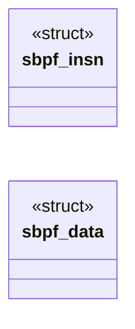

# `headers/seccomp_bpf.h`

> Source: [headers/seccomp_bpf.h:1](../../headers/seccomp_bpf.h#L1) | language `h` | coverage 13.8% | [API index](../index.md)

Docstring: seccomp_bpf.h -- classic BPF checker and interpreter for

## Contents

- **Structs:** [`sbpf_insn`](#sbpf_insn), [`sbpf_data`](#sbpf_data)
- **Functions:** [`sbpf_check`](#sbpf_check), [`sbpf_run`](#sbpf_run), [`sbpf_action_rank`](#sbpf_action_rank)
- **Macros:** [`SBPF_MAX_INSNS`](#sbpf_max_insns), [`SBPF_DATA_SIZE`](#sbpf_data_size), [`SBPF_MEMWORDS`](#sbpf_memwords), [`SBPF_WORD`](#sbpf_word), [`SBPF_SHIFT_MAX`](#sbpf_shift_max), [`SBPF_ERR_INVALID`](#sbpf_err_invalid), [`SBPF_RET_KILL_PROCESS`](#sbpf_ret_kill_process), [`SBPF_RET_KILL_THREAD`](#sbpf_ret_kill_thread), [`SBPF_RET_TRAP`](#sbpf_ret_trap), [`SBPF_RET_ERRNO`](#sbpf_ret_errno), [`SBPF_RET_USER_NOTIF`](#sbpf_ret_user_notif), [`SBPF_RET_TRACE`](#sbpf_ret_trace), [`SBPF_RET_LOG`](#sbpf_ret_log), [`SBPF_RET_ALLOW`](#sbpf_ret_allow), [`SBPF_RET_ACTION_FULL`](#sbpf_ret_action_full), [`SBPF_RET_DATA`](#sbpf_ret_data), [`SBPF_AUDIT_ARCH_X86_64`](#sbpf_audit_arch_x86_64), [`SBPF_CLASS`](#sbpf_class), [`SBPF_LD`](#sbpf_ld), [`SBPF_LDX`](#sbpf_ldx), [`SBPF_ST`](#sbpf_st), [`SBPF_STX`](#sbpf_stx), [`SBPF_ALU`](#sbpf_alu), [`SBPF_JMP`](#sbpf_jmp), [`SBPF_RET`](#sbpf_ret), [`SBPF_MISC`](#sbpf_misc), [`SBPF_W`](#sbpf_w), [`SBPF_IMM`](#sbpf_imm), [`SBPF_ABS`](#sbpf_abs), [`SBPF_MEM`](#sbpf_mem), [`SBPF_LEN`](#sbpf_len), [`SBPF_ADD`](#sbpf_add), [`SBPF_SUB`](#sbpf_sub), [`SBPF_MUL`](#sbpf_mul), [`SBPF_DIV`](#sbpf_div), [`SBPF_OR`](#sbpf_or), [`SBPF_AND`](#sbpf_and), [`SBPF_LSH`](#sbpf_lsh), [`SBPF_RSH`](#sbpf_rsh), [`SBPF_NEG`](#sbpf_neg), [`SBPF_MOD`](#sbpf_mod), [`SBPF_XOR`](#sbpf_xor), [`SBPF_JA`](#sbpf_ja), [`SBPF_JEQ`](#sbpf_jeq), [`SBPF_JGT`](#sbpf_jgt), [`SBPF_JGE`](#sbpf_jge), [`SBPF_JSET`](#sbpf_jset), [`SBPF_K`](#sbpf_k), [`SBPF_X`](#sbpf_x), [`SBPF_A`](#sbpf_a), [`SBPF_TAX`](#sbpf_tax), [`SBPF_TXA`](#sbpf_txa)

## Type Diagram



## Structs

<a id="sbpf_insn"></a>

### `sbpf_insn`

`struct` | [headers/seccomp_bpf.h:15](../../headers/seccomp_bpf.h#L15)

```c
typedef struct
```

struct sock_filter: 8 bytes.

---

<a id="sbpf_data"></a>

### `sbpf_data`

`struct` | [headers/seccomp_bpf.h:23](../../headers/seccomp_bpf.h#L23)

```c
typedef struct
```

struct seccomp_data: 64 bytes.

---

## Functions

<a id="sbpf_check"></a>

### `sbpf_check`

`function` | [headers/seccomp_bpf.h:95](../../headers/seccomp_bpf.h#L95)

```c
int sbpf_check(const sbpf_insn *prog, unsigned len, unsigned short *scratch);
```

Validate a program before it ever runs: 1..SBPF_MAX_INSNS instructions, only the opcodes Linux accepts for seccomp, word loads inside seccomp_data at aligned offsets, scratch indices below SBPF_MEMWORDS, no constant zero divisor or modulus, constant shifts below 32, every jump landing inside the program, no scratch word read before every path wrote it, and a RET last. scratch must hold len entries (the per-pc initialized-scratch masks).

0 when valid, SBPF_ERR_INVALID otherwise.

**Parameters**

| Name | Type | Default | Description |
|---|---|---|---|
| `prog` | `sbpf_insn *` |  |  |
| `len` | `unsigned` |  |  |
| `scratch` | `unsigned short *` |  |  |

**Returns:** `int`

---

<a id="sbpf_run"></a>

### `sbpf_run`

`function` | [headers/seccomp_bpf.h:100](../../headers/seccomp_bpf.h#L100)

```c
unsigned int sbpf_run(const sbpf_insn *prog, unsigned len, const sbpf_data *d);
```

Run a program sbpf_check accepted over one syscall's data; returns the 32-bit action.

A runtime division or modulus by a zero X returns SBPF_RET_KILL_PROCESS.

**Parameters**

| Name | Type | Default | Description |
|---|---|---|---|
| `prog` | `sbpf_insn *` |  |  |
| `len` | `unsigned` |  |  |
| `d` | `sbpf_data *` |  |  |

**Returns:** `unsigned int`

*Called by:* [`proc_sec_filter`](kernel.proc_sec.c.md#proc_sec_filter)

---

<a id="sbpf_action_rank"></a>

### `sbpf_action_rank`

`function` | [headers/seccomp_bpf.h:104](../../headers/seccomp_bpf.h#L104)

```c
int sbpf_action_rank(unsigned int action);
```

Restrictiveness rank of an action (0 = most restrictive): the order stacked filters are combined in.

Unknown actions rank as KILL_PROCESS.

**Parameters**

| Name | Type | Default | Description |
|---|---|---|---|
| `action` | `unsigned int` |  |  |

**Returns:** `int`

*Called by:* [`proc_sec_filter`](kernel.proc_sec.c.md#proc_sec_filter)

---

## Macros

<a id="sbpf_max_insns"></a>

### `SBPF_MAX_INSNS`

`macro` | [headers/seccomp_bpf.h:30](../../headers/seccomp_bpf.h#L30)

```c
#define SBPF_MAX_INSNS
```

---

<a id="sbpf_data_size"></a>

### `SBPF_DATA_SIZE`

`macro` | [headers/seccomp_bpf.h:31](../../headers/seccomp_bpf.h#L31)

```c
#define SBPF_DATA_SIZE
```

---

<a id="sbpf_memwords"></a>

### `SBPF_MEMWORDS`

`macro` | [headers/seccomp_bpf.h:32](../../headers/seccomp_bpf.h#L32)

```c
#define SBPF_MEMWORDS
```

---

<a id="sbpf_word"></a>

### `SBPF_WORD`

`macro` | [headers/seccomp_bpf.h:33](../../headers/seccomp_bpf.h#L33)

```c
#define SBPF_WORD
```

---

<a id="sbpf_shift_max"></a>

### `SBPF_SHIFT_MAX`

`macro` | [headers/seccomp_bpf.h:34](../../headers/seccomp_bpf.h#L34)

```c
#define SBPF_SHIFT_MAX
```

---

<a id="sbpf_err_invalid"></a>

### `SBPF_ERR_INVALID`

`macro` | [headers/seccomp_bpf.h:35](../../headers/seccomp_bpf.h#L35)

```c
#define SBPF_ERR_INVALID
```

---

<a id="sbpf_ret_kill_process"></a>

### `SBPF_RET_KILL_PROCESS`

`macro` | [headers/seccomp_bpf.h:38](../../headers/seccomp_bpf.h#L38)

```c
#define SBPF_RET_KILL_PROCESS
```

Seccomp return actions (high 16 bits) and the data mask.

---

<a id="sbpf_ret_kill_thread"></a>

### `SBPF_RET_KILL_THREAD`

`macro` | [headers/seccomp_bpf.h:39](../../headers/seccomp_bpf.h#L39)

```c
#define SBPF_RET_KILL_THREAD
```

---

<a id="sbpf_ret_trap"></a>

### `SBPF_RET_TRAP`

`macro` | [headers/seccomp_bpf.h:40](../../headers/seccomp_bpf.h#L40)

```c
#define SBPF_RET_TRAP
```

---

<a id="sbpf_ret_errno"></a>

### `SBPF_RET_ERRNO`

`macro` | [headers/seccomp_bpf.h:41](../../headers/seccomp_bpf.h#L41)

```c
#define SBPF_RET_ERRNO
```

---

<a id="sbpf_ret_user_notif"></a>

### `SBPF_RET_USER_NOTIF`

`macro` | [headers/seccomp_bpf.h:42](../../headers/seccomp_bpf.h#L42)

```c
#define SBPF_RET_USER_NOTIF
```

---

<a id="sbpf_ret_trace"></a>

### `SBPF_RET_TRACE`

`macro` | [headers/seccomp_bpf.h:43](../../headers/seccomp_bpf.h#L43)

```c
#define SBPF_RET_TRACE
```

---

<a id="sbpf_ret_log"></a>

### `SBPF_RET_LOG`

`macro` | [headers/seccomp_bpf.h:44](../../headers/seccomp_bpf.h#L44)

```c
#define SBPF_RET_LOG
```

---

<a id="sbpf_ret_allow"></a>

### `SBPF_RET_ALLOW`

`macro` | [headers/seccomp_bpf.h:45](../../headers/seccomp_bpf.h#L45)

```c
#define SBPF_RET_ALLOW
```

---

<a id="sbpf_ret_action_full"></a>

### `SBPF_RET_ACTION_FULL`

`macro` | [headers/seccomp_bpf.h:46](../../headers/seccomp_bpf.h#L46)

```c
#define SBPF_RET_ACTION_FULL
```

---

<a id="sbpf_ret_data"></a>

### `SBPF_RET_DATA`

`macro` | [headers/seccomp_bpf.h:47](../../headers/seccomp_bpf.h#L47)

```c
#define SBPF_RET_DATA
```

---

<a id="sbpf_audit_arch_x86_64"></a>

### `SBPF_AUDIT_ARCH_X86_64`

`macro` | [headers/seccomp_bpf.h:49](../../headers/seccomp_bpf.h#L49)

```c
#define SBPF_AUDIT_ARCH_X86_64
```

---

<a id="sbpf_class"></a>

### `SBPF_CLASS`

`macro` | [headers/seccomp_bpf.h:52](../../headers/seccomp_bpf.h#L52)

```c
#define SBPF_CLASS(c)
```

Classic BPF opcode fields.

*Called by:* [`SBPF_MEM_ALL`](kernel.seccomp_bpf.c.md#sbpf_mem_all), [`sbpf_check`](kernel.seccomp_bpf.c.md#sbpf_check), [`sbpf_run`](kernel.seccomp_bpf.c.md#sbpf_run)

---

<a id="sbpf_ld"></a>

### `SBPF_LD`

`macro` | [headers/seccomp_bpf.h:53](../../headers/seccomp_bpf.h#L53)

```c
#define SBPF_LD
```

---

<a id="sbpf_ldx"></a>

### `SBPF_LDX`

`macro` | [headers/seccomp_bpf.h:54](../../headers/seccomp_bpf.h#L54)

```c
#define SBPF_LDX
```

---

<a id="sbpf_st"></a>

### `SBPF_ST`

`macro` | [headers/seccomp_bpf.h:55](../../headers/seccomp_bpf.h#L55)

```c
#define SBPF_ST
```

---

<a id="sbpf_stx"></a>

### `SBPF_STX`

`macro` | [headers/seccomp_bpf.h:56](../../headers/seccomp_bpf.h#L56)

```c
#define SBPF_STX
```

---

<a id="sbpf_alu"></a>

### `SBPF_ALU`

`macro` | [headers/seccomp_bpf.h:57](../../headers/seccomp_bpf.h#L57)

```c
#define SBPF_ALU
```

---

<a id="sbpf_jmp"></a>

### `SBPF_JMP`

`macro` | [headers/seccomp_bpf.h:58](../../headers/seccomp_bpf.h#L58)

```c
#define SBPF_JMP
```

---

<a id="sbpf_ret"></a>

### `SBPF_RET`

`macro` | [headers/seccomp_bpf.h:59](../../headers/seccomp_bpf.h#L59)

```c
#define SBPF_RET
```

---

<a id="sbpf_misc"></a>

### `SBPF_MISC`

`macro` | [headers/seccomp_bpf.h:60](../../headers/seccomp_bpf.h#L60)

```c
#define SBPF_MISC
```

---

<a id="sbpf_w"></a>

### `SBPF_W`

`macro` | [headers/seccomp_bpf.h:61](../../headers/seccomp_bpf.h#L61)

```c
#define SBPF_W
```

---

<a id="sbpf_imm"></a>

### `SBPF_IMM`

`macro` | [headers/seccomp_bpf.h:62](../../headers/seccomp_bpf.h#L62)

```c
#define SBPF_IMM
```

---

<a id="sbpf_abs"></a>

### `SBPF_ABS`

`macro` | [headers/seccomp_bpf.h:63](../../headers/seccomp_bpf.h#L63)

```c
#define SBPF_ABS
```

---

<a id="sbpf_mem"></a>

### `SBPF_MEM`

`macro` | [headers/seccomp_bpf.h:64](../../headers/seccomp_bpf.h#L64)

```c
#define SBPF_MEM
```

---

<a id="sbpf_len"></a>

### `SBPF_LEN`

`macro` | [headers/seccomp_bpf.h:65](../../headers/seccomp_bpf.h#L65)

```c
#define SBPF_LEN
```

---

<a id="sbpf_add"></a>

### `SBPF_ADD`

`macro` | [headers/seccomp_bpf.h:66](../../headers/seccomp_bpf.h#L66)

```c
#define SBPF_ADD
```

---

<a id="sbpf_sub"></a>

### `SBPF_SUB`

`macro` | [headers/seccomp_bpf.h:67](../../headers/seccomp_bpf.h#L67)

```c
#define SBPF_SUB
```

---

<a id="sbpf_mul"></a>

### `SBPF_MUL`

`macro` | [headers/seccomp_bpf.h:68](../../headers/seccomp_bpf.h#L68)

```c
#define SBPF_MUL
```

---

<a id="sbpf_div"></a>

### `SBPF_DIV`

`macro` | [headers/seccomp_bpf.h:69](../../headers/seccomp_bpf.h#L69)

```c
#define SBPF_DIV
```

---

<a id="sbpf_or"></a>

### `SBPF_OR`

`macro` | [headers/seccomp_bpf.h:70](../../headers/seccomp_bpf.h#L70)

```c
#define SBPF_OR
```

---

<a id="sbpf_and"></a>

### `SBPF_AND`

`macro` | [headers/seccomp_bpf.h:71](../../headers/seccomp_bpf.h#L71)

```c
#define SBPF_AND
```

---

<a id="sbpf_lsh"></a>

### `SBPF_LSH`

`macro` | [headers/seccomp_bpf.h:72](../../headers/seccomp_bpf.h#L72)

```c
#define SBPF_LSH
```

---

<a id="sbpf_rsh"></a>

### `SBPF_RSH`

`macro` | [headers/seccomp_bpf.h:73](../../headers/seccomp_bpf.h#L73)

```c
#define SBPF_RSH
```

---

<a id="sbpf_neg"></a>

### `SBPF_NEG`

`macro` | [headers/seccomp_bpf.h:74](../../headers/seccomp_bpf.h#L74)

```c
#define SBPF_NEG
```

---

<a id="sbpf_mod"></a>

### `SBPF_MOD`

`macro` | [headers/seccomp_bpf.h:75](../../headers/seccomp_bpf.h#L75)

```c
#define SBPF_MOD
```

---

<a id="sbpf_xor"></a>

### `SBPF_XOR`

`macro` | [headers/seccomp_bpf.h:76](../../headers/seccomp_bpf.h#L76)

```c
#define SBPF_XOR
```

---

<a id="sbpf_ja"></a>

### `SBPF_JA`

`macro` | [headers/seccomp_bpf.h:77](../../headers/seccomp_bpf.h#L77)

```c
#define SBPF_JA
```

---

<a id="sbpf_jeq"></a>

### `SBPF_JEQ`

`macro` | [headers/seccomp_bpf.h:78](../../headers/seccomp_bpf.h#L78)

```c
#define SBPF_JEQ
```

---

<a id="sbpf_jgt"></a>

### `SBPF_JGT`

`macro` | [headers/seccomp_bpf.h:79](../../headers/seccomp_bpf.h#L79)

```c
#define SBPF_JGT
```

---

<a id="sbpf_jge"></a>

### `SBPF_JGE`

`macro` | [headers/seccomp_bpf.h:80](../../headers/seccomp_bpf.h#L80)

```c
#define SBPF_JGE
```

---

<a id="sbpf_jset"></a>

### `SBPF_JSET`

`macro` | [headers/seccomp_bpf.h:81](../../headers/seccomp_bpf.h#L81)

```c
#define SBPF_JSET
```

---

<a id="sbpf_k"></a>

### `SBPF_K`

`macro` | [headers/seccomp_bpf.h:82](../../headers/seccomp_bpf.h#L82)

```c
#define SBPF_K
```

---

<a id="sbpf_x"></a>

### `SBPF_X`

`macro` | [headers/seccomp_bpf.h:83](../../headers/seccomp_bpf.h#L83)

```c
#define SBPF_X
```

---

<a id="sbpf_a"></a>

### `SBPF_A`

`macro` | [headers/seccomp_bpf.h:84](../../headers/seccomp_bpf.h#L84)

```c
#define SBPF_A
```

---

<a id="sbpf_tax"></a>

### `SBPF_TAX`

`macro` | [headers/seccomp_bpf.h:85](../../headers/seccomp_bpf.h#L85)

```c
#define SBPF_TAX
```

---

<a id="sbpf_txa"></a>

### `SBPF_TXA`

`macro` | [headers/seccomp_bpf.h:86](../../headers/seccomp_bpf.h#L86)

```c
#define SBPF_TXA
```

---
