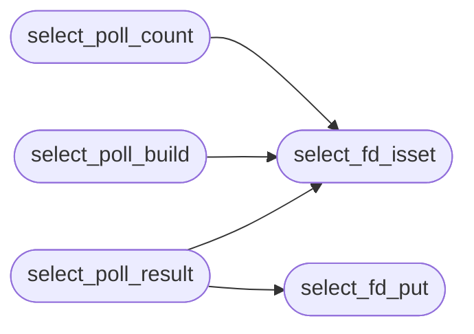

# `headers/select_map.h`

> Source: [headers/select_map.h:1](../../headers/select_map.h#L1) | language `h` | coverage 37.5% | [API index](../index.md)

Docstring: select_map.h -- fd_set <-> pollfd translation for select(2).

## Contents

- **Structs:** [`select_pollfd_t`](#select_pollfd_t)
- **Functions:** [`select_fd_isset`](#select_fd_isset), [`select_fd_put`](#select_fd_put), [`select_poll_count`](#select_poll_count), [`select_poll_build`](#select_poll_build), [`select_poll_result`](#select_poll_result), [`select_poll_badfd`](#select_poll_badfd)
- **Macros:** [`SELECT_FD_SETSIZE`](#select_fd_setsize), [`SELECT_FD_SET_BYTES`](#select_fd_set_bytes), [`SELECT_POLLIN`](#select_pollin), [`SELECT_POLLPRI`](#select_pollpri), [`SELECT_POLLOUT`](#select_pollout), [`SELECT_POLLERR`](#select_pollerr), [`SELECT_POLLHUP`](#select_pollhup), [`SELECT_POLLNVAL`](#select_pollnval)

## Call Graph

Solid arrows stay in this module, dashed arrows leave it.



## Structs

<a id="select_pollfd_t"></a>

### `select_pollfd_t`

`struct` | [headers/select_map.h:31](../../headers/select_map.h#L31)

```c
typedef struct
```

---

## Functions

<a id="select_fd_isset"></a>

### `select_fd_isset`

`function` `inline` `static` | [headers/select_map.h:37](../../headers/select_map.h#L37)

```c
static inline int select_fd_isset(const unsigned char *set, int fd)
```

**Parameters**

| Name | Type | Default | Description |
|---|---|---|---|
| `set` | `unsigned char *` |  |  |
| `fd` | `int` |  |  |

**Returns:** `int`

*Called by:* [`select_poll_build`](#select_poll_build), [`select_poll_count`](#select_poll_count), [`select_poll_result`](#select_poll_result)

---

<a id="select_fd_put"></a>

### `select_fd_put`

`function` `inline` `static` | [headers/select_map.h:41](../../headers/select_map.h#L41)

```c
static inline void select_fd_put(unsigned char *set, int fd)
```

**Parameters**

| Name | Type | Default | Description |
|---|---|---|---|
| `set` | `unsigned char *` |  |  |
| `fd` | `int` |  |  |

*Called by:* [`select_poll_result`](#select_poll_result)

---

<a id="select_poll_count"></a>

### `select_poll_count`

`function` `inline` `static` | [headers/select_map.h:46](../../headers/select_map.h#L46)

```c
static inline unsigned select_poll_count(const unsigned char *r, const unsigned char *w, const unsigned char *e, unsigned nfds)
```

Docstring: Count fds below nfds present in any of the three sets.

**Parameters**

| Name | Type | Default | Description |
|---|---|---|---|
| `r` | `unsigned char *` |  |  |
| `w` | `unsigned char *` |  |  |
| `e` | `unsigned char *` |  |  |
| `nfds` | `unsigned` |  |  |

**Returns:** `unsigned`

*Calls:* [`select_fd_isset`](#select_fd_isset)

---

<a id="select_poll_build"></a>

### `select_poll_build`

`function` `inline` `static` | [headers/select_map.h:66](../../headers/select_map.h#L66)

```c
static inline unsigned select_poll_build(select_pollfd_t *pfd, const unsigned char *r, const unsigned char *w, const unsigned char *e, unsigned nfds)
```

Docstring: Build the pollfd array for the fds the sets request.

Entries come out in ascending fd order, one per requested fd, with
the union of the classes the three sets asked for. The caller sizes
the array through select_poll_count with the same arguments.

**Parameters**

| Name | Type | Default | Description |
|---|---|---|---|
| `pfd` | `select_pollfd_t *` |  |  |
| `r` | `unsigned char *` |  |  |
| `w` | `unsigned char *` |  |  |
| `e` | `unsigned char *` |  |  |
| `nfds` | `unsigned` |  |  |

**Returns:** `unsigned`

*Calls:* [`select_fd_isset`](#select_fd_isset)

---

<a id="select_poll_result"></a>

### `select_poll_result`

`function` `inline` `static` | [headers/select_map.h:95](../../headers/select_map.h#L95)

```c
static inline unsigned select_poll_result(unsigned char *rout, const unsigned char *rin, unsigned char *wout, const unsigned char *win, unsigned char *eout, const unsigned char *ein, const select_pollfd_t *pfd, unsigned count)
```

Docstring: Map poll revents into fresh result sets (Linux classes).

The "in" sets are the kernel-side copies of what the caller requested
(roin/win/ein may be NULL); "out" sets are zeroed and receive only fds
that were both requested in that set and ready in that class, so an
fd armed for write only never appears in the read results. Returns
the number of fds ready in at least one set, like Linux select.

**Parameters**

| Name | Type | Default | Description |
|---|---|---|---|
| `rout` | `unsigned char *` |  |  |
| `rin` | `unsigned char *` |  |  |
| `wout` | `unsigned char *` |  |  |
| `win` | `unsigned char *` |  |  |
| `eout` | `unsigned char *` |  |  |
| `ein` | `unsigned char *` |  |  |
| `pfd` | `select_pollfd_t *` |  |  |
| `count` | `unsigned` |  |  |

**Returns:** `unsigned`

*Calls:* [`select_fd_isset`](#select_fd_isset), [`select_fd_put`](#select_fd_put)

---

<a id="select_poll_badfd"></a>

### `select_poll_badfd`

`function` `inline` `static` | [headers/select_map.h:131](../../headers/select_map.h#L131)

```c
static inline int select_poll_badfd(const select_pollfd_t *pfd, unsigned count)
```

Docstring: True when any polled fd reported POLLNVAL (a bad fd).

**Parameters**

| Name | Type | Default | Description |
|---|---|---|---|
| `pfd` | `select_pollfd_t *` |  |  |
| `count` | `unsigned` |  |  |

**Returns:** `int`

---

## Macros

<a id="select_fd_setsize"></a>

### `SELECT_FD_SETSIZE`

`macro` | [headers/select_map.h:20](../../headers/select_map.h#L20)

```c
#define SELECT_FD_SETSIZE
```

---

<a id="select_fd_set_bytes"></a>

### `SELECT_FD_SET_BYTES`

`macro` | [headers/select_map.h:21](../../headers/select_map.h#L21)

```c
#define SELECT_FD_SET_BYTES
```

---

<a id="select_pollin"></a>

### `SELECT_POLLIN`

`macro` | [headers/select_map.h:24](../../headers/select_map.h#L24)

```c
#define SELECT_POLLIN
```

Linux poll(2) event bits (struct pollfd), same values net/net.c uses.

---

<a id="select_pollpri"></a>

### `SELECT_POLLPRI`

`macro` | [headers/select_map.h:25](../../headers/select_map.h#L25)

```c
#define SELECT_POLLPRI
```

---

<a id="select_pollout"></a>

### `SELECT_POLLOUT`

`macro` | [headers/select_map.h:26](../../headers/select_map.h#L26)

```c
#define SELECT_POLLOUT
```

---

<a id="select_pollerr"></a>

### `SELECT_POLLERR`

`macro` | [headers/select_map.h:27](../../headers/select_map.h#L27)

```c
#define SELECT_POLLERR
```

---

<a id="select_pollhup"></a>

### `SELECT_POLLHUP`

`macro` | [headers/select_map.h:28](../../headers/select_map.h#L28)

```c
#define SELECT_POLLHUP
```

---

<a id="select_pollnval"></a>

### `SELECT_POLLNVAL`

`macro` | [headers/select_map.h:29](../../headers/select_map.h#L29)

```c
#define SELECT_POLLNVAL
```

---
