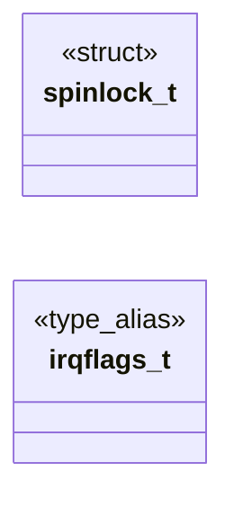

# `headers/spinlock.h`

> Source: [headers/spinlock.h:1](../../headers/spinlock.h#L1) | language `h` | coverage 68.4% | [API index](../index.md)

spinlock.h -- Lightweight spinlock for MiniOS kernel.

## Contents

- **Structs:** [`spinlock_t`](#spinlock_t)
- **Type Aliases:** [`irqflags_t`](#irqflags_t)
- **Functions:** [`spin_init`](#spin_init), [`spin_save_irq`](#spin_save_irq), [`spin_restore_irq`](#spin_restore_irq), [`spin_lock`](#spin_lock), [`spin_unlock`](#spin_unlock), [`spin_lock_irqsave`](#spin_lock_irqsave), [`spin_unlock_irqrestore`](#spin_unlock_irqrestore), [`spin_unlock_keep_irq`](#spin_unlock_keep_irq), [`spin_trylock`](#spin_trylock), [`spin_save_irq`](#spin_save_irq), [`spin_restore_irq`](#spin_restore_irq), [`spin_lock`](#spin_lock), [`spin_unlock`](#spin_unlock), [`spin_unlock_keep_irq`](#spin_unlock_keep_irq), [`spin_unlock_irqrestore`](#spin_unlock_irqrestore)
- **Macros:** [`SPINLOCK_INIT`](#spinlock_init)

## Type Diagram



## Call Graph

Solid arrows stay in this module, dashed arrows leave it.


## Structs

<a id="spinlock_t"></a>

### `spinlock_t`

`struct` | [headers/spinlock.h:38](../../headers/spinlock.h#L38)

```c
typedef struct
```

---

## Type Aliases

<a id="irqflags_t"></a>

### `irqflags_t`

`type_alias` | [headers/spinlock.h:41](../../headers/spinlock.h#L41)

```c
typedef unsigned long irqflags_t;
```

---

## Functions

<a id="spin_init"></a>

### `spin_init`

`function` `inline` `static` | [headers/spinlock.h:46](../../headers/spinlock.h#L46)

```c
static inline void spin_init(spinlock_t *lock)
```

**Parameters**

| Name | Type | Default | Description |
|---|---|---|---|
| `lock` | `spinlock_t *` |  |  |

*Called by:* [`futex_init`](kernel.futex.c.md#futex_init), [`rq_init`](kernel.percpu_rq.c.md#rq_init), [`rcu_init`](kernel.rcu.c.md#rcu_init), [`mutex_init`](kernel.sync.c.md#mutex_init), [`rwlock_init`](kernel.sync.c.md#rwlock_init), [`sem_init`](kernel.sync.c.md#sem_init), [`wq_init`](kernel.sync.c.md#wq_init)

---

<a id="spin_save_irq"></a>

### `spin_save_irq`

`function` `inline` `static` | [headers/spinlock.h:56](../../headers/spinlock.h#L56)

```c
static inline irqflags_t spin_save_irq(void)
```

Host unit-test variants (tests/test_sync.c, `make test-sync`): cli/sti and pushf/popf are privileged and fault in userspace, so the host build spins on the GCC atomics only and treats interrupt state as a dummy value.

Kernel builds never define SYNC_HOST_TEST and always take the real path in the #else branch below.

**Returns:** `irqflags_t`

*Called by:* [`ldso_bind_into`](kernel.loader.c.md#ldso_bind_into), [`load_exec_elf`](kernel.loader.c.md#load_exec_elf), [`load_exec_elf_into`](kernel.loader.c.md#load_exec_elf_into), [`time`](kernel.loader.c.md#time), [`mm_copy_user_page`](kernel.mm.paging.c.md#mm_copy_user_page), [`do_execve`](kernel.sched.c.md#do_execve), [`do_fork_ex`](kernel.sched.c.md#do_fork_ex), [`isr_dispatch`](kernel.sched.c.md#isr_dispatch), [`proc_spawn_elf`](kernel.sched.c.md#proc_spawn_elf), [`state`](kernel.vga_fb.c.md#state), [`vga_fb_mouse_tick`](kernel.vga_fb.c.md#vga_fb_mouse_tick), [`smp_nmi_broadcast`](smp.c.md#smp_nmi_broadcast)

---

<a id="spin_restore_irq"></a>

### `spin_restore_irq`

`function` `inline` `static` | [headers/spinlock.h:57](../../headers/spinlock.h#L57)

```c
static inline void spin_restore_irq(irqflags_t flags)
```

Restore RFLAGS (including IF) from a saved value.

**Parameters**

| Name | Type | Default | Description |
|---|---|---|---|
| `flags` | `irqflags_t` |  |  |

> **Inherited:** Documentation from [`spin_restore_irq`](#spin_restore_irq) (headers/spinlock.h:99).

*Called by:* [`spin_unlock_irqrestore`](#spin_unlock_irqrestore), [`ldso_bind_into`](kernel.loader.c.md#ldso_bind_into), [`load_exec_elf`](kernel.loader.c.md#load_exec_elf), [`load_exec_elf_into`](kernel.loader.c.md#load_exec_elf_into), [`time`](kernel.loader.c.md#time), [`mm_copy_user_page`](kernel.mm.paging.c.md#mm_copy_user_page), [`do_execve`](kernel.sched.c.md#do_execve), [`do_fork_ex`](kernel.sched.c.md#do_fork_ex), [`isr_dispatch`](kernel.sched.c.md#isr_dispatch), [`proc_spawn_elf`](kernel.sched.c.md#proc_spawn_elf), [`state`](kernel.vga_fb.c.md#state), [`vga_fb_mouse_tick`](kernel.vga_fb.c.md#vga_fb_mouse_tick) and 1 more

---

<a id="spin_lock"></a>

### `spin_lock`

`function` `inline` `static` | [headers/spinlock.h:58](../../headers/spinlock.h#L58)

```c
static inline void spin_lock(spinlock_t *lock)
```

Acquire the lock and disable interrupts.

Interrupts are disabled before the CAS loop to prevent ISR re-entry. The memory clobber ensures the compiler does not reorder across the lock. Use this from ISR context or when a single-level lock is sufficient.

**Parameters**

| Name | Type | Default | Description |
|---|---|---|---|
| `lock` | `spinlock_t *` |  |  |

> **Inherited:** Documentation from [`spin_lock`](#spin_lock) (headers/spinlock.h:107).

*Called by:* [`do_exit`](kernel.sched.c.md#do_exit), [`do_kill_code`](kernel.sched.c.md#do_kill_code), [`do_thread_spawn`](kernel.sched.c.md#do_thread_spawn), [`do_waitpid`](kernel.sched.c.md#do_waitpid), [`do_waitpid_linux`](kernel.sched.c.md#do_waitpid_linux), [`proc_create`](kernel.sched.c.md#proc_create), [`schedtop_report`](kernel.sched.c.md#schedtop_report), [`schedule`](kernel.sched.c.md#schedule), [`shell_nchildren`](kernel.sched.c.md#shell_nchildren), [`shell_reap_nb`](kernel.sched.c.md#shell_reap_nb), [`shell_reap_one`](kernel.sched.c.md#shell_reap_one), [`VMA`](kernel.shell.c.md#vma) and 1 more

---

<a id="spin_unlock"></a>

### `spin_unlock`

`function` `inline` `static` | [headers/spinlock.h:64](../../headers/spinlock.h#L64)

```c
static inline void spin_unlock(spinlock_t *lock)
```

Release the lock and re-enable interrupts.

The release uses __sync_lock_release which is a store-release with the correct memory ordering.

**Parameters**

| Name | Type | Default | Description |
|---|---|---|---|
| `lock` | `spinlock_t *` |  |  |

> **Inherited:** Documentation from [`spin_unlock`](#spin_unlock) (headers/spinlock.h:118).

*Called by:* [`vga_putc`](kernel.console.c.md#vga_putc), [`rq_steal_once`](kernel.percpu_rq.c.md#rq_steal_once), [`do_exit`](kernel.sched.c.md#do_exit), [`do_kill_code`](kernel.sched.c.md#do_kill_code), [`do_thread_spawn`](kernel.sched.c.md#do_thread_spawn), [`do_waitpid`](kernel.sched.c.md#do_waitpid), [`do_waitpid_linux`](kernel.sched.c.md#do_waitpid_linux), [`proc_create`](kernel.sched.c.md#proc_create), [`schedtop_report`](kernel.sched.c.md#schedtop_report), [`schedule`](kernel.sched.c.md#schedule), [`shell_nchildren`](kernel.sched.c.md#shell_nchildren), [`shell_reap_nb`](kernel.sched.c.md#shell_reap_nb) and 3 more

---

<a id="spin_lock_irqsave"></a>

### `spin_lock_irqsave`

`function` `inline` `static` | [headers/spinlock.h:68](../../headers/spinlock.h#L68)

```c
static inline void spin_lock_irqsave(spinlock_t *lock, irqflags_t *flags)
```

**Parameters**

| Name | Type | Default | Description |
|---|---|---|---|
| `lock` | `spinlock_t *` |  |  |
| `flags` | `irqflags_t *` |  |  |

*Called by:* [`block_read`](drivers.block.c.md#block_read), [`block_write_multi`](drivers.block.c.md#block_write_multi), [`pcm2_close`](drivers.pcm2.c.md#pcm2_close), [`pcm2_irq`](drivers.pcm2.c.md#pcm2_irq), [`pcm2_open`](drivers.pcm2.c.md#pcm2_open), [`pcm2_poll`](drivers.pcm2.c.md#pcm2_poll), [`pcm2_write`](drivers.pcm2.c.md#pcm2_write), [`match`](fs.pcache.c.md#match), [`pcache_get`](fs.pcache.c.md#pcache_get), [`pcache_invalidate_ino`](fs.pcache.c.md#pcache_invalidate_ino), [`pcache_lookup`](fs.pcache.c.md#pcache_lookup), [`pcache_mark_dirty`](fs.pcache.c.md#pcache_mark_dirty) and 56 more

---

<a id="spin_unlock_irqrestore"></a>

### `spin_unlock_irqrestore`

`function` `inline` `static` | [headers/spinlock.h:75](../../headers/spinlock.h#L75)

```c
static inline void spin_unlock_irqrestore(spinlock_t *lock, irqflags_t flags)
```

Release the lock and restore the saved interrupt state.

If the caller's interrupts were enabled before spin_lock_irqsave, they are re-enabled here.  If they were disabled, they stay disabled.

**Parameters**

| Name | Type | Default | Description |
|---|---|---|---|
| `lock` | `spinlock_t *` |  |  |
| `flags` | `irqflags_t` |  |  |

> **Inherited:** Documentation from [`spin_unlock_irqrestore`](#spin_unlock_irqrestore) (headers/spinlock.h:150).

*Called by:* [`block_read`](drivers.block.c.md#block_read), [`block_write_multi`](drivers.block.c.md#block_write_multi), [`pcm2_close`](drivers.pcm2.c.md#pcm2_close), [`pcm2_irq`](drivers.pcm2.c.md#pcm2_irq), [`pcm2_open`](drivers.pcm2.c.md#pcm2_open), [`pcm2_poll`](drivers.pcm2.c.md#pcm2_poll), [`pcm2_write`](drivers.pcm2.c.md#pcm2_write), [`match`](fs.pcache.c.md#match), [`pcache_get`](fs.pcache.c.md#pcache_get), [`pcache_invalidate_ino`](fs.pcache.c.md#pcache_invalidate_ino), [`pcache_lookup`](fs.pcache.c.md#pcache_lookup), [`pcache_mark_dirty`](fs.pcache.c.md#pcache_mark_dirty) and 56 more

---

<a id="spin_unlock_keep_irq"></a>

### `spin_unlock_keep_irq`

`function` `inline` `static` | [headers/spinlock.h:80](../../headers/spinlock.h#L80)

```c
static inline void spin_unlock_keep_irq(spinlock_t *lock)
```

Release the lock WITHOUT touching interrupts (IF stays as-is).

For context-switch paths: the lock was acquired with interrupts off and they must stay off across the switch, because a timer tick landing between the release and switch_to would park the half-switched state over the incoming thread's ctx.  The incoming context's own rflags decide IF after the switch.

**Parameters**

| Name | Type | Default | Description |
|---|---|---|---|
| `lock` | `spinlock_t *` |  |  |

> **Inherited:** Documentation from [`spin_unlock_keep_irq`](#spin_unlock_keep_irq) (headers/spinlock.h:130).

*Called by:* [`schedule`](kernel.sched.c.md#schedule)

---

<a id="spin_trylock"></a>

### `spin_trylock`

`function` `inline` `static` | [headers/spinlock.h:84](../../headers/spinlock.h#L84)

```c
static inline int spin_trylock(spinlock_t *lock)
```

**Parameters**

| Name | Type | Default | Description |
|---|---|---|---|
| `lock` | `spinlock_t *` |  |  |

**Returns:** `int`

*Called by:* [`vga_putc`](kernel.console.c.md#vga_putc), [`rq_steal_once`](kernel.percpu_rq.c.md#rq_steal_once)

---

<a id="spin_save_irq"></a>

### `spin_save_irq`

`function` `inline` `static` | [headers/spinlock.h:92](../../headers/spinlock.h#L92)

```c
static inline irqflags_t spin_save_irq(void)
```

Read RFLAGS and disable interrupts.

**Returns:** `irqflags_t`

---

<a id="spin_restore_irq"></a>

### `spin_restore_irq`

`function` `inline` `static` | [headers/spinlock.h:99](../../headers/spinlock.h#L99)

```c
static inline void spin_restore_irq(irqflags_t flags)
```

Restore RFLAGS (including IF) from a saved value.

**Parameters**

| Name | Type | Default | Description |
|---|---|---|---|
| `flags` | `irqflags_t` |  |  |

---

<a id="spin_lock"></a>

### `spin_lock`

`function` `inline` `static` | [headers/spinlock.h:107](../../headers/spinlock.h#L107)

```c
static inline void spin_lock(spinlock_t *lock)
```

Acquire the lock and disable interrupts.

Interrupts are disabled before the CAS loop to prevent ISR re-entry. The memory clobber ensures the compiler does not reorder across the lock. Use this from ISR context or when a single-level lock is sufficient.

**Parameters**

| Name | Type | Default | Description |
|---|---|---|---|
| `lock` | `spinlock_t *` |  |  |

---

<a id="spin_unlock"></a>

### `spin_unlock`

`function` `inline` `static` | [headers/spinlock.h:118](../../headers/spinlock.h#L118)

```c
static inline void spin_unlock(spinlock_t *lock)
```

Release the lock and re-enable interrupts.

The release uses __sync_lock_release which is a store-release with the correct memory ordering.

**Parameters**

| Name | Type | Default | Description |
|---|---|---|---|
| `lock` | `spinlock_t *` |  |  |

---

<a id="spin_unlock_keep_irq"></a>

### `spin_unlock_keep_irq`

`function` `inline` `static` | [headers/spinlock.h:130](../../headers/spinlock.h#L130)

```c
static inline void spin_unlock_keep_irq(spinlock_t *lock)
```

Release the lock WITHOUT touching interrupts (IF stays as-is).

For context-switch paths: the lock was acquired with interrupts off and they must stay off across the switch, because a timer tick landing between the release and switch_to would park the half-switched state over the incoming thread's ctx.  The incoming context's own rflags decide IF after the switch.

**Parameters**

| Name | Type | Default | Description |
|---|---|---|---|
| `lock` | `spinlock_t *` |  |  |

---

<a id="spin_unlock_irqrestore"></a>

### `spin_unlock_irqrestore`

`function` `inline` `static` | [headers/spinlock.h:150](../../headers/spinlock.h#L150)

```c
static inline void spin_unlock_irqrestore(spinlock_t *lock, irqflags_t flags)
```

Release the lock and restore the saved interrupt state.

If the caller's interrupts were enabled before spin_lock_irqsave, they are re-enabled here.  If they were disabled, they stay disabled.

**Parameters**

| Name | Type | Default | Description |
|---|---|---|---|
| `lock` | `spinlock_t *` |  |  |
| `flags` | `irqflags_t` |  |  |

*Calls:* [`spin_restore_irq`](#spin_restore_irq)

---

## Macros

<a id="spinlock_init"></a>

### `SPINLOCK_INIT`

`macro` | [headers/spinlock.h:44](../../headers/spinlock.h#L44)

```c
#define SPINLOCK_INIT
```

---
