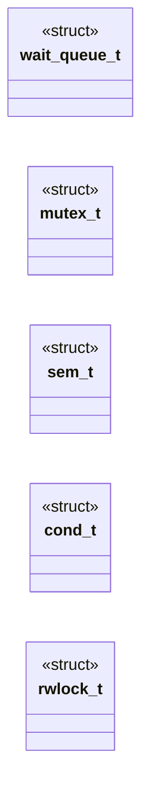

# `headers/sync.h`

> Source: [headers/sync.h:1](../../headers/sync.h#L1) | language `h` | coverage 18.4% | [API index](../index.md)

sync.h -- Blocking synchronization primitives (roadmap Phase 3.1).

## Contents

- **Structs:** [`wait_queue_t`](#wait_queue_t), [`mutex_t`](#mutex_t), [`sem_t`](#sem_t), [`cond_t`](#cond_t), [`rwlock_t`](#rwlock_t)
- **Functions:** [`wq_init`](#wq_init), [`sleep_on`](#sleep_on), [`wake_up`](#wake_up), [`wake_up_all`](#wake_up_all), [`inheritance`](#inheritance), [`mutex_init`](#mutex_init), [`mutex_lock`](#mutex_lock), [`mutex_unlock`](#mutex_unlock), [`mutex_trylock`](#mutex_trylock), [`mutex_note_waiter`](#mutex_note_waiter), [`pi_set_base`](#pi_set_base), [`pi_get_eff`](#pi_get_eff), [`sem_init`](#sem_init), [`sem_wait`](#sem_wait), [`sem_post`](#sem_post), [`cond_init`](#cond_init), [`cond_wait`](#cond_wait), [`cond_signal`](#cond_signal), [`cond_broadcast`](#cond_broadcast), [`rwlock_init`](#rwlock_init), [`rwlock_read_lock`](#rwlock_read_lock), [`rwlock_read_unlock`](#rwlock_read_unlock), [`rwlock_write_lock`](#rwlock_write_lock), [`rwlock_write_unlock`](#rwlock_write_unlock), [`now`](#now), [`rwlock_write_trylock`](#rwlock_write_trylock)
- **Macros:** [`WQ_NONE`](#wq_none), [`WAIT_QUEUE_INIT`](#wait_queue_init), [`MUTEX_INIT`](#mutex_init), [`SEM_INIT`](#sem_init), [`COND_INIT`](#cond_init), [`RWLOCK_INIT`](#rwlock_init)

## Type Diagram



## Structs

<a id="wait_queue_t"></a>

### `wait_queue_t`

`struct` | [headers/sync.h:42](../../headers/sync.h#L42)

```c
typedef struct
```

---- Wait queues ----

---

<a id="mutex_t"></a>

### `mutex_t`

`struct` | [headers/sync.h:63](../../headers/sync.h#L63)

```c
typedef struct
```

---- Mutex (blocking, non-recursive) ----
Priority inheritance (thesis correction 3): a low-priority holder that
blocks a high-priority waiter is boosted to the waiter's effective
priority, transitively along the blocked-on chain, until it releases.
pi_set_base assigns a thread's base priority (default 0); pi_get_eff
reports the boosted value the scheduler must honor. State lives in
sync.c parallel arrays: proc_t is 248 bytes by asm contract (sched.c
asserts it, syscall_entry hardcodes it), so no field can be added.

---

<a id="sem_t"></a>

### `sem_t`

`struct` | [headers/sync.h:81](../../headers/sync.h#L81)

```c
typedef struct
```

---- Counting semaphore ----

---

<a id="cond_t"></a>

### `cond_t`

`struct` | [headers/sync.h:97](../../headers/sync.h#L97)

```c
typedef struct
```

---- Condition variable ----
Always paired with a mutex: cond_wait atomically releases the mutex,
sleeps, and re-acquires it before returning (Mesa semantics: re-check
the predicate in a loop).

---

<a id="rwlock_t"></a>

### `rwlock_t`

`struct` | [headers/sync.h:114](../../headers/sync.h#L114)

```c
typedef struct
```

---- Read-write lock (writer-preferring, no recursion) ----
A queued writer announces itself in `writers_waiting`, and new
readers yield to it: without that rule a steady stream of readers
starves the writer (every reader sees readers == 0 on its way in).
The counter is incremented when the writer starts waiting and
decremented when it finally holds the lock, so it never leaks.

---

## Functions

<a id="wq_init"></a>

### `wq_init`

`function` | [headers/sync.h:50](../../headers/sync.h#L50)

```c
void wq_init(wait_queue_t *q);
```

**Parameters**

| Name | Type | Default | Description |
|---|---|---|---|
| `q` | `wait_queue_t *` |  |  |

*Called by:* [`minfo_sleep_init`](kernel.syscalls.c.md#minfo_sleep_init)

---

<a id="sleep_on"></a>

### `sleep_on`

`function` | [headers/sync.h:51](../../headers/sync.h#L51)

```c
void sleep_on(wait_queue_t *q);
```

**Parameters**

| Name | Type | Default | Description |
|---|---|---|---|
| `q` | `wait_queue_t *` |  |  |

*Called by:* [`view`](kernel.syscalls.c.md#view)

---

<a id="wake_up"></a>

### `wake_up`

`function` | [headers/sync.h:52](../../headers/sync.h#L52)

```c
int wake_up(wait_queue_t *q);
```

**Parameters**

| Name | Type | Default | Description |
|---|---|---|---|
| `q` | `wait_queue_t *` |  |  |

**Returns:** `int`

---

<a id="wake_up_all"></a>

### `wake_up_all`

`function` | [headers/sync.h:53](../../headers/sync.h#L53)

```c
int wake_up_all(wait_queue_t *q);
```

**Parameters**

| Name | Type | Default | Description |
|---|---|---|---|
| `q` | `wait_queue_t *` |  |  |

**Returns:** `int`

*Called by:* [`minfo_tick_wake`](kernel.syscalls.c.md#minfo_tick_wake)

---

<a id="inheritance"></a>

### `inheritance`

`function` | [headers/sync.h:56](../../headers/sync.h#L56)

```c
* Priority inheritance (thesis correction 3): a low-priority holder that * blocks a high-priority waiter is boosted to the waiter's effective * priority, transitively along the blocked-on chain, until
```

**Parameters**

| Name | Type | Default | Description |
|---|---|---|---|
| `correction` | `thesis 3` |  |  |

**Returns:** `a low-priority holder that * blocks a high-priority waiter is boosted to the waiter's effective * priority, transitively along the blocked-on chain, until`

---

<a id="mutex_init"></a>

### `mutex_init`

`function` | [headers/sync.h:72](../../headers/sync.h#L72)

```c
void mutex_init(mutex_t *m);
```

**Parameters**

| Name | Type | Default | Description |
|---|---|---|---|
| `m` | `mutex_t *` |  |  |

---

<a id="mutex_lock"></a>

### `mutex_lock`

`function` | [headers/sync.h:73](../../headers/sync.h#L73)

```c
void mutex_lock(mutex_t *m);
```

**Parameters**

| Name | Type | Default | Description |
|---|---|---|---|
| `m` | `mutex_t *` |  |  |

---

<a id="mutex_unlock"></a>

### `mutex_unlock`

`function` | [headers/sync.h:74](../../headers/sync.h#L74)

```c
void mutex_unlock(mutex_t *m);
```

**Parameters**

| Name | Type | Default | Description |
|---|---|---|---|
| `m` | `mutex_t *` |  |  |

---

<a id="mutex_trylock"></a>

### `mutex_trylock`

`function` | [headers/sync.h:75](../../headers/sync.h#L75)

```c
int mutex_trylock(mutex_t *m);
```

**Parameters**

| Name | Type | Default | Description |
|---|---|---|---|
| `m` | `mutex_t *` |  |  |

**Returns:** `int`

---

<a id="mutex_note_waiter"></a>

### `mutex_note_waiter`

`function` | [headers/sync.h:76](../../headers/sync.h#L76)

```c
void mutex_note_waiter(mutex_t *m, int waiter);
```

**Parameters**

| Name | Type | Default | Description |
|---|---|---|---|
| `m` | `mutex_t *` |  |  |
| `waiter` | `int` |  |  |

*Called by:* [`mutex_lock`](kernel.sync.c.md#mutex_lock)

---

<a id="pi_set_base"></a>

### `pi_set_base`

`function` | [headers/sync.h:77](../../headers/sync.h#L77)

```c
void pi_set_base(int pid, int prio);
```

**Parameters**

| Name | Type | Default | Description |
|---|---|---|---|
| `pid` | `int` |  |  |
| `prio` | `int` |  |  |

---

<a id="pi_get_eff"></a>

### `pi_get_eff`

`function` | [headers/sync.h:78](../../headers/sync.h#L78)

```c
int pi_get_eff(int pid);
```

**Parameters**

| Name | Type | Default | Description |
|---|---|---|---|
| `pid` | `int` |  |  |

**Returns:** `int`

---

<a id="sem_init"></a>

### `sem_init`

`function` | [headers/sync.h:89](../../headers/sync.h#L89)

```c
void sem_init(sem_t *s, int value);
```

**Parameters**

| Name | Type | Default | Description |
|---|---|---|---|
| `s` | `sem_t *` |  |  |
| `value` | `int` |  |  |

---

<a id="sem_wait"></a>

### `sem_wait`

`function` | [headers/sync.h:90](../../headers/sync.h#L90)

```c
void sem_wait(sem_t *s);
```

**Parameters**

| Name | Type | Default | Description |
|---|---|---|---|
| `s` | `sem_t *` |  |  |

---

<a id="sem_post"></a>

### `sem_post`

`function` | [headers/sync.h:91](../../headers/sync.h#L91)

```c
void sem_post(sem_t *s);
```

**Parameters**

| Name | Type | Default | Description |
|---|---|---|---|
| `s` | `sem_t *` |  |  |

---

<a id="cond_init"></a>

### `cond_init`

`function` | [headers/sync.h:103](../../headers/sync.h#L103)

```c
void cond_init(cond_t *c);
```

**Parameters**

| Name | Type | Default | Description |
|---|---|---|---|
| `c` | `cond_t *` |  |  |

---

<a id="cond_wait"></a>

### `cond_wait`

`function` | [headers/sync.h:104](../../headers/sync.h#L104)

```c
void cond_wait(cond_t *c, mutex_t *m);
```

**Parameters**

| Name | Type | Default | Description |
|---|---|---|---|
| `c` | `cond_t *` |  |  |
| `m` | `mutex_t *` |  |  |

---

<a id="cond_signal"></a>

### `cond_signal`

`function` | [headers/sync.h:105](../../headers/sync.h#L105)

```c
void cond_signal(cond_t *c);
```

**Parameters**

| Name | Type | Default | Description |
|---|---|---|---|
| `c` | `cond_t *` |  |  |

---

<a id="cond_broadcast"></a>

### `cond_broadcast`

`function` | [headers/sync.h:106](../../headers/sync.h#L106)

```c
void cond_broadcast(cond_t *c);
```

**Parameters**

| Name | Type | Default | Description |
|---|---|---|---|
| `c` | `cond_t *` |  |  |

---

<a id="rwlock_init"></a>

### `rwlock_init`

`function` | [headers/sync.h:124](../../headers/sync.h#L124)

```c
void rwlock_init(rwlock_t *rw);
```

**Parameters**

| Name | Type | Default | Description |
|---|---|---|---|
| `rw` | `rwlock_t *` |  |  |

---

<a id="rwlock_read_lock"></a>

### `rwlock_read_lock`

`function` | [headers/sync.h:125](../../headers/sync.h#L125)

```c
void rwlock_read_lock(rwlock_t *rw);
```

**Parameters**

| Name | Type | Default | Description |
|---|---|---|---|
| `rw` | `rwlock_t *` |  |  |

---

<a id="rwlock_read_unlock"></a>

### `rwlock_read_unlock`

`function` | [headers/sync.h:126](../../headers/sync.h#L126)

```c
void rwlock_read_unlock(rwlock_t *rw);
```

**Parameters**

| Name | Type | Default | Description |
|---|---|---|---|
| `rw` | `rwlock_t *` |  |  |

---

<a id="rwlock_write_lock"></a>

### `rwlock_write_lock`

`function` | [headers/sync.h:127](../../headers/sync.h#L127)

```c
void rwlock_write_lock(rwlock_t *rw);
```

**Parameters**

| Name | Type | Default | Description |
|---|---|---|---|
| `rw` | `rwlock_t *` |  |  |

---

<a id="rwlock_write_unlock"></a>

### `rwlock_write_unlock`

`function` | [headers/sync.h:128](../../headers/sync.h#L128)

```c
void rwlock_write_unlock(rwlock_t *rw);
```

**Parameters**

| Name | Type | Default | Description |
|---|---|---|---|
| `rw` | `rwlock_t *` |  |  |

---

<a id="now"></a>

### `now`

`function` | [headers/sync.h:130](../../headers/sync.h#L130)

```c
* available right now (a reader never takes it while a writer waits). */ int rwlock_read_trylock(rwlock_t *rw);
```

**Parameters**

| Name | Type | Default | Description |
|---|---|---|---|
| `waits` | `a reader never takes it while a writer` |  |  |

**Returns:** `* available right`

---

<a id="rwlock_write_trylock"></a>

### `rwlock_write_trylock`

`function` | [headers/sync.h:132](../../headers/sync.h#L132)

```c
int rwlock_write_trylock(rwlock_t *rw);
```

**Parameters**

| Name | Type | Default | Description |
|---|---|---|---|
| `rw` | `rwlock_t *` |  |  |

**Returns:** `int`

---

## Macros

<a id="wq_none"></a>

### `WQ_NONE`

`macro` | [headers/sync.h:39](../../headers/sync.h#L39)

```c
#define WQ_NONE
```

wait-queue linkage: procs chain through proc_t.wq_next, WQ_NONE ends the chain and marks an empty queue.

PIDs start at 1 (sched.c), so a zeroed proc_t never aliases a queued entry.

---

<a id="wait_queue_init"></a>

### `WAIT_QUEUE_INIT`

`macro` | [headers/sync.h:48](../../headers/sync.h#L48)

```c
#define WAIT_QUEUE_INIT
```

---

<a id="mutex_init"></a>

### `MUTEX_INIT`

`macro` | [headers/sync.h:70](../../headers/sync.h#L70)

```c
#define MUTEX_INIT
```

---

<a id="sem_init"></a>

### `SEM_INIT`

`macro` | [headers/sync.h:87](../../headers/sync.h#L87)

```c
#define SEM_INIT(n)
```

---

<a id="cond_init"></a>

### `COND_INIT`

`macro` | [headers/sync.h:101](../../headers/sync.h#L101)

```c
#define COND_INIT
```

---

<a id="rwlock_init"></a>

### `RWLOCK_INIT`

`macro` | [headers/sync.h:122](../../headers/sync.h#L122)

```c
#define RWLOCK_INIT
```

---
