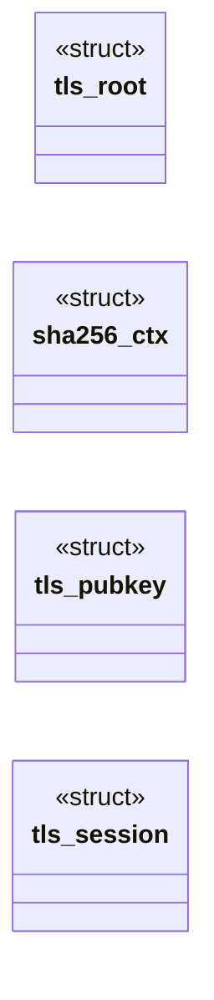

# `headers/tls.h`

> Source: [headers/tls.h:1](../../headers/tls.h#L1) | language `h` | coverage 40.3% | [API index](../index.md)

========== TLS 1.2 client (RFC 5246) ==========

## Contents

- **Structs:** [`tls_root`](#tls_root), [`sha256_ctx`](#sha256_ctx), [`tls_pubkey`](#tls_pubkey), [`tls_session`](#tls_session)
- **Functions:** [`sha256_init`](#sha256_init), [`sha256_update`](#sha256_update), [`sha256_final`](#sha256_final), [`sha256`](#sha256), [`sha384`](#sha384), [`hmac_sha256`](#hmac_sha256), [`tls_prf`](#tls_prf), [`aes128_encrypt_block`](#aes128_encrypt_block), [`aes128_gcm_seal`](#aes128_gcm_seal), [`aes128_gcm_open`](#aes128_gcm_open), [`aes128_gcm_seal_core`](#aes128_gcm_seal_core), [`aes128_gcm_open_core`](#aes128_gcm_open_core), [`p256_scalar_mult`](#p256_scalar_mult), [`p384_scalar_mult`](#p384_scalar_mult), [`p256_ecdh`](#p256_ecdh), [`p256_point_valid`](#p256_point_valid), [`p256_pub`](#p256_pub), [`p256_scalar_valid`](#p256_scalar_valid), [`ecdsa_verify`](#ecdsa_verify), [`rsa_pkcs1_verify_sha256`](#rsa_pkcs1_verify_sha256), [`rsa_pkcs1_verify_sha384`](#rsa_pkcs1_verify_sha384), [`tls_x509_parse_pubkey`](#tls_x509_parse_pubkey), [`now`](#now), [`tls_handshake`](#tls_handshake), [`tls_send`](#tls_send), [`tls_recv`](#tls_recv), [`tls_free_fd`](#tls_free_fd), [`tls_sys_handshake`](#tls_sys_handshake), [`tls_sys_send`](#tls_sys_send), [`tls_sys_recv`](#tls_sys_recv)
- **Macros:** [`TLS_CT_CCS`](#tls_ct_ccs), [`TLS_CT_ALERT`](#tls_ct_alert), [`TLS_CT_HANDSHAKE`](#tls_ct_handshake), [`TLS_CT_APPDATA`](#tls_ct_appdata), [`TLS_REC_HEADER`](#tls_rec_header), [`TLS_REC_MAX`](#tls_rec_max), [`TLS_MSG_MAX`](#tls_msg_max), [`TLS_PLAIN_MAX`](#tls_plain_max), [`TLS_VERSION_TLS12`](#tls_version_tls12), [`TLS_VERSION_TLS10`](#tls_version_tls10), [`TLS_HS_CLIENT_HELLO`](#tls_hs_client_hello), [`TLS_HS_SERVER_HELLO`](#tls_hs_server_hello), [`TLS_HS_CERTIFICATE`](#tls_hs_certificate), [`TLS_HS_SERVER_KEY_EXCHANGE`](#tls_hs_server_key_exchange), [`TLS_HS_SERVER_HELLO_DONE`](#tls_hs_server_hello_done), [`TLS_HS_CLIENT_KEY_EXCHANGE`](#tls_hs_client_key_exchange), [`TLS_HS_FINISHED`](#tls_hs_finished), [`TLS_CSUITE_ECDHE_RSA_AES128GCM`](#tls_csuite_ecdhe_rsa_aes128gcm), [`TLS_CSUITE_ECDHE_ECDSA_AES128GCM`](#tls_csuite_ecdhe_ecdsa_aes128gcm), [`TLS_SIG_RSA_PKCS1_SHA256`](#tls_sig_rsa_pkcs1_sha256), [`TLS_SIG_ECDSA_P256_SHA256`](#tls_sig_ecdsa_p256_sha256), [`TLS_SIG_ECDSA_P384_SHA384`](#tls_sig_ecdsa_p384_sha384), [`TLS_GROUP_SECP256R1`](#tls_group_secp256r1), [`TLS_EXT_SERVER_NAME`](#tls_ext_server_name), [`TLS_EXT_SUPPORTED_GROUPS`](#tls_ext_supported_groups), [`TLS_EXT_EC_POINT_FORMATS`](#tls_ext_ec_point_formats), [`TLS_EXT_SIGNATURE_ALGS`](#tls_ext_signature_algs), [`TLS_ALERT_LEVEL_WARNING`](#tls_alert_level_warning), [`TLS_ALERT_LEVEL_FATAL`](#tls_alert_level_fatal), [`TLS_HS_TIMEOUT_MS`](#tls_hs_timeout_ms), [`TLS_READ_TIMEOUT_MS`](#tls_read_timeout_ms), [`TLS_HOST_MAX`](#tls_host_max), [`TLS_CHAIN_MAX`](#tls_chain_max), [`TLS_CERT_MAX`](#tls_cert_max), [`TLS_BN_4096_WORDS`](#tls_bn_4096_words), [`TLS_BN_384_WORDS`](#tls_bn_384_words), [`TLS_ROOT_COUNT`](#tls_root_count)
- **Variables:** [`tls_roots`](#tls_roots)

## Type Diagram



## Structs

<a id="tls_root"></a>

### `tls_root`

`struct` | [headers/tls.h:70](../../headers/tls.h#L70)

```c
struct tls_root
```

---

<a id="sha256_ctx"></a>

### `sha256_ctx`

`struct` | [headers/tls.h:79](../../headers/tls.h#L79)

```c
struct sha256_ctx
```

---

<a id="tls_pubkey"></a>

### `tls_pubkey`

`struct` | [headers/tls.h:85](../../headers/tls.h#L85)

```c
struct tls_pubkey
```

---

<a id="tls_session"></a>

### `tls_session`

`struct` | [headers/tls.h:95](../../headers/tls.h#L95)

```c
struct tls_session
```

---

## Functions

<a id="sha256_init"></a>

### `sha256_init`

`function` | [headers/tls.h:168](../../headers/tls.h#L168)

```c
void sha256_init(struct sha256_ctx *c);
```

**Parameters**

| Name | Type | Default | Description |
|---|---|---|---|
| `c` | `struct sha256_ctx *` |  |  |

*Called by:* [`tls_handshake`](net.tls.c.md#tls_handshake)

---

<a id="sha256_update"></a>

### `sha256_update`

`function` | [headers/tls.h:169](../../headers/tls.h#L169)

```c
void sha256_update(struct sha256_ctx *c, const unsigned char *data, unsigned len);
```

**Parameters**

| Name | Type | Default | Description |
|---|---|---|---|
| `c` | `struct sha256_ctx *` |  |  |
| `data` | `unsigned char *` |  |  |
| `len` | `unsigned` |  |  |

*Called by:* [`exchange`](net.tls.c.md#exchange), [`tls_handshake`](net.tls.c.md#tls_handshake)

---

<a id="sha256_final"></a>

### `sha256_final`

`function` | [headers/tls.h:170](../../headers/tls.h#L170)

```c
void sha256_final(struct sha256_ctx *c, unsigned char out[32]);
```

**Parameters**

| Name | Type | Default | Description |
|---|---|---|---|
| `c` | `struct sha256_ctx *` |  |  |
| `out` | `unsigned char [32]` |  |  |

*Called by:* [`tls_handshake`](net.tls.c.md#tls_handshake)

---

<a id="sha256"></a>

### `sha256`

`function` | [headers/tls.h:171](../../headers/tls.h#L171)

```c
void sha256(const unsigned char *data, unsigned len, unsigned char out[32]);
```

**Parameters**

| Name | Type | Default | Description |
|---|---|---|---|
| `data` | `unsigned char *` |  |  |
| `len` | `unsigned` |  |  |
| `out` | `unsigned char [32]` |  |  |

---

<a id="sha384"></a>

### `sha384`

`function` | [headers/tls.h:172](../../headers/tls.h#L172)

```c
void sha384(const unsigned char *data, unsigned len, unsigned char out[48]);
```

**Parameters**

| Name | Type | Default | Description |
|---|---|---|---|
| `data` | `unsigned char *` |  |  |
| `len` | `unsigned` |  |  |
| `out` | `unsigned char [48]` |  |  |

---

<a id="hmac_sha256"></a>

### `hmac_sha256`

`function` | [headers/tls.h:174](../../headers/tls.h#L174)

```c
void hmac_sha256(const unsigned char *key, unsigned klen, const unsigned char *data, unsigned dlen, unsigned char out[32]);
```

**Parameters**

| Name | Type | Default | Description |
|---|---|---|---|
| `key` | `unsigned char *` |  |  |
| `klen` | `unsigned` |  |  |
| `data` | `unsigned char *` |  |  |
| `dlen` | `unsigned` |  |  |
| `out` | `unsigned char [32]` |  |  |

---

<a id="tls_prf"></a>

### `tls_prf`

`function` | [headers/tls.h:179](../../headers/tls.h#L179)

```c
void tls_prf(const unsigned char *secret, unsigned secret_len, const char *label, const unsigned char *seed, unsigned seed_len, unsigned char *out, unsigned out_len);
```

TLS 1.2 PRF with SHA-256

**Parameters**

| Name | Type | Default | Description |
|---|---|---|---|
| `secret` | `unsigned char *` |  |  |
| `secret_len` | `unsigned` |  |  |
| `label` | `char *` |  |  |
| `seed` | `unsigned char *` |  |  |
| `seed_len` | `unsigned` |  |  |
| `out` | `unsigned char *` |  |  |
| `out_len` | `unsigned` |  |  |

*Called by:* [`tls_handshake`](net.tls.c.md#tls_handshake)

---

<a id="aes128_encrypt_block"></a>

### `aes128_encrypt_block`

`function` | [headers/tls.h:184](../../headers/tls.h#L184)

```c
void aes128_encrypt_block(const unsigned char key[16], const unsigned char in[16], unsigned char out[16]);
```

AES-128 block cipher (key expansion internal; T-table implementation)

**Parameters**

| Name | Type | Default | Description |
|---|---|---|---|
| `key` | `unsigned char [16]` |  |  |
| `in` | `unsigned char [16]` |  |  |
| `out` | `unsigned char [16]` |  |  |

---

<a id="aes128_gcm_seal"></a>

### `aes128_gcm_seal`

`function` | [headers/tls.h:189](../../headers/tls.h#L189)

```c
int aes128_gcm_seal(const unsigned char key[16], const unsigned char salt[4], unsigned long long seq, const unsigned char *aad, unsigned aad_len, const unsigned char *pt, unsigned pt_len, unsigned char *ct, unsigned char tag[16])
```

GCM.

Each call seals one record: tag = 16 bytes appended to ct. Returns 0 on success, -1 on overflow (len > TLS_REC_MAX).

**Parameters**

| Name | Type | Default | Description |
|---|---|---|---|
| `key` | `unsigned char [16]` |  |  |
| `salt` | `unsigned char [4]` |  |  |
| `seq` | `unsigned long long` |  |  |
| `aad` | `unsigned char *` |  |  |
| `aad_len` | `unsigned` |  |  |
| `pt` | `unsigned char *` |  |  |
| `pt_len` | `unsigned` |  |  |
| `ct` | `unsigned char *` |  |  |
| `tag` | `unsigned char [16]` |  |  |

**Returns:** `int`

---

<a id="aes128_gcm_open"></a>

### `aes128_gcm_open`

`function` | [headers/tls.h:197](../../headers/tls.h#L197)

```c
int aes128_gcm_open(const unsigned char key[16], const unsigned char salt[4], unsigned long long seq, const unsigned char *aad, unsigned aad_len, const unsigned char *ct, unsigned ct_len, const unsigned char tag[16], unsigned char *pt)
```

Returns 0 when the tag verifies, -1 otherwise (constant-time compare).

**Parameters**

| Name | Type | Default | Description |
|---|---|---|---|
| `key` | `unsigned char [16]` |  |  |
| `salt` | `unsigned char [4]` |  |  |
| `seq` | `unsigned long long` |  |  |
| `aad` | `unsigned char *` |  |  |
| `aad_len` | `unsigned` |  |  |
| `ct` | `unsigned char *` |  |  |
| `ct_len` | `unsigned` |  |  |
| `tag` | `unsigned char [16]` |  |  |
| `pt` | `unsigned char *` |  |  |

**Returns:** `int`

---

<a id="aes128_gcm_seal_core"></a>

### `aes128_gcm_seal_core`

`function` | [headers/tls.h:208](../../headers/tls.h#L208)

```c
int aes128_gcm_seal_core(const unsigned char key[16], const unsigned char nonce[12], const unsigned char *aad, unsigned aad_len, const unsigned char *pt, unsigned pt_len, unsigned char *ct, unsigned char tag[16])
```

Core GCM with an arbitrary 12-byte nonce (the TLS API above is the 4-byte salt + 8-byte sequence special case).

Used by the host tests against the NIST vectors.

**Parameters**

| Name | Type | Default | Description |
|---|---|---|---|
| `key` | `unsigned char [16]` |  |  |
| `nonce` | `unsigned char [12]` |  |  |
| `aad` | `unsigned char *` |  |  |
| `aad_len` | `unsigned` |  |  |
| `pt` | `unsigned char *` |  |  |
| `pt_len` | `unsigned` |  |  |
| `ct` | `unsigned char *` |  |  |
| `tag` | `unsigned char [16]` |  |  |

**Returns:** `int`

*Called by:* [`number`](net.tls.c.md#number)

---

<a id="aes128_gcm_open_core"></a>

### `aes128_gcm_open_core`

`function` | [headers/tls.h:213](../../headers/tls.h#L213)

```c
int aes128_gcm_open_core(const unsigned char key[16], const unsigned char nonce[12], const unsigned char *aad, unsigned aad_len, const unsigned char *ct, unsigned ct_len, const unsigned char tag[16], unsigned char *pt)
```

**Parameters**

| Name | Type | Default | Description |
|---|---|---|---|
| `key` | `unsigned char [16]` |  |  |
| `nonce` | `unsigned char [12]` |  |  |
| `aad` | `unsigned char *` |  |  |
| `aad_len` | `unsigned` |  |  |
| `ct` | `unsigned char *` |  |  |
| `ct_len` | `unsigned` |  |  |
| `tag` | `unsigned char [16]` |  |  |
| `pt` | `unsigned char *` |  |  |

**Returns:** `int`

---

<a id="p256_scalar_mult"></a>

### `p256_scalar_mult`

`function` | [headers/tls.h:222](../../headers/tls.h#L222)

```c
int p256_scalar_mult(const unsigned char scalar[32], const unsigned char qx[32], const unsigned char qy[32], unsigned char rx[32], unsigned char ry[32]);
```

secp256r1 / secp384r1: shared Jacobian point arithmetic over NIST primes. curve: 0 = P-256, 1 = P-384.

**Parameters**

| Name | Type | Default | Description |
|---|---|---|---|
| `scalar` | `unsigned char [32]` |  |  |
| `qx` | `unsigned char [32]` |  |  |
| `qy` | `unsigned char [32]` |  |  |
| `rx` | `unsigned char [32]` |  |  |
| `ry` | `unsigned char [32]` |  |  |

**Returns:** `int`

---

<a id="p384_scalar_mult"></a>

### `p384_scalar_mult`

`function` | [headers/tls.h:225](../../headers/tls.h#L225)

```c
int p384_scalar_mult(const unsigned char scalar[48], const unsigned char qx[48], const unsigned char qy[48], unsigned char rx[48], unsigned char ry[48]);
```

**Parameters**

| Name | Type | Default | Description |
|---|---|---|---|
| `scalar` | `unsigned char [48]` |  |  |
| `qx` | `unsigned char [48]` |  |  |
| `qy` | `unsigned char [48]` |  |  |
| `rx` | `unsigned char [48]` |  |  |
| `ry` | `unsigned char [48]` |  |  |

**Returns:** `int`

---

<a id="p256_ecdh"></a>

### `p256_ecdh`

`function` | [headers/tls.h:231](../../headers/tls.h#L231)

```c
int p256_ecdh(const unsigned char priv[32], const unsigned char peer_x[32], const unsigned char peer_y[32], unsigned char z[32]);
```

ECDH shared secret: Z = priv * peer_pub (P-256).

Returns 0 on success, -1 when the peer point is not on the curve (fail closed).

**Parameters**

| Name | Type | Default | Description |
|---|---|---|---|
| `priv` | `unsigned char [32]` |  |  |
| `peer_x` | `unsigned char [32]` |  |  |
| `peer_y` | `unsigned char [32]` |  |  |
| `z` | `unsigned char [32]` |  |  |

**Returns:** `int`

---

<a id="p256_point_valid"></a>

### `p256_point_valid`

`function` | [headers/tls.h:236](../../headers/tls.h#L236)

```c
int p256_point_valid(const unsigned char x[32], const unsigned char y[32]);
```

P-256 point validation and helpers for the handshake

**Parameters**

| Name | Type | Default | Description |
|---|---|---|---|
| `x` | `unsigned char [32]` |  |  |
| `y` | `unsigned char [32]` |  |  |

**Returns:** `int`

---

<a id="p256_pub"></a>

### `p256_pub`

`function` | [headers/tls.h:237](../../headers/tls.h#L237)

```c
int p256_pub(const unsigned char priv[32], unsigned char x[32], unsigned char y[32]);
```

**Parameters**

| Name | Type | Default | Description |
|---|---|---|---|
| `priv` | `unsigned char [32]` |  |  |
| `x` | `unsigned char [32]` |  |  |
| `y` | `unsigned char [32]` |  |  |

**Returns:** `int`

---

<a id="p256_scalar_valid"></a>

### `p256_scalar_valid`

`function` | [headers/tls.h:239](../../headers/tls.h#L239)

```c
int p256_scalar_valid(const unsigned char scalar[32]);
```

**Parameters**

| Name | Type | Default | Description |
|---|---|---|---|
| `scalar` | `unsigned char [32]` |  |  |

**Returns:** `int`

---

<a id="ecdsa_verify"></a>

### `ecdsa_verify`

`function` | [headers/tls.h:243](../../headers/tls.h#L243)

```c
int ecdsa_verify(int curve, const unsigned char pub_x[], const unsigned char pub_y[], const unsigned char digest[], unsigned digest_len, const unsigned char sig[], unsigned sig_len);
```

ECDSA verify over a SHA-256 or SHA-384 digest. curve: 0 = P-256, 1 = P-384.

Returns 0 when the signature verifies.

**Parameters**

| Name | Type | Default | Description |
|---|---|---|---|
| `curve` | `int` |  |  |
| `pub_x` | `unsigned char []` |  |  |
| `pub_y` | `unsigned char []` |  |  |
| `digest` | `unsigned char []` |  |  |
| `digest_len` | `unsigned` |  |  |
| `sig` | `unsigned char []` |  |  |
| `sig_len` | `unsigned` |  |  |

**Returns:** `int`

---

<a id="rsa_pkcs1_verify_sha256"></a>

### `rsa_pkcs1_verify_sha256`

`function` | [headers/tls.h:249](../../headers/tls.h#L249)

```c
int rsa_pkcs1_verify_sha256(const unsigned char *n, unsigned n_len, const unsigned char *e, unsigned e_len, const unsigned char digest[32], const unsigned char *sig, unsigned sig_len);
```

RSA PKCS#1 v1.5 signature verify with SHA-256. modulus up to 4096 bits. digest is the SHA-256 of the signed data.

Returns 0 on success.

**Parameters**

| Name | Type | Default | Description |
|---|---|---|---|
| `n` | `unsigned char *` |  |  |
| `n_len` | `unsigned` |  |  |
| `e` | `unsigned char *` |  |  |
| `e_len` | `unsigned` |  |  |
| `digest` | `unsigned char [32]` |  |  |
| `sig` | `unsigned char *` |  |  |
| `sig_len` | `unsigned` |  |  |

**Returns:** `int`

---

<a id="rsa_pkcs1_verify_sha384"></a>

### `rsa_pkcs1_verify_sha384`

`function` | [headers/tls.h:253](../../headers/tls.h#L253)

```c
int rsa_pkcs1_verify_sha384(const unsigned char *n, unsigned n_len, const unsigned char *e, unsigned e_len, const unsigned char digest[48], const unsigned char *sig, unsigned sig_len);
```

**Parameters**

| Name | Type | Default | Description |
|---|---|---|---|
| `n` | `unsigned char *` |  |  |
| `n_len` | `unsigned` |  |  |
| `e` | `unsigned char *` |  |  |
| `e_len` | `unsigned` |  |  |
| `digest` | `unsigned char [48]` |  |  |
| `sig` | `unsigned char *` |  |  |
| `sig_len` | `unsigned` |  |  |

**Returns:** `int`

---

<a id="tls_x509_parse_pubkey"></a>

### `tls_x509_parse_pubkey`

`function` | [headers/tls.h:261](../../headers/tls.h#L261)

```c
int tls_x509_parse_pubkey(const unsigned char *der, unsigned len, struct tls_pubkey *pk);
```

Parse one DER certificate into a public key.

Returns 0 on success.

**Parameters**

| Name | Type | Default | Description |
|---|---|---|---|
| `der` | `unsigned char *` |  |  |
| `len` | `unsigned` |  |  |
| `pk` | `struct tls_pubkey *` |  |  |

**Returns:** `int`

*Called by:* [`tls_handshake`](net.tls.c.md#tls_handshake)

---

<a id="now"></a>

### `now`

`function` | [headers/tls.h:267](../../headers/tls.h#L267)

```c
* window against now (days since epoch). Returns 0 on success. */ int tls_x509_verify_chain(const unsigned char *chain, unsigned chain_len, unsigned cert_lens[], int n_certs, const char *host, long no
```

**Parameters**

| Name | Type | Default | Description |
|---|---|---|---|
| `epoch` | `days since` |  |  |

**Returns:** `* window against`

---

<a id="tls_handshake"></a>

### `tls_handshake`

`function` | [headers/tls.h:277](../../headers/tls.h#L277)

```c
int tls_handshake(int fd, const char *host);
```

Blocking TLS 1.2 handshake over an open TCP socket (net fd index). host is the SNI + certificate hostname.

Returns 0 on success, -1 with a diagnostic on the console. The session lives on the kernel heap.

**Parameters**

| Name | Type | Default | Description |
|---|---|---|---|
| `fd` | `int` |  |  |
| `host` | `char *` |  |  |

**Returns:** `int`

*Called by:* [`main`](progs.tls_u.tls_u_main.c.md#main)

---

<a id="tls_send"></a>

### `tls_send`

`function` | [headers/tls.h:280](../../headers/tls.h#L280)

```c
int tls_send(int fd, const char *buf, int len);
```

Send len plaintext bytes as one TLS record.

All-or-error.

**Parameters**

| Name | Type | Default | Description |
|---|---|---|---|
| `fd` | `int` |  |  |
| `buf` | `char *` |  |  |
| `len` | `int` |  |  |

**Returns:** `int`

*Called by:* [`main`](progs.tls_u.tls_u_main.c.md#main)

---

<a id="tls_recv"></a>

### `tls_recv`

`function` | [headers/tls.h:284](../../headers/tls.h#L284)

```c
int tls_recv(int fd, char *buf, int len);
```

Receive decrypted application bytes.

0 = clean EOF (close_notify or FIN at a record boundary); -1 = protocol error / truncation (diagnostic).

**Parameters**

| Name | Type | Default | Description |
|---|---|---|---|
| `fd` | `int` |  |  |
| `buf` | `char *` |  |  |
| `len` | `int` |  |  |

**Returns:** `int`

*Called by:* [`main`](progs.tls_u.tls_u_main.c.md#main)

---

<a id="tls_free_fd"></a>

### `tls_free_fd`

`function` `inline` `static` | [headers/tls.h:293](../../headers/tls.h#L293)

```c
static inline void tls_free_fd(int fd)
```

Kernel built without the TLS engine (net/tls*.c unlinked): no session can ever exist, so the net.c close path needs no call.

Inline no-op keeps the reference without pulling the engine back in.

**Parameters**

| Name | Type | Default | Description |
|---|---|---|---|
| `fd` | `int` |  |  |

---

<a id="tls_sys_handshake"></a>

### `tls_sys_handshake`

`function` | [headers/tls.h:297](../../headers/tls.h#L297)

```c
long tls_sys_handshake(long fd, long host);
```

========== Syscalls (kernel wiring in tls.c) ==========

**Parameters**

| Name | Type | Default | Description |
|---|---|---|---|
| `fd` | `long` |  |  |
| `host` | `long` |  |  |

**Returns:** `long`

---

<a id="tls_sys_send"></a>

### `tls_sys_send`

`function` | [headers/tls.h:298](../../headers/tls.h#L298)

```c
long tls_sys_send(long fd, long buf, long len);
```

**Parameters**

| Name | Type | Default | Description |
|---|---|---|---|
| `fd` | `long` |  |  |
| `buf` | `long` |  |  |
| `len` | `long` |  |  |

**Returns:** `long`

---

<a id="tls_sys_recv"></a>

### `tls_sys_recv`

`function` | [headers/tls.h:299](../../headers/tls.h#L299)

```c
long tls_sys_recv(long fd, long buf, long len);
```

**Parameters**

| Name | Type | Default | Description |
|---|---|---|---|
| `fd` | `long` |  |  |
| `buf` | `long` |  |  |
| `len` | `long` |  |  |

**Returns:** `long`

---

## Macros

<a id="tls_ct_ccs"></a>

### `TLS_CT_CCS`

`macro` | [headers/tls.h:7](../../headers/tls.h#L7)

```c
#define TLS_CT_CCS
```

Record layer

---

<a id="tls_ct_alert"></a>

### `TLS_CT_ALERT`

`macro` | [headers/tls.h:8](../../headers/tls.h#L8)

```c
#define TLS_CT_ALERT
```

---

<a id="tls_ct_handshake"></a>

### `TLS_CT_HANDSHAKE`

`macro` | [headers/tls.h:9](../../headers/tls.h#L9)

```c
#define TLS_CT_HANDSHAKE
```

---

<a id="tls_ct_appdata"></a>

### `TLS_CT_APPDATA`

`macro` | [headers/tls.h:10](../../headers/tls.h#L10)

```c
#define TLS_CT_APPDATA
```

---

<a id="tls_rec_header"></a>

### `TLS_REC_HEADER`

`macro` | [headers/tls.h:11](../../headers/tls.h#L11)

```c
#define TLS_REC_HEADER
```

---

<a id="tls_rec_max"></a>

### `TLS_REC_MAX`

`macro` | [headers/tls.h:12](../../headers/tls.h#L12)

```c
#define TLS_REC_MAX
```

---

<a id="tls_msg_max"></a>

### `TLS_MSG_MAX`

`macro` | [headers/tls.h:13](../../headers/tls.h#L13)

```c
#define TLS_MSG_MAX
```

---

<a id="tls_plain_max"></a>

### `TLS_PLAIN_MAX`

`macro` | [headers/tls.h:14](../../headers/tls.h#L14)

```c
#define TLS_PLAIN_MAX
```

---

<a id="tls_version_tls12"></a>

### `TLS_VERSION_TLS12`

`macro` | [headers/tls.h:15](../../headers/tls.h#L15)

```c
#define TLS_VERSION_TLS12
```

---

<a id="tls_version_tls10"></a>

### `TLS_VERSION_TLS10`

`macro` | [headers/tls.h:16](../../headers/tls.h#L16)

```c
#define TLS_VERSION_TLS10
```

---

<a id="tls_hs_client_hello"></a>

### `TLS_HS_CLIENT_HELLO`

`macro` | [headers/tls.h:19](../../headers/tls.h#L19)

```c
#define TLS_HS_CLIENT_HELLO
```

Handshake message types

---

<a id="tls_hs_server_hello"></a>

### `TLS_HS_SERVER_HELLO`

`macro` | [headers/tls.h:20](../../headers/tls.h#L20)

```c
#define TLS_HS_SERVER_HELLO
```

---

<a id="tls_hs_certificate"></a>

### `TLS_HS_CERTIFICATE`

`macro` | [headers/tls.h:21](../../headers/tls.h#L21)

```c
#define TLS_HS_CERTIFICATE
```

---

<a id="tls_hs_server_key_exchange"></a>

### `TLS_HS_SERVER_KEY_EXCHANGE`

`macro` | [headers/tls.h:22](../../headers/tls.h#L22)

```c
#define TLS_HS_SERVER_KEY_EXCHANGE
```

---

<a id="tls_hs_server_hello_done"></a>

### `TLS_HS_SERVER_HELLO_DONE`

`macro` | [headers/tls.h:23](../../headers/tls.h#L23)

```c
#define TLS_HS_SERVER_HELLO_DONE
```

---

<a id="tls_hs_client_key_exchange"></a>

### `TLS_HS_CLIENT_KEY_EXCHANGE`

`macro` | [headers/tls.h:24](../../headers/tls.h#L24)

```c
#define TLS_HS_CLIENT_KEY_EXCHANGE
```

---

<a id="tls_hs_finished"></a>

### `TLS_HS_FINISHED`

`macro` | [headers/tls.h:25](../../headers/tls.h#L25)

```c
#define TLS_HS_FINISHED
```

---

<a id="tls_csuite_ecdhe_rsa_aes128gcm"></a>

### `TLS_CSUITE_ECDHE_RSA_AES128GCM`

`macro` | [headers/tls.h:28](../../headers/tls.h#L28)

```c
#define TLS_CSUITE_ECDHE_RSA_AES128GCM
```

Cipher suites (TLS 1.2)

---

<a id="tls_csuite_ecdhe_ecdsa_aes128gcm"></a>

### `TLS_CSUITE_ECDHE_ECDSA_AES128GCM`

`macro` | [headers/tls.h:29](../../headers/tls.h#L29)

```c
#define TLS_CSUITE_ECDHE_ECDSA_AES128GCM
```

---

<a id="tls_sig_rsa_pkcs1_sha256"></a>

### `TLS_SIG_RSA_PKCS1_SHA256`

`macro` | [headers/tls.h:32](../../headers/tls.h#L32)

```c
#define TLS_SIG_RSA_PKCS1_SHA256
```

Signature algorithms (TLS 1.2 SignatureAndHashAlgorithm)

---

<a id="tls_sig_ecdsa_p256_sha256"></a>

### `TLS_SIG_ECDSA_P256_SHA256`

`macro` | [headers/tls.h:33](../../headers/tls.h#L33)

```c
#define TLS_SIG_ECDSA_P256_SHA256
```

---

<a id="tls_sig_ecdsa_p384_sha384"></a>

### `TLS_SIG_ECDSA_P384_SHA384`

`macro` | [headers/tls.h:34](../../headers/tls.h#L34)

```c
#define TLS_SIG_ECDSA_P384_SHA384
```

---

<a id="tls_group_secp256r1"></a>

### `TLS_GROUP_SECP256R1`

`macro` | [headers/tls.h:37](../../headers/tls.h#L37)

```c
#define TLS_GROUP_SECP256R1
```

Named curve: secp256r1 (P-256) only, offered in supported_groups

---

<a id="tls_ext_server_name"></a>

### `TLS_EXT_SERVER_NAME`

`macro` | [headers/tls.h:40](../../headers/tls.h#L40)

```c
#define TLS_EXT_SERVER_NAME
```

Extensions

---

<a id="tls_ext_supported_groups"></a>

### `TLS_EXT_SUPPORTED_GROUPS`

`macro` | [headers/tls.h:41](../../headers/tls.h#L41)

```c
#define TLS_EXT_SUPPORTED_GROUPS
```

---

<a id="tls_ext_ec_point_formats"></a>

### `TLS_EXT_EC_POINT_FORMATS`

`macro` | [headers/tls.h:42](../../headers/tls.h#L42)

```c
#define TLS_EXT_EC_POINT_FORMATS
```

---

<a id="tls_ext_signature_algs"></a>

### `TLS_EXT_SIGNATURE_ALGS`

`macro` | [headers/tls.h:43](../../headers/tls.h#L43)

```c
#define TLS_EXT_SIGNATURE_ALGS
```

---

<a id="tls_alert_level_warning"></a>

### `TLS_ALERT_LEVEL_WARNING`

`macro` | [headers/tls.h:46](../../headers/tls.h#L46)

```c
#define TLS_ALERT_LEVEL_WARNING
```

Alerts

---

<a id="tls_alert_level_fatal"></a>

### `TLS_ALERT_LEVEL_FATAL`

`macro` | [headers/tls.h:47](../../headers/tls.h#L47)

```c
#define TLS_ALERT_LEVEL_FATAL
```

---

<a id="tls_hs_timeout_ms"></a>

### `TLS_HS_TIMEOUT_MS`

`macro` | [headers/tls.h:50](../../headers/tls.h#L50)

```c
#define TLS_HS_TIMEOUT_MS
```

Handshake deadlines: a silent peer must not hang the shell forever

---

<a id="tls_read_timeout_ms"></a>

### `TLS_READ_TIMEOUT_MS`

`macro` | [headers/tls.h:51](../../headers/tls.h#L51)

```c
#define TLS_READ_TIMEOUT_MS
```

---

<a id="tls_host_max"></a>

### `TLS_HOST_MAX`

`macro` | [headers/tls.h:54](../../headers/tls.h#L54)

```c
#define TLS_HOST_MAX
```

Hostname bound: matches the ramdisk filename bound used by the shell

---

<a id="tls_chain_max"></a>

### `TLS_CHAIN_MAX`

`macro` | [headers/tls.h:57](../../headers/tls.h#L57)

```c
#define TLS_CHAIN_MAX
```

Certificate chain bounds: 4 certs, each up to 8 KB of DER, 32 KB total

---

<a id="tls_cert_max"></a>

### `TLS_CERT_MAX`

`macro` | [headers/tls.h:58](../../headers/tls.h#L58)

```c
#define TLS_CERT_MAX
```

---

<a id="tls_bn_4096_words"></a>

### `TLS_BN_4096_WORDS`

`macro` | [headers/tls.h:62](../../headers/tls.h#L62)

```c
#define TLS_BN_4096_WORDS
```

Big number word sizes (32-bit words): RSA up to 4096-bit moduli, P-384 curves

---

<a id="tls_bn_384_words"></a>

### `TLS_BN_384_WORDS`

`macro` | [headers/tls.h:63](../../headers/tls.h#L63)

```c
#define TLS_BN_384_WORDS
```

---

<a id="tls_root_count"></a>

### `TLS_ROOT_COUNT`

`macro` | [headers/tls.h:68](../../headers/tls.h#L68)

```c
#define TLS_ROOT_COUNT
```

Embedded roots live in tls_roots.h as DER byte arrays; the count must equal the table mkroots.sh generates.

The host test build (tls_test.py) pads its injected table to the same count.

---

## Variables

<a id="tls_roots"></a>

### `tls_roots`

`variable` `const` `extern` | [headers/tls.h:75](../../headers/tls.h#L75)

```c
extern const struct tls_root tls_roots[TLS_ROOT_COUNT];
```

---
