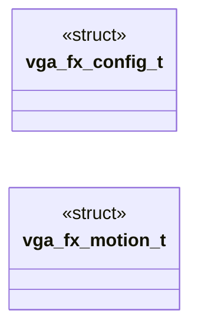
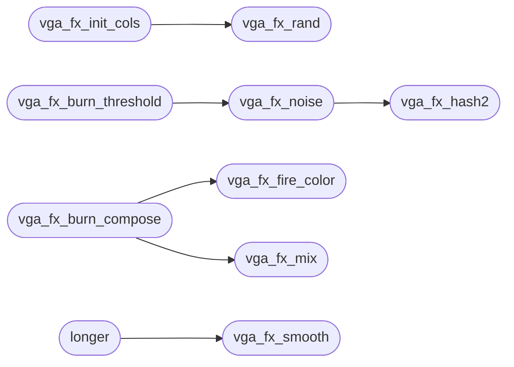

# `headers/vga_fx.h`

> Source: [headers/vga_fx.h:1](../../headers/vga_fx.h#L1) | language `h` | coverage 96.0% | [API index](../index.md)

Docstring: DOOM-melt desktop effect contract for MiniOS.

## Contents

- **Structs:** [`vga_fx_config_t`](#vga_fx_config_t), [`vga_fx_motion_t`](#vga_fx_motion_t)
- **Functions:** [`vga_fx_rand`](#vga_fx_rand), [`vga_fx_init_cols`](#vga_fx_init_cols), [`vga_fx_advance`](#vga_fx_advance), [`vga_fx_front`](#vga_fx_front), [`vga_fx_clamp_rect`](#vga_fx_clamp_rect), [`vga_fx_smooth`](#vga_fx_smooth), [`vga_fx_hash2`](#vga_fx_hash2), [`vga_fx_noise`](#vga_fx_noise), [`vga_fx_burn_span`](#vga_fx_burn_span), [`vga_fx_burn_threshold`](#vga_fx_burn_threshold), [`vga_fx_burn_pixel`](#vga_fx_burn_pixel), [`vga_fx_fire_color`](#vga_fx_fire_color), [`vga_fx_mix`](#vga_fx_mix), [`vga_fx_burn_compose`](#vga_fx_burn_compose), [`longer`](#longer)
- **Macros:** [`VGA_FX_CONFIG_DEFAULT`](#vga_fx_config_default), [`VGA_FX_COLS_MAX`](#vga_fx_cols_max), [`VGA_FX_PROG_ONE`](#vga_fx_prog_one), [`VGA_FX_FRAME_MS`](#vga_fx_frame_ms), [`VGA_FX_HEAT_STEP`](#vga_fx_heat_step), [`VGA_FX_HEAT_MAX`](#vga_fx_heat_max), [`VGA_FX_MOTION_DEFAULT`](#vga_fx_motion_default)

## Type Diagram



## Call Graph

Solid arrows stay in this module, dashed arrows leave it.



## Structs

<a id="vga_fx_config_t"></a>

### `vga_fx_config_t`

`struct` | [headers/vga_fx.h:16](../../headers/vga_fx.h#L16)

```c
typedef struct
```

Docstring: Centralized effect configuration, no magic numbers.

---

<a id="vga_fx_motion_t"></a>

### `vga_fx_motion_t`

`struct` | [headers/vga_fx.h:155](../../headers/vga_fx.h#L155)

```c
typedef struct
```

Docstring: Fire (window close) and genie (minimize/restore) tuning, no magic numbers.

Burn: duration, how far the front climbs, the noise jitter added to each pixel's ignition time, the flame thickness, the glow reach ahead of the front, the ember heat of that glow, and the noise cell sizes (coarse blobs and fine grain). Genie: duration, how long the top rows wait for the bottom ones (the lag that bends the shape) and the width the window narrows to at the taskbar button.

---

## Functions

<a id="vga_fx_rand"></a>

### `vga_fx_rand`

`function` `inline` `static` | [headers/vga_fx.h:30](../../headers/vga_fx.h#L30)

```c
static inline unsigned long vga_fx_rand(unsigned long *s)
```

Docstring: One xorshift32 step, the melt's deterministic PRNG.

**Parameters**

| Name | Type | Default | Description |
|---|---|---|---|
| `s` | `unsigned long *` |  |  |

**Returns:** `unsigned long`

*Called by:* [`vga_fx_init_cols`](#vga_fx_init_cols)

---

<a id="vga_fx_init_cols"></a>

### `vga_fx_init_cols`

`function` `inline` `static` | [headers/vga_fx.h:47](../../headers/vga_fx.h#L47)

```c
static inline int vga_fx_init_cols(const vga_fx_config_t *cfg, int *cols, int w)
```

Docstring: Seed consecutive column fronts with staggered delays.

Mirrors f_wipe.c: first column waits a random 0..15 frames, each next column drifts by -1..+1, clamped at zero, -16 repaired to -15.

**Parameters**

| Name | Type | Default | Description |
|---|---|---|---|
| `cfg` | `vga_fx_config_t *` |  |  |
| `cols` | `int *` |  |  |
| `w` | `int` |  |  |

**Returns:** `int`

*Calls:* [`vga_fx_rand`](#vga_fx_rand)

*Called by:* [`once`](kernel.vga_fx.c.md#once)

---

<a id="vga_fx_advance"></a>

### `vga_fx_advance`

`function` `inline` `static` | [headers/vga_fx.h:71](../../headers/vga_fx.h#L71)

```c
static inline int vga_fx_advance(const vga_fx_config_t *cfg, int *cols, int w, int h)
```

Docstring: Advance every column front one melt frame.

Returns 1 when every front reached the rect bottom, 0 otherwise.

**Parameters**

| Name | Type | Default | Description |
|---|---|---|---|
| `cfg` | `vga_fx_config_t *` |  |  |
| `cols` | `int *` |  |  |
| `w` | `int` |  |  |
| `h` | `int` |  |  |

**Returns:** `int`

*Called by:* [`once`](kernel.vga_fx.c.md#once)

---

<a id="vga_fx_front"></a>

### `vga_fx_front`

`function` `inline` `static` | [headers/vga_fx.h:97](../../headers/vga_fx.h#L97)

```c
static inline int vga_fx_front(int col_y, int h)
```

Docstring: Rows [0, front) of one column already show the new frame.

**Parameters**

| Name | Type | Default | Description |
|---|---|---|---|
| `col_y` | `int` |  |  |
| `h` | `int` |  |  |

**Returns:** `int`

*Called by:* [`once`](kernel.vga_fx.c.md#once)

---

<a id="vga_fx_clamp_rect"></a>

### `vga_fx_clamp_rect`

`function` `inline` `static` | [headers/vga_fx.h:109](../../headers/vga_fx.h#L109)

```c
static inline int vga_fx_clamp_rect(int *x, int *y, int *w, int *h, int fb_w, int fb_h)
```

Docstring: Clamp a transition rect inside the framebuffer.

**Parameters**

| Name | Type | Default | Description |
|---|---|---|---|
| `x` | `int *` |  |  |
| `y` | `int *` |  |  |
| `w` | `int *` |  |  |
| `h` | `int *` |  |  |
| `fb_w` | `int` |  |  |
| `fb_h` | `int` |  |  |

**Returns:** `int`

*Called by:* [`vga_fb_draw_desktop`](kernel.vga_fb.c.md#vga_fb_draw_desktop), [`once`](kernel.vga_fx.c.md#once), [`vga_fx_restore_rect`](kernel.vga_fx.c.md#vga_fx_restore_rect), [`vga_fx_snap_rect`](kernel.vga_fx.c.md#vga_fx_snap_rect)

---

<a id="vga_fx_smooth"></a>

### `vga_fx_smooth`

`function` `inline` `static` | [headers/vga_fx.h:177](../../headers/vga_fx.h#L177)

```c
static inline int vga_fx_smooth(int q)
```

Docstring: Integer smoothstep of q in [0, PROG_ONE]: slow start, slow end, the ease every genie row follows.

**Parameters**

| Name | Type | Default | Description |
|---|---|---|---|
| `q` | `int` |  |  |

**Returns:** `int`

*Called by:* [`longer`](#longer)

---

<a id="vga_fx_hash2"></a>

### `vga_fx_hash2`

`function` `inline` `static` | [headers/vga_fx.h:191](../../headers/vga_fx.h#L191)

```c
static inline unsigned long vga_fx_hash2(int x, int y, unsigned long seed)
```

Docstring: Deterministic 32-bit hash of a lattice point and a seed.

**Parameters**

| Name | Type | Default | Description |
|---|---|---|---|
| `x` | `int` |  |  |
| `y` | `int` |  |  |
| `seed` | `unsigned long` |  |  |

**Returns:** `unsigned long`

*Called by:* [`vga_fx_noise`](#vga_fx_noise)

---

<a id="vga_fx_noise"></a>

### `vga_fx_noise`

`function` `inline` `static` | [headers/vga_fx.h:204](../../headers/vga_fx.h#L204)

```c
static inline int vga_fx_noise(int x, int y, int cell, unsigned long seed)
```

Docstring: Bilinear value noise in [0, 255] over cells of `cell` pixels (x and y non-negative).

Fails closed to 0 on a degenerate cell.

**Parameters**

| Name | Type | Default | Description |
|---|---|---|---|
| `x` | `int` |  |  |
| `y` | `int` |  |  |
| `cell` | `int` |  |  |
| `seed` | `unsigned long` |  |  |

**Returns:** `int`

*Calls:* [`vga_fx_hash2`](#vga_fx_hash2)

*Called by:* [`vga_fx_burn_threshold`](#vga_fx_burn_threshold)

---

<a id="vga_fx_burn_span"></a>

### `vga_fx_burn_span`

`function` `inline` `static` | [headers/vga_fx.h:230](../../headers/vga_fx.h#L230)

```c
static inline int vga_fx_burn_span(const vga_fx_motion_t *cfg)
```

Docstring: Total progress the burn runs over: the climb, the noise spread and the flame thickness.

**Parameters**

| Name | Type | Default | Description |
|---|---|---|---|
| `cfg` | `vga_fx_motion_t *` |  |  |

**Returns:** `int`

---

<a id="vga_fx_burn_threshold"></a>

### `vga_fx_burn_threshold`

`function` `inline` `static` | [headers/vga_fx.h:241](../../headers/vga_fx.h#L241)

```c
static inline int vga_fx_burn_threshold(const vga_fx_motion_t *cfg, int lx, int ly, int w, int h)
```

Docstring: Ignition time of window pixel (lx, ly) of a w x h window: the bottom ignites first and the front climbs, bent by coarse noise into blobs and by fine noise into ragged tongues.

Fails closed to 0.

**Parameters**

| Name | Type | Default | Description |
|---|---|---|---|
| `cfg` | `vga_fx_motion_t *` |  |  |
| `lx` | `int` |  |  |
| `ly` | `int` |  |  |
| `w` | `int` |  |  |
| `h` | `int` |  |  |

**Returns:** `int`

*Calls:* [`vga_fx_noise`](#vga_fx_noise)

---

<a id="vga_fx_burn_pixel"></a>

### `vga_fx_burn_pixel`

`function` `inline` `static` | [headers/vga_fx.h:260](../../headers/vga_fx.h#L260)

```c
static inline int vga_fx_burn_pixel(const vga_fx_motion_t *cfg, int thr, int prog, int *heat)
```

Docstring: What one pixel shows at progress `prog` given its ignition time: *heat is the flame overlay strength (0 none, up to HEAT_MAX) and the return value picks the pixel underneath, 0 the old frame, 1 the new one.

Ahead of the front an ember glow tints the old pixel; the flame ramps up to its peak a quarter of the way through the band, where the base switches to the new frame under full cover, then cools to nothing.

**Parameters**

| Name | Type | Default | Description |
|---|---|---|---|
| `cfg` | `vga_fx_motion_t *` |  |  |
| `thr` | `int` |  |  |
| `prog` | `int` |  |  |
| `heat` | `int *` |  |  |

**Returns:** `int`

---

<a id="vga_fx_fire_color"></a>

### `vga_fx_fire_color`

`function` `inline` `static` | [headers/vga_fx.h:289](../../headers/vga_fx.h#L289)

```c
static inline unsigned int vga_fx_fire_color(int heat)
```

Docstring: Flame colour (0x00RRGGBB) of a heat: dark red embers up through red, orange and yellow to a white-hot core.

**Parameters**

| Name | Type | Default | Description |
|---|---|---|---|
| `heat` | `int` |  |  |

**Returns:** `unsigned int`

*Called by:* [`vga_fx_burn_compose`](#vga_fx_burn_compose)

---

<a id="vga_fx_mix"></a>

### `vga_fx_mix`

`function` `inline` `static` | [headers/vga_fx.h:319](../../headers/vga_fx.h#L319)

```c
static inline unsigned int vga_fx_mix(unsigned int a, unsigned int b, int alpha)
```

Docstring: Blend two 0x00RRGGBB pixels: alpha 0 keeps a, 255 gives b.

**Parameters**

| Name | Type | Default | Description |
|---|---|---|---|
| `a` | `unsigned int` |  |  |
| `b` | `unsigned int` |  |  |
| `alpha` | `int` |  |  |

**Returns:** `unsigned int`

*Called by:* [`vga_fx_burn_compose`](#vga_fx_burn_compose)

---

<a id="vga_fx_burn_compose"></a>

### `vga_fx_burn_compose`

`function` `inline` `static` | [headers/vga_fx.h:340](../../headers/vga_fx.h#L340)

```c
static inline unsigned int vga_fx_burn_compose(unsigned int base, int heat)
```

Docstring: Final pixel of a burn: the base frame pixel under the flame overlay, whose opacity grows with the square of the heat so the glow is a faint tint and the front is opaque.

**Parameters**

| Name | Type | Default | Description |
|---|---|---|---|
| `base` | `unsigned int` |  |  |
| `heat` | `int` |  |  |

**Returns:** `unsigned int`

*Calls:* [`vga_fx_fire_color`](#vga_fx_fire_color), [`vga_fx_mix`](#vga_fx_mix)

---

<a id="longer"></a>

### `longer`

`function` | [headers/vga_fx.h:353](../../headers/vga_fx.h#L353)

```c
* longer (the lag), every row follows the same smoothstep toward the * target and narrows to gen...
```

**Parameters**

| Name | Type | Default | Description |
|---|---|---|---|
| `lag` | `the` |  |  |

**Returns:** `*`

*Calls:* [`vga_fx_smooth`](#vga_fx_smooth)

---

## Macros

<a id="vga_fx_config_default"></a>

### `VGA_FX_CONFIG_DEFAULT`

`macro` | [headers/vga_fx.h:24](../../headers/vga_fx.h#L24)

```c
#define VGA_FX_CONFIG_DEFAULT
```

Docstring: Default melt pacing: 8 px per frame, 8 ms per frame.

---

<a id="vga_fx_cols_max"></a>

### `VGA_FX_COLS_MAX`

`macro` | [headers/vga_fx.h:27](../../headers/vga_fx.h#L27)

```c
#define VGA_FX_COLS_MAX
```

Docstring: Widest transition the column array can describe.

---

<a id="vga_fx_prog_one"></a>

### `VGA_FX_PROG_ONE`

`macro` | [headers/vga_fx.h:136](../../headers/vga_fx.h#L136)

```c
#define VGA_FX_PROG_ONE
```

Docstring: Fixed-point scale of every effect progress value: 0 is the first frame, VGA_FX_PROG_ONE the last.

---

<a id="vga_fx_frame_ms"></a>

### `VGA_FX_FRAME_MS`

`macro` | [headers/vga_fx.h:140](../../headers/vga_fx.h#L140)

```c
#define VGA_FX_FRAME_MS
```

Docstring: Pacing of the burn and genie drivers, one paint per this many milliseconds at most.

---

<a id="vga_fx_heat_step"></a>

### `VGA_FX_HEAT_STEP`

`macro` | [headers/vga_fx.h:143](../../headers/vga_fx.h#L143)

```c
#define VGA_FX_HEAT_STEP
```

Docstring: Burn flame colour stops are spaced this far apart in heat.

---

<a id="vga_fx_heat_max"></a>

### `VGA_FX_HEAT_MAX`

`macro` | [headers/vga_fx.h:146](../../headers/vga_fx.h#L146)

```c
#define VGA_FX_HEAT_MAX
```

Docstring: Highest flame heat.

---

<a id="vga_fx_motion_default"></a>

### `VGA_FX_MOTION_DEFAULT`

`macro` | [headers/vga_fx.h:173](../../headers/vga_fx.h#L173)

```c
#define VGA_FX_MOTION_DEFAULT
```

Docstring: Default feel: a 700 ms fire climbing 560 units with 220 of noise and 244 of flame (they add up to VGA_FX_PROG_ONE), a 420 ms genie whose top rows trail by 600 units and narrow to 28 px.

---
