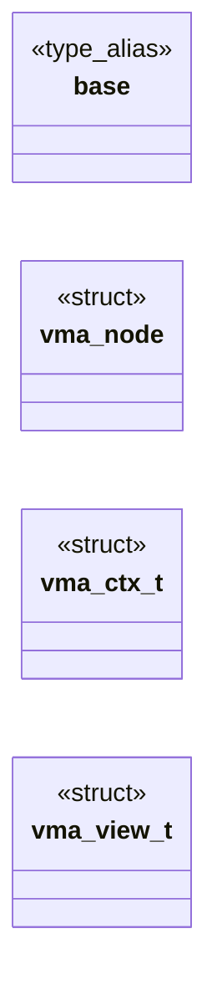

# `headers/vma.h`

> Source: [headers/vma.h:1](../../headers/vma.h#L1) | language `h` | coverage 22.2% | [API index](../index.md)

## Contents

- **Structs:** [`vma_node`](#vma_node), [`vma_ctx_t`](#vma_ctx_t), [`vma_view_t`](#vma_view_t)
- **Type Aliases:** [`base`](#base)
- **Functions:** [`vma_tree_init`](#vma_tree_init), [`vma_tree_insert`](#vma_tree_insert), [`vma_tree_find`](#vma_tree_find), [`vma_tree_find_containing`](#vma_tree_find_containing), [`vma_tree_delete`](#vma_tree_delete), [`vma_ctx_init`](#vma_ctx_init), [`vma_ctx_bind`](#vma_ctx_bind), [`vma_ctx_save`](#vma_ctx_save), [`vma_view_save`](#vma_view_save), [`vma_view_load`](#vma_view_load), [`vma_ctx_alloc`](#vma_ctx_alloc), [`vma_ctx_free`](#vma_ctx_free)
- **Macros:** [`VMA_MAX`](#vma_max)
- **Variables:** [`VMA_NIL`](#vma_nil), [`vma_live_root`](#vma_live_root), [`vma_free_root`](#vma_free_root), [`vma_pool`](#vma_pool), [`vma_pool_n`](#vma_pool_n), [`vma_spare`](#vma_spare), [`vma_pool_ptr`](#vma_pool_ptr), [`vma_legacy`](#vma_legacy)

## Type Diagram



## Structs

<a id="vma_node"></a>

### `vma_node`

`struct` | [headers/vma.h:21](../../headers/vma.h#L21)

```c
typedef struct vma_node
```

---

<a id="vma_ctx_t"></a>

### `vma_ctx_t`

`struct` | [headers/vma.h:44](../../headers/vma.h#L44)

```c
typedef struct
```

Per-process VMA context (multitask foundation): every non-CLONE_VM process owns its live/free trees plus a private node pool, so two concurrent jobs never corrupt each other's mmap bookkeeping the way the old single global tree did (the DOOM-in-isolation #GP came from exactly that: a fresh window over a stale shared tree).

CLONE_VM threads share their parent's context pointer. The kernel-global VMA_NIL/roots/pool below are a *view* onto the running process's context, rebound by vma_ctx_bind on every brk/mmap-view switch; the legacy single-window path keeps using the static vma_legacy context, so its behavior is byte-for-byte unchanged. Pools live on the kernel heap (a static per-proc pool would blow the USER_LOAD_BASE budget).

---

<a id="vma_view_t"></a>

### `vma_view_t`

`struct` | [headers/vma.h:76](../../headers/vma.h#L76)

```c
typedef struct
```

Opaque snapshot of the bound view (all globals vma_ctx_bind swaps, including the MRU).

The ld.so child-window dance saves the spawner view, binds the child, and restores exactly, so a stale MRU can never hand one window's node to another.

---

## Type Aliases

<a id="base"></a>

### `base`

`type_alias` | [headers/vma.h:20](../../headers/vma.h#L20)

```c
typedef struct vma_node { unsigned long base;
```

Virtual Memory Area (VMA) red-black tree for mmap/munmap tracking.

Replaces the former flat mmap_used/mmap_free arrays with an O(log n)
tree.  A single fixed node pool backs the tree for the life of one
ring-3 program; both the live and free trees draw from it.  The pool is
reset by vma_tree_init on every exec, so a fresh program starts empty.

The current kernel runs a single address space, so the tree is a set of
process-wide globals (vma_live_root, vma_free_root, VMA_NIL, vma_pool)
rather than a per-process instance.  The SPAWN syscall saves and
restores those globals across a child ET_EXEC/DYN execution.

All operations are integer-only and free of kernel dependencies, which
lets the tree be exercised host-side by tests/test_vma.c.

---

## Functions

<a id="vma_tree_init"></a>

### `vma_tree_init`

`function` | [headers/vma.h:64](../../headers/vma.h#L64)

```c
void vma_tree_init(void);
```

---

<a id="vma_tree_insert"></a>

### `vma_tree_insert`

`function` | [headers/vma.h:65](../../headers/vma.h#L65)

```c
vma_node_t *vma_tree_insert(vma_node_t **root, unsigned long base, unsigned long len);
```

**Parameters**

| Name | Type | Default | Description |
|---|---|---|---|
| `root` | `vma_node_t **` |  |  |
| `base` | `unsigned long` |  |  |
| `len` | `unsigned long` |  |  |

**Returns:** `vma_node_t *`

---

<a id="vma_tree_find"></a>

### `vma_tree_find`

`function` | [headers/vma.h:66](../../headers/vma.h#L66)

```c
vma_node_t *vma_tree_find(vma_node_t *root, unsigned long base);
```

**Parameters**

| Name | Type | Default | Description |
|---|---|---|---|
| `root` | `vma_node_t *` |  |  |
| `base` | `unsigned long` |  |  |

**Returns:** `vma_node_t *`

---

<a id="vma_tree_find_containing"></a>

### `vma_tree_find_containing`

`function` | [headers/vma.h:67](../../headers/vma.h#L67)

```c
vma_node_t *vma_tree_find_containing(vma_node_t *root, unsigned long va);
```

**Parameters**

| Name | Type | Default | Description |
|---|---|---|---|
| `root` | `vma_node_t *` |  |  |
| `va` | `unsigned long` |  |  |

**Returns:** `vma_node_t *`

---

<a id="vma_tree_delete"></a>

### `vma_tree_delete`

`function` | [headers/vma.h:68](../../headers/vma.h#L68)

```c
int vma_tree_delete(vma_node_t **root, unsigned long base);
```

**Parameters**

| Name | Type | Default | Description |
|---|---|---|---|
| `root` | `vma_node_t **` |  |  |
| `base` | `unsigned long` |  |  |

**Returns:** `int`

---

<a id="vma_ctx_init"></a>

### `vma_ctx_init`

`function` | [headers/vma.h:69](../../headers/vma.h#L69)

```c
void vma_ctx_init(vma_ctx_t *c, vma_node_t *pool);
```

**Parameters**

| Name | Type | Default | Description |
|---|---|---|---|
| `c` | `vma_ctx_t *` |  |  |
| `pool` | `vma_node_t *` |  |  |

---

<a id="vma_ctx_bind"></a>

### `vma_ctx_bind`

`function` | [headers/vma.h:70](../../headers/vma.h#L70)

```c
void vma_ctx_bind(vma_ctx_t *c);
```

**Parameters**

| Name | Type | Default | Description |
|---|---|---|---|
| `c` | `vma_ctx_t *` |  |  |

---

<a id="vma_ctx_save"></a>

### `vma_ctx_save`

`function` | [headers/vma.h:71](../../headers/vma.h#L71)

```c
void vma_ctx_save(vma_ctx_t *c);
```

**Parameters**

| Name | Type | Default | Description |
|---|---|---|---|
| `c` | `vma_ctx_t *` |  |  |

---

<a id="vma_view_save"></a>

### `vma_view_save`

`function` | [headers/vma.h:86](../../headers/vma.h#L86)

```c
void vma_view_save(vma_view_t *v);
```

**Parameters**

| Name | Type | Default | Description |
|---|---|---|---|
| `v` | `vma_view_t *` |  |  |

---

<a id="vma_view_load"></a>

### `vma_view_load`

`function` | [headers/vma.h:87](../../headers/vma.h#L87)

```c
void vma_view_load(const vma_view_t *v);
```

**Parameters**

| Name | Type | Default | Description |
|---|---|---|---|
| `v` | `vma_view_t *` |  |  |

---

<a id="vma_ctx_alloc"></a>

### `vma_ctx_alloc`

`function` | [headers/vma.h:90](../../headers/vma.h#L90)

```c
vma_ctx_t *vma_ctx_alloc(void);
```

Heap-backed contexts live in sched.c (vma.c stays host-testable): alloc returns a fresh context with a private pool, or 0 on OOM.

**Returns:** `vma_ctx_t *`

---

<a id="vma_ctx_free"></a>

### `vma_ctx_free`

`function` | [headers/vma.h:91](../../headers/vma.h#L91)

```c
void vma_ctx_free(vma_ctx_t *c);
```

**Parameters**

| Name | Type | Default | Description |
|---|---|---|---|
| `c` | `vma_ctx_t *` |  |  |

---

## Macros

<a id="vma_max"></a>

### `VMA_MAX`

`macro` | [headers/vma.h:31](../../headers/vma.h#L31)

```c
#define VMA_MAX
```

---

## Variables

<a id="vma_nil"></a>

### `VMA_NIL`

`variable` `extern` | [headers/vma.h:55](../../headers/vma.h#L55)

```c
extern vma_node_t *VMA_NIL;
```

---

<a id="vma_live_root"></a>

### `vma_live_root`

`variable` `extern` | [headers/vma.h:56](../../headers/vma.h#L56)

```c
extern vma_node_t *vma_live_root;
```

---

<a id="vma_free_root"></a>

### `vma_free_root`

`variable` `extern` | [headers/vma.h:57](../../headers/vma.h#L57)

```c
extern vma_node_t *vma_free_root;
```

---

<a id="vma_pool"></a>

### `vma_pool`

`variable` `extern` | [headers/vma.h:58](../../headers/vma.h#L58)

```c
extern vma_node_t vma_pool[VMA_MAX];
```

---

<a id="vma_pool_n"></a>

### `vma_pool_n`

`variable` `extern` | [headers/vma.h:59](../../headers/vma.h#L59)

```c
extern int vma_pool_n;
```

---

<a id="vma_spare"></a>

### `vma_spare`

`variable` `extern` | [headers/vma.h:60](../../headers/vma.h#L60)

```c
extern vma_node_t *vma_spare;
```

---

<a id="vma_pool_ptr"></a>

### `vma_pool_ptr`

`variable` `extern` | [headers/vma.h:61](../../headers/vma.h#L61)

```c
extern vma_node_t *vma_pool_ptr;
```

---

<a id="vma_legacy"></a>

### `vma_legacy`

`variable` `extern` | [headers/vma.h:62](../../headers/vma.h#L62)

```c
extern vma_ctx_t vma_legacy;
```

---
