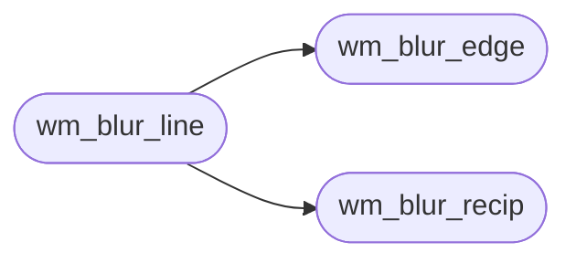

# `headers/wm_blur.h`

> Source: [headers/wm_blur.h:1](../../headers/wm_blur.h#L1) | language `h` | coverage 100.0% | [API index](../index.md)

Docstring: Frosted-glass box blur for the MiniOS desktop.

## Contents

- **Structs:** [`wm_blur_config_t`](#wm_blur_config_t)
- **Functions:** [`wm_blur_config_valid`](#wm_blur_config_valid), [`wm_blur_line_len`](#wm_blur_line_len), [`wm_blur_recip`](#wm_blur_recip), [`wm_blur_edge`](#wm_blur_edge), [`wm_blur_line`](#wm_blur_line)
- **Macros:** [`WM_BLUR_RADIUS_MAX`](#wm_blur_radius_max), [`WM_BLUR_PASSES_MAX`](#wm_blur_passes_max), [`WM_BLUR_RECIP_SHIFT`](#wm_blur_recip_shift), [`WM_BLUR_CHANNEL_MASK`](#wm_blur_channel_mask), [`WM_BLUR_CONFIG_DEFAULT`](#wm_blur_config_default)

## Call Graph

Solid arrows stay in this module, dashed arrows leave it.



## Structs

<a id="wm_blur_config_t"></a>

### `wm_blur_config_t`

`struct` | [headers/wm_blur.h:39](../../headers/wm_blur.h#L39)

```c
typedef struct
```

Docstring: Centralized blur configuration, no magic numbers.

---

## Functions

<a id="wm_blur_config_valid"></a>

### `wm_blur_config_valid`

`function` `inline` `static` | [headers/wm_blur.h:50](../../headers/wm_blur.h#L50)

```c
static inline int wm_blur_config_valid(const wm_blur_config_t *cfg)
```

Docstring: 1 when the configuration is inside the supported range.

**Parameters**

| Name | Type | Default | Description |
|---|---|---|---|
| `cfg` | `wm_blur_config_t *` |  |  |

**Returns:** `int`

---

<a id="wm_blur_line_len"></a>

### `wm_blur_line_len`

`function` `inline` `static` | [headers/wm_blur.h:58](../../headers/wm_blur.h#L58)

```c
static inline unsigned long wm_blur_line_len(int w, int h)
```

Docstring: Scratch entries wm_blur_rect needs for a w by h rect: one full line in either direction.

Zero for a degenerate rect.

**Parameters**

| Name | Type | Default | Description |
|---|---|---|---|
| `w` | `int` |  |  |
| `h` | `int` |  |  |

**Returns:** `unsigned long`

---

<a id="wm_blur_recip"></a>

### `wm_blur_recip`

`function` `inline` `static` | [headers/wm_blur.h:68](../../headers/wm_blur.h#L68)

```c
static inline unsigned long wm_blur_recip(int win)
```

Docstring: Reciprocal of a window of win pixels, rounded up, in WM_BLUR_RECIP_SHIFT fixed point.

Zero for a non-positive window.

**Parameters**

| Name | Type | Default | Description |
|---|---|---|---|
| `win` | `int` |  |  |

**Returns:** `unsigned long`

*Called by:* [`wm_blur_line`](#wm_blur_line)

---

<a id="wm_blur_edge"></a>

### `wm_blur_edge`

`function` `inline` `static` | [headers/wm_blur.h:84](../../headers/wm_blur.h#L84)

```c
static inline int wm_blur_edge(int i, int n)
```

Docstring: Clamp a line index to 0..n-1 (edge replication).

**Parameters**

| Name | Type | Default | Description |
|---|---|---|---|
| `i` | `int` |  |  |
| `n` | `int` |  |  |

**Returns:** `int`

*Called by:* [`wm_blur_line`](#wm_blur_line)

---

<a id="wm_blur_line"></a>

### `wm_blur_line`

`function` `inline` `static` | [headers/wm_blur.h:93](../../headers/wm_blur.h#L93)

```c
static inline void wm_blur_line(unsigned int *px, long stride, int n, int radius, unsigned int *line)
```

Docstring: Box-blur one line of n pixels spaced stride entries apart, in place. line is a scratch of at least n entries that receives the untouched source.

A radius outside 1..WM_BLUR_RADIUS_MAX, a null pointer or an empty line leave the pixels untouched.

**Parameters**

| Name | Type | Default | Description |
|---|---|---|---|
| `px` | `unsigned int *` |  |  |
| `stride` | `long` |  |  |
| `n` | `int` |  |  |
| `radius` | `int` |  |  |
| `line` | `unsigned int *` |  |  |

*Calls:* [`wm_blur_edge`](#wm_blur_edge), [`wm_blur_recip`](#wm_blur_recip)

---

## Macros

<a id="wm_blur_radius_max"></a>

### `WM_BLUR_RADIUS_MAX`

`macro` | [headers/wm_blur.h:25](../../headers/wm_blur.h#L25)

```c
#define WM_BLUR_RADIUS_MAX
```

Docstring: Largest box radius; bounds the running sum and the reciprocal table so the fixed-point average stays exact.

---

<a id="wm_blur_passes_max"></a>

### `WM_BLUR_PASSES_MAX`

`macro` | [headers/wm_blur.h:28](../../headers/wm_blur.h#L28)

```c
#define WM_BLUR_PASSES_MAX
```

Docstring: Largest number of box passes.

---

<a id="wm_blur_recip_shift"></a>

### `WM_BLUR_RECIP_SHIFT`

`macro` | [headers/wm_blur.h:33](../../headers/wm_blur.h#L33)

```c
#define WM_BLUR_RECIP_SHIFT
```

Docstring: Fixed-point shift of the window reciprocal.

With a window of at most 2*WM_BLUR_RADIUS_MAX+1 pixels of 8-bit channels the multiply-shift equals the integer division exactly.

---

<a id="wm_blur_channel_mask"></a>

### `WM_BLUR_CHANNEL_MASK`

`macro` | [headers/wm_blur.h:36](../../headers/wm_blur.h#L36)

```c
#define WM_BLUR_CHANNEL_MASK
```

Docstring: Channel mask of a packed pixel.

---

<a id="wm_blur_config_default"></a>

### `WM_BLUR_CONFIG_DEFAULT`

`macro` | [headers/wm_blur.h:47](../../headers/wm_blur.h#L47)

```c
#define WM_BLUR_CONFIG_DEFAULT
```

Docstring: Default frost: two passes of a 9-pixel box (radius 4), a triangle kernel 17 pixels wide that hides text and edges behind a panel while keeping the colour of what lies under it.

---
