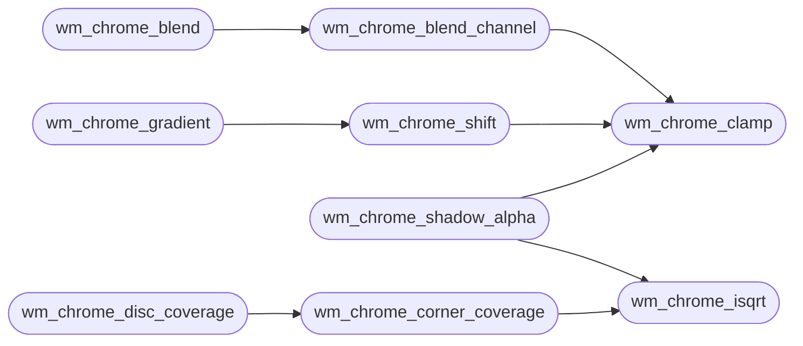

# `headers/wm_chrome.h`

> Source: [headers/wm_chrome.h:1](../../headers/wm_chrome.h#L1) | language `h` | coverage 93.3% | [API index](../index.md)

Docstring: Window chrome pixel math for the MiniOS desktop.

## Contents

- **Structs:** [`wm_chrome_config_t`](#wm_chrome_config_t)
- **Functions:** [`wm_chrome_isqrt`](#wm_chrome_isqrt), [`wm_chrome_clamp`](#wm_chrome_clamp), [`wm_chrome_blend_channel`](#wm_chrome_blend_channel), [`wm_chrome_blend`](#wm_chrome_blend), [`wm_chrome_shift`](#wm_chrome_shift), [`wm_chrome_gradient`](#wm_chrome_gradient), [`by`](#by), [`wm_chrome_shadow_alpha`](#wm_chrome_shadow_alpha), [`wm_chrome_corner_coverage`](#wm_chrome_corner_coverage), [`wm_chrome_disc_coverage`](#wm_chrome_disc_coverage)
- **Macros:** [`WM_CHROME_ALPHA_OPAQUE`](#wm_chrome_alpha_opaque), [`WM_CHROME_CONFIG_DEFAULT`](#wm_chrome_config_default), [`WM_CHROME_RADIUS_MAX`](#wm_chrome_radius_max)

## Call Graph

Solid arrows stay in this module, dashed arrows leave it.



## Structs

<a id="wm_chrome_config_t"></a>

### `wm_chrome_config_t`

`struct` | [headers/wm_chrome.h:18](../../headers/wm_chrome.h#L18)

```c
typedef struct
```

Docstring: Centralized chrome configuration, no magic numbers.

---

## Functions

<a id="wm_chrome_isqrt"></a>

### `wm_chrome_isqrt`

`function` `inline` `static` | [headers/wm_chrome.h:41](../../headers/wm_chrome.h#L41)

```c
static inline unsigned long wm_chrome_isqrt(unsigned long v)
```

Docstring: Integer square root, floor, for non-negative arguments.

**Parameters**

| Name | Type | Default | Description |
|---|---|---|---|
| `v` | `unsigned long` |  |  |

**Returns:** `unsigned long`

*Called by:* [`wm_chrome_corner_coverage`](#wm_chrome_corner_coverage), [`wm_chrome_shadow_alpha`](#wm_chrome_shadow_alpha)

---

<a id="wm_chrome_clamp"></a>

### `wm_chrome_clamp`

`function` `inline` `static` | [headers/wm_chrome.h:61](../../headers/wm_chrome.h#L61)

```c
static inline int wm_chrome_clamp(int v)
```

Docstring: Clamp a channel to 0..255.

**Parameters**

| Name | Type | Default | Description |
|---|---|---|---|
| `v` | `int` |  |  |

**Returns:** `int`

*Called by:* [`wm_chrome_blend_channel`](#wm_chrome_blend_channel), [`wm_chrome_shadow_alpha`](#wm_chrome_shadow_alpha), [`wm_chrome_shift`](#wm_chrome_shift)

---

<a id="wm_chrome_blend_channel"></a>

### `wm_chrome_blend_channel`

`function` `inline` `static` | [headers/wm_chrome.h:67](../../headers/wm_chrome.h#L67)

```c
static inline int wm_chrome_blend_channel(int dst, int src, int alpha)
```

Docstring: Blend one channel: src over dst at alpha/255, rounded.

**Parameters**

| Name | Type | Default | Description |
|---|---|---|---|
| `dst` | `int` |  |  |
| `src` | `int` |  |  |
| `alpha` | `int` |  |  |

**Returns:** `int`

*Calls:* [`wm_chrome_clamp`](#wm_chrome_clamp)

*Called by:* [`wm_chrome_blend`](#wm_chrome_blend)

---

<a id="wm_chrome_blend"></a>

### `wm_chrome_blend`

`function` `inline` `static` | [headers/wm_chrome.h:76](../../headers/wm_chrome.h#L76)

```c
static inline unsigned long wm_chrome_blend(unsigned long dst, unsigned long src, int alpha)
```

Docstring: Blend a packed src pixel over a packed dst pixel.

**Parameters**

| Name | Type | Default | Description |
|---|---|---|---|
| `dst` | `unsigned long` |  |  |
| `src` | `unsigned long` |  |  |
| `alpha` | `int` |  |  |

**Returns:** `unsigned long`

*Calls:* [`wm_chrome_blend_channel`](#wm_chrome_blend_channel)

---

<a id="wm_chrome_shift"></a>

### `wm_chrome_shift`

`function` `inline` `static` | [headers/wm_chrome.h:85](../../headers/wm_chrome.h#L85)

```c
static inline unsigned long wm_chrome_shift(unsigned long px, int delta)
```

Docstring: Add a signed delta to every channel of a packed pixel.

**Parameters**

| Name | Type | Default | Description |
|---|---|---|---|
| `px` | `unsigned long` |  |  |
| `delta` | `int` |  |  |

**Returns:** `unsigned long`

*Calls:* [`wm_chrome_clamp`](#wm_chrome_clamp)

*Called by:* [`wm_chrome_gradient`](#wm_chrome_gradient)

---

<a id="wm_chrome_gradient"></a>

### `wm_chrome_gradient`

`function` `inline` `static` | [headers/wm_chrome.h:95](../../headers/wm_chrome.h#L95)

```c
static inline unsigned long wm_chrome_gradient(unsigned long base, int row, int span, const wm_chrome_config_t *cfg)
```

Docstring: Vertical gradient row: lighter by lift at row 0, darker by sink at the last row of span rows, linear in between.

**Parameters**

| Name | Type | Default | Description |
|---|---|---|---|
| `base` | `unsigned long` |  |  |
| `row` | `int` |  |  |
| `span` | `int` |  |  |
| `cfg` | `wm_chrome_config_t *` |  |  |

**Returns:** `unsigned long`

*Calls:* [`wm_chrome_shift`](#wm_chrome_shift)

---

<a id="by"></a>

### `by`

`function` | [headers/wm_chrome.h:107](../../headers/wm_chrome.h#L107)

```c
* The shadow is the window rect shifted by (dx,dy);
```

**Returns:** `* The shadow is the window rect shifted`

---

<a id="wm_chrome_shadow_alpha"></a>

### `wm_chrome_shadow_alpha`

`function` `inline` `static` | [headers/wm_chrome.h:110](../../headers/wm_chrome.h#L110)

```c
static inline int wm_chrome_shadow_alpha(const wm_chrome_config_t *cfg, int px, int py, int rx, int ry, int rw, int rh)
```

Docstring: Shadow alpha for pixel (px,py) of a window at (rx,ry,rw,rh).

The shadow is the window rect shifted by (dx,dy); inside it the alpha is the maximum, outside it falls off quadratically over radius pixels of euclidean distance. Zero for degenerate input or beyond the radius.

**Parameters**

| Name | Type | Default | Description |
|---|---|---|---|
| `cfg` | `wm_chrome_config_t *` |  |  |
| `px` | `int` |  |  |
| `py` | `int` |  |  |
| `rx` | `int` |  |  |
| `ry` | `int` |  |  |
| `rw` | `int` |  |  |
| `rh` | `int` |  |  |

**Returns:** `int`

*Calls:* [`wm_chrome_clamp`](#wm_chrome_clamp), [`wm_chrome_isqrt`](#wm_chrome_isqrt)

---

<a id="wm_chrome_corner_coverage"></a>

### `wm_chrome_corner_coverage`

`function` `inline` `static` | [headers/wm_chrome.h:141](../../headers/wm_chrome.h#L141)

```c
static inline int wm_chrome_corner_coverage(int radius, int x, int y)
```

Docstring: Coverage 0..255 of pixel (x,y) inside a rounded corner of the given radius.

(0,0) is the outermost pixel of the corner and (radius-1,radius-1) the innermost; pixels outside the radius box are fully covered. The edge is anti-aliased across one pixel.

**Parameters**

| Name | Type | Default | Description |
|---|---|---|---|
| `radius` | `int` |  |  |
| `x` | `int` |  |  |
| `y` | `int` |  |  |

**Returns:** `int`

*Calls:* [`wm_chrome_isqrt`](#wm_chrome_isqrt)

*Called by:* [`wm_chrome_disc_coverage`](#wm_chrome_disc_coverage)

---

<a id="wm_chrome_disc_coverage"></a>

### `wm_chrome_disc_coverage`

`function` `inline` `static` | [headers/wm_chrome.h:162](../../headers/wm_chrome.h#L162)

```c
static inline int wm_chrome_disc_coverage(int radius, int x, int y)
```

Docstring: Coverage 0..255 of pixel (x,y) of a disc of the given radius inscribed in a 2*radius square, anti-aliased across one pixel.

Zero outside the square or for a non-positive radius.

**Parameters**

| Name | Type | Default | Description |
|---|---|---|---|
| `radius` | `int` |  |  |
| `x` | `int` |  |  |
| `y` | `int` |  |  |

**Returns:** `int`

*Calls:* [`wm_chrome_corner_coverage`](#wm_chrome_corner_coverage)

---

## Macros

<a id="wm_chrome_alpha_opaque"></a>

### `WM_CHROME_ALPHA_OPAQUE`

`macro` | [headers/wm_chrome.h:15](../../headers/wm_chrome.h#L15)

```c
#define WM_CHROME_ALPHA_OPAQUE
```

Docstring: Fully opaque alpha.

---

<a id="wm_chrome_config_default"></a>

### `WM_CHROME_CONFIG_DEFAULT`

`macro` | [headers/wm_chrome.h:35](../../headers/wm_chrome.h#L35)

```c
#define WM_CHROME_CONFIG_DEFAULT
```

Docstring: Default chrome: 8 px soft shadow offset 2/4 px at 110/255, 4 px corners (an 8 px title strip cannot carry more), title gradient lifting 22 and sinking 18 levels, glass panels at 150/255, hover glow at 70/255, terminal background 205/255 opaque.

---

<a id="wm_chrome_radius_max"></a>

### `WM_CHROME_RADIUS_MAX`

`macro` | [headers/wm_chrome.h:38](../../headers/wm_chrome.h#L38)

```c
#define WM_CHROME_RADIUS_MAX
```

Docstring: Largest corner radius the caller's scratch buffers carry.

---
